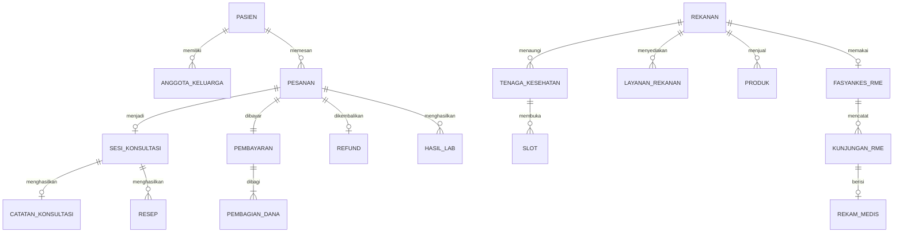

# PRD (Product Requirements Document): Ruang Sehat

Tanggal: 2026-11-18
Versi: **1.3** (CR-021, 2026-11-19): situs web company profile dan layanan korporat; EP-18 dan EP-19 baru (US-1801, US-1802, US-1901–US-1917), AB-80–AB-87, PB-23–PB-25, E-18, UP-79–UP-87, perubahan §1.1, §1.2, §2.1, §2.2, §3.1, AB-13, AB-17, AB-20, NFR-SEC-02/04/06/08, NFR-PERF-04, NFR-COMP-03, §8.1, §12.3, §12.6; keputusan user `[USER] C21-P0–P4` (`docs/cr/CR-021-wawancara.md`), BRD v1.4. Rincian di §14. Versi **1.2 final** (Checkpoint 2, 2026-11-18): revisi CR-013 (pajak) disetujui `[USER] C2-B15`; klarifikasi AC Fase 1 diterapkan; MFA wajib untuk pasien (CR-018) `[USER] C2-Q9`; ubah password saat login (CR-017) `[USER] C2-B14`; story baru US-110 "Perangkat dan sesi aktif" `[USER] C2-Q10`. Rincian per bagian ada di §14 Riwayat versi. Versi 1.2 draf (Tahap 7, 2026-11-18): revisi CR-013, pajak dihitung dari harga rekanan + markup dan ditambahkan ke total, arah rumus disetujui user `[USER] T5-Q11, T5-Q11a`. Bagian yang berubah ditandai "CR-013": AB-10a, AB-11, AB-13, AB-17, AB-21, AB-27, §3.5 definisi, PB-21, US-801 AC1, US-804 AC2, US-811 AC1, US-812 AC4, §12.4. Versi 1.1 (revisi CR-007: login Google/Apple, push, dan WhatsApp dihapus; disetujui user 2026-11-18 `[USER] T4-Q2`; revisi CR-008: verifikasi keaslian resep oleh apotek, disetujui user 2026-11-18 `[USER] T4-Q5`; revisi CR-009: kunci aplikasi tenaga kesehatan, `[USER] T4-Q6`; revisi CR-010: penjelasan AB-36, `[USER] T4-G3`; disetujui di gate Tahap 4, 2026-11-18 `[USER] T4-G5`). Versi 1.0 disetujui di gate Tahap 3, 2026-11-17 `[USER] T3-Gate` (catatan gate di `docs/03-catatan-prd.md`)
Penyusun: Claude (persona Product Manager + Tech Lead). Review acceptance criteria oleh subagent `qa-engineer`, review kepatuhan CR-006 oleh `compliance-reviewer`, dan pemeriksaan fakta oleh `fact-checker`
Pemilik dan penyetuju: user (project manager, meneruskan ke CEO dan CTO) `[DOK: 00-project-brief.md]`
Dasar: BRD v1.3 `[DOK: 02-brd.md]` (v1.2 disetujui bersama PRD v1.0 di gate Tahap 3; v1.3 revisi CR-007).
Tingkat ketelitian:
- **T1 Kritis**: §3.1 (akses), §3.3–§3.5 (harga, pembayaran, refund), EP-08 (pembayaran), EP-13 (RME minimalis), EP-15 (audit trail), EP-16 (data pribadi), §6.4–§6.6 (keamanan, privasi, retensi), §7 (audit trail).
- **T2 Standar**: bagian lain.

PRD menetapkan *apa* yang dibangun dan bagaimana mengujinya. *Bagaimana* membangunnya ditetapkan di Tahap 4 (arsitektur) dan Tahap 5 (stack).

## 0. Cara membaca

### 0.1 Label sumber

| Penanda | Arti |
| --- | --- |
| `BR-xxx` | Kebutuhan bisnis di BRD v1.3 (dokumen yang lulus gate atau diajukan bersama PRD ini; v1.3 memuat CR-007). Di tabel dan baris "Rujukan" story, penanda ini berfungsi sebagai label `[DOK: 02-brd.md]` |
| `[USER] T3-Qx` | Jawaban user di wawancara Tahap 3, tercatat di `docs/03-catatan-prd.md`. `[USER] T2-Qx` merujuk ke `docs/02-catatan-brd.md` |
| `[DOK] Px.x` | Project Brief dan catatan intake (`docs/00-project-brief.md`, `docs/00-catatan-intake.md`) |
| `[UP-xx]` | **Usulan penyusun** untuk detail produk yang belum diputuskan user, terdaftar di §11. **Seluruh UP-01–UP-57 disetujui user di gate Tahap 3, 2026-11-17 `[USER] T3-Gate`**, termasuk penyesuaian G2–G5. UP-58–UP-78 (Tahap 6–7) terdaftar di `docs/06-design-guideline.md` §11 dan `docs/07-catatan-phase-plan.md`, dan disetujui di Checkpoint 2 (lihat baris berikut) |
| `[USER] C2-Qx`, `[USER] C2-Bn` | Jawaban user di Checkpoint 2, 2026-11-18 (`docs/checkpoint-2.md` bagian "Jawaban user"). `C2-Qx` adalah jawaban langsung (C2-Q1–C2-Q11). `C2-Bn` adalah butir n yang didelegasikan user ke usulan penyusun ("jawab sesuai dengan rekomendasimu"), sehingga usulan default butir itu berlaku sebagai keputusan user |
| `T-xx` | Temuan QA test plan §9 yang klarifikasinya disetujui di Checkpoint 2 (`docs/07-klarifikasi-ac-fase-1.md`). Penanda ini menunjukkan asal rumusan AC, bukan label sumber tersendiri |
| `[USER] C21-Px-y`, `[USER] C21-P4` | Jawaban wawancara CR-021 putaran 0–3 dan keputusan putaran 4 di `docs/cr/CR-021-wawancara.md`. UP-79–UP-87 disetujui di putaran 4 |
| `[KEPUTUSAN-xx]` | Keputusan teknis penyusun, tercatat di `docs/decision-log.md` |
| `[SRC-xx]` | Fakta eksternal yang sudah diverifikasi, tercatat di `docs/sources.md` |
| `[TIDAK DIKETAHUI]` | Belum ada informasi. Masuk pertanyaan terbuka (§12) beserta pemiliknya |

### 0.2 Penomoran

| Awalan | Isi |
| --- | --- |
| `EP-xx` | Epic, yaitu modul fitur |
| `US-xxx` | User story. Tiga digit pertama mengikuti epic (misalnya US-301 ada di EP-03) |
| `AB-xx` | Aturan bisnis lintas modul (§3) |
| `PB-xx` | Parameter bisnis yang nilainya bisa diatur (§3.7) |
| `KU-xx` | Kriteria umum yang berlaku untuk semua story (§4) |
| `NFR-xxx-nn` | Kebutuhan non-fungsional (§6, §7) |
| `UP-xx` | Usulan penyusun (§11) |

Acceptance criteria hanya ditulis di PRD ini. `docs/backlog.md` memuat indeks epic dan story yang merujuk ke PRD, supaya tidak ada dua versi kriteria yang bisa berbeda `[KEPUTUSAN-03]`.

## 1. Ringkasan produk

Ruang Sehat adalah platform yang menghubungkan pasien dengan klinik, lab, dan outlet rekanan. PT. Arunika berperan sebagai Penyelenggara Sistem Elektronik, bukan fasyankes, bukan penjual barang, dan tidak menampung dana mitra (BRD §2.1, §7.2). Data klinik, lab, home visit, dan produk berasal dari integrasi dengan sistem rekanan, sedangkan konsultasi online berlangsung di Ruang Sehat (BR-013, BR-033, BR-070). Ruang Sehat hanya platform yang mengintegrasikan pasien dengan rekanan `[USER] T3-Q14`.

Tujuan bisnis dan KPI tidak berubah dari BRD §1 (TB-01–TB-04, KPI-01–KPI-04).

### 1.1 Komponen yang dibangun di rilis 1

| Komponen | Pengguna | Platform | Sumber |
| --- | --- | --- | --- |
| Aplikasi pasien | Pasien | Android dan iOS (Flutter) | BR-007 `[DOK] P6.1, P7.4` |
| Aplikasi tenaga kesehatan | Dokter, psikolog, fisioterapis, tenaga medis | Android dan iOS (Flutter) | BR-007 `[USER] T3-Q9` |
| Backoffice admin Ruang Sehat | Admin Ruang Sehat | Web | BR-007, BR-060–BR-063 |
| Portal rekanan | Admin klinik, admin lab, admin outlet | Web. Isinya pelaporan dan rekap, ditambah satu menu pengaturan konsultasi online untuk klinik | BR-064, BR-065 `[USER] T3-Q4, T3-Q14, T3-Q16` |
| Aplikasi RME minimalis | Staf klinik dan lab rekanan yang belum punya sistem | Web, terpisah dari aplikasi dan portal Ruang Sehat, terhubung lewat integrasi | BR-120, BR-121 `[USER] T3-Q15` |
| Backend, integrasi, dan audit trail | Semua komponen | Server di Indonesia | BR-070, BR-071, BR-080, BR-113 |
| Situs web publik (CR-021) | Pengunjung tanpa login | Web (`web/situs`), tanpa sesi | BR-130, BR-131; ADR-027 |
| Member area korporat (CR-021) | HR/admin perusahaan | Web (`web/korporat`), BFF realm `korporat` | BR-132, BR-136; ADR-027 |

Apakah aplikasi tenaga kesehatan dibuat terpisah atau digabung dengan aplikasi pasien diputuskan di Tahap 4 `[USER] T3-Q9`.

### 1.2 Peran pengguna

Sembilan peran Ruang Sehat mengikuti BRD §2.2. Tambahan dari PRD ini:

| Peran | Komponen | Sumber |
| --- | --- | --- |
| Sub-peran admin Ruang Sehat: Super Admin, Verifikator, Layanan Pelanggan, Keuangan, Konten, Auditor, Petugas PDP | Backoffice | `[UP-18]` |
| Admin Fasyankes, Tenaga Kesehatan Fasyankes, Petugas Lab | Aplikasi RME minimalis, untuk klinik/lab rekanan pengguna RME | BR-120 `[UP-26]` |
| Operator RME (staf PT. Arunika untuk onboarding fasyankes ke RME minimalis; tidak dapat melihat isi rekam medis) | Aplikasi RME minimalis | BR-120 `[UP-26]` |
| HR/admin perusahaan (CR-021). Semua HR satu perusahaan berperan sama sampai PT-68 dijawab | Member area korporat | BR-132, BR-136 |
| Karyawan peserta (CR-021): pasien biasa yang tertaut ke pesanan korporat | Aplikasi pasien | BR-132, BR-140 `[USER] C21-P4` (K-01 opsi a) |
| Sub-peran Verifikator juga memverifikasi dan membuat akun perusahaan serta memulai reset MFA HR (CR-021) | Backoffice | BR-136 `[USER] C21-P4` (PT-67) |

## 2. Scope rilis 1

### 2.1 In-scope

Layanan S-01 sampai S-16 mengikuti BRD §4.1. Tambahan CR-006 dan Tahap 3:

| # | Kemampuan | Sumber |
| --- | --- | --- |
| S-17 | Aplikasi RME minimalis untuk klinik dan lab rekanan yang belum punya sistem, terpisah dari Ruang Sehat dan terhubung lewat integrasi | BR-120–BR-126 `[USER] T3-Q1a, T3-Q1b, T3-Q1c, T3-Q14, T3-Q15` |
| S-18 | Antrean real-time klinik | BR-027 `[USER] T3-Q1a` |
| S-19 | Pemesanan layanan untuk anggota keluarga | BR-008 `[USER] T3-Q3, T3-Q3a` |
| S-20 | Situs web company profile dengan konten dari CMS (EP-18) | BR-130, BR-131 `[USER] C21-P1-1, C21-P3-4` |
| S-21 | Layanan korporat lewat member area: vaksinasi, MCU, dan lab massal, invoice B2B (EP-19) | BR-132–BR-145 `[USER] C21-P0-1–P3-3, C21-P4` |

### 2.2 Won't (tidak dibangun di rilis 1)

Semua butir non-scope BRD §4.2 tetap berlaku. Tambahan:

| Butir | Sumber |
| --- | --- |
| RME lengkap untuk operasional klinik dan lab (diganti RME minimalis) | `[USER] T3-Q1a` |
| RME minimalis untuk pasien yang tidak datang lewat Ruang Sehat (walk-in) | `[USER] T3-Q1c` |
| Program loyalitas, poin, dan voucher | `[USER] T3-Q1a` (tidak dipilih) |
| Multi-bahasa; antarmuka hanya Bahasa Indonesia | `[USER] T3-Q1a` (tidak dipilih) |
| Jadwal ulang (reschedule) layanan terjadwal | Tafsiran penyusun atas opsi yang tidak dipilih user di T2-Q17 dan T3-Q6 `[UP-57]` |
| Pengisian katalog, stok, atau pesanan produk di portal oleh outlet tanpa sistem | BR-033 `[USER] T3-Q1b` (tidak disebut user) |
| Rekam medis, check-in, antrean, hasil lab, atau home visit yang diisi di portal Ruang Sehat | `[USER] T3-Q14` |
| Menanggapi keluhan atau mengajukan perubahan profil lewat portal rekanan (keduanya hanya dapat dilihat) | `[USER] T3-Gate G3` |
| Pembatalan pesanan produk oleh pasien setelah membayar | BR-045 `[UP-08]` |
| Login dengan akun Google atau Apple (US-102 dihapus) | BR-001 `[USER] T4-Q1, T4-Q2` (CR-007) |
| Notifikasi push dan WhatsApp | BR-050 `[USER] T4-Q1, T4-Q2` (CR-007) |
| Email pemberitahuan ke pemilik akun saat akun terkunci sementara (dapat diajukan lewat change request) | `[USER] C2-B4` (UP-73 butir 9) |
| Faktor kedua selain TOTP dan kode pemulihan (WebAuthn, SMS, OTP email) | `[USER] C2-Q9`; ADR-011 butir 5 |
| Onboarding mandiri calon rekanan dan langganan berbayar RME (CR-011), ditempatkan di rilis berikutnya | `[USER] C2-B5` (UP-68) |
| Vaksinasi dan suntik/infus vitamin sebagai layanan lab (CR-015), ditempatkan di rilis berikutnya; ubin vaksinasi/infus tidak tampil di aplikasi pasien. Vaksinasi massal korporat (EP-19, BR-133) adalah layanan terpisah dan masuk rilis 1 (K-05) | `[USER] C2-B6` (UP-69, UP-63) `[USER] C21-P4` |
| Member area web untuk karyawan peserta (peserta memakai aplikasi pasien, K-01 opsi a); agregat hasil peserta untuk HR (AB-87); pengisian harga paket korporat lewat portal rekanan (K-04 opsi a) | `[USER] C21-P4` |
| Layar backoffice untuk mengelola versi teks persetujuan dan daftar alasan penolakan identitas (keduanya lewat migrasi data) | `[USER] C2-B14` (UP-75) |

### 2.3 Urutan pengurangan scope

Kalau layanan belum siap pada 1 Maret 2027, tanggal tetap dan layanan dilepas berurutan, dimulai dari nomor 1 `[USER] T3-Q2` `[DOK] P8.3`:

1. Antrean real-time klinik (EP-04 US-405, EP-13 US-1305)
2. Obat bebas, lalu seluruh pembelian produk (EP-07)
3. Home visit (EP-05)
4. Konsultasi online fisioterapis dan tenaga medis (bagian EP-03)
5. Pendaftaran lab dan informasi biaya MCU/lab (EP-04 bagian lab, EP-06, EP-09)
6. Pendaftaran klinik (EP-04 bagian klinik)

Konsultasi online dokter dan psikolog dipertahankan paling akhir `[USER] T3-Q2`. Syarat izin dan kepatuhan, audit keamanan, dan UAT tidak bisa dikurangi `[DOK] P8.3`. RME minimalis tidak diberi nomor sendiri. Fiturnya ikut dilepas bersama layanan yang memakainya (misalnya penugasan home visit ikut nomor 3) `[UP-33]`.

### 2.4 Prioritas MoSCoW

- Ketujuh layanan rilis 1 berprioritas Must, karena "ketujuh layanan berjalan" adalah syarat go-live 3 `[DOK] P8.2`.
- Fitur kepatuhan (EP-15, EP-16) dan pembayaran (EP-08) berprioritas Must, karena syarat izin dan kepatuhan tidak bisa dikurangi `[DOK] P8.3`.
- Antrean real-time diusulkan berprioritas Should, mengikuti posisinya di urutan pertama pengurangan scope (`[USER] T3-Q2`) `[UP-01]`.
- MoSCoW per story di bagian 5 adalah usulan penyusun `[UP-01]`.

## 3. Aturan bisnis lintas modul

### 3.1 Akses data per peran (T1)

| Data | Pasien | Tenaga kesehatan | Admin klinik/lab/outlet (portal) | Admin RS | Pengguna RME minimalis | Sensitif | Sumber |
| --- | --- | --- | --- | --- | --- | --- | --- |
| Profil dan identitas dasar | Miliknya dan anggota keluarganya | Nama, jenis kelamin, tanggal lahir, dan keluhan awal pasien di sesi/kunjungan yang ditanganinya. Untuk home visit juga alamat kunjungan dan nomor HP pasien, hanya di hari kunjungan sampai kunjungan selesai | Nama pasien di laporan transaksi rekanannya | Layanan Pelanggan, Verifikator, Super Admin; Petugas PDP untuk pemohon hak subjek data | Pasien Ruang Sehat di fasyankesnya | Ya untuk keluhan awal dan data anak; tidak untuk profil dewasa lainnya | BR-002, BR-105 `[UP-13]` `[UP-17]` |
| NIK, foto KTP, foto KK | Miliknya dan anggota keluarganya | Tidak | Tidak | NIK lengkap dan foto hanya Verifikator. Peran lain, termasuk Petugas PDP, melihat NIK termasking | NIK pasien di fasyankesnya bila dibutuhkan pencatatan rekam medis `[TIDAK DIKETAHUI]` (L-05) | Ya | BR-003, BR-004, BR-105 `[UP-17]` |
| Isi chat, catatan konsultasi, resep | Miliknya dan anggota keluarganya (UP-15) | Hanya sesi yang ditanganinya | Tidak | Tidak ada peran admin RS yang dapat melihat. Salinan untuk hak subjek data dibuat otomatis oleh sistem, tanpa dibuka Petugas PDP | Tidak | Ya | BR-016, BR-105 `[UP-15]` `[UP-17]` |
| Hasil lab | Miliknya dan anggota keluarganya (UP-15) | Tidak, di rilis 1 | Tidak | Tidak (seperti baris di atas) | Petugas Lab dan Tenaga Kesehatan Fasyankes di lab/klinik yang memeriksa | Ya | BR-025, BR-105 `[UP-17]` |
| Rekam medis RME minimalis | `[TIDAK DIKETAHUI]`, menunggu L-05 (sama dengan US-1604 AC3) | Tidak | Tidak | Tidak (Operator RME juga tidak) | Tenaga Kesehatan Fasyankes: baca dan tulis. Admin Fasyankes: baca saja. Petugas Lab: tidak | Ya | BR-123 `[UP-17]` `[UP-26]` |
| Foto bukti klaim | Miliknya | Tidak | Tidak | Layanan Pelanggan (klaim yang ditanganinya); Super Admin (klaim tereskalasi) | Tidak | Ya | BR-045 `[UP-36]` |
| Transaksi, pembagian dana, refund | Transaksinya | Tidak | Transaksi rekanannya | Keuangan; Super Admin (baca); Layanan Pelanggan (baca, hanya pesanan terkait klaim atau tiket yang ditanganinya) | Tidak | Ya untuk detail transaksi seorang pasien yang dibuka admin (data keuangan pribadi); tidak untuk laporan berisi banyak transaksi | BR-046, BR-105 `[UP-17]` |
| Permintaan hak subjek data | Miliknya | Tidak | Tidak | Petugas PDP; Super Admin (baca) | Tidak | Tidak (dicatat sebagai E-13) | BR-106 `[UP-18]` |
| Audit log | Tidak di rilis 1 | Tidak | Tidak | Auditor (baca dan export), Super Admin (baca) | Admin Fasyankes: log akses rekam medis fasyankesnya | Tidak | BR-080 `[UP-18]` `[UP-26]` |

**Tambahan CR-021 (T1).** Kolom HR perusahaan ditambahkan untuk data korporat. "Pasien" di sini adalah karyawan peserta yang tertaut. HR hanya mengakses data perusahaannya (AB-86).

| Data | Pasien (peserta) | HR perusahaan | Admin klinik/lab (portal) | Admin RS | Sensitif | Sumber |
| --- | --- | --- | --- | --- | --- | --- |
| Data perusahaan, dokumen NIB/NPWP, bukti kewenangan pendaftar | — | Perusahaannya (baca) | — | Verifikator | Tidak (dokumen dapat memuat PII pengurus) | BR-136 `[USER] C21-P4` |
| Data peserta (nama, kontak, tanggal lahir, NIK bila ada), termasuk keikutsertaan dalam pesanan korporat | Dirinya | Peserta perusahaannya; NIK termasking | Peserta pesanan yang dilaksanakannya, data minimal (L-17) | Layanan Pelanggan (baca, tiket terkait); NIK lengkap tidak ada peran | NIK: Ya. Data lain: perlu konfirmasi legal (L-08, L-18); sampai dijawab diperlakukan Ya | BR-139, BR-145 `[SRC-440]` |
| Rekap kehadiran | Dirinya | Perusahaannya | Pesanannya | Layanan Pelanggan (baca) | Perlu konfirmasi legal (L-08, L-18); sampai dijawab diperlakukan Ya | BR-144, BR-145 |
| Ringkasan hasil (misalnya fit/unfit) | Dirinya | Hanya dengan persetujuan aktif (AB-84, AB-87) | — | Tidak ada peran | Ya | BR-144 |
| Hasil lengkap layanan korporat | Dirinya | Tidak | Pemeriksa di rekanan (seperti baris hasil lab) | Tidak ada peran | Ya | BR-143 |
| Invoice B2B, mutasi bank, alokasi | — | Invoice perusahaannya | — | Keuangan; Super Admin (baca). Berkas bukti transfer hanya Keuangan | Tidak (data keuangan badan usaha); bukti transfer dapat memuat rekening lengkap pembayar | BR-141 |

**Data sensitif** untuk KU-03 dan E-05 adalah data bertanda "Ya" di kolom Sensitif: data pribadi spesifik (AB-70: data kesehatan termasuk keluhan awal, data anak, data keuangan pribadi), NIK lengkap, dokumen identitas, dan foto bukti klaim. E-05 dicatat saat detail data itu dibuka oleh pihak selain subjek data, bukan saat daftar ringkas tampil. Akses yang ditolak ke data sensitif dicatat dengan hasil "gagal" (KU-03, §7) `[KEPUTUSAN-07]`.

### 3.2 Verifikasi identitas dan pembatasan layanan

| ID | Aturan | Sumber |
| --- | --- | --- |
| AB-01 | Konsultasi online, home visit, serta pendaftaran klinik dan lab hanya dapat dipesan untuk orang yang identitasnya sudah **disetujui** admin. Pembelian produk tidak mewajibkan identitas | BR-003, BR-004 |
| AB-02 | Pemilik akun memverifikasi dirinya dengan NIK dan foto KTP | BR-003 |
| AB-03 | Anggota keluarga dewasa diverifikasi dengan NIK dan foto KTP. Anak diverifikasi dengan NIK dan foto Kartu Keluarga yang memuat pemilik akun sebagai orang tua/wali. Semuanya diverifikasi manual oleh admin | BR-008 `[USER] T3-Q3a` |
| AB-04 | Saat menambah anggota keluarga, pemilik akun wajib menyatakan telah mendapat persetujuan anggota keluarga dewasa, atau memberi persetujuan sebagai orang tua/wali untuk anak. Pernyataan disimpan sebagai bukti. Kecukupan cara ini menunggu konfirmasi legal (L-08) | BR-008, BR-104 `[USER] T3-Q3a` |
| AB-05 | Status verifikasi identitas: Belum diunggah, Menunggu verifikasi, Disetujui, Ditolak (dengan alasan). Identitas yang ditolak dapat diunggah ulang | BR-004 `[UP-10]` |
| AB-05a | Siklus status identitas pemilik akun: (a) pengajuan NIK dan KTP baru juga dapat dibuat dari status "Disetujui", lalu status menjadi "Menunggu verifikasi" (UP-39); (b) pengajuan dokumen yang dibatalkan pasien mengembalikan status ke status sebelum pengajuan itu, sedangkan pengajuan karena perubahan nama atau tanggal lahir tidak dapat dibatalkan; (c) persetujuan yang gagal karena NIK sudah dipakai pemilik akun lain diselesaikan Verifikator dengan penolakan beralasan `nik_unavailable` (US-106 AC1, AC5; US-201 AC7) | BR-004 `[USER] C2-B14` (UP-74; T-14, T-15, T-18) |

### 3.3 Harga (T1)

| ID | Aturan | Sumber |
| --- | --- | --- |
| AB-10 | Harga layanan yang dibayar pasien = harga rekanan + markup Ruang Sehat. Markup berbentuk persen atau nominal, diatur per rekanan oleh admin Ruang Sehat | BR-042 |
| AB-10a | **CR-013.** Pajak dihitung dari (harga rekanan + markup) setelah markup diterapkan, ditambahkan ke total yang dibayar pasien, dan tampil sebagai baris terpisah di rincian harga. Tarif pajak adalah parameter berlaku-mulai yang diatur Keuangan (PB-21). Jenis pajak, tarif, cara pembulatan, dasar hitung per unit atau per pesanan, perlakuan pajak atas ongkos kirim dan biaya transaksi, pihak pemungut/penyetor, dan perilaku saat tarif belum diatur `[TIDAK DIKETAHUI]` (sisa PT-28) | BR-042 `[USER] T5-Q11, T5-Q11a` (arah rumus dan baris terpisah); `[DOK: backlog.md CR-013]` (tarif berlaku-mulai diatur Keuangan) |
| AB-11 | Untuk produk, total = jumlah harga produk (harga rekanan + markup, per unit dikali jumlah) + pajak (AB-10a, CR-013) + ongkos kirim | BR-034, BR-042 `[USER] T5-Q11a` (CR-013) |
| AB-11a | Markup dihitung per unit layanan atau produk atas harga rekanan per unit. Markup persen dibulatkan per unit ke Rupiah penuh terdekat (setengah ke atas), lalu dikalikan jumlah. Markup nominal berlaku per unit. Markup tidak dikenakan pada ongkos kirim dan biaya transaksi | `[UP-51]` |
| AB-12 | Untuk metode pembayaran non-QRIS, biaya transaksi ditambahkan ke total dan ditampilkan sebelum pasien membayar. Untuk QRIS, pasien tidak dikenai biaya transaksi, dan MDR dipotong dari bagian rekanan. Pembebanan per metode menunggu L-12 | BR-044 `[SRC-24]` |
| AB-13 | Pasien melihat harga layanan sebagai **satu angka** (harga rekanan + markup). Pajak (CR-013), ongkos kirim, dan biaya transaksi tampil sebagai baris terpisah. Markup tidak ditampilkan sebagai baris tersendiri. Berlaku juga untuk katalog dan invoice korporat (AB-80), kecuali bila L-21 membuat penagihan korporat memakai dua tagihan (K-02 opsi b): markup lalu tampil terpisah bagi perusahaan sebagai pengecualian korporat | `[UP-07]` (sejalan dengan T2-Q20); baris pajak `[USER] T5-Q11a` (CR-013); keterbukaan rincian harga menunggu L-14; pengecualian korporat `[USER] C21-P4` |
| AB-14 | Informasi biaya MCU dan lab menampilkan harga yang sama dengan harga bayar di aplikasi | BR-023 `[USER] T2-Q20` |
| AB-15 | Sebelum pembayaran dibuat, harga dan ketersediaan (slot atau stok) diperiksa ulang ke sistem rekanan. Kalau berbeda, pasien diberi tahu nilai terbaru dan harus menyetujuinya sebelum membayar | `[UP-25]` |
| AB-16 | Layar ringkasan pesanan klinik, lab, dan home visit menyatakan bahwa harga hanya mencakup layanan yang tercantum, dan tindakan tambahan diselesaikan serta dibayar di luar aplikasi | BR-024 (L-14) |
| AB-17 | Harga (harga rekanan atau tarif + markup), tarif dan nominal pajak (CR-013), dan nilai parameter bisnis yang berlaku untuk suatu pesanan dikunci saat pembayaran dibuat di payment gateway. Perubahan sesudahnya tidak memengaruhi pesanan itu, walaupun pembayaran diselesaikan setelah perubahan berlaku. Perubahan markup atau tarif antara ringkasan harga dan pembuatan pembayaran ditangani seperti AB-15. Pesanan korporat tanpa payment gateway mengunci harga saat konfirmasi (AB-81) | ADR-004 `[UP-32]` |

### 3.4 Pembayaran dan pembagian dana (T1)

| ID | Aturan | Sumber |
| --- | --- | --- |
| AB-20 | Semua layanan yang dipesan di aplikasi dibayar di aplikasi lewat payment gateway berizin Bank Indonesia. Pengecualian: pesanan korporat lewat invoice B2B (AB-82) | BR-040, BR-115, BR-141 |
| AB-21 | Setiap pembayaran dibagi langsung oleh payment gateway: bagian rekanan ke rekening rekanan, markup ke rekening PT. Arunika. PT. Arunika tidak menampung bagian rekanan. Penerima dan cara penyaluran komponen pajak (CR-013) dalam pembagian dana `[TIDAK DIKETAHUI]` (sisa PT-28) | BR-041 |
| AB-22 | Bagian rekanan = harga rekanan, dikurangi MDR bila dibayar dengan QRIS | BR-041, BR-044 |
| AB-23 | Penerima dana ongkos kirim (outlet atau kurir) dan cara penyalurannya dalam pembagian dana `[TIDAK DIKETAHUI]` (PT-31). Ditetapkan di Tahap 4–5 bersama pemilihan kurir dan payment gateway | BR-034, BR-041 |
| AB-24 | Cara penagihan biaya rekanan (dipotong dari pembagian dana atau ditagih terpisah) `[TIDAK DIKETAHUI]` (PT-17). Rilis 1 menyediakan pengaturan dan perhitungan tagihannya | BR-043 |
| AB-25 | Metode pembayaran yang tersedia mengikuti payment gateway terpilih (Tahap 4–5) `[TIDAK DIKETAHUI]` | BR-071 |
| AB-26 | Pembayaran, pembagian dana, dan refund dicatat immutable. Koreksi dilakukan lewat entri pembalik | ADR-004 |
| AB-27 | **CR-013.** Arah rumus pajak ditetapkan AB-10a. Rincian yang belum diketahui (jenis, tarif, pembulatan, perlakuan atas ongkos kirim dan biaya transaksi, pemungut/penyetor, penyaluran dalam pembagian dana, isi bukti bayar) `[TIDAK DIKETAHUI]` (sisa PT-28) | BR-042 `[USER] T5-Q11, T5-Q11a` |

### 3.5 Pembatalan, ketidakhadiran, dan refund (T1)

Aturan pokok BR-045 dirinci dengan jawaban `[USER] T3-Q5, T3-Q6, T3-Q7, T3-Q8`. Mekanisme penarikan dana dari rekanan ditetapkan di Tahap 4–5 (PT-27). Kebijakan ini menunggu konfirmasi legal L-04 dan L-14.

**Definisi** (sumber: `[USER] T3-Q6` untuk definisi no-show yang disetujui bersama pertanyaan):

- **Layanan terjadwal**: konsultasi online, pendaftaran klinik, pendaftaran lab, home visit.
- **Bergabung (konsultasi)**: pihak membuka ruang sesi di aplikasinya saat ruang sudah terbuka. Server mencatat waktu pertama kali tiap pihak bergabung. Berlaku sama untuk chat dan video; menjawab panggilan video tidak disyaratkan `[UP-29]`.
- **Batas ketidakhadiran konsultasi**: PB-02 (pasien) atau PB-03 (tenaga kesehatan) sejak jadwal mulai, atau akhir durasi sesi bila lebih dulu `[UP-29]`.
- **Pasien tidak hadir (no-show)**:
    - konsultasi: tenaga kesehatan sudah bergabung, tetapi pasien belum bergabung saat batas ketidakhadiran pasien habis;
    - klinik/lab: appointment yang sudah diterima sistem rekanan tidak di-check-in sampai jadwalnya berakhir;
    - home visit: tenaga kesehatan menandai pasien tidak ada di lokasi setelah berstatus "Tiba".
- **Tenaga kesehatan tidak hadir**:
    - konsultasi: tenaga kesehatan belum bergabung saat batas ketidakhadiran tenaga kesehatan habis `[USER] T3-Q8`;
    - home visit: tenaga kesehatan belum menandai "Tiba" sampai PB-03 habis sejak jadwal mulai, lalu pasien melaporkannya `[UP-13]`.
- **Harga layanan**: harga rekanan + markup (AB-10, AB-11a).
- **Seluruh pembayaran**: harga layanan + ongkos kirim (produk) + biaya transaksi (non-QRIS).
- **Pajak dalam refund (CR-013)**: apakah komponen pajak (AB-10a) ikut dikembalikan pada RF-01 dan termasuk "seluruh pembayaran" pada refund lain, serta perlakuannya di AB-34 `[TIDAK DIKETAHUI]` (sisa PT-28).

**Matriks refund**

| # | Kejadian | Berlaku untuk | Refund? | Yang dikembalikan ke pasien | Kelompok penanggung (AB-34) | Cara | Sumber |
| --- | --- | --- | --- | --- | --- | --- | --- |
| RF-01 | Pasien membatalkan paling lambat PB-01 sebelum jadwal | Layanan terjadwal | Ya | Harga layanan. Biaya transaksi non-QRIS tidak dikembalikan | Pembatalan pasien | Otomatis | BR-045 `[USER] T3-Q5, T3-Q7, T3-Q8` |
| RF-02 | Pasien membatalkan kurang dari PB-01 sebelum jadwal | Layanan terjadwal | Tidak | — | — | — | BR-045 |
| RF-03 | Pasien tidak hadir | Layanan terjadwal | Tidak | — | Rekanan tetap menerima bagiannya | — | `[USER] T3-Q6` |
| RF-04 | Tenaga kesehatan tidak hadir di sesi konsultasi | Konsultasi | Ya | Seluruh pembayaran | Penyebab rekanan | Otomatis | `[USER] T3-Q7, T3-Q8` |
| RF-05 | Rekanan atau tenaga kesehatan membatalkan, termasuk akibat penonaktifan akun rekanan atau tenaga kesehatan dan SIP berakhir | Layanan terjadwal | Ya | Seluruh pembayaran | Penyebab rekanan (penggolongan penonaktifan oleh admin dan SIP berakhir sebagai penyebab rekanan adalah tafsiran penyusun `[UP-57]`) | Otomatis | BR-045 `[USER] T3-Q7, T3-Q8` |
| RF-06 | Tenaga kesehatan home visit tidak datang, dilaporkan pasien paling lambat PB-15 setelah jadwal berakhir | Home visit | Ya, bila klaim disetujui | Seluruh pembayaran | Penyebab rekanan | Pengajuan, diputuskan dalam PB-05 | `[USER] T3-Q7` `[UP-13]` `[UP-53]` |
| RF-07 | Layanan gagal karena gangguan platform Ruang Sehat, diajukan paling lambat PB-15 setelah jadwal berakhir (layanan terjadwal) atau PB-04 setelah status terakhir pesanan (produk) | Semua | Ya, bila klaim disetujui | Seluruh pembayaran | Penyebab platform | Pengajuan, diputuskan dalam PB-05 | `[USER] T3-Q7` `[UP-53]` |
| RF-08 | Outlet menolak pesanan (misalnya stok habis), tidak menerimanya sampai PB-06, membatalkannya sebelum diserahkan ke kurir, atau dinonaktifkan sebelum pesanan dikirim | Produk | Ya | Seluruh pembayaran | Penyebab rekanan | Otomatis | `[USER] T3-Q7, T3-Q8` `[UP-03]` |
| RF-09 | Kurir gagal mengirim (status gagal dari kurir) | Produk | Ya | Seluruh pembayaran | Penyebab kurir `[TIDAK DIKETAHUI]` (PT-29) | Otomatis | `[USER] T3-Q7, T3-Q8` |
| RF-10 | Barang rusak, tidak sesuai, atau kurang, diajukan paling lambat PB-04 setelah status Diterima, dengan foto | Produk | Ya, bila klaim disetujui | Seluruh pembayaran. Klaim sebagian barang `[TIDAK DIKETAHUI]` (PT-33) | Penyebab rekanan. Kerusakan dalam pengiriman: penyebab kurir (PT-29). Pengembalian barang fisik `[TIDAK DIKETAHUI]` (PT-30) | Pengajuan, diputuskan dalam PB-05 | BR-045 `[USER] T3-Q7, T3-Q8` |
| RF-11 | Pasien ingin membatalkan pesanan produk setelah membayar | Produk | Tidak. Pembatalan tidak disediakan | — | — | — | BR-045 `[UP-08]` |
| RF-12 | Pasien terdebit dua kali untuk satu pesanan (pembayaran ganda) | Semua | Ya, untuk pembayaran ganda | Seluruh pembayaran ganda | Penyebab platform | Otomatis saat notifikasi berhasil kedua diterima, atau saat terdeteksi di rekonsiliasi | `[USER] T3-Q7` `[UP-34]` |
| RF-13 | Pembayaran berhasil diterima setelah pesanan kedaluwarsa, dan slot atau stok sudah tidak tersedia | Semua | Ya | Seluruh pembayaran | Penyebab platform | Otomatis | `[USER] T3-Q7` `[UP-34]` |
| RF-14 | Nominal di notifikasi pembayaran tidak sama dengan nominal pesanan | Semua | Ya. Pesanan tidak dikonfirmasi dan menjadi Kedaluwarsa | Seluruh nominal yang diterima | Penyebab platform | Keuangan memeriksa dan membuat refund dalam PB-16. Bila PB-16 habis tanpa tindakan, refund dibuat otomatis dan Super Admin diberi tahu | `[UP-52]` |
| RF-15 | Outlet sudah menerima pesanan tetapi tidak menyerahkannya ke kurir sampai PB-17 sejak status Diproses outlet | Produk | Ya | Seluruh pembayaran | Penyebab rekanan | Otomatis | `[USER] T3-Q7` `[UP-52]` |
| RF-16 | Barang tidak sampai: status Dikirim tanpa kabar terkirim atau gagal sampai PB-18, atau kurir menyatakan terkirim tetapi pasien tidak menerima (diajukan paling lambat PB-04 setelah status Diterima, atau paling lambat PB-04 setelah PB-18 habis untuk jalur Dikirim) | Produk | Ya, bila klaim disetujui | Seluruh pembayaran | Penyebab kurir `[TIDAK DIKETAHUI]` (PT-29) | Pengajuan tanpa wajib foto, diputuskan dalam PB-05 | `[USER] T3-Q7` `[UP-52]` |
| RF-17 | Pasien keberatan atas status "Pasien tidak hadir" home visit, diajukan paling lambat PB-15 setelah jadwal berakhir | Home visit | Ya, bila klaim disetujui | Seluruh pembayaran | Penyebab rekanan | Pengajuan, diputuskan dalam PB-05 | `[USER] T3-Q7` `[UP-13]` `[UP-53]` |
| RF-18 | Pesanan klinik, lab, atau home visit yang sudah dibayar belum diterima sistem rekanan saat jadwal mulai | Pendaftaran klinik/lab, home visit | Ya | Seluruh pembayaran, dibuat otomatis saat jadwal mulai | Menunggu penetapan penyebab: Keuangan menetapkan penyebab rekanan (sistem rekanan menolak atau tidak tersedia) atau penyebab platform (gangguan Ruang Sehat) dari log integrasi dalam PB-20. Bila PB-20 habis tanpa penetapan, berlaku penyebab platform | Refund ke pasien otomatis; penetapan penyebab manual | `[USER] T3-Q7` `[UP-56]` |

Ketentuan tambahan:

- **AB-30** Refund dieksekusi lewat payment gateway ke metode bayar asal bila penyedia mendukungnya `[TIDAK DIKETAHUI]` (Tahap 4–5). Waktu sampainya dana ke pasien mengikuti penyedia dan metode pembayaran `[TIDAK DIKETAHUI]`.
- **AB-31** Setiap refund dicatat sebagai entri pembalik yang merujuk transaksi asal (ADR-004), termasuk kewajiban rekanan dan Ruang Sehat menurut AB-34.
- **AB-32** Refund yang gagal dieksekusi berstatus "Gagal" dan masuk antrean tindak lanjut peran Keuangan. Pasien diberi tahu bahwa refund sedang ditangani `[UP-35]`.
- **AB-33** Klaim refund yang tidak diputuskan sampai PB-05 habis dieskalasi ke Super Admin dan ditandai terlambat di laporan. Super Admin dapat memutuskan klaim tereskalasi beserta melihat buktinya. Klaim tidak otomatis disetujui atau ditolak `[UP-36]`.
- **AB-34** Rumus kewajiban pengembalian per kelompok penanggung. "Biaya payment gateway yang tidak kembali" mencakup MDR dan biaya transaksi sejauh tidak dikembalikan penyedia `[TIDAK DIKETAHUI]` (Tahap 4–5).

  | Kelompok | Pasien menerima | Kewajiban rekanan | Kewajiban Ruang Sehat | Sumber |
  | --- | --- | --- | --- | --- |
  | Pembatalan pasien (RF-01) | Harga layanan | Harga rekanan penuh (MDR QRIS tetap ditanggung rekanan) | Markup | `[USER] T3-Q7` |
  | Penyebab rekanan (RF-04, RF-05, RF-06, RF-08, RF-10, RF-15, RF-17; RF-18 bila ditetapkan penyebab rekanan) | Seluruh pembayaran | Bagian yang benar-benar diterimanya dari pembayaran itu (AB-22) + semua biaya payment gateway yang tidak kembali. Untuk QRIS hasilnya sama dengan harga rekanan penuh bila MDR tidak dikembalikan penyedia | Markup | `[USER] T3-Q7` |
  | Penyebab platform (RF-07, RF-12, RF-13, RF-14; RF-18 bila ditetapkan penyebab platform atau PB-20 habis) | Seluruh pembayaran yang di-refund | Bagian yang benar-benar diterimanya dari pembayaran itu (harga rekanan dikurangi MDR bila QRIS) | Markup + semua biaya payment gateway yang tidak kembali | `[USER] T3-Q7` `[UP-34]` |
  | Penyebab kurir (RF-09, RF-16, kerusakan dalam pengiriman) | Seluruh pembayaran | `[TIDAK DIKETAHUI]` (PT-29) | `[TIDAK DIKETAHUI]` (PT-29) | — |

  Ongkos kirim dikembalikan oleh penerima dana ongkos kirim (AB-23, PT-31). Nominal kewajiban dihitung dari harga yang dikunci (AB-17).
- **AB-35** Refund yang berstatus Diproses lebih dari PB-19 tanpa konfirmasi penyedia menjadi "Perlu dicek" dan masuk antrean Keuangan. Status ditanyakan ke penyedia, dan refund tidak dieksekusi ulang sebelum status penyedia diketahui. Keuangan menandai kewajiban rekanan "Selesai" dengan rujukan bukti `[UP-55]`.
- **AB-36** Satu pesanan paling banyak punya satu refund, kecuali RF-12, RF-13, dan RF-14. RF-13 dan RF-14 dikecualikan karena keduanya refund atas dana yang tidak menjadi pembayaran pesanan (CR-010 `[USER] T4-G3`). Bila dua kejadian datang hampir bersamaan, transisi status yang tersimpan lebih dulu yang berlaku, dan kejadian berikutnya yang tidak sah dari status baru ditolak dan tercatat (E-09, hasil gagal) `[UP-10]`.

### 3.6 Status layanan dan pesanan

Status dan transisi berikut usulan penyusun `[UP-10]`. Perubahan status dicatat di audit trail (E-09). Transisi yang tidak ada di tabel ditolak, dan penolakannya tercatat dengan hasil gagal (US-1404 AC2, AB-36). "Status akhir" adalah status tanpa transisi keluar.

**Transisi bersama semua pesanan**

| Dari | Ke | Pemicu | Aktor | Refund |
| --- | --- | --- | --- | --- |
| Menunggu pembayaran | Terkonfirmasi (layanan terjadwal) atau Dibayar (produk) | Notifikasi pembayaran berhasil dengan nominal sama, sebelum PB-07 habis | Sistem | — |
| Menunggu pembayaran | Kedaluwarsa | PB-07 habis, atau nominal notifikasi tidak sama | Sistem | RF-13 atau RF-14 bila dana sudah masuk |
| Menunggu pembayaran | Dibatalkan pasien | Pasien membatalkan sebelum membayar | Pasien | — |
| Kedaluwarsa | Terkonfirmasi atau Dibayar | Notifikasi berhasil datang setelah kedaluwarsa dan slot/stok masih tersedia | Sistem | — |

**Konsultasi online**

| Dari | Ke | Pemicu | Aktor | Refund |
| --- | --- | --- | --- | --- |
| Terkonfirmasi | Dibatalkan pasien | US-805 | Pasien | RF-01 atau RF-02 |
| Terkonfirmasi | Dibatalkan rekanan | Tenaga kesehatan membatalkan; akun tenaga kesehatan atau rekanan dinonaktifkan; SIP berakhir | Tenaga kesehatan, admin RS, sistem | RF-05 |
| Terkonfirmasi | Berlangsung | Pihak pertama bergabung (§3.5) | Sistem | — |
| Terkonfirmasi atau Berlangsung | Tenaga kesehatan tidak hadir | Batas ketidakhadiran tenaga kesehatan habis dan tenaga kesehatan belum bergabung (berlaku juga bila keduanya tidak bergabung) | Sistem | RF-04 |
| Berlangsung | Pasien tidak hadir | Tenaga kesehatan sudah bergabung dan batas ketidakhadiran pasien habis tanpa pasien bergabung | Sistem | — (RF-03) |
| Berlangsung | Selesai | Durasi sesi habis dan kedua pihak pernah bergabung | Sistem | — |

**Pendaftaran klinik dan lab**

| Dari | Ke | Pemicu | Aktor | Refund |
| --- | --- | --- | --- | --- |
| Terkonfirmasi | Dibatalkan pasien | US-805 | Pasien | RF-01 atau RF-02 |
| Terkonfirmasi | Dibatalkan rekanan | Rekanan membatalkan lewat integrasi; akun rekanan dinonaktifkan | Rekanan, admin RS | RF-05 |
| Terkonfirmasi | Dibatalkan sistem | Pesanan belum diterima sistem rekanan saat jadwal mulai | Sistem | RF-18 |
| Terkonfirmasi | Check-in | Status check-in dari sistem rekanan | Rekanan | — |
| Terkonfirmasi | Pasien tidak hadir | Jadwal berakhir tanpa check-in, dan pesanan sudah diterima sistem rekanan | Sistem | — (RF-03) |
| Check-in | Selesai | Status selesai dari sistem rekanan, atau akhir hari kalender rekanan | Rekanan, sistem | — |

Untuk lab, hasil lab adalah objek tersendiri yang terhubung ke pendaftaran (EP-09). Pembatalan oleh rekanan setelah Check-in ditolak.

**Home visit**

| Dari | Ke | Pemicu | Aktor | Refund |
| --- | --- | --- | --- | --- |
| Terkonfirmasi atau Ditugaskan | Dibatalkan pasien | US-805 | Pasien | RF-01 atau RF-02 |
| Terkonfirmasi atau Ditugaskan | Dibatalkan rekanan | Klinik membatalkan; akun klinik dinonaktifkan | Rekanan, admin RS | RF-05 |
| Terkonfirmasi | Dibatalkan sistem | Pesanan belum diterima sistem klinik saat jadwal mulai | Sistem | RF-18 |
| Terkonfirmasi | Ditugaskan | Penugasan valid dari sistem klinik (US-502) | Rekanan | — |
| Ditugaskan | Ditugaskan | Penugasan ulang ke tenaga kesehatan lain | Rekanan | — |
| Ditugaskan | Terkonfirmasi | Tenaga kesehatan yang ditugaskan dinonaktifkan atau SIP-nya berakhir; menunggu penugasan ulang | Sistem | — |
| Ditugaskan | Berangkat | Tenaga kesehatan menandai | Tenaga kesehatan | — |
| Berangkat | Tiba | Tenaga kesehatan menandai | Tenaga kesehatan | — |
| Tiba | Selesai | Tenaga kesehatan menandai | Tenaga kesehatan | — |
| Tiba | Selesai | Belum ditandai Selesai sampai akhir hari kalender klinik | Sistem | — |
| Terkonfirmasi, Ditugaskan, atau Berangkat | Ditutup tanpa konfirmasi | PB-15 habis setelah jadwal berakhir tanpa status Tiba dan tanpa laporan pasien; ditandai untuk ditindaklanjuti Layanan Pelanggan dan tidak dihitung di KPI-01 | Sistem | — |
| Tiba | Pasien tidak hadir | Tenaga kesehatan menandai pasien tidak ada di lokasi, dengan keterangan | Tenaga kesehatan | — (RF-03) |
| Terkonfirmasi, Ditugaskan, atau Berangkat | Dilaporkan tidak datang | Pasien melapor setelah PB-03 habis sejak jadwal mulai, paling lambat PB-15 setelah jadwal berakhir | Pasien | Klaim RF-06 |
| Dilaporkan tidak datang | Tenaga kesehatan tidak hadir | Klaim disetujui | Layanan Pelanggan, Super Admin | RF-06 |
| Dilaporkan tidak datang | Klaim ditolak | Klaim ditolak | Layanan Pelanggan, Super Admin | — |
| Pasien tidak hadir | Keberatan diajukan | Pasien keberatan paling lambat PB-15 setelah jadwal berakhir | Pasien | Klaim RF-17 |
| Keberatan diajukan | Tenaga kesehatan tidak hadir | Klaim disetujui | Layanan Pelanggan, Super Admin | RF-17 |
| Keberatan diajukan | Pasien tidak hadir | Klaim ditolak | Layanan Pelanggan, Super Admin | — |

Status dari tenaga kesehatan yang datang setelah pasien melapor "tidak datang" ditolak (AB-36). Keputusan klaim yang diambil sesudahnya memakai bukti dari kedua pihak.

**Pesanan produk**

| Dari | Ke | Pemicu | Aktor | Refund |
| --- | --- | --- | --- | --- |
| Dibayar | Diproses outlet | Outlet menerima pesanan | Rekanan | — |
| Dibayar | Ditolak outlet | Outlet menolak, PB-06 habis, atau outlet dinonaktifkan | Rekanan, sistem, admin RS | RF-08 |
| Diproses outlet | Ditolak outlet | Outlet membatalkan, atau outlet dinonaktifkan | Rekanan, admin RS | RF-08 |
| Diproses outlet | Tidak diserahkan | PB-17 habis tanpa barang diserahkan ke kurir | Sistem | RF-15 |
| Diproses outlet | Dikirim | Nomor resi dan status kurir diterima | Rekanan, kurir | — |
| Dikirim | Diterima | Kurir mengirim status terkirim, atau pasien menekan "Pesanan diterima" | Kurir, pasien | — |
| Dikirim | Gagal kirim | Kurir mengirim status gagal | Kurir | RF-09 |
| Dikirim | Klaim | PB-18 habis tanpa status terkirim atau gagal, dan pasien mengajukan "barang tidak sampai" | Pasien | Klaim RF-16 |
| Diterima | Klaim | Pasien mengajukan klaim dalam PB-04 (rusak, tidak sesuai, kurang, atau tidak sampai) | Pasien | Klaim RF-10 atau RF-16 |
| Diterima | Selesai | PB-04 habis tanpa klaim | Sistem | — |
| Klaim | Klaim disetujui | Klaim disetujui | Layanan Pelanggan, Super Admin | RF-10 atau RF-16 |
| Klaim | Selesai | Klaim ditolak | Layanan Pelanggan, Super Admin | — |

Pesanan yang sudah Dikirim tetap berjalan walaupun outlet dinonaktifkan.

**Refund**

| Dari | Ke | Pemicu |
| --- | --- | --- |
| Diproses | Berhasil | Penyedia mengonfirmasi berhasil |
| Diproses | Gagal | Penyedia mengembalikan galat (AB-32) |
| Diproses | Perlu dicek | PB-19 habis tanpa konfirmasi penyedia (AB-35) |
| Perlu dicek | Berhasil atau Gagal | Status penyedia diketahui |
| Gagal | Diproses | Keuangan memproses ulang |

**Klaim:** Diajukan → Disetujui atau Ditolak (dengan alasan). Klaim aktif adalah klaim berstatus Diajukan. Setelah klaim ditolak, klaim baru untuk pesanan yang sama tidak dapat diajukan `[UP-36]`.

### 3.7 Parameter bisnis

Parameter diatur di backoffice. Setiap perubahan dicatat di audit trail sebagai perubahan konfigurasi.

| ID | Parameter | Nilai awal | Diatur oleh | Sumber |
| --- | --- | --- | --- | --- |
| PB-01 | Batas waktu pembatalan berbayar-kembali, per jenis layanan terjadwal | 24 jam sebelum jadwal (semua jenis) | Super Admin | `[USER] T3-Q5` |
| PB-02 | Toleransi keterlambatan pasien bergabung ke sesi konsultasi | 15 menit | Super Admin | `[UP-02]` |
| PB-03 | Toleransi tenaga kesehatan bergabung ke sesi konsultasi atau tiba di lokasi home visit | 15 menit | Super Admin | `[USER] T3-Q8` (konsultasi) `[UP-13]` (home visit) |
| PB-04 | Batas pengajuan klaim barang rusak atau tidak sesuai | 2 x 24 jam setelah status Diterima | Super Admin | `[USER] T3-Q8` |
| PB-05 | Batas waktu keputusan admin atas klaim refund | 3 hari kerja | Super Admin | `[USER] T3-Q8` |
| PB-06 | Batas waktu outlet menerima pesanan sebelum refund otomatis | 24 jam setelah pembayaran | Super Admin | `[UP-03]` |
| PB-07 | Batas waktu pembayaran sebelum pesanan kedaluwarsa dan slot/stok dilepas | 30 menit, dibatasi kemampuan payment gateway | Super Admin | `[UP-04]` |
| PB-08 | Waktu pengingat jadwal | 24 jam dan 1 jam sebelum jadwal | Super Admin | `[UP-05]` |
| PB-09 | Peringatan sebelum SIP berakhir | 30 hari sebelum tanggal berakhir | Super Admin | `[UP-06]` |
| PB-10 | Notifikasi antrean | Saat giliran tinggal 3 nomor | Super Admin | `[UP-12]` |
| PB-11 | Markup per rekanan (persen atau nominal) | `[TIDAK DIKETAHUI]`, ditetapkan CEO sebelum go-live (PT-17) | Keuangan | BR-042, BR-063 |
| PB-12 | Biaya rekanan (tidak dipakai, langganan, atau per pendaftaran; besaran) | `[TIDAK DIKETAHUI]`, diputuskan CEO (PT-17) | Keuangan | BR-043, BR-063 |
| PB-13 | Tarif dan durasi sesi konsultasi per tenaga kesehatan dan per jenis (chat/video) | Diisi klinik | Admin klinik (portal) | BR-018 `[USER] T3-Q4, T3-Q16` |
| PB-14 | Dokumen izin wajib per jenis tenaga kesehatan | STR dan SIP untuk semua jenis, menunggu L-07 | Super Admin | BR-102 `[UP-19]` |
| PB-15 | Batas pengajuan klaim layanan terjadwal (RF-06, RF-07, RF-17) | 2 x 24 jam setelah jadwal berakhir | Super Admin | `[UP-53]` |
| PB-16 | Batas pemeriksaan Keuangan atas notifikasi pembayaran yang nominalnya tidak sama (RF-14) | 1 hari kerja | Super Admin | `[UP-52]` |
| PB-17 | Batas outlet menyerahkan barang ke kurir sejak status Diproses outlet (RF-15) | 2 x 24 jam | Super Admin | `[UP-52]` |
| PB-18 | Batas status Dikirim tanpa kabar kurir sebelum pasien dapat mengajukan "barang tidak sampai" (RF-16) | 7 hari | Super Admin | `[UP-52]` |
| PB-19 | Batas refund berstatus Diproses tanpa konfirmasi penyedia sebelum menjadi "Perlu dicek" (AB-35) | 2 x 24 jam | Super Admin | `[UP-55]` |
| PB-20 | Batas Keuangan menetapkan penyebab RF-18 sebelum berlaku penyebab platform | 3 hari kerja | Super Admin | `[UP-56]` |
| PB-21 | Tarif pajak atas (harga rekanan + markup), berlaku-mulai (CR-013) | `[TIDAK DIKETAHUI]` (sisa PT-28) | Keuangan | `[DOK: backlog.md CR-013]` |
| PB-22 | Usia minimum pemilik akun pasien (US-105 AC1b) | `[TIDAK DIKETAHUI]`: nilai dari jawaban legal L-08, atau diisi user sebelum go-live. Fase 1 memakai nilai uji | Super Admin | `[USER] C2-B14` (UP-77; T-12) `[SRC-15]` (Pasal 25, data anak) |
| PB-23 | Batas berkas unggahan peserta: ukuran dan jumlah baris per berkas (CR-021) | `[TIDAK DIKETAHUI]`; nilai teknis awal diusulkan di task K2 | Super Admin | `[UP-82]` |
| PB-24 | Masa berlaku tautan undangan peserta (CR-021) | `[TIDAK DIKETAHUI]` | Super Admin | `[UP-83]` |
| PB-25 | Jatuh tempo invoice B2B bawaan (CR-021) | 14 hari; hari kalender atau hari kerja `[TIDAK DIKETAHUI]` (PT-63) | Keuangan | `[USER] C21-P3-3` |

"Hari kerja" mengikuti kalender hari kerja yang diatur Super Admin. Batas berbasis hari kerja (PB-05, PB-16, PB-20) dihitung dari waktu kejadian dan berakhir pukul 23.59 WIB pada hari kerja ke-N setelah hari kejadian; hari libur tidak dihitung `[UP-37]`.

### 3.8 Zona waktu

| ID | Aturan | Sumber |
| --- | --- | --- |
| AB-40 | Jadwal klinik, lab, dan home visit tampil dalam zona waktu lokasi rekanan, dengan label zona (misalnya "10.00 WITA") | `[USER] T3-Q10` |
| AB-41 | Jadwal konsultasi online tampil dalam zona waktu perangkat masing-masing pengguna | `[USER] T3-Q10` |
| AB-42 | Laporan di portal rekanan memakai zona waktu rekanan; laporan Ruang Sehat memakai WIB `[USER] T3-Q10`. Tampilan backoffice lainnya juga memakai WIB `[UP-48]` | `[USER] T3-Q10` `[UP-48]` |
| AB-43 | Batas waktu berbasis jam atau hari kalender (PB-01–PB-04, PB-06, PB-07, PB-15, PB-17–PB-19; PB-20 berbasis hari kerja seperti PB-05) dihitung dari waktu absolut, tidak terpengaruh zona waktu tampilan | `[KEPUTUSAN-11]` |

### 3.9 Tenaga kesehatan

| ID | Aturan | Sumber |
| --- | --- | --- |
| AB-50 | Setiap tenaga kesehatan terhubung ke satu klinik rekanan yang menaunginya, dan melayani atas nama klinik itu. Batasan "satu klinik" adalah tafsiran penyusun atas BR-005 | BR-005, BR-014 `[UP-57]` |
| AB-51 | Tenaga kesehatan hanya dapat diaktifkan bila dokumen wajib (PB-14) terverifikasi dan masih berlaku. Akun dinonaktifkan otomatis saat SIP berakhir | BR-102 |
| AB-52 | Satu tenaga kesehatan melayani satu sesi konsultasi pada satu waktu. Slot jadwalnya tidak boleh tumpang tindih | `[UP-11]` |
| AB-53 | Hanya dokter yang dapat menerbitkan resep digital | BR-015 |
| AB-54 | Tenaga kesehatan berstatus **siap melayani** (KPI-02) bila akunnya aktif, terverifikasi, dokumen izinnya berlaku, terhubung ke klinik rekanan yang aktif, dan tarif konsultasinya sudah diatur | BR-090 `[UP-24]` |
| AB-55 | Jadwal praktik online diatur tenaga kesehatan di aplikasinya. Admin klinik dapat melihat dan mengubahnya di portal | `[USER] T3-Q4, T3-Q16` |

### 3.10 Sumber data rekanan

| ID | Aturan | Sumber |
| --- | --- | --- |
| AB-60 | Jadwal, layanan, harga, home visit, katalog, stok, pesanan produk, status appointment, check-in, antrean, dan hasil lab berasal dari sistem rekanan lewat integrasi | BR-033, BR-070 |
| AB-61 | Klinik dan lab yang belum punya sistem memakai aplikasi RME minimalis. RME minimalis terhubung ke Ruang Sehat lewat integrasi yang sama dengan sistem rekanan lain | BR-120, BR-121 `[USER] T3-Q14, T3-Q15` |
| AB-62 | Portal rekanan hanya untuk pelaporan dan rekap, ditambah satu menu pengaturan konsultasi online untuk klinik (PB-13, AB-55). Keluhan dan profil rekanan hanya dapat dilihat; tanggapan keluhan dan perubahan profil lewat Layanan Pelanggan di luar portal | BR-064, BR-065 `[USER] T3-Q14, T3-Q16, T3-Gate G3` |
| AB-63 | Outlet wajib terhubung lewat integrasi sistemnya sendiri. RME minimalis tidak menyediakan katalog produk | BR-033 `[USER] T3-Q1b` |
| AB-64 | Klinik/lab yang memakai RME minimalis dihitung "terintegrasi" untuk syarat go-live 1 dan KPI-03/KPI-04, karena terhubung lewat integrasi | `[USER] T3-Q14, T3-Q15, T3-Gate` |
| AB-65 | Klinik rekanan yang juga menjual produk memakai satu akun rekanan dengan dua kemampuan (klinik dan outlet). Portalnya menampilkan laporan keduanya | `[UP-20]` |

### 3.11 Data klinis dan kerahasiaan

| ID | Aturan | Sumber |
| --- | --- | --- |
| AB-70 | Data kesehatan (catatan, isi chat, resep, hasil lab, rekam medis), data anak, dan data keuangan pribadi adalah data pribadi spesifik dengan akses lebih ketat (§3.1) | BR-105 `[SRC-15]` |
| AB-71 | Pasien dapat melihat catatan konsultasi dan resep miliknya dan milik anggota keluarganya. Untuk anggota keluarga dewasa, akses pemilik akun adalah keputusan produk yang dibawa ke gate dan kebolehannya ditanyakan ke legal (L-05 rahasia kedokteran, L-08). Akses pemilik akun ke data klinis anggota keluarga, dewasa maupun anak, dicatat di audit trail (E-05) | `[UP-15]` |
| AB-72 | Catatan konsultasi memakai struktur data yang selaras dengan SATUSEHAT, sama dengan rekam medis RME minimalis, supaya siap kalau legal menyatakan catatan konsultasi termasuk rekam medis (L-05) | BR-114 `[UP-16]` |
| AB-73 | Isi notifikasi email dan notifikasi di dalam aplikasi tidak memuat data kesehatan rinci (diagnosis, nama obat, nilai hasil lab, isi chat) | BR-105 `[UP-23]` |
| AB-74 | Panggilan video tidak direkam dan tidak disimpan | BR-016 |
| AB-75 | Data yang dikirim ke payment gateway dibatasi pada yang diperlukan untuk pembayaran. Batas datanya menunggu L-08 | BR-105 (L-08) |

### 3.12 Layanan korporat (CR-021, T1)

| ID | Aturan | Sumber |
| --- | --- | --- |
| AB-80 | Harga paket korporat yang dibayar perusahaan = harga rekanan + markup Ruang Sehat, dihitung server per satuan dengan pembulatan AB-11a. Pajak mengikuti AB-10a. Harga rekanan masuk lewat integrasi (K-04 opsi a) | BR-138 `[USER] C21-P3-1, C21-P4` |
| AB-81 | Harga, markup, tarif pajak, dan parameter yang berlaku untuk pesanan korporat dikunci saat HR mengonfirmasi pesanan (saat invoice terbit) | BR-142 `[UP-81]` |
| AB-82 | Pesanan korporat tidak memakai payment gateway. Pelunasan dicatat dari mutasi bank oleh Keuangan, dengan pemisahan tugas UP-84. Arah dana menunggu L-21 (PT-59) | BR-141 `[USER] C21-P1-4, C21-P4` |
| AB-83 | Layanan korporat hanya dapat dijadwalkan setelah invoice lunas | BR-142 `[USER] C21-P3-3` |
| AB-84 | HR tidak pernah dapat mengakses hasil lengkap (nilai, PDF, catatan pemeriksa). Ringkasan hanya dapat dibaca HR selama persetujuan peserta untuk pesanan itu aktif | BR-143, BR-144 `[USER] C21-P2-4` |
| AB-85 | Peserta ditautkan ke akun pasien hanya oleh peserta sendiri, lewat tautan undangan yang dibuka setelah masuk di aplikasi pasien, dan hanya bila email terverifikasi akun sama dengan email undangan (UP-83). Tidak ada penautan otomatis berdasarkan kecocokan email | BR-140 `[UP-83]` `[KEPUTUSAN-255]` `[KEPUTUSAN-267]` |
| AB-86 | Setiap HR hanya dapat mengakses data perusahaannya. ID perusahaan diambil dari sesi, bukan dari parameter permintaan | BR-145 `[KEPUTUSAN-254]` |
| AB-87 | HR hanya menerima data yang berasal dari hasil (nilai, ringkasan, ketersediaan hasil, status tindak lanjut, agregat, atau baris tagihan yang bergantung pada hasil) untuk peserta yang persetujuannya aktif saat permintaan. Rilis ini tidak menyediakan agregat hasil bagi HR | BR-144 `[KEPUTUSAN-266]` |

## 4. Kriteria umum (berlaku untuk semua story)

Kriteria ini berlaku di setiap story tanpa ditulis ulang `[KEPUTUSAN-04]`. Story hanya menulis kondisi khususnya.

| ID | Kriteria |
| --- | --- |
| KU-01 | **Validasi.** Given field wajib kosong atau formatnya salah, When pengguna menyimpan atau mengirim, Then aksi ditolak, pesan kesalahan tampil di setiap field yang salah, dan isian yang sudah benar tidak hilang |
| KU-02 | **Gagal jaringan.** Given koneksi terputus, atau server tidak merespons dalam 15 detik (unggah berkas: 60 detik), When pengguna melakukan aksi, Then pesan "gagal terhubung" dan tombol coba lagi tampil, dan percobaan ulang tidak menghasilkan aksi ganda (idempoten, KU-05), terutama untuk pembayaran, refund, dan pemesanan. Angka ini batas sisi klien; target server tetap NFR-PERF-01/02 `[KEPUTUSAN-196]` (T-20) |
| KU-03 | **Akses ditolak.** Given pengguna tidak berhak atas suatu data atau aksi, When ia mencoba mengaksesnya (termasuk dengan mengganti ID di permintaan), Then akses ditolak tanpa membocorkan keberadaan data, dan percobaan akses ke data sensitif (§3.1) dicatat di audit trail dengan hasil "gagal" |
| KU-04 | **Data terhapus.** Data master yang di-soft delete tidak tampil di daftar dan pencarian default, dan tidak bisa dipilih untuk transaksi baru (ADR-003) |
| KU-05 | **Kiriman ganda.** Given pengguna menekan kirim dua kali atau permintaan terkirim ulang, When server menerimanya, Then hanya satu entitas yang dibuat |
| KU-06 | **Audit.** Setiap aksi yang termasuk event audit (§7.1) mencatat event dengan field §7.2, baik sukses maupun gagal |
| KU-07 | **Waktu.** Semua waktu tampil mengikuti AB-40–AB-42 |
| KU-08 | **Rekanan atau pihak ketiga tidak tersedia.** Given sistem rekanan atau penyedia pihak ketiga tidak merespons, When pasien membuka data atau memesan, Then aplikasi menyatakan data sementara tidak tersedia, tidak menampilkan data lama seolah terbaru (menampilkan waktu pembaruan terakhir bila ada), dan tidak membuat pembayaran untuk layanan yang tidak bisa dikonfirmasi ke rekanan |
| KU-09 | **Rebutan slot atau stok.** Given dua pasien memilih slot atau stok terakhir yang sama, When keduanya melanjutkan ke pembayaran, Then hanya satu yang berhasil, dan yang lain diberi tahu bahwa slot/stok tidak tersedia sebelum membayar |
| KU-10 | **Akun nonaktif.** Given akun pasien, tenaga kesehatan, rekanan, atau admin berstatus nonaktif: (a) When pemiliknya masuk, Then akses ditolak dengan pesan seragam login gagal (US-103 AC2), tanpa kalimat atau tanda tambahan apa pun; (b) When pemiliknya memakai sesi yang masih terbuka, Then permintaan berikutnya ditolak dan aplikasi menampilkan layar "Akun nonaktif" dengan kontak Layanan Pelanggan. "Berikutnya" berarti setiap permintaan yang mulai diproses setelah aksi penonaktifan mengembalikan sukses ke pelakunya; koneksi WebSocket sesi itu diputus `[USER] C2-B4` (UP-73 butir 4–5) `[KEPUTUSAN-193]` (T-09). Kode respons khusus "akun nonaktif" didaftarkan di `docs/05-response-codes.md` saat task terkait (klarifikasi §5 S-05) |

## 5. Fitur per modul dan user story

Setiap story mencantumkan rujukan BR (induk), prioritas, event audit (§7.1), dan acceptance criteria (AC) format Given–When–Then. Kriteria umum KU-01–KU-10 berlaku tanpa ditulis ulang. Prioritas per story adalah usulan penyusun `[UP-01]`.

### EP-01 Akun, identitas, dan anggota keluarga (aplikasi pasien)

| Story | Fitur | BR | Prioritas |
| --- | --- | --- | --- |
| US-101 | Registrasi dengan email dan password | BR-001, BR-103 | Must |
| US-102 | Dihapus oleh CR-007 (sebelumnya: masuk dengan akun Google atau Apple) | BR-001 | Won't |
| US-103 | Masuk, keluar, dan atur ulang password | BR-001 | Must |
| US-104 | Persetujuan pemrosesan data | BR-103, BR-104, BR-107 | Must |
| US-105 | Profil data diri | BR-002 | Must |
| US-106 | Unggah NIK dan foto KTP | BR-003 | Must |
| US-107 | Pembatasan layanan berdasarkan status verifikasi | BR-003, BR-004 | Must |
| US-108 | Tambah anggota keluarga | BR-002, BR-008, BR-104 | Should |
| US-109 | Ubah dan hapus anggota keluarga | BR-008, BR-106 | Should |
| US-110 | Perangkat dan sesi aktif (lintas aplikasi: pasien, tenaga kesehatan, backoffice, portal rekanan, web RME) | BR-001, BR-108 | Must |

Catatan Checkpoint 2: AC story EP-01 Fase 1 di bawah memuat rumusan klarifikasi AC Fase 1 yang disetujui `[USER] C2-B4, C2-B14, C2-B15` (`docs/07-klarifikasi-ac-fase-1.md`), MFA wajib untuk pasien `[USER] C2-Q9` (CR-018), dan ubah password saat login `[USER] C2-B14` (CR-017). US-110 ditempatkan di EP-01 karena dimulai dari akun, tetapi berlaku di semua aplikasi.

#### US-101 Registrasi dengan email dan password

Sebagai pasien, saya ingin mendaftar dengan email dan password, agar dapat memakai layanan Ruang Sehat.
Rujukan: BR-001, BR-103, ADR-011 butir 4–6 · Audit: E-04

- AC1. Given email belum terdaftar dan password memenuhi kebijakan NFR-SEC-03, When pasien mengisi formulir, menyetujui persetujuan pemrosesan data (US-104), dan mengirim, Then akun dibuat berstatus "email belum diverifikasi" dan tautan verifikasi dikirim ke email itu `[KEPUTUSAN-06]`.
- AC1a. Given password tidak memenuhi NFR-SEC-03, When formulir dikirim, Then pendaftaran ditolak, pesan menyebut aturan yang dilanggar (panjang, kata sandi umum atau bocor, kata konteks, sama dengan email), dan isian lain tidak hilang (KU-01). Rumusan ini juga berlaku untuk atur ulang password (US-103 AC4b), aktivasi akun admin (US-206, US-208), dan ubah password (US-103 AC6) `[KEPUTUSAN-188]` (T-02).
- AC1b. Given salah satu langkah pembuatan akun gagal (user Keycloak, akun aplikasi, atau bukti persetujuan), When pendaftaran diproses, Then:
  - tidak ada akun setengah jadi, dan user Keycloak yang dibuat oleh permintaan itu dihapus kembali berdasarkan ID-nya, bukan berdasarkan email;
  - user Keycloak, akun aplikasi, dan bukti persetujuan milik akun lain yang sudah ada tidak berubah;
  - pasien melihat pesan gagal dengan tombol coba lagi (KU-02);
  - setelah kompensasi selesai, pendaftaran ulang dengan email yang sama berhasil;
  - bila penghapusan kompensasi gagal, penghapusan diulang dari antrean job sampai berhasil dan memicu entri security log;
  - event E-04 dengan hasil gagal dicoba dicatat (KU-06).
  `[KEPUTUSAN-189]` `[KEPUTUSAN-201]` (T-04)
- AC1c. Given akun berhasil dibuat tetapi email verifikasi gagal terkirim, Then akun tetap berstatus "email belum diverifikasi" dan pendaftaran tidak dibatalkan; pengiriman dicoba ulang otomatis dari antrean job; pasien tetap dapat meminta kirim ulang (AC2b) `[KEPUTUSAN-189]` (T-04).
- AC2. Given tautan verifikasi dibuka paling lambat 24 jam sejak tautan itu dikirim dan belum pernah dipakai, When pasien membukanya, Then email berstatus terverifikasi dan pasien dapat masuk (AC5). Given tautan sudah lewat 24 jam atau sudah dipakai, Then status email tidak berubah dan pasien diminta mengirim ulang tautan. Given email akun sudah terverifikasi, When tautan verifikasi lain untuk akun itu dibuka, Then tidak ada perubahan dan pasien diarahkan ke halaman masuk `[KEPUTUSAN-187]` (T-01).
- AC2b. Given pasien meminta kirim ulang tautan untuk sebuah email, When permintaan dikirim, Then respons sama, terdaftar atau tidak.
  - Email hanya dikirim bila akun ada dan belum terverifikasi, paling banyak 1 kali per 60 detik dan 5 kali per 60 menit per email (dinormalisasi huruf kecil). Permintaan di atas batas itu tidak mengirim email, tanpa respons yang berbeda.
  - Lebih dari 30 permintaan per 60 menit dari satu alamat IP dijawab `4290001`.
  - Tautan yang terkirim lebih dulu tidak dijamin batal sebelum kedaluwarsa.
  `[KEPUTUSAN-192]` (T-01)
- AC3. Given email sudah terdaftar, When pasien mendaftar dengan email itu, Then akun baru tidak dibuat, layar yang tampil sama dengan pendaftaran berhasil ("Cek email Anda untuk melanjutkan"), dan email berisi petunjuk masuk atau atur ulang password dikirim ke alamat itu.
  - Kode dan isi respons API tidak dapat dibedakan dari pendaftaran baru, dan waktu respons kedua kasus ditahan sampai batas tetap 900 ms sejak permintaan diterima.
  - Pendaftaran ini tidak mengubah akun yang ada dan tidak menulis bukti persetujuan baru.
  - Email itu dibatasi 1 kali per 60 detik dan 5 kali per 60 menit per alamat tujuan, tanpa respons berbeda.
  `[USER] C2-B4` (UP-73 butir 1) `[KEPUTUSAN-192]` `[KEPUTUSAN-201]` (T-03)
- AC4. Given kotak persetujuan belum dipilih, When pasien mengirim formulir, Then pendaftaran ditolak dan pasien diberi tahu bahwa persetujuan wajib (BR-103).
- AC5. **Pendaftaran TOTP dan kode pemulihan (CR-018).** Given email pasien sudah terverifikasi dan pasien belum mendaftarkan TOTP, When ia masuk pertama kali dengan email dan password yang benar, Then sebelum masuk ke beranda:
  - halaman login bertema menampilkan kode QR dan kunci teks untuk aplikasi authenticator, lalu meminta satu kode TOTP;
  - kode yang benar menyimpan TOTP, lalu 12 kode pemulihan sekali pakai ditampilkan sekali beserta petunjuk menyimpannya;
  - kode TOTP yang salah tidak menyimpan apa pun, dan pasien dapat mencoba lagi;
  - bila pasien menutup atau membatalkan langkah ini, ia tidak masuk ke beranda, dan masuk berikutnya meminta pendaftaran TOTP lagi;
  - event E-04 tercatat tanpa rahasia TOTP maupun kode pemulihan (§7.3).
  `[USER] C2-Q9` `[KEPUTUSAN-202]` `[KEPUTUSAN-203]`. Mekanisme Keycloak untuk mewajibkan kode pemulihan `[TIDAK DIKETAHUI]`, diverifikasi di Tahap 8 (KEPUTUSAN-203).

#### US-102 (dihapus oleh CR-007)

Login dengan akun Google atau Apple tidak dibangun di rilis 1. Lokasi pemrosesannya tidak dapat dipastikan di Indonesia, padahal semua penyedia pihak ketiga wajib memproses data di Indonesia `[USER] T4-Q1, T4-Q2`. Nomor story tidak dipakai ulang.

#### US-103 Masuk, keluar, dan atur ulang password

Sebagai pasien, saya ingin masuk, keluar, mengatur ulang dan mengubah password, serta mengelola faktor kedua (MFA), agar akun saya aman dan tetap bisa diakses.
Rujukan: BR-001, BR-108, ADR-011 butir 4, 5, 8, 9 · Audit: E-01, E-02, E-03, E-04

- AC1. Given email dan password benar, email terverifikasi, dan TOTP sudah terdaftar, When pasien masuk lalu memasukkan kode TOTP yang benar (atau satu kode pemulihan yang belum dipakai), Then ia masuk ke beranda dan event login berhasil tercatat (E-01). Pasien yang belum mendaftarkan TOTP mengikuti US-101 AC5 `[USER] C2-Q9` (CR-018).
- AC1a. Given email dan password benar tetapi email belum terverifikasi, When pasien masuk, Then pasien tidak masuk ke beranda, layar meminta verifikasi email dengan tombol kirim ulang tautan (US-101 AC2b), dan event login tercatat sesuai pemetaan event Keycloak (ADR-011 butir 10). Given password salah, Then berlaku AC2, tanpa petunjuk status verifikasi. Urutan pemeriksaan di Keycloak diverifikasi di Tahap 8 (T-05).
- AC1b. Given password benar tetapi kode TOTP atau kode pemulihan salah, When pasien mengirim kode, Then pasien tidak masuk, layar kode menampilkan pesan umum dan dapat dicoba lagi, kegagalan dihitung untuk penguncian AC3, dan event login gagal tercatat (E-02). Deteksi brute force Keycloak berlaku untuk password, OTP, dan kode pemulihan `[SRC-273]` (CR-018).
- AC2. **Pesan seragam login gagal.** Given masuk gagal karena email atau password salah, akun tidak ada, akun terkunci sementara (AC3), atau akun nonaktif (KU-10), When pasien masuk, Then tampil **satu pesan seragam yang identik kata per kata** untuk keempat kondisi. Pesan itu tidak menyebut bagian mana yang salah dan memuat petunjuk tetap "Bila tidak dapat masuk, gunakan Lupa password atau hubungi Layanan Pelanggan". Event login gagal tercatat (E-02). Teks keempat kondisi diuji identik di realm `pasien`, `nakes`, `admin`, dan `rme` `[USER] C2-B4` (UP-73 butir 2, 4).
- AC3. Given 5 percobaan masuk gagal berturut-turut untuk satu akun, When percobaan berikutnya dilakukan, Then akun terkunci sementara selama 15 menit sejak percobaan gagal ke-5, walaupun password benar `[KEPUTUSAN-06]`.
  - "Berturut-turut" berarti tanpa login berhasil di antaranya, dan setiap kegagalan terjadi tidak lebih dari 12 jam sejak kegagalan sebelumnya.
  - Percobaan selama akun terkunci tidak menambah hitungan dan tidak memperpanjang penguncian. Bila uji Tahap 8 menunjukkan Keycloak memperpanjangnya, rumusan ini disesuaikan lewat keputusan yang dibawa ke user.
  - Setelah 15 menit, password benar dapat dipakai masuk dan hitungan kembali nol. Penguncian kedua dan seterusnya juga 15 menit.
  - Pesan yang tampil adalah pesan seragam AC2, dan atur ulang password tetap dapat dipakai saat akun terkunci.
  - Email pemberitahuan penguncian ke pemilik akun tidak dikirim (PRD §2.2).
  `[KEPUTUSAN-190]` `[USER] C2-B4` (UP-73 butir 2, 3, 9) (T-06)
- AC4. Given pasien meminta atur ulang password, When ia memasukkan email, Then pesan yang sama tampil, terdaftar atau tidak. Kalau terdaftar, tautan sekali pakai yang berlaku 60 menit dikirim `[KEPUTUSAN-06]`.
- AC4a. Given tautan atur ulang sudah lewat 60 menit sejak dikirim atau sudah dipakai, When dibuka, Then password tidak dapat diubah dan pasien diminta meminta tautan baru (T-08).
- AC4b. Given password baru tidak memenuhi NFR-SEC-03, When disimpan, Then ditolak dengan pesan aturan yang dilanggar, dan pasien dapat mencoba lagi selama tautan masih berlaku (T-08).
- AC4c. Given lebih dari 5 permintaan atur ulang untuk email yang sama (dinormalisasi huruf kecil) dalam 60 menit, Then permintaan berikutnya tidak mengirim email dan pesan tetap sama dengan AC4. Given lebih dari 30 permintaan per 60 menit dari satu alamat IP, Then permintaan dijawab HTTP 429 oleh proxy di depan Keycloak atau ditampilkan halaman galat bertema; kode `4290001` tidak dipakai di jalur halaman Keycloak `[KEPUTUSAN-192]` `[USER] C2-B4` (UP-73 butir 6) (T-08).
- AC4d. Given password berhasil diatur ulang, Then:
  - event E-04 tercatat tanpa nilai kredensial, dan password lama tidak dapat dipakai;
  - semua sesi pengguna diakhiri, yaitu sesi Keycloak dan catatan `session_revocation` aplikasi, paling lambat 2 menit setelah atur ulang berhasil;
  - pengguna tidak otomatis masuk, dan masuk lewat alur biasa (termasuk TOTP);
  - email pemberitahuan "password Anda telah diatur ulang", beserta kontak Layanan Pelanggan, dikirim ke email akun.
  `[KEPUTUSAN-198]` `[KEPUTUSAN-200]` (T-08)
- AC4e. **Atur ulang tidak melewati MFA.** Given akun memakai MFA (semua realm pengguna, termasuk `pasien`), When password diatur ulang lewat tautan email, Then kode TOTP atau kode pemulihan tetap diminta sebelum password baru berlaku dan sebelum akses diberikan (ASVS 6.4.3 L2) `[SRC-265]` `[KEPUTUSAN-199]` `[USER] C2-Q9`. Bila uji Tahap 8 menunjukkan alur Reset Credentials Keycloak tidak dapat dikonfigurasi begitu, temuannya dibawa ke user sebelum task ditutup.
- AC5. Given pasien memilih keluar, When proses keluar selesai, Then sesi di server diakhiri, dan setiap permintaan API berikutnya yang memakai token akses atau token penyegar sesi itu ditolak dengan `4010001`, walaupun token belum kedaluwarsa (ADR-011 butir 8). "Berikutnya" mengikuti definisi KU-10 `[KEPUTUSAN-193]` (T-09).
- AC6. **Ubah password saat login (CR-017).** Given pasien sudah login, When ia mengubah password, Then:
  - password lama dan password baru wajib diisi (ASVS 6.2.3 L1) `[SRC-276]`;
  - autentikasi ulang berlaku (ADR-011 butir 9, jendela 5 menit `[KEPUTUSAN-195]`);
  - password baru mengikuti NFR-SEC-03, dan pelanggaran ditolak seperti US-101 AC1a;
  - opsi "keluar dari perangkat lain" tampil dan tercentang secara bawaan; sesi yang sedang dipakai tetap berjalan `[KEPUTUSAN-198]`;
  - event E-04 tercatat tanpa nilai kredensial.
  Berlaku juga untuk realm `nakes`, `admin`, dan `rme` di aplikasi masing-masing. Mekanisme Keycloak (required action atau konsol akun) `[TIDAK DIKETAHUI]`, diverifikasi di Tahap 8 `[USER] C2-B14` (CR-017).
- AC7. **Mendaftarkan ulang TOTP (ganti perangkat).** Given pasien sudah login, When ia memilih mendaftarkan ulang TOTP, Then:
  - autentikasi ulang berlaku (ADR-011 butir 9);
  - TOTP baru didaftarkan seperti US-101 AC5, dan TOTP lama tidak berlaku lagi setelah TOTP baru tersimpan;
  - kode pemulihan baru dibuat dan kode lama tidak berlaku;
  - opsi "keluar dari perangkat lain" tampil dan tercentang secara bawaan (ASVS 7.4.3 L2 `[SRC-266]`);
  - event E-04 tercatat tanpa rahasia.
  Berlaku juga untuk realm `nakes`, `admin`, dan `rme`. Mekanisme Keycloak `[TIDAK DIKETAHUI]`, diverifikasi di Tahap 8 `[USER] C2-Q9` `[KEPUTUSAN-204]` (CR-018).
- AC8. **Perangkat MFA hilang.** Given pasien kehilangan perangkat authenticator:
  - When ia masuk dengan password dan satu kode pemulihan yang belum dipakai, Then ia masuk ke beranda, kode itu tidak dapat dipakai lagi, dan aplikasi mengarahkannya ke pendaftaran ulang TOTP (AC7);
  - When kode pemulihan juga hilang, Then layar kode TOTP menampilkan petunjuk menghubungi Layanan Pelanggan, dan pemulihan berjalan lewat US-207 AC5.
  `[USER] C2-Q9` `[KEPUTUSAN-204]` (ASVS 6.4.4 L2 `[SRC-276]`; CR-018)

#### US-104 Persetujuan pemrosesan data

Sebagai pasien, saya ingin membaca dan memberikan persetujuan pemrosesan data, agar saya tahu data apa yang diproses dan untuk apa.
Rujukan: BR-103, BR-104, BR-107 `[SRC-15]` · Audit: E-13

- AC1. Given pasien mendaftar, When layar persetujuan tampil, Then layar memuat ketujuh informasi Pasal 21 ayat (1) UU PDP: (a) legalitas pemrosesan, (b) tujuan pemrosesan, (c) jenis dan relevansi data yang diproses termasuk data kesehatan, (d) jangka waktu retensi dokumen yang memuat data pribadi, (e) rincian informasi yang dikumpulkan, (f) jangka waktu pemrosesan, dan (g) hak subjek data, ditambah kontak Ruang Sehat `[SRC-15]`. Teks legalitas menunggu L-08; teks retensi dan jangka waktu pemrosesan menunggu PT-24. Semuanya wajib terisi sebelum go-live.
- AC2. Given pasien menyetujui, When ia melanjutkan, Then bukti persetujuan tersimpan: versi teks, butir yang disetujui, waktu, dan kanal.
- AC3. Given legal menetapkan butir atau teks versi baru (L-08), When versi dan butirnya dimasukkan lewat migrasi data yang direview dan dijalankan pipeline, tanpa rilis baru aplikasi mobile atau web, Then layar persetujuan menampilkan teks dan butir baru mulai `effective_from`, dan versi yang sudah terbit tidak dapat diubah (percobaan mengubahnya ditolak trigger). Isi teks disetujui legal dan Petugas PDP sebelum migrasi dibuat `[KEPUTUSAN-12]` `[USER] C2-B14` (UP-75 a; T-11).
- AC4. Given teks persetujuan akan diperbarui ke versi baru dengan tanggal berlaku, When versi baru dijadwalkan, Then pemberitahuan perubahan beserta tanggal berlakunya dikirim ke pasien sebelum tanggal itu (Pasal 21 ayat (2) `[SRC-15]`). Setelah tanggal berlaku, pasien diminta menyetujui versi baru sebelum dapat memesan layanan.
- AC5. Given pasien tidak menyetujui, When ia mencoba melanjutkan, Then akun tidak dibuat (registrasi) atau layanan tidak dapat dipesan (versi baru).

#### US-105 Profil data diri

Sebagai pasien, saya ingin mengisi dan mengubah data diri, agar data layanan dan pengiriman saya benar.
Rujukan: BR-002 · Audit: E-10 (perubahan data identitas)

- AC1. Given pasien membuka profil, When ia mengisi nama, tanggal lahir, jenis kelamin, nomor HP, email, dan alamat, Then data tersimpan.
- AC1a. **Aturan validasi profil.** Field wajib mengikuti kolom `NOT NULL` data dictionary A2.1–A2.3. Setiap pelanggaran ditolak dengan `4220001` dan pesan per field (KU-01) `[KEPUTUSAN-194]` (T-12):

  | Field | Wajib | Aturan |
  | --- | --- | --- |
  | Nama lengkap | Ya | 1–100 karakter setelah spasi di awal dan akhir dipangkas; tidak boleh hanya spasi; huruf (aksara apa pun), spasi, titik, koma, apostrof, dan tanda hubung |
  | Tanggal lahir | Ya | Tanggal sah; tidak di masa depan (tanggal WIB); tidak lebih dari 120 tahun sebelum hari ini; usia minimum mengikuti AC1b |
  | Jenis kelamin | Ya | Laki-laki atau Perempuan |
  | Nomor HP (profil) | Tidak | Spasi dan tanda hubung dibuang; awalan "+62" atau "0"; disimpan dalam bentuk +62; 8–13 digit setelah kode negara. Kepemilikan nomor tidak diverifikasi |
  | Alamat: nama penerima, nomor HP penerima, alamat lengkap, provinsi, kota | Ya | Nama penerima seperti aturan nama; nomor HP seperti aturan di atas; alamat lengkap 5–500 karakter; provinsi dan kota berupa teks 2–100 karakter sampai sistem kode wilayah ditetapkan |
  | Alamat: label, kode pos, patokan | Tidak | Label ≤ 30 karakter; kode pos hanya angka; patokan ≤ 200 karakter |
  | Alamat utama | — | Tepat satu alamat utama per pasien |

- AC1b. **Usia minimum pemilik akun.** Given tanggal lahir yang diisi saat pendaftaran atau pengisian profil menghasilkan usia di bawah PB-22, When disimpan, Then ditolak dengan pesan usia minimum (KU-01). Nilai PB-22 `[TIDAK DIKETAHUI]` (L-08); Fase 1 memakai nilai uji `[USER] C2-B14` (UP-77; T-12).
- AC2. Given pasien menambah lebih dari satu alamat, When ia menyimpannya, Then alamat tersimpan di daftar alamat dan dapat dipilih saat pengiriman produk atau home visit `[UP-38]`.
- AC3. Given identitas pasien sudah disetujui, When ia mengubah nama atau tanggal lahir (perubahan NIK lewat US-106), Then status identitas kembali ke "Menunggu verifikasi", dan layanan yang mewajibkan identitas tidak dapat dipesan sampai disetujui lagi. Pesanan yang sudah dibayar tetap berlaku `[UP-39]`.
- AC4. Given pasien mengubah email, When ia menyimpan, Then email baru baru berlaku setelah diverifikasi lewat tautan, dan email lama diberi tahu `[KEPUTUSAN-06]`. Rinciannya AC4a–AC4e (T-13).
- AC4a. Given autentikasi terakhir pasien lebih dari 5 menit sebelum permintaan, When ia mengajukan perubahan email, Then ia diminta masuk ulang di Keycloak sebelum permintaan diproses. Permintaan tanpa autentikasi ulang ditolak (ADR-011 butir 9) `[KEPUTUSAN-195]`.
- AC4b. Given perubahan email diajukan, Then tautan verifikasi dikirim ke email baru, berlaku 24 jam, dan sekali pakai; email lama tetap dipakai untuk masuk dan notifikasi sampai tautan dibuka; hanya tautan dari permintaan terakhir yang berlaku, dan permintaan baru membatalkan tautan sebelumnya `[KEPUTUSAN-187]` `[KEPUTUSAN-200]`.
- AC4c. Given tautan kedaluwarsa, sudah dipakai, atau sudah digantikan, When dibuka, Then email tidak berubah dan pasien diminta mengajukan ulang `[KEPUTUSAN-187]`.
- AC4d. Given tautan yang berlaku dibuka, Then email untuk masuk dan notifikasi berganti ke email baru di Keycloak dan di aplikasi; email lama menerima pemberitahuan perubahan beserta kontak Layanan Pelanggan; semua sesi lain pengguna diakhiri; event E-04 tercatat `[KEPUTUSAN-198]` `[KEPUTUSAN-200]`.
- AC4e. Given email baru sudah dipakai akun lain, Then respons ke pasien sama dengan AC4b, alamat tujuan menerima pemberitahuan bahwa alamat itu sudah terdaftar, dan email akun pasien tidak berubah. Email pemberitahuan itu dibatasi 1 kali per 60 detik dan 5 kali per 60 menit per alamat tujuan `[USER] C2-B4` (UP-73 butir 7) `[KEPUTUSAN-192]`.

#### US-106 Unggah NIK dan foto KTP

Sebagai pasien, saya ingin mengunggah NIK dan foto KTP, agar dapat memakai konsultasi, home visit, serta pendaftaran klinik dan lab.
Rujukan: BR-003, BR-004 · Audit: E-07 (saat diputuskan), E-10

- AC1. Given identitas berstatus "Belum diunggah", "Ditolak", atau "Disetujui", When pasien mengisi NIK dan mengunggah foto KTP dari kamera atau galeri, Then status menjadi "Menunggu verifikasi" dan pasien diberi tahu bahwa verifikasi dilakukan manual oleh admin. Bila status sebelumnya "Disetujui":
  - dialog konfirmasi lebih dulu menjelaskan bahwa layanan yang mewajibkan identitas tidak dapat dipesan sampai disetujui lagi;
  - pesanan yang sudah dibayar tetap berlaku (UP-39);
  - NIK lama tetap tercatat sebagai NIK pemilik akun ini sampai NIK baru disetujui.
  `[USER] C2-B14` (UP-74 a; T-14)
- AC2. Given NIK bukan tepat 16 digit angka, When dikirim, Then ditolak dengan `4220001` dan pesan "NIK harus 16 digit angka" (KU-01). Tidak ada validasi struktur lain `[DOK: 04-data-dictionary.md]` (A2.4) `[SRC-63]` (T-15).
- AC3. Given berkas bukan JPG/PNG atau melebihi batas ukuran, When diunggah, Then ditolak dengan pesan jenis dan ukuran yang diizinkan `[KEPUTUSAN-08]`. Rinciannya (T-07) `[KEPUTUSAN-191]`:
  - berkas berukuran tepat 5.242.880 byte dan bertipe JPG/PNG menurut isinya diterima;
  - berkas berukuran 5.242.881 byte ditolak dengan `4130001`;
  - berkas yang jenisnya menurut isi bukan JPG/PNG, termasuk ekstensi palsu, ditolak dengan `4150001`.
- AC4. Given NIK sudah disetujui sebagai **pemilik akun** di akun lain, When pasien mengirim NIK itu sebagai pemilik akun, Then:
  - pengajuan tidak disimpan dan status identitas tidak berubah;
  - pesan umum tampil: "NIK ini tidak dapat dipakai untuk akun Anda. Hubungi Layanan Pelanggan bila ini NIK Anda.";
  - pemeriksaan registri hanya dilakukan saat pengajuan lengkap (NIK dan foto), bukan saat NIK diketik;
  - batas berlapis berlaku: per akun 3 penolakan per 24 jam, lalu pengajuan NIK akun itu ditahan 24 jam; per NIK lintas akun 3 penolakan untuk NIK yang sama dari akun mana pun per 24 jam, lalu pengajuan NIK itu dari akun mana pun ditolak dengan pesan umum yang sama selama 24 jam; per alamat IP 10 penolakan per 24 jam; lebih dari 20 penolakan per jam di seluruh sistem memicu peringatan di security log;
  - setiap penahanan tercatat sebagai kejadian keamanan.
  NIK anggota keluarga boleh tercatat di lebih dari satu akun, misalnya anak yang didaftarkan kedua orang tuanya `[UP-40]` `[USER] C2-B4` (UP-73 butir 8; T-16).
- AC5. Given status "Menunggu verifikasi" dari pengajuan dokumen, When pasien membuka profil, Then foto tidak dapat diganti sampai diputuskan, kecuali pasien membatalkan pengiriman. Bila dibatalkan, status kembali seperti sebelum pengajuan itu ("Belum diunggah"; "Ditolak" dengan alasan terakhir; atau "Disetujui" dengan NIK lama), dan foto dapat diganti. Pengajuan karena perubahan nama atau tanggal lahir (US-105 AC3) tidak dapat dibatalkan. Bila pembatalan dan keputusan Verifikator terjadi bersamaan, transisi yang tersimpan lebih dulu berlaku dan pihak lain diberi tahu (UP-10, US-201 AC5) `[USER] C2-B14` (UP-74 b; T-15).

#### US-107 Pembatasan layanan berdasarkan status verifikasi

Sebagai Ruang Sehat, saya ingin layanan tertentu hanya dapat dipesan untuk identitas yang sudah disetujui, agar sesuai ketentuan BR-003.
Rujukan: BR-003, BR-004, BR-008, AB-01 · Audit: tidak ada aksi sensitif

- AC1. Given penerima layanan (pemilik akun atau anggota keluarga) belum berstatus "Disetujui", When pasien memesan konsultasi, home visit, atau pendaftaran klinik/lab untuknya, Then pemesanan dihentikan sebelum pembayaran, dengan pesan status verifikasi dan tautan ke langkah berikutnya.
- AC2. Given identitas belum disetujui, When pasien membeli produk, Then pembelian tetap dapat dilakukan.
- AC3. Given identitas disetujui, When pasien memesan layanan, Then pemesanan berlanjut ke pemilihan jadwal.

#### US-108 Tambah anggota keluarga

Sebagai pasien, saya ingin menambahkan anggota keluarga, agar dapat memesankan layanan untuk mereka.
Rujukan: BR-002, BR-008, BR-104, AB-03, AB-04 · Audit: E-15

- AC1. Given pasien menambah anggota keluarga dewasa, When ia mengisi nama, hubungan, tanggal lahir, jenis kelamin, NIK, foto KTP, dan menyatakan telah mendapat persetujuan yang bersangkutan, Then anggota keluarga tersimpan berstatus "Menunggu verifikasi".
- AC2. Given pasien menambah anak, When ia mengisi data anak, NIK anak, foto Kartu Keluarga, dan memberikan persetujuan sebagai orang tua/wali, Then anggota keluarga tersimpan berstatus "Menunggu verifikasi" dan persetujuan orang tua/wali tersimpan sebagai bukti (BR-104).
- AC3. Given pernyataan atau persetujuan tidak dipilih, When dikirim, Then penambahan ditolak.
- AC4. Given NIK anggota keluarga sama dengan NIK pemilik akun, When dikirim, Then ditolak.
- AC5. Given NIK yang sama sudah tercatat sebagai anggota keluarga di akun yang sama, When dikirim, Then ditolak sebagai duplikat (KU-05).
- AC6. Given pasien mengisi tanggal lahir anggota keluarga, When formulir tampil, Then alur dewasa (KTP) atau anak (KK) ditentukan sistem dari tanggal lahir, bukan dipilih pasien. Batas usianya `[TIDAK DIKETAHUI]` (L-08) dan diatur sebagai parameter sebelum go-live.

#### US-109 Ubah dan hapus anggota keluarga

Sebagai pasien, saya ingin mengubah atau menghapus anggota keluarga, agar datanya tetap benar.
Rujukan: BR-008, BR-106 · Audit: E-15, E-16

- AC1. Given anggota keluarga sudah disetujui, When pasien mengubah nama, tanggal lahir, NIK, atau dokumen, Then statusnya kembali ke "Menunggu verifikasi" `[UP-39]`.
- AC2. Given anggota keluarga punya pesanan terjadwal yang sudah dibayar dan belum selesai, When pasien menghapusnya, Then penghapusan ditolak sampai pesanan selesai atau dibatalkan.
- AC3. Given tidak ada pesanan aktif, When pasien menghapus anggota keluarga, Then anggota keluarga tidak lagi tampil (soft delete). Riwayat transaksi dan rekam medis yang terkait tetap tersimpan mengikuti ketentuan retensi (PT-24, L-06).
- AC4. Given anggota keluarga dengan NIK yang sama pernah dihapus, When pasien menambahkannya kembali, Then data dibuat sebagai entri baru berstatus "Menunggu verifikasi", dan riwayat layanan entri lama tetap dapat dilihat (US-310 AC3).

#### US-110 Perangkat dan sesi aktif

Sebagai pengguna yang sudah masuk (pasien, tenaga kesehatan, admin Ruang Sehat, admin rekanan, atau pengguna RME), saya ingin melihat dan mengakhiri sesi aktif akun saya, agar dapat menghentikan akses dari perangkat yang hilang atau tidak saya kenali.
Rujukan: BR-001, BR-108, ADR-011 butir 8, 9, 12 `[USER] C2-Q10, C2-Q11` · Audit: E-03
Fase: 2 untuk aplikasi pasien, aplikasi tenaga kesehatan, backoffice, dan portal rekanan; bagian web RME diverifikasi di Fase 3 bersama EN-22 (`docs/backlog.md`)

- AC1. Given pengguna sudah masuk, When ia membuka "Perangkat dan sesi aktif", Then tampil semua sesi aktif akunnya sendiri. Setiap sesi menampilkan:
  - nama aplikasi (aplikasi pasien, aplikasi tenaga kesehatan, backoffice, portal rekanan, atau web RME);
  - alamat IP, waktu mulai, dan waktu terakhir aktif (KU-07);
  - penanda "Sesi ini" untuk sesi yang sedang dipakai;
  - nama perangkat bila tersedia `[KEPUTUSAN-205]`.
  Daftar bersumber dari Keycloak `[SRC-275]`.
- AC2. Given pengguna memilih mengakhiri satu sesi selain "Sesi ini", When autentikasi terakhirnya lebih dari 5 menit sebelumnya, Then ia diminta masuk ulang lebih dulu (ADR-011 butir 9) `[KEPUTUSAN-195]`. Setelah autentikasi ulang berhasil:
  - sesi itu diakhiri di Keycloak dan dicatat di `session_revocation`;
  - setiap permintaan berikutnya yang memakai token sesi itu ditolak dengan `4010001`, dan WebSocket sesi itu diputus (definisi "berikutnya" di KU-10) `[KEPUTUSAN-193]`;
  - sesi itu tidak lagi tampil di daftar.
  Bila autentikasi ulang gagal atau dibatalkan, tidak ada sesi yang diakhiri (ASVS 7.5.2 L2 `[SRC-277]`).
- AC3. Given pengguna memilih "Akhiri semua sesi lain", When autentikasi ulang berhasil (seperti AC2), Then semua sesi akun itu kecuali "Sesi ini" diakhiri dengan perilaku AC2, dan "Sesi ini" tetap berjalan.
- AC4. Given pengguna memilih mengakhiri "Sesi ini", When dikonfirmasi, Then perilakunya sama dengan keluar (US-103 AC5).
- AC5. Given permintaan mengakhiri sesi memakai ID sesi milik akun lain, When diproses, Then permintaan ditolak tanpa membocorkan keberadaan sesi itu (KU-03), dan sesi akun lain tidak berubah.
- AC6. Given sesi web (backoffice, portal rekanan, atau web RME) diakhiri dari perangkat lain, When browser sesi itu mengirim permintaan berikutnya, Then BFF menolak permintaan itu dan menampilkan halaman masuk. Mekanisme pengakhiran sesi BFF diverifikasi di Tahap 8 `[KEPUTUSAN-205]`.
- AC7. Given pengguna sudah punya sesi aktif di perangkat lain, When ia masuk di perangkat baru, Then sesi lama tetap aktif dan tampil di daftar. Jumlah sesi paralel tidak dibatasi (NFR-SEC-11) `[USER] C2-Q11`.
- AC8. Given sesi diakhiri lewat layar ini, Then event E-03 tercatat untuk setiap sesi yang diakhiri, dengan keterangan "diakhiri dari daftar sesi", tanpa nilai token (§7.3).

### EP-02 Verifikasi dan pengelolaan akun

| Story | Fitur | BR | Prioritas |
| --- | --- | --- | --- |
| US-201 | Verifikasi identitas (KTP/KK) | BR-004, BR-008 | Must |
| US-202 | Pendaftaran tenaga kesehatan | BR-005, BR-102 | Must |
| US-203 | Verifikasi tenaga kesehatan | BR-005, BR-102 | Must |
| US-204 | Pemantauan masa berlaku SIP | BR-102 | Must |
| US-205 | Onboarding rekanan | BR-006, BR-031 | Must |
| US-206 | Akun admin mitra | BR-006 | Must |
| US-207 | Menonaktifkan dan mengaktifkan akun | BR-060 | Must |
| US-208 | Akun dan sub-peran admin Ruang Sehat | BR-060, BR-080 | Must |

#### US-201 Verifikasi identitas (KTP/KK)

Sebagai Verifikator, saya ingin memeriksa NIK dan foto KTP/KK, agar hanya identitas yang sah yang dapat memakai layanan berbatas.
Rujukan: BR-004, BR-008, AB-03, AB-05 · Audit: E-05 (membuka foto), E-07

- AC1. Given ada pengajuan "Menunggu verifikasi", When Verifikator membuka antrean, Then pengajuan tampil urut dari yang terlama, dengan data diri, NIK, dan foto dokumen.
- AC2. Given Verifikator menyetujui, When keputusan disimpan, Then status menjadi "Disetujui" dan pasien diberi tahu (US-1001).
- AC3. Given Verifikator menolak, When ia memilih alasan dari daftar dan dapat menambah keterangan, Then status menjadi "Ditolak", alasan tampil ke pasien, dan pasien dapat mengunggah ulang. Penolakan tanpa alasan tidak dapat disimpan.
  - Daftar alasan awal dikelola lewat migrasi data, tanpa layar admin `[USER] C2-B14` (UP-75 b; T-17): `photo_unreadable` (foto dokumen buram atau tidak terbaca), `document_invalid` (dokumen bukan KTP/KK, tidak utuh, atau tidak sesuai jenis yang diminta), `nik_mismatch` (NIK yang diisi tidak sama dengan NIK di dokumen), `profile_mismatch` (nama atau tanggal lahir di profil tidak sama dengan dokumen), `guardian_not_listed` (pemilik akun tidak tercantum sebagai orang tua/wali di KK, AC4), `nik_unavailable` (teks umum US-106 AC4), `other` (lainnya; keterangan wajib). Label final diselaraskan dengan pedoman teks UI.
- AC3a. Given Verifikator memilih alasan "Lainnya", When keterangan kosong, Then penolakan tidak dapat disimpan. Keterangan paling panjang 500 karakter dan tampil ke pasien (T-17).
- AC4. Given pengajuan anak memakai KK, When Verifikator memeriksa, Then ia dapat memastikan pemilik akun tercantum sebagai orang tua/wali. Kalau tidak tercantum, pengajuan ditolak dengan alasan itu.
- AC5. Given dua Verifikator membuka pengajuan yang sama, When keduanya memutuskan, Then hanya keputusan pertama yang tersimpan, dan yang kedua diberi tahu bahwa pengajuan sudah diputuskan.
- AC6. Given pengguna bukan Verifikator, When ia mencoba membuka foto dokumen, Then akses ditolak dan tercatat (KU-03).
- AC7. Given NIK sudah disetujui sebagai pemilik akun di akun lain, When Verifikator menyetujui pengajuan pemilik akun dengan NIK yang sama, Then:
  - persetujuan ditolak dengan pesan konflik ke Verifikator;
  - formulir penolakan terbuka dengan alasan `nik_unavailable` terpilih;
  - setelah disimpan, status menjadi "Ditolak" dengan teks umum US-106 AC4 (E-07 dengan aktor Verifikator).
  Pemberitahuan ke pasien di Fase 2 bersama US-1001 `[UP-40]` `[USER] C2-B14` (UP-74 c; T-18).
- AC8. Given Verifikator juga pemilik akun pasien, When ia membuka pengajuan identitas milik akunnya sendiri (termasuk anggota keluarga di akunnya), Then tombol setuju/tolak tidak tersedia, API menolak keputusan itu dengan pesan pemisahan tugas, dan percobaan tercatat (E-07). Pengajuan tersebut diputuskan Verifikator lain (klarifikasi T-19 butir d, usulan default UP-76 yang disetujui lewat delegasi) `[USER]` checkpoint-2 butir 7 (PT-56).

#### US-202 Pendaftaran tenaga kesehatan

Sebagai tenaga kesehatan, saya ingin mendaftar di aplikasi tenaga kesehatan atas nama klinik rekanan saya, agar dapat melayani pasien Ruang Sehat.
Rujukan: BR-005, BR-102, AB-50, PB-14 `[UP-19]` · Audit: E-10

- AC1. Given klinik rekanan sudah aktif, When tenaga kesehatan mengisi data diri, jenis (dokter, psikolog, fisioterapis, tenaga medis), klinik penaung, dan dokumen wajib PB-14 (nomor dan foto STR; nomor, tanggal berakhir, dan foto SIP), serta dokumen penugasan dari klinik, Then akun tersimpan berstatus "Menunggu verifikasi".
- AC2. Given akun berstatus "Menunggu verifikasi" atau "Ditolak", When tenaga kesehatan masuk, Then ia hanya dapat melihat status dan melengkapi dokumen, dan tidak tampil untuk pasien.
- AC3. Given tanggal berakhir SIP sudah lewat, When dikirim, Then pendaftaran ditolak dengan pesan SIP sudah berakhir.
- AC4. Given klinik yang dipilih tidak aktif, When tenaga kesehatan mencari klinik, Then klinik itu tidak tampil di daftar.

#### US-203 Verifikasi tenaga kesehatan

Sebagai Verifikator, saya ingin memeriksa dokumen izin dan afiliasi tenaga kesehatan, agar hanya tenaga kesehatan berizin yang melayani.
Rujukan: BR-005, BR-102, AB-51 `[UP-19]` · Audit: E-05, E-10

- AC1. Given pengajuan lengkap, When Verifikator memeriksa dokumen dan mencatat konfirmasi afiliasi dari klinik (tanggal, cara konfirmasi, nama petugas klinik), lalu menyetujui, Then akun menjadi aktif. Statusnya menjadi siap melayani setelah tarif diatur klinik (AB-54).
- AC2. Given konfirmasi afiliasi klinik belum dicatat, When Verifikator menyetujui, Then persetujuan ditolak.
- AC3. Given Verifikator menolak, When alasan diisi, Then tenaga kesehatan diberi tahu alasannya dan dapat memperbaiki pengajuan.
- AC4. Kanal resmi untuk memeriksa keabsahan STR/SIP `[TIDAK DIKETAHUI]` (L-07). Sampai ada jawaban legal, pemeriksaan dilakukan atas dokumen yang diunggah dan konfirmasi klinik.

#### US-204 Pemantauan masa berlaku SIP

Sebagai Ruang Sehat, saya ingin masa berlaku SIP dipantau otomatis, agar tidak ada tenaga kesehatan melayani dengan SIP yang sudah berakhir.
Rujukan: BR-102, AB-51, PB-09 · Audit: E-09, E-10

- AC1. Given SIP berakhir dalam PB-09, When pemeriksaan harian berjalan, Then tenaga kesehatan, admin kliniknya (email), dan Verifikator diberi tahu.
- AC2. Given tanggal berakhir SIP terlewati, When pemeriksaan harian berjalan, Then akun dinonaktifkan otomatis, tidak tampil untuk pasien, dan event tercatat dengan aktor "sistem".
- AC3. Given akun dinonaktifkan karena SIP berakhir, When penonaktifan terjadi, Then sesi konsultasi terbayar di masa depan berstatus "Dibatalkan rekanan" dengan refund RF-05 otomatis, home visit yang ditugaskan kepadanya kembali ke "Terkonfirmasi" untuk ditugaskan ulang oleh klinik (§3.6), dan pasien serta klinik diberi tahu.
- AC4. Given tenaga kesehatan mengunggah SIP baru, When Verifikator menyetujuinya, Then akun aktif kembali.

#### US-205 Onboarding rekanan

Sebagai Verifikator, saya ingin mendaftarkan dan memverifikasi rekanan, agar hanya rekanan berizin yang tampil di aplikasi.
Rujukan: BR-006, BR-031, AB-60–AB-65 · Audit: E-05, E-10

- AC1. Given data rekanan lengkap (nama, jenis: klinik, lab, toko kecantikan, toko alat kesehatan, atau apotek; klinik dapat sekaligus outlet; alamat dan zona waktu; dokumen izin usaha; rekening penerima; sumber sistem: sistem sendiri atau RME minimalis), When Verifikator menyimpan, Then rekanan berstatus "Menunggu verifikasi".
- AC2. Given dokumen izin diperiksa dan disetujui, markup sudah diatur (US-809), dan status integrasi "Aktif" (US-1405), When ketiga syarat terpenuhi, Then rekanan tampil untuk pasien `[UP-44]`. Kalau salah satu belum, rekanan tidak tampil.
- AC3. Given rekanan berjenis toko kecantikan atau toko alat kesehatan, When katalognya memuat produk berkategori obat bebas, Then produk itu tidak ditampilkan (US-702), karena obat bebas hanya dijual apotek dan klinik berizin (BR-031).
- AC4. Jenis dokumen izin wajib per jenis rekanan `[TIDAK DIKETAHUI]` (L-02, L-03). Daftar dokumen wajib dapat diatur Super Admin `[UP-19]`.
- AC5. Cara verifikasi rekening dan pendaftaran rekening ke payment gateway mengikuti penyedia terpilih (Tahap 4–5) `[TIDAK DIKETAHUI]`.

#### US-206 Akun admin mitra

Sebagai Verifikator, saya ingin membuat dan mengelola akun admin klinik, admin lab, dan admin outlet, agar rekanan dapat memakai portal.
Rujukan: BR-006 · Audit: E-10, E-11

- AC1. Given rekanan sudah terverifikasi, When Verifikator membuat akun admin mitra dengan email, Then undangan aktivasi dikirim, dan admin mitra wajib mengatur password serta MFA saat aktivasi `[KEPUTUSAN-06]`.
- AC2. Given akun admin mitra, When ia masuk ke portal, Then ia hanya melihat data rekanannya sendiri (KU-03).
- AC3. Given admin mitra mencoba membuat akun admin lain, When ia mencari menu itu, Then menu tidak tersedia. Akun admin mitra hanya dikelola admin Ruang Sehat (BR-006).

#### US-207 Menonaktifkan dan mengaktifkan akun

Sebagai admin Ruang Sehat, saya ingin menonaktifkan dan mengaktifkan kembali akun pasien, tenaga kesehatan, dan rekanan, agar penyalahgunaan bisa dihentikan.
Rujukan: BR-060 · Audit: E-10

- AC1. Given admin berhak (Super Admin; Verifikator untuk tenaga kesehatan dan rekanan; Layanan Pelanggan untuk pasien) mengisi alasan, When ia menonaktifkan akun, Then akun tidak dapat masuk (KU-10) dan alasan tersimpan.
- AC2. Given tenaga kesehatan atau rekanan punya pesanan terbayar yang belum selesai, When akunnya dinonaktifkan, Then: sesi konsultasi dan pendaftaran/home visit rekanan itu yang belum mulai menjadi "Dibatalkan rekanan" (RF-05); home visit yang ditugaskan ke tenaga kesehatan itu kembali ke "Terkonfirmasi" untuk ditugaskan ulang; pesanan produk outlet itu yang belum Dikirim menjadi "Ditolak outlet" (RF-08), sedangkan yang sudah Dikirim tetap berjalan.
- AC3. Given pasien punya pesanan terbayar yang belum selesai, When admin mencoba menonaktifkannya, Then penonaktifan ditolak sampai pesanan selesai atau dibatalkan `[UP-41]`.
- AC4. Given akun nonaktif, When admin mengaktifkannya kembali dengan alasan, Then akun dapat dipakai lagi.
- AC5. **Reset MFA pasien oleh Layanan Pelanggan (CR-018, Fase 2).** Given pasien melaporkan perangkat authenticator dan kode pemulihannya hilang, When Layanan Pelanggan memulai reset MFA untuk akun itu di backoffice dan mengisi alasan, Then:
  - sistem mengirim tautan konfirmasi sekali pakai yang berlaku 60 menit ke email akun, bukan ke kanal tempat permintaan diajukan;
  - reset baru berlaku setelah pasien membuka tautan itu dan memasukkan password yang benar; sebelum itu TOTP lama tetap berlaku. Mekanisme pemeriksaan password tanpa meminta TOTP lama `[TIDAK DIKETAHUI]`, dirancang di Tahap 8 (KEPUTUSAN-204);
  - tautan yang kedaluwarsa atau sudah dipakai tidak mengubah apa pun;
  - Layanan Pelanggan tidak dapat melihat, memilih, atau menetapkan password, rahasia TOTP, maupun kode pemulihan pasien;
  - setelah reset berlaku, semua sesi pasien diakhiri, email pemberitahuan beserta kontak Layanan Pelanggan dikirim ke email akun, dan pasien wajib mendaftarkan TOTP baru saat masuk berikutnya (US-101 AC5);
  - event E-04 tercatat dengan aktor Layanan Pelanggan dan alasan, tanpa nilai kredensial;
  - sub-peran selain Layanan Pelanggan, termasuk Super Admin, tidak dapat memulai reset MFA pasien (KU-03). Super Admin tidak ditambahkan karena keputusan user hanya menyebut Layanan Pelanggan (review keamanan `docs/review/checkpoint-2-security.md` B-01).
  `[USER] C2-Q9` `[KEPUTUSAN-198]` `[KEPUTUSAN-204]` (ASVS 6.4.4 L2 `[SRC-276]`; prosedur H-05). Pasien yang juga kehilangan akses email atau password tidak tercakup AC ini; bukti identitas penggantinya `[TIDAK DIKETAHUI]` (KEPUTUSAN-204 butir 3).

#### US-208 Akun dan sub-peran admin Ruang Sehat

Sebagai Super Admin, saya ingin mengelola akun admin Ruang Sehat dan sub-perannya, agar setiap staf hanya punya akses yang dibutuhkan.
Rujukan: BR-060, BR-080 butir 8 `[UP-18]` · Audit: E-10, E-11

- AC1. Given Super Admin membuat akun admin, When ia memilih satu atau lebih sub-peran (Super Admin, Verifikator, Layanan Pelanggan, Keuangan, Konten, Auditor, Petugas PDP), Then akses akun mengikuti §3.1 dan MFA wajib diaktifkan saat pertama masuk.
- AC2. Given hanya tersisa satu Super Admin aktif, When peran Super Admin-nya akan dicabut atau akunnya dinonaktifkan, Then aksi ditolak.
- AC3. Given admin mencoba mengubah peran akunnya sendiri, When ia menyimpan, Then aksi ditolak.
- AC4. **Bootstrap Super Admin pertama.** Given belum ada Super Admin aktif maupun yang menunggu aktivasi, When operator menjalankan perintah bootstrap lewat jalur administrasi production, dengan kredensial yang terbit setelah persetujuan orang kedua (Control Group OpenBao), dan dengan email calon Super Admin yang sudah disetujui, Then:
  - satu akun admin dengan sub-peran Super Admin dibuat berstatus menunggu aktivasi;
  - undangan aktivasi (password dan MFA) dikirim, sekali pakai, dan berlaku 24 jam;
  - E-10 dan E-11 tercatat dengan aktor "sistem (bootstrap)" beserta identitas operator dan penyetuju.
  Given sudah ada Super Admin aktif atau yang menunggu aktivasi, When perintah bootstrap dijalankan, Then perintah ditolak tanpa perubahan. Given dua perintah dijalankan bersamaan, Then hanya satu akun yang dibuat. Undangan yang kedaluwarsa dibuat ulang lewat perintah yang sama dengan persetujuan orang kedua. File migrasi tidak memuat data pribadi `[USER] C2-B7` (UP-76 a; T-19) `[SRC-253]`. Siapa Super Admin pertama dan orang kedua penyetujunya `[TIDAK DIKETAHUI]` (PT-52, tenggat sebelum EN-26 production 2027-02-01).
- AC5. Given admin mencoba menonaktifkan akunnya sendiri, When disimpan, Then aksi ditolak `[USER] C2-B7` (UP-76 b).
- AC6. Given akun memegang sub-peran Auditor, When sub-peran lain ditambahkan (atau sebaliknya, Auditor ditambahkan ke akun yang memegang sub-peran lain), Then aksi ditolak dengan pesan pemisahan tugas `[USER] C2-B7` (UP-76 c).
- AC7. Given hanya tersisa satu Auditor aktif, When sub-perannya akan dicabut atau akunnya dinonaktifkan, Then aksi ditolak `[USER] C2-B7` (UP-76 d-3).
- AC8. **Pemberitahuan sub-peran sensitif (Fase 2, bersama US-1003).** Given sub-peran Super Admin, Auditor, Verifikator, Keuangan, atau Petugas PDP diberikan ke sebuah akun, When perubahan disimpan, Then semua Super Admin dan Auditor aktif menerima pemberitahuan lewat kanal notifikasi admin US-1003 (siapa memberi, kepada siapa, sub-peran apa, kapan). Tinjauan akses berkala dijalankan menurut prosedur operasi; frekuensinya `[TIDAK DIKETAHUI]`, ditetapkan sebelum go-live `[USER] C2-B7` (UP-76 d-2; risiko WEB-07/M-16).
- Checklist go-live (bukan AC): minimal dua Super Admin aktif sebelum go-live `[USER] C2-B7` (UP-76 a').

### EP-03 Konsultasi online

| Story | Fitur | BR | Prioritas |
| --- | --- | --- | --- |
| US-301 | Tarif dan durasi konsultasi (menu portal klinik) | BR-018, BR-064 | Must |
| US-302 | Jadwal praktik online | BR-017 | Must |
| US-303 | Cari dan pilih tenaga kesehatan | BR-010, BR-011, BR-012, BR-014 | Must |
| US-304 | Pesan sesi konsultasi | BR-010, BR-011, BR-012, BR-040 | Must |
| US-305 | Sesi chat | BR-010, BR-016 | Must |
| US-306 | Sesi video | BR-010, BR-016 | Must |
| US-307 | Ketidakhadiran dan pembatalan oleh tenaga kesehatan | BR-045 | Must |
| US-308 | Catatan konsultasi | BR-013, BR-016, BR-114 | Must |
| US-309 | Resep digital | BR-015, BR-114 | Must |
| US-310 | Riwayat konsultasi pasien | BR-016, BR-106 | Must |
| US-311 | Daftar sesi tenaga kesehatan | BR-013 | Must |

Konsultasi online fisioterapis dan tenaga medis memakai story yang sama dan berada di nomor 4 urutan pengurangan scope (§2.3).

#### US-301 Tarif dan durasi konsultasi

Sebagai admin klinik, saya ingin mengatur tarif dan durasi sesi konsultasi per tenaga kesehatan dan per jenis, agar pasien melihat harga dan durasi yang benar.
Rujukan: BR-018, BR-064, PB-13 `[USER] T3-Q4, T3-Q16` · Audit: E-14

- AC1. Given admin klinik membuka menu pengaturan konsultasi online, When ia mengisi tarif (Rupiah, lebih dari 0) dan durasi (kelipatan 5 menit, 10–120 menit) untuk chat dan/atau video seorang tenaga kesehatan kliniknya, Then pengaturan tersimpan `[UP-29]`.
- AC2. Given suatu jenis belum diberi tarif, When pasien melihat tenaga kesehatan itu, Then jenis tersebut tidak dapat dipesan.
- AC3. Given tarif diubah, When pembayaran dibuat setelah perubahan, Then harga baru berlaku. Pesanan yang pembayarannya sudah dibuat sebelum perubahan tidak berubah (AB-17).
- AC4. Given admin klinik mencoba mengatur tenaga kesehatan klinik lain, When ia mengirim permintaan, Then ditolak (KU-03).
- AC5. Given pasien melihat harga, When harga tampil, Then nilainya = tarif + markup rekanan itu (AB-10).

#### US-302 Jadwal praktik online

Sebagai tenaga kesehatan, saya ingin mengatur jadwal praktik online saya, agar pasien dapat memesan di waktu yang saya sediakan.
Rujukan: BR-017, AB-52, AB-55 `[USER] T3-Q4` · Audit: E-14

- AC1. Given tenaga kesehatan berstatus aktif, When ia membuat jadwal mingguan berulang (hari, jam mulai, jam selesai) dan pengecualian tanggal, Then slot terbentuk sesuai durasi per jenis (US-301) dalam zona waktu perangkatnya (AB-41).
- AC2. Given jadwal baru tumpang tindih dengan jadwal yang ada, When disimpan, Then ditolak (AB-52).
- AC3. Given slot sudah dipesan dan dibayar, When tenaga kesehatan atau admin klinik menghapus jadwal yang memuat slot itu, Then penghapusan ditolak. Sesi itu harus dibatalkan lebih dulu (US-307 AC4).
- AC4. Given admin klinik membuka jadwal tenaga kesehatan kliniknya di portal, When ia mengubahnya, Then aturan AC1–AC3 berlaku sama, dan perubahan tercatat atas nama admin klinik.
- AC5. Given perubahan jam, durasi, atau penghapusan memengaruhi slot yang sudah dipesan dan dibayar, When disimpan, Then perubahan ditolak sampai sesi itu dibatalkan (RF-05).

#### US-303 Cari dan pilih tenaga kesehatan

Sebagai pasien, saya ingin mencari tenaga kesehatan dan melihat profil, harga, serta jadwalnya, agar dapat memilih yang sesuai.
Rujukan: BR-010, BR-011, BR-012, BR-014, AB-54 · Audit: tidak ada aksi sensitif

- AC1. Given pasien membuka konsultasi, When ia memilih jenis (dokter, psikolog, fisioterapis, tenaga medis) atau mencari nama, Then hasil hanya memuat tenaga kesehatan yang siap melayani (AB-54) dan punya minimal satu slot di masa depan.
- AC2. Given hasil tampil, When pasien melihat kartu tenaga kesehatan, Then kartu memuat nama, jenis, klinik penaung (BR-014), harga chat dan/atau video (AB-10), dan slot terdekat.
- AC3. Given tidak ada hasil, When pencarian selesai, Then pesan "tidak ada tenaga kesehatan tersedia" tampil.

#### US-304 Pesan sesi konsultasi

Sebagai pasien, saya ingin memesan sesi konsultasi untuk saya atau anggota keluarga, agar mendapat konsultasi pada waktu yang dipilih.
Rujukan: BR-010, BR-011, BR-012, BR-040, AB-01, AB-15, PB-07 · Audit: E-08, E-09

- AC1. Given penerima layanan sudah terverifikasi (US-107), When pasien memilih jenis, slot, dan penerima layanan, mengisi keluhan awal (opsional, maksimal 500 karakter), lalu melanjutkan, Then slot ditahan selama PB-07 dan pasien masuk ke ringkasan harga (US-801).
- AC2. Given pembayaran berhasil (US-802), When notifikasi dari payment gateway diterima, Then sesi berstatus "Terkonfirmasi", dan pasien serta tenaga kesehatan diberi tahu.
- AC3. Given slot dimulai kurang dari PB-01 lagi, When pasien memesan, Then sebelum membayar pasien diberi tahu bahwa pembatalan sesi ini tidak dapat di-refund.
- AC4. Given pembayaran tidak selesai sampai PB-07, When batas habis, Then sesi berstatus "Kedaluwarsa" dan slot dilepas.

#### US-305 Sesi chat

Sebagai pasien dan tenaga kesehatan, kami ingin berkomunikasi lewat chat teks dan foto selama sesi, agar konsultasi berjalan.
Rujukan: BR-010, BR-016, NFR-PERF-03 `[UP-29]` · Audit: E-05 (akses tenaga kesehatan ke riwayat chat setelah sesi), E-09

- AC1. Given sesi chat "Terkonfirmasi", When waktu mulai tiba, Then ruang chat terbuka untuk pasien dan tenaga kesehatan sesi itu saja. Waktu tiap pihak bergabung (§3.5) dicatat server, dan status menjadi "Berlangsung" saat pihak pertama bergabung.
- AC2. Given ruang chat terbuka, When salah satu pihak mengirim teks atau foto (KEPUTUSAN-08), Then pesan sampai ke penerima yang online dalam p95 2 detik dan tersimpan (BR-016).
- AC3. Given koneksi pengirim terputus, When ia mengirim pesan, Then pesan berstatus "belum terkirim" dan terkirim otomatis saat koneksi pulih selama sesi masih berjalan.
- AC4. Given durasi sesi habis, When waktu berakhir, Then ruang chat menjadi baca-saja dan sesi tidak diperpanjang karena gangguan jaringan. Status menjadi "Selesai" hanya bila kedua pihak pernah bergabung; selain itu berlaku US-307.
- AC5. Given pengguna lain (termasuk admin Ruang Sehat), When mencoba membuka isi chat, Then ditolak (§3.1, KU-03).

#### US-306 Sesi video

Sebagai pasien dan tenaga kesehatan, kami ingin melakukan panggilan video selama sesi, agar konsultasi dapat dilakukan tatap muka.
Rujukan: BR-010, BR-016, AB-74 `[UP-29]` · Audit: E-09

- AC1. Given sesi video "Terkonfirmasi" dan waktu mulai tiba, When pihak membuka ruang sesi, Then ia tercatat bergabung (§3.5), status menjadi "Berlangsung" saat pihak pertama bergabung, dan salah satu pihak dapat memulai panggilan yang diterima pihak lain sebagai panggilan masuk selama pihak lain berada di ruang sesi. Panggilan tidak dapat diterima saat aplikasi tertutup, karena push tidak tersedia (CR-007 `[USER] T4-Q1, T4-Q2`).
- AC2. Given panggilan terputus, When salah satu pihak menyambung ulang sebelum durasi habis, Then panggilan tersambung kembali tanpa menambah durasi.
- AC3. Given durasi habis, When waktu berakhir, Then panggilan diakhiri. Status menjadi "Selesai" hanya bila kedua pihak pernah bergabung; selain itu berlaku US-307.
- AC4. Given sesi berlangsung, When diperiksa, Then aplikasi tidak menyediakan fitur rekam, dan fitur rekam di layanan video pihak ketiga dinonaktifkan (AB-74). Cara memverifikasi pengaturan penyedia ditetapkan di Tahap 4.

#### US-307 Ketidakhadiran dan pembatalan oleh tenaga kesehatan

Sebagai pasien, saya ingin ketidakhadiran ditangani otomatis sesuai aturan, agar saya mendapat refund bila tenaga kesehatan tidak hadir.
Rujukan: BR-045, RF-03, RF-04, RF-05, PB-02, PB-03 `[USER] T3-Q6, T3-Q8` `[UP-29]` · Audit: E-08, E-09

- AC1. Given tenaga kesehatan belum bergabung saat batas ketidakhadiran tenaga kesehatan habis (PB-03 sejak jadwal mulai, atau akhir durasi bila lebih dulu), When batas habis, Then status menjadi "Tenaga kesehatan tidak hadir", refund RF-04 berjalan otomatis, dan pasien diberi tahu.
- AC2. Given tenaga kesehatan sudah bergabung dan pasien belum bergabung saat batas ketidakhadiran pasien habis (PB-02 sejak jadwal mulai, atau akhir durasi bila lebih dulu), When batas habis, Then status menjadi "Pasien tidak hadir" tanpa refund (RF-03), dan pasien diberi tahu.
- AC3. Given keduanya tidak bergabung, When batas habis, Then berlaku AC1, karena kehadiran tenaga kesehatan adalah syarat sesi dapat berlangsung.
- AC4. Given tenaga kesehatan membatalkan sesi terkonfirmasi sebelum mulai dengan mengisi alasan, When pembatalan disimpan, Then status menjadi "Dibatalkan rekanan", refund RF-05 berjalan otomatis, dan pasien diberi tahu.

#### US-308 Catatan konsultasi

Sebagai tenaga kesehatan, saya ingin menulis catatan konsultasi, agar hasil konsultasi terdokumentasi.
Rujukan: BR-013, BR-016, BR-114, AB-72 `[UP-16]` · Audit: E-06

- AC1. Given sesi berstatus "Berlangsung" atau "Selesai", When tenaga kesehatan sesi itu mengisi catatan terstruktur (keluhan, temuan, diagnosis atau kesan, rencana atau saran) lalu memfinalkannya, Then catatan tersimpan dan dapat dilihat pasien (AB-71).
- AC2. Given catatan sudah final, When penulisnya mengubah, Then versi baru dibuat, versi lama tetap tersimpan dan terlihat sebagai riwayat, dan alasan perubahan wajib diisi.
- AC3. Given pengguna selain penulis, When ia mencoba mengubah catatan, Then ditolak.
- AC4. Struktur dan kode data (misalnya kode diagnosis) diselaraskan dengan SATUSEHAT di Tahap 4 `[SRC-28]`. Status catatan konsultasi sebagai rekam medis dan masa simpannya `[TIDAK DIKETAHUI]` (L-05).

#### US-309 Resep digital

Sebagai dokter, saya ingin menerbitkan resep digital setelah konsultasi, agar pasien dapat menebus obat di apotek mana pun.
Rujukan: BR-015, BR-114, AB-53 `[UP-42]` `[USER] T4-Q5` (CR-008) · Audit: E-06, E-12 (unduh), E-05 (verifikasi resep)

- AC1. Given pengguna berjenis dokter dan sesinya "Berlangsung" atau "Selesai", When ia mengisi daftar obat (nama, kekuatan/dosis, jumlah, aturan pakai) lalu menerbitkan, Then resep bernomor unik terbit memuat identitas pasien, nama dokter dan nomor SIP, klinik, dan tanggal.
- AC2. Given pengguna bukan dokter, When ia mencari fitur resep, Then fitur tidak tersedia (AB-53).
- AC3. Given resep sudah terbit, When dokter perlu mengoreksi, Then resep tidak dapat diubah. Dokter membatalkannya dengan alasan lalu menerbitkan resep baru, dan resep batal tetap tersimpan berstatus "Dibatalkan".
- AC4. Given resep terbit, When pasien membukanya, Then ia dapat melihat dan mengunduhnya sebagai PDF untuk ditunjukkan di apotek.
- AC5. Format, tanda tangan elektronik, dan kewajiban integrasi resep elektronik `[TIDAK DIKETAHUI]` (L-05) `[SRC-07]`. Kanal apotek untuk memeriksa keaslian resep: AC6–AC8 (CR-008); tanda tangan elektronik dipertimbangkan setelah L-05 terjawab.
- AC6. Given resep terbit, When PDF resep dibuat, Then PDF memuat kode verifikasi acak, QR yang mengarah ke halaman verifikasi di domain resmi Ruang Sehat, dan alamat halaman itu dalam teks agar dapat diketik manual `[USER] T4-Q5`.
- AC7. Given seseorang membuka halaman verifikasi dengan kode yang valid, When halaman tampil, Then tampil status resep (Terbit atau Dibatalkan), tanggal terbit, nama dokter dan nomor SIP, klinik, daftar obat, dan nama pasien yang disamarkan; isi final mengikuti L-05/L-08. Given kode tidak valid, Then tampil "resep tidak ditemukan" `[USER] T4-Q5`.
- AC8. Given percobaan verifikasi dari sumber yang sama melebihi batas laju, When dicoba lagi, Then ditolak sementara. Setiap verifikasi yang menampilkan data resep dicatat E-05 dengan aktor "pemeriksa anonim" dan alamat IP `[USER] T4-Q5`.

#### US-310 Riwayat konsultasi pasien

Sebagai pasien, saya ingin melihat riwayat konsultasi beserta catatan, resep, dan chat, agar bisa merujuknya kembali.
Rujukan: BR-016, BR-106, BR-008, AB-71 `[UP-15]` · Audit: E-05 (pemilik akun membuka data anggota keluarga, dewasa maupun anak), E-12 (unduh)

- AC1. Given pasien membuka riwayat, When ia memilih dirinya atau anggota keluarga, Then daftar sesi tampil dengan tanggal, tenaga kesehatan, jenis, dan status.
- AC2. Given sesi selesai, When pasien membukanya, Then ia melihat chat (baca-saja), catatan final, dan resep.
- AC3. Given anggota keluarga sudah dihapus, When pemilik akun membuka riwayat, Then riwayat sesi anggota keluarga itu tetap dapat dilihat selama datanya disimpan (PT-24).

#### US-311 Daftar sesi tenaga kesehatan

Sebagai tenaga kesehatan, saya ingin melihat sesi hari ini dan yang akan datang, agar siap melayani tepat waktu.
Rujukan: BR-013 · Audit: E-05 (membuka detail sesi berisi keluhan awal)

- AC1. Given tenaga kesehatan masuk, When ia membuka daftar sesi, Then tampil sesi terkonfirmasi dengan waktu (zona waktu perangkat), jenis, dan nama pasien.
- AC2. Given ada pesanan baru atau waktu pengingat PB-08 tiba, When kejadian terjadi, Then tenaga kesehatan menerima email dan notifikasi di dalam aplikasi (US-1003, CR-007).
- AC3. Given waktu mulai sesi belum tiba, When ia menekan tombol bergabung, Then tombol belum aktif.
- AC4. Given tenaga kesehatan membuka detail sesi yang ditanganinya, When detail tampil, Then keluhan awal pasien tampil dan akses tercatat (E-05).

### EP-04 Pendaftaran klinik dan lab, check-in, dan antrean

| Story | Fitur | BR | Prioritas |
| --- | --- | --- | --- |
| US-401 | Cari klinik, lab, dan layanannya | BR-020, BR-021 | Must |
| US-402 | Pesan pendaftaran klinik atau lab | BR-020, BR-021, BR-024, BR-040 | Must |
| US-403 | Appointment dan kode check-in | BR-024 | Must |
| US-404 | Check-in lewat sistem rekanan | BR-024, BR-070 | Must |
| US-405 | Antrean real-time | BR-027 | Should |
| US-406 | Riwayat pendaftaran | BR-026 | Must |

#### US-401 Cari klinik, lab, dan layanannya

Sebagai pasien, saya ingin mencari klinik atau lab beserta layanan, harga, dan jadwalnya, agar dapat memilih tempat pemeriksaan.
Rujukan: BR-020, BR-021, AB-10, AB-40 · Audit: tidak ada aksi sensitif

- AC1. Given pasien mencari berdasarkan kota dan nama layanan/pemeriksaan (izin lokasi perangkat opsional), When hasil tampil, Then hasil hanya memuat rekanan aktif dan terintegrasi, beserta layanan, harga (AB-10), dan jadwal tersedia dalam zona waktu rekanan berlabel (AB-40).
- AC2. Given data rekanan tidak dapat diambil, When pasien membuka rekanan itu, Then berlaku KU-08.
- AC3. Given izin lokasi ditolak, When pasien mencari, Then pencarian tetap dapat dilakukan berdasarkan kota.

#### US-402 Pesan pendaftaran klinik atau lab

Sebagai pasien, saya ingin mendaftar ke klinik atau lab dan membayar di aplikasi, agar saat datang cukup menunjukkan appointment.
Rujukan: BR-020, BR-021, BR-024, BR-040, AB-01, AB-15, AB-16 · Audit: E-08, E-09

- AC1. Given penerima layanan terverifikasi, When pasien memilih layanan dan slot, Then slot ditahan selama PB-07 dan ringkasan harga tampil, termasuk pernyataan bahwa tindakan tambahan dibayar di luar aplikasi (AB-16).
- AC2. Given pembayaran berhasil, When notifikasi diterima, Then pendaftaran berstatus "Terkonfirmasi" dan dikirim ke sistem rekanan dengan status lunas (US-1403).
- AC3. Given pengiriman ke sistem rekanan gagal, When percobaan ulang otomatis juga gagal sampai batas waktu integrasi (Tahap 4), Then pendaftaran ditandai untuk tindak lanjut Layanan Pelanggan. Kalau rekanan menyatakan tidak dapat melayani, status menjadi "Dibatalkan rekanan" (RF-05). Kalau sampai jadwal mulai pesanan belum diterima sistem rekanan, status menjadi "Dibatalkan sistem" dan refund RF-18 berjalan otomatis.

#### US-403 Appointment dan kode check-in

Sebagai pasien, saya ingin melihat appointment beserta kode check-in, agar dapat menunjukkannya saat datang.
Rujukan: BR-024 `[UP-14]` · Audit: tidak ada aksi sensitif

- AC1. Given pendaftaran "Terkonfirmasi", When pasien membuka appointment, Then tampil kode dan QR check-in, nama rekanan, alamat, layanan, jadwal (AB-40), dan nama penerima layanan.
- AC2. Given perangkat sedang offline, When pasien membuka appointment yang pernah dibuka, Then kode dan QR tetap dapat ditampilkan.
- AC3. Given pendaftaran dibatalkan atau kedaluwarsa, When appointment dibuka, Then kode ditandai tidak berlaku.

#### US-404 Check-in lewat sistem rekanan

Sebagai pasien, saya ingin kedatangan saya tercatat saat menunjukkan appointment, agar status pendaftaran saya benar.
Rujukan: BR-024, BR-070, RF-03 `[UP-14]` · Audit: E-09

- AC1. Given rekanan memindai atau memasukkan kode di sistemnya (sistem sendiri atau RME minimalis), When sistem rekanan mengirim status check-in, Then status di Ruang Sehat menjadi "Check-in".
- AC2. Given sistem rekanan mengirim status selesai, When diterima, Then status menjadi "Selesai". Kalau status selesai tidak dikirim, pendaftaran yang sudah check-in otomatis menjadi "Selesai" pada akhir hari kalender rekanan.
- AC3. Given pesanan sudah diterima sistem rekanan dan tidak ada check-in sampai jadwal berakhir, When batas terlewati, Then status menjadi "Pasien tidak hadir" tanpa refund (RF-03). Pesanan yang belum diterima sistem rekanan mengikuti US-402 AC3 (RF-18).
- AC4. Given kode milik rekanan lain, tanggal lain, atau pendaftaran yang tidak berlaku, When dikirim ke Ruang Sehat, Then check-in ditolak dan alasannya dikembalikan ke sistem rekanan.

#### US-405 Antrean real-time

Sebagai pasien yang sudah check-in, saya ingin melihat antrean secara langsung, agar tahu kapan giliran saya.
Rujukan: BR-027, PB-10 `[UP-12]` · Audit: tidak ada aksi sensitif

- AC1. Given rekanan mengirim data antrean, When pasien sudah check-in, Then aplikasi menampilkan nomor antrean pasien dan nomor yang sedang dilayani, diperbarui otomatis dengan keterlambatan maksimal 30 detik dari data rekanan.
- AC2. Given giliran pasien tinggal PB-10 nomor, When kondisi terpenuhi, Then notifikasi tampil di dalam aplikasi; bila aplikasi tertutup, notifikasi tersedia di kotak notifikasi saat aplikasi dibuka (CR-007).
- AC3. Given sistem rekanan tidak menyediakan data antrean, When pasien membuka appointment, Then tampilan antrean tidak muncul.

#### US-406 Riwayat pendaftaran

Sebagai pasien, saya ingin melihat riwayat pendaftaran klinik, lab, dan home visit, agar tahu layanan yang pernah saya pakai.
Rujukan: BR-026 · Audit: tidak ada aksi sensitif

- AC1. Given pasien membuka riwayat, When ia memilih dirinya atau anggota keluarga, Then daftar pendaftaran tampil dengan rekanan, layanan, jadwal, status, dan total pembayaran.
- AC2. Given pasien memfilter status, When filter diterapkan, Then hanya pendaftaran berstatus itu yang tampil.

### EP-05 Home visit

| Story | Fitur | BR | Prioritas |
| --- | --- | --- | --- |
| US-501 | Cari dan pesan home visit | BR-022, BR-024, BR-040 | Must |
| US-502 | Penugasan tenaga kesehatan | BR-022, BR-070 | Must |
| US-503 | Status kunjungan oleh tenaga kesehatan | BR-022 | Must |
| US-504 | Pantau kunjungan dan laporkan tenaga kesehatan tidak datang | BR-022, BR-045 | Must |

#### US-501 Cari dan pesan home visit

Sebagai pasien, saya ingin memesan home visit dari klinik rekanan, agar dapat dilayani di rumah.
Rujukan: BR-022, BR-024, BR-040, AB-01, AB-15, AB-16 `[UP-22]` · Audit: E-08, E-09

- AC1. Given pasien memilih alamat kunjungan, When ia mencari home visit, Then hanya layanan home visit dari klinik yang area layanannya mencakup alamat itu yang tampil, beserta harga (AB-10) dan jadwal (AB-40).
- AC2. Given penerima layanan terverifikasi, When pasien memilih layanan dan jadwal lalu membayar, Then pesanan berstatus "Terkonfirmasi" dan dikirim ke sistem klinik (US-1403).
- AC3. Given alamat di luar area layanan semua klinik, When pencarian selesai, Then pesan bahwa home visit belum tersedia di alamat itu tampil.

#### US-502 Penugasan tenaga kesehatan

Sebagai klinik rekanan, saya ingin menugaskan tenaga kesehatan klinik saya ke pesanan home visit, agar kunjungan dilayani.
Rujukan: BR-022, BR-070, AB-50, AB-51 `[UP-13]` · Audit: E-09

- AC1. Given klinik menugaskan tenaga kesehatan di sistemnya (sistem sendiri atau RME minimalis), When penugasan diterima Ruang Sehat, Then status menjadi "Ditugaskan", tenaga kesehatan menerima notifikasi, dan pasien melihat nama serta jenis tenaga kesehatan.
- AC2. Given tenaga kesehatan yang ditugaskan bukan tenaga kesehatan aktif klinik itu di Ruang Sehat, When penugasan diterima, Then penugasan ditolak dan alasannya dikembalikan ke sistem klinik.
- AC3. Given pesanan berstatus "Ditugaskan", When klinik mengirim penugasan ke tenaga kesehatan lain, Then penugasan diganti, tenaga kesehatan lama dan baru serta pasien diberi tahu.

#### US-503 Status kunjungan oleh tenaga kesehatan

Sebagai tenaga kesehatan, saya ingin melihat tugas home visit dan memperbarui statusnya, agar pasien dan klinik tahu perkembangan kunjungan.
Rujukan: BR-022, RF-03, RF-17 `[UP-13]` · Audit: E-09. Alamat dan nomor HP bukan data sensitif menurut §3.1, sehingga tidak dicatat sebagai E-05; aksesnya dibatasi waktu (AC1)

- AC1. Given tenaga kesehatan punya tugas, When ia membuka aplikasi, Then tampil jadwal, alamat (dengan tautan peta), nama pasien, layanan, dan nomor HP pasien. Nomor HP hanya tampil di hari kunjungan sampai kunjungan selesai.
- AC2. Given tugas "Ditugaskan", When tenaga kesehatan menandai "Berangkat", lalu "Tiba", lalu "Selesai", Then setiap status tersimpan berurutan dan pasien diberi tahu saat "Berangkat" dan "Tiba". Urutan tidak boleh dilompati.
- AC3. Given status "Tiba", When tenaga kesehatan menandai "Pasien tidak ada di lokasi" dengan keterangan, Then status menjadi "Pasien tidak hadir" tanpa refund (RF-03), dan pasien dapat mengajukan keberatan paling lambat PB-15 setelah jadwal berakhir sebagai klaim RF-17 (US-807). Penandaan dari status selain "Tiba" ditolak.

#### US-504 Pantau kunjungan dan laporkan tenaga kesehatan tidak datang

Sebagai pasien, saya ingin memantau status kunjungan dan melaporkan bila tenaga kesehatan tidak datang, agar mendapat refund.
Rujukan: BR-022, BR-045, RF-06, PB-03, PB-05 `[UP-13]` · Audit: E-08, E-09

- AC1. Given pesanan home visit aktif, When pasien membukanya, Then tampil linimasa status dan nama tenaga kesehatan yang ditugaskan.
- AC2. Given status "Terkonfirmasi", "Ditugaskan", atau "Berangkat" saat PB-03 habis sejak jadwal mulai, When pasien membuka pesanan sebelum PB-15 habis setelah jadwal berakhir, Then tombol "Laporkan tenaga kesehatan tidak datang" aktif, dan laporan menjadi klaim RF-06 (US-807).
- AC3. Given status sudah "Tiba", When pasien membuka pesanan, Then tombol laporan tidak tersedia. Keluhan lain diajukan lewat layanan pelanggan (US-1103).

### EP-06 Informasi biaya MCU dan lab

| Story | Fitur | BR | Prioritas |
| --- | --- | --- | --- |
| US-601 | Cari dan bandingkan biaya MCU dan pemeriksaan lab | BR-023 | Must |
| US-602 | Lanjut mendaftar dari informasi biaya | BR-023, BR-020, BR-021 | Should |

#### US-601 Cari dan bandingkan biaya MCU dan pemeriksaan lab

Sebagai calon pasien, saya ingin melihat dan membandingkan biaya MCU dan pemeriksaan lab, agar tahu biayanya sebelum datang.
Rujukan: BR-023, AB-14 `[UP-21]` · Audit: tidak ada aksi sensitif

- AC1. Given pengguna, termasuk yang belum masuk, mencari nama pemeriksaan atau paket MCU dan kota, When hasil tampil, Then setiap rekanan yang menyediakannya ditampilkan dengan harga bayar di aplikasi (AB-14), diurutkan dari harga terendah.
- AC2. Given pengguna membuka paket MCU, When rincian tersedia dari rekanan, Then daftar pemeriksaan dalam paket dan informasi persiapan tampil.
- AC3. Given data harga rekanan tidak dapat diambil, When pengguna membuka hasil, Then berlaku KU-08.

#### US-602 Lanjut mendaftar dari informasi biaya

Sebagai calon pasien, saya ingin langsung mendaftar dari halaman informasi biaya, agar tidak perlu mencari ulang.
Rujukan: BR-023, BR-020, BR-021 · Audit: mengikuti US-402

- AC1. Given pengguna menekan "Daftar" di hasil, When ia sudah masuk dan terverifikasi, Then alur US-402 terbuka dengan rekanan dan layanan terpilih.
- AC2. Given pengguna belum masuk atau belum terverifikasi, When ia menekan "Daftar", Then ia diarahkan masuk atau melengkapi verifikasi, lalu kembali ke layanan yang sama.

### EP-07 Pembelian produk

| Story | Fitur | BR | Prioritas |
| --- | --- | --- | --- |
| US-701 | Jelajah dan cari katalog | BR-030, BR-033 | Must |
| US-702 | Detail produk | BR-030, BR-031, BR-032, BR-116 | Must |
| US-703 | Keranjang dan checkout | BR-034, BR-040 | Must |
| US-704 | Status dan pelacakan pesanan | BR-033, BR-034 | Must |
| US-705 | Konfirmasi terima dan klaim barang | BR-045 | Must |
| US-706 | Riwayat pesanan | BR-035 | Must |

Obat bebas berada di nomor 2 urutan pengurangan scope dan dapat dilepas tanpa melepas produk lain (§2.3, PT-21).

#### US-701 Jelajah dan cari katalog

Sebagai pasien, saya ingin menjelajah dan mencari produk, agar menemukan barang yang saya butuhkan.
Rujukan: BR-030, BR-033 `[UP-21]` · Audit: tidak ada aksi sensitif

- AC1. Given pengguna (boleh belum masuk) membuka belanja, When ia memilih kategori (obat bebas, kecantikan, kesehatan lain), outlet, atau mencari nama, Then produk dari outlet aktif dan terintegrasi tampil dengan harga (AB-10) dan status stok.
- AC2. Given stok produk habis, When produk tampil, Then produk ditandai "habis" dan tidak dapat dimasukkan ke keranjang.
- AC3. Given katalog outlet tidak dapat diambil, When pengguna membuka outlet itu, Then berlaku KU-08.

#### US-702 Detail produk

Sebagai pasien, saya ingin melihat detail produk, agar yakin sebelum membeli.
Rujukan: BR-030, BR-031, BR-032, BR-116 · Audit: tidak ada aksi sensitif

- AC1. Given pasien membuka produk, When detail tampil, Then memuat nama, foto, deskripsi, kategori, harga (AB-10), stok, nama outlet, dan jenis outlet.
- AC2. Given produk berkategori obat bebas dari outlet yang bukan apotek atau klinik berizin, When data katalog diterima, Then produk tidak ditampilkan dan dilaporkan ke admin Ruang Sehat (BR-031).
- AC3. Given data rekanan menandai produk sebagai obat resep, When katalog diterima, Then produk ditolak dan tidak pernah ditampilkan (BR-032).
- AC4. Informasi produk yang wajib ditampilkan menurut ketentuan BPOM `[TIDAK DIKETAHUI]` (L-03).

#### US-703 Keranjang dan checkout

Sebagai pasien, saya ingin memasukkan produk ke keranjang dan membayar beserta ongkos kirim, agar barang dikirim ke alamat saya.
Rujukan: BR-034, BR-040, AB-11, AB-15 `[UP-09]` `[UP-25]` · Audit: E-08, E-09

- AC1. Given pasien menambah produk, When produk berasal dari outlet berbeda, Then keranjang dipisah per outlet, dan setiap checkout hanya memuat satu outlet.
- AC2. Given jumlah melebihi stok, When ditambahkan, Then jumlah dibatasi sesuai stok dengan pesan.
- AC3. Given pasien memilih alamat, When ia melanjutkan, Then pilihan kurir dan ongkos kirim dari kurir terintegrasi tampil. Kalau kurir tidak melayani alamat itu, checkout tidak dapat dilanjutkan dan pesannya tampil.
- AC4. Given pasien menekan bayar, When harga atau stok di sistem outlet berbeda dari tampilan, Then pasien diberi tahu nilai terbaru dan harus menyetujuinya sebelum pembayaran dibuat (AB-15).
- AC5. Given pembayaran berhasil, When notifikasi diterima, Then pesanan berstatus "Dibayar" dan dikirim ke sistem outlet (US-1403).

#### US-704 Status dan pelacakan pesanan

Sebagai pasien, saya ingin melihat status dan pelacakan pesanan, agar tahu kapan barang tiba.
Rujukan: BR-033, BR-034, RF-08, RF-09, PB-06 · Audit: E-08, E-09

- AC1. Given outlet menerima pesanan, When status diterima dari sistem outlet, Then status menjadi "Diproses outlet".
- AC2. Given outlet menolak pesanan, tidak menerimanya sampai PB-06, atau membatalkannya sebelum diserahkan ke kurir, When kondisi terjadi, Then status menjadi "Ditolak outlet", refund RF-08 berjalan otomatis, dan pasien diberi tahu.
- AC3. Given barang diserahkan ke kurir, When nomor resi dan status kurir diterima, Then status menjadi "Dikirim" dan pasien dapat melihat riwayat pelacakan.
- AC4. Given kurir mengirim status gagal kirim, When diterima, Then status menjadi "Gagal kirim", refund RF-09 berjalan otomatis, dan pasien diberi tahu.
- AC5. Given status "Diproses outlet" dan PB-17 habis tanpa barang diserahkan ke kurir, When batas habis, Then status menjadi "Tidak diserahkan", refund RF-15 berjalan otomatis, dan pasien diberi tahu.
- AC6. Given status "Dikirim" dan PB-18 habis tanpa status terkirim atau gagal dari kurir, When pasien membuka pesanan, Then tombol "Barang tidak sampai" aktif dan pengajuannya menjadi klaim RF-16 tanpa wajib foto (US-807).

#### US-705 Konfirmasi terima dan klaim barang

Sebagai pasien, saya ingin mengonfirmasi barang diterima atau mengajukan klaim bila rusak atau tidak sesuai, agar masalah pesanan ditangani.
Rujukan: BR-045, RF-10, PB-04 `[USER] T3-Q8` · Audit: E-08, E-09

- AC1. Given kurir mengirim status terkirim atau pasien menekan "Pesanan diterima", When kejadian pertama terjadi, Then status menjadi "Diterima".
- AC2. Given status "Diterima" dan PB-04 belum habis, When pasien mengajukan klaim dengan alasan rusak, tidak sesuai, atau kurang (minimal satu foto), atau tidak sampai (foto tidak wajib), Then klaim tercatat (US-807) dan status menjadi "Klaim".
- AC3. Given PB-04 sudah habis, When pasien mencari tombol klaim, Then tombol tidak tersedia dan status menjadi "Selesai".
- AC4. Given pasien mencoba membatalkan pesanan setelah membayar, When ia mencari fitur pembatalan, Then fitur tidak tersedia (RF-11).

#### US-706 Riwayat pesanan

Sebagai pasien, saya ingin melihat riwayat pesanan produk, agar dapat melacak pembelian lama.
Rujukan: BR-035 · Audit: tidak ada aksi sensitif

- AC1. Given pasien membuka riwayat pesanan, When daftar tampil, Then setiap pesanan memuat tanggal, outlet, produk, total, dan status.
- AC2. Given pasien membuka detail, When tampil, Then rincian pembayaran (US-801) dan riwayat status ikut tampil.

### EP-08 Pembayaran, harga, pembagian dana, dan refund (T1)

| Story | Fitur | BR | Prioritas |
| --- | --- | --- | --- |
| US-801 | Ringkasan harga sebelum membayar | BR-042, BR-044, BR-024 | Must |
| US-802 | Pembayaran lewat payment gateway | BR-040, BR-115 | Must |
| US-803 | Pembagian dana per transaksi | BR-041, BR-044 | Must |
| US-804 | Bukti pembayaran | BR-040 | Must |
| US-805 | Pembatalan layanan terjadwal oleh pasien | BR-045 | Must |
| US-806 | Refund otomatis | BR-045 | Must |
| US-807 | Klaim refund | BR-045 | Must |
| US-808 | Eksekusi dan status refund | BR-045 | Must |
| US-809 | Pengaturan markup per rekanan | BR-042, BR-063 | Must |
| US-810 | Pengaturan biaya rekanan | BR-043, BR-063 | Must |
| US-811 | Laporan transaksi dan rekonsiliasi pembagian dana | BR-046 | Must |
| US-812 | Pengaturan parameter bisnis | BR-045, BR-063 | Must |

#### US-801 Ringkasan harga sebelum membayar

Sebagai pasien, saya ingin melihat rincian harga sebelum membayar, agar tahu persis apa yang saya bayar.
Rujukan: BR-042, BR-044, BR-024, AB-10–AB-16 `[UP-07]` `[UP-43]` · Audit: tidak ada aksi sensitif

- AC1. Given pasien di ringkasan pesanan, When ia memilih metode pembayaran, Then tampil harga layanan (satu angka), pajak (AB-10a, CR-013), ongkos kirim (produk), biaya transaksi metode itu (Rp0 untuk QRIS), dan total, semuanya dihitung server. Tarif dan rincian pajak mengikuti sisa PT-28.
- AC2. Given markup berbentuk persen, When harga dihitung, Then markup dihitung dan dibulatkan per unit ke Rupiah penuh terdekat (setengah ke atas), lalu dikalikan jumlah. Given markup nominal, Then markup berlaku per unit (AB-11a) `[UP-43]` `[UP-51]`.
- AC3. Given pesanan layanan terjadwal, When ringkasan tampil, Then ringkasan aturan pembatalan (PB-01, no-show) tampil. Untuk klinik, lab, dan home visit, pernyataan AB-16 juga tampil.
- AC4. Given pesanan produk, When ringkasan tampil, Then pernyataan bahwa pesanan tidak dapat dibatalkan setelah dibayar tampil (RF-11).
- AC5. Given markup atau tarif berubah setelah ringkasan tampil dan sebelum pembayaran dibuat, When pasien menekan bayar, Then total baru tampil dan pasien harus menyetujuinya sebelum pembayaran dibuat (AB-15, AB-17).

#### US-802 Pembayaran lewat payment gateway

Sebagai pasien, saya ingin membayar dengan metode yang tersedia, agar pesanan saya terkonfirmasi.
Rujukan: BR-040, BR-115, AB-20, AB-25, PB-07, RF-12, RF-13, RF-14 `[UP-34]` `[UP-52]` · Audit: E-08

- AC1. Given pasien memilih metode dan menekan bayar, When pembayaran dibuat di payment gateway, Then nominalnya sama dengan total di ringkasan, dan pasien diarahkan ke instruksi atau halaman pembayaran.
- AC2. Given notifikasi pembayaran berhasil diterima dan terverifikasi berasal dari payment gateway, When diproses, Then pesanan dikonfirmasi satu kali saja walaupun notifikasi diterima berulang (KU-05).
- AC3. Given nominal di notifikasi tidak sama dengan nominal pesanan, When diproses, Then pesanan tidak dikonfirmasi dan menjadi "Kedaluwarsa", lalu masuk antrean Keuangan. Keuangan memeriksa dan membuat refund RF-14 sebesar seluruh nominal yang diterima. Bila PB-16 habis tanpa tindakan Keuangan, refund RF-14 dibuat otomatis dan Super Admin diberi tahu.
- AC4. Given pembayaran gagal atau pasien berganti metode, When pasien kembali ke aplikasi, Then ia dapat mencoba metode lain selama PB-07 belum habis, dan instruksi pembayaran sebelumnya dibatalkan di payment gateway bila penyedia mendukungnya.
- AC5. Given notifikasi berhasil datang setelah pesanan kedaluwarsa, When slot atau stok masih tersedia, Then pesanan dikonfirmasi. Kalau tidak tersedia, refund RF-13 berjalan otomatis `[UP-34]`.
- AC6. Given pesanan sudah dibayar, When notifikasi berhasil untuk pembayaran lain atas pesanan yang sama diterima, Then refund RF-12 dibuat langsung tanpa menunggu rekonsiliasi.

#### US-803 Pembagian dana per transaksi

Sebagai Ruang Sehat, saya ingin setiap pembayaran dibagi langsung oleh payment gateway dan tercatat, agar bagian rekanan tidak pernah ditampung PT. Arunika.
Rujukan: BR-041, BR-044, AB-21–AB-23, AB-26 · Audit: E-08

- AC1. Given pembayaran berhasil, When transaksi dicatat, Then tercatat bagian rekanan (AB-22), markup Ruang Sehat, MDR atau biaya transaksi, dan rekening tujuan, sebagai instruksi pembagian ke payment gateway.
- AC2. Given payment gateway melaporkan hasil pembagian dana, When laporan diterima, Then hasil per pihak tercatat dan dapat dicocokkan (US-811).
- AC3. Given catatan transaksi sudah dibuat, When ada koreksi, Then catatan asal tidak diubah, dan koreksi dibuat sebagai entri pembalik (AB-26).
- AC4. Penyaluran dana ongkos kirim `[TIDAK DIKETAHUI]` (AB-23, PT-31).

#### US-804 Bukti pembayaran

Sebagai pasien, saya ingin menerima bukti pembayaran, agar punya catatan transaksi.
Rujukan: BR-040, BR-014 · Audit: tidak ada aksi sensitif

- AC1. Given pembayaran berhasil, When bukti dibuat, Then bukti tersedia di aplikasi dan dikirim ke email. Isinya: nomor transaksi, tanggal, rincian harga (US-801), metode, nama rekanan pemberi layanan atau penjual, dan pernyataan bahwa Ruang Sehat berperan sebagai platform.
- AC2. Bukti memuat baris pajak sebagaimana rincian harga (CR-013). Isi wajib bukti terkait pajak dan identitas *merchant of record* `[TIDAK DIKETAHUI]` (sisa PT-28, L-12).

#### US-805 Pembatalan layanan terjadwal oleh pasien

Sebagai pasien, saya ingin membatalkan layanan terjadwal, agar slot dapat dipakai orang lain dan saya mendapat refund bila masih dalam batas waktu.
Rujukan: BR-045, RF-01, RF-02, PB-01 `[USER] T3-Q5` · Audit: E-08, E-09

- AC1. Given layanan berstatus "Terkonfirmasi" (atau "Ditugaskan" untuk home visit) dan sisa waktu sebelum jadwal minimal PB-01, When pasien menekan batal, Then pasien melihat nominal refund (harga layanan; biaya transaksi non-QRIS tidak kembali) dan harus mengonfirmasi.
- AC2. Given pasien mengonfirmasi, When pembatalan disimpan, Then status menjadi "Dibatalkan pasien", slot dilepas, rekanan (dan tenaga kesehatan yang sudah ditugaskan untuk home visit) diberi tahu, dan refund RF-01 berjalan otomatis.
- AC3. Given sisa waktu kurang dari PB-01, When pasien menekan batal, Then pasien diberi tahu tidak ada refund (RF-02). Kalau tetap dibatalkan, status menjadi "Dibatalkan pasien" tanpa refund dan slot dilepas.
- AC4. Given konsultasi "Berlangsung", klinik/lab "Check-in", home visit "Berangkat" atau sesudahnya, atau status akhir, When pasien mencari tombol batal, Then tombol tidak tersedia.

#### US-806 Refund otomatis

Sebagai pasien, saya ingin refund berjalan otomatis untuk kejadian yang tercatat sistem, agar tidak perlu mengajukan klaim.
Rujukan: BR-045, RF-01, RF-04, RF-05, RF-08, RF-09, RF-12, RF-13, RF-15, RF-18, AB-34 `[USER] T3-Q7, T3-Q8` · Audit: E-08

- AC1. Given salah satu kejadian RF-01, RF-04, RF-05, RF-08, RF-09, RF-12, RF-13, RF-15, atau RF-18 terjadi, When sistem mencatatnya, Then refund ke pasien dibuat dengan nominal sesuai matriks §3.5 tanpa persetujuan manual, dan pasien diberi tahu. Kewajiban per pihak (AB-34) langsung tercatat, kecuali RF-18 yang berstatus "Menunggu penetapan penyebab" sampai ditetapkan Keuangan atau PB-20 habis.
- AC2. Given refund untuk satu pesanan sudah dibuat, When kejadian lain atau kejadian yang sama tercatat untuk pesanan itu, Then refund kedua tidak dibuat, kecuali RF-12 (AB-36, KU-05).
- AC3. Given refund RF-01, When nominal dihitung, Then pasien menerima harga layanan tanpa biaya transaksi non-QRIS, kewajiban rekanan = harga rekanan penuh, dan kewajiban Ruang Sehat = markup. Given refund kelompok penyebab rekanan atau penyebab platform, Then pasien menerima seluruh pembayaran dan kewajiban per pihak mengikuti AB-34.

#### US-807 Klaim refund

Sebagai pasien, saya ingin mengajukan klaim untuk kejadian yang perlu diperiksa, agar mendapat refund bila klaim saya benar.
Rujukan: BR-045, RF-06, RF-07, RF-10, RF-16, RF-17, PB-04, PB-05, PB-15 `[USER] T3-Q8` `[UP-36]` `[UP-52]` `[UP-53]` · Audit: E-05 (membuka bukti), E-08

- AC1. Given kejadian RF-06, RF-07, RF-10, RF-16, atau RF-17 dan masih dalam batas pengajuannya (PB-15 setelah jadwal berakhir untuk RF-06, RF-07 layanan terjadwal, dan RF-17; PB-04 setelah status Diterima untuk RF-07 produk, RF-10, dan RF-16; PB-04 setelah PB-18 habis untuk RF-16 jalur Dikirim), When pasien mengirim klaim dengan alasan dan bukti (foto wajib untuk RF-10), Then klaim berstatus "Diajukan" dan pasien melihat batas keputusan PB-05. Di luar batas pengajuan, tombol klaim tidak tersedia.
- AC2. Given pesanan sudah punya klaim aktif, When pasien mengajukan klaim lagi, Then ditolak (KU-05).
- AC3. Given Layanan Pelanggan (atau Super Admin untuk klaim tereskalasi) menyetujui klaim, When keputusan disimpan, Then refund dibuat dengan nominal sesuai matriks dan kewajiban per pihak sesuai AB-34, dan pasien diberi tahu.
- AC4. Given Layanan Pelanggan atau Super Admin menolak klaim, When alasan diisi, Then pasien diberi tahu alasannya, dan klaim baru untuk pesanan itu tidak dapat diajukan. Penolakan tanpa alasan tidak dapat disimpan.
- AC5. Given PB-05 habis tanpa keputusan, When batas terlewati, Then klaim ditandai terlambat dan dieskalasi ke Super Admin, tanpa disetujui atau ditolak otomatis (AB-33).

#### US-808 Eksekusi dan status refund

Sebagai Keuangan, saya ingin refund dieksekusi dan dipantau sampai berhasil, agar dana pasien kembali dan pencatatan lengkap.
Rujukan: BR-045, AB-30–AB-35, PB-19, ADR-004 `[UP-35]` `[UP-55]` · Audit: E-08

- AC1. Given refund dibuat, When dieksekusi lewat payment gateway, Then status "Diproses" lalu "Berhasil" setelah dikonfirmasi penyedia, dan entri pembalik untuk kewajiban rekanan dan Ruang Sehat (AB-34) tercatat (AB-31).
- AC2. Given eksekusi gagal, When penyedia mengembalikan galat, Then status menjadi "Gagal", refund masuk antrean Keuangan, pasien diberi tahu bahwa refund sedang ditangani, dan Keuangan dapat memproses ulang.
- AC3. Given refund menimbulkan kewajiban rekanan (AB-34), When kewajiban tercatat (saat refund dibuat, atau untuk RF-18 saat penyebab ditetapkan), Then nominalnya tampil di laporan rekanan (US-1201) dan laporan Keuangan berstatus "Terbuka". Kewajiban RF-18 yang belum ditetapkan tampil di laporan Keuangan sebagai "Menunggu penetapan penyebab" dan tidak tampil di laporan rekanan. Mekanisme penarikan dana ditetapkan di Tahap 4–5 (PT-27) `[UP-35]` `[UP-56]`.
- AC4. Given refund berstatus "Diproses" lebih dari PB-19 tanpa konfirmasi penyedia, When batas habis, Then status menjadi "Perlu dicek", refund masuk antrean Keuangan, dan refund tidak dapat dieksekusi ulang sebelum status penyedia diketahui (AB-35).
- AC5. Given kewajiban rekanan sudah dilunasi, When Keuangan menandainya "Selesai" dengan rujukan bukti, Then status kewajiban berubah di kedua laporan dan tercatat (E-08). Penandaan tanpa rujukan bukti ditolak.
- AC6. Given refund RF-18 berstatus "Menunggu penetapan penyebab", When Keuangan menetapkan penyebab rekanan atau platform dengan rujukan log integrasi dalam PB-20, Then kewajiban per pihak dihitung sesuai AB-34 dan tercatat (E-08). Given PB-20 habis tanpa penetapan, Then berlaku penyebab platform dan Super Admin diberi tahu.

#### US-809 Pengaturan markup per rekanan

Sebagai Keuangan, saya ingin mengatur markup per rekanan, agar harga pasien sesuai keputusan CEO.
Rujukan: BR-042, BR-063, PB-11 `[UP-44]` · Audit: E-14

- AC1. Given Keuangan memilih rekanan, When ia mengisi jenis (persen atau nominal), nilai (persen 0–100; nominal Rupiah 0 atau lebih), dan waktu berlaku (segera atau tanggal mendatang), Then pengaturan tersimpan dan riwayat perubahan tetap ada.
- AC2. Given markup diubah dengan waktu berlaku tertentu, When pembayaran suatu pesanan dibuat sebelum waktu berlaku, Then harga pesanan itu memakai markup lama walaupun pembayarannya diselesaikan sesudahnya (AB-17).
- AC3. Given rekanan belum punya pengaturan markup, When Verifikator mencoba menampilkannya ke pasien, Then rekanan tidak tampil sampai markup diatur. Nilai 0 diperbolehkan (US-205 AC2).
- AC4. Given pengguna bukan Keuangan, When ia mencoba mengubah markup, Then ditolak (KU-03).

#### US-810 Pengaturan biaya rekanan

Sebagai Keuangan, saya ingin mengatur biaya rekanan untuk klinik dan lab, agar tagihan biaya rekanan dapat dihitung bila CEO memutuskan memakainya.
Rujukan: BR-043, BR-063, PB-12, AB-24 · Audit: E-14

- AC1. Given Keuangan memilih klinik atau lab, When ia mengisi jenis (tidak ada, langganan per bulan, atau per pendaftaran), nilai, dan waktu berlaku, Then pengaturan tersimpan dengan riwayat.
- AC2. Given jenis per pendaftaran atau langganan, When periode bulan berakhir, Then sistem menghitung tagihan biaya rekanan per rekanan dan menampilkannya di laporan Keuangan dan portal rekanan.
- AC3. Cara penagihan dan penyetoran `[TIDAK DIKETAHUI]` (AB-24, PT-17).

#### US-811 Laporan transaksi dan rekonsiliasi pembagian dana

Sebagai Keuangan, saya ingin melihat laporan transaksi dan mencocokkan pembagian dana, agar selisih segera diketahui.
Rujukan: BR-046 · Audit: E-12 (export)

- AC1. Given Keuangan memilih periode, rekanan, jenis layanan, dan status, When laporan tampil, Then setiap transaksi memuat total, bagian rekanan, markup, pajak (CR-013), MDR atau biaya transaksi, refund, dan status pembagian dari payment gateway, dalam WIB (AB-42).
- AC2. Given rekonsiliasi harian berjalan, When data penyedia dibandingkan dengan catatan Ruang Sehat, Then selisih nominal, pembagian yang tidak terlaporkan, dan pembayaran ganda (RF-12) ditandai untuk ditindaklanjuti.
- AC3. Given Keuangan mengekspor laporan, When file dibuat, Then file berformat CSV dan event export tercatat.

#### US-812 Pengaturan parameter bisnis

Sebagai Super Admin, saya ingin mengatur parameter bisnis, agar aturan operasional dapat disesuaikan tanpa mengubah aplikasi.
Rujukan: BR-045, BR-063, §3.7 `[UP-32]` · Audit: E-14

- AC1. Given Super Admin mengubah parameter PB-01–PB-10 atau PB-14–PB-20, When nilainya valid (angka positif dengan satuan yang ditentukan; untuk PB-14 daftar dokumen tidak kosong), Then perubahan tersimpan dengan riwayat.
- AC2. Given parameter diubah, When pesanan yang pembayarannya dibuat sebelum perubahan dievaluasi (misalnya batas pembatalan), Then nilai yang berlaku saat pembayaran dibuat yang dipakai (AB-17) `[UP-32]`.
- AC3. Given nilai tidak valid (kosong, negatif, atau nol untuk batas waktu), When disimpan, Then ditolak (KU-01).
- AC4. **CR-013.** Given Keuangan mengatur tarif pajak PB-21 dengan waktu berlaku (segera atau tanggal mendatang), When disimpan, Then pengaturan tersimpan dengan riwayat, tercatat sebagai E-14, dan pesanan yang pembayarannya dibuat sebelum waktu berlaku memakai tarif lama (AB-17). Batas nilai yang sah `[TIDAK DIKETAHUI]` (sisa PT-28). Sumber: `[DOK: backlog.md CR-013]` (tarif berlaku-mulai diatur Keuangan); pencatatan E-14 mengikuti §7.1 (perubahan parameter bisnis); pilihan "segera atau tanggal mendatang" mengikuti pola berlaku-mulai US-809 AC1.

### EP-09 Hasil lab

| Story | Fitur | BR | Prioritas |
| --- | --- | --- | --- |
| US-901 | Penerimaan hasil lab | BR-025, BR-070 | Must |
| US-902 | Lihat dan unduh hasil lab | BR-025, BR-050 | Must |

#### US-901 Penerimaan hasil lab

Sebagai Ruang Sehat, saya ingin menerima hasil lab dari sistem lab rekanan, agar pasien mendapat hasilnya di aplikasi.
Rujukan: BR-025, BR-070, AB-73 · Audit: E-06, E-17

- AC1. Given sistem lab (sistem sendiri atau RME minimalis) mengirim hasil untuk pendaftaran lab yang valid, When diterima, Then hasil tersimpan (dokumen PDF dan/atau nilai terstruktur) dan pasien diberi tahu tanpa menyebut nilai hasil (AB-73).
- AC2. Given hasil dikirim untuk pendaftaran yang tidak ada atau milik rekanan lain, When diterima, Then hasil ditolak dan galat integrasi tercatat.
- AC3. Given lab mengirim koreksi hasil, When diterima, Then versi baru tersimpan, versi lama tetap ada dan ditandai sudah dikoreksi, dan pasien diberi tahu ada pembaruan.

#### US-902 Lihat dan unduh hasil lab

Sebagai pasien, saya ingin melihat dan mengunduh hasil lab saya dan anggota keluarga, agar dapat memakainya.
Rujukan: BR-025, BR-050, BR-008, AB-71 `[UP-15]` · Audit: E-05 (pemilik akun membuka data anggota keluarga, dewasa maupun anak), E-12 (unduh)

- AC1. Given hasil tersedia, When pasien membukanya, Then hasil tampil di aplikasi dan dapat diunduh sebagai PDF.
- AC2. Given pengguna lain, When mencoba membuka hasil lab pasien, Then ditolak (§3.1, KU-03).

### EP-10 Notifikasi

| Story | Fitur | BR | Prioritas |
| --- | --- | --- | --- |
| US-1001 | Notifikasi pasien per kejadian dan kanal | BR-050 | Must |
| US-1002 | Pengingat jadwal | BR-050 | Must |
| US-1003 | Notifikasi tenaga kesehatan dan admin | BR-013, BR-102 | Must |

Matriks kanal notifikasi pasien `[UP-23]`, disesuaikan CR-007 `[USER] T4-Q2`. Push dan WhatsApp dihapus. Kejadian yang sebelumnya hanya lewat push tampil di dalam aplikasi, dan pengingat jadwal dipindah ke email. Notifikasi di dalam aplikasi tampil langsung saat aplikasi terbuka dan tersimpan di kotak notifikasi. Tidak ada SMS (BR-050).

| Kejadian | Email | Di dalam aplikasi |
| --- | --- | --- |
| Verifikasi identitas diputuskan (disetujui atau ditolak) | Ya | Ya |
| Pembayaran berhasil dan bukti bayar | Ya | Ya |
| Pengingat jadwal (PB-08) | Ya | Ya |
| Pesanan dibatalkan rekanan, tenaga kesehatan tidak hadir, refund dibuat | Ya | Ya |
| Perubahan status lain (ditugaskan, berangkat, tiba, dikirim, diterima) | Tidak | Ya |
| Pesan chat baru | Tidak | Ya |
| Antrean mendekati giliran (PB-10) | Tidak | Ya |
| Hasil lab tersedia atau dikoreksi | Ya | Ya |
| Klaim diputuskan, refund berhasil atau gagal | Ya | Ya |
| Permintaan hak subjek data ditanggapi | Ya | Ya |

#### US-1001 Notifikasi pasien per kejadian dan kanal

Sebagai pasien, saya ingin diberi tahu setiap kejadian penting lewat kanal yang sesuai, agar tidak melewatkan layanan.
Rujukan: BR-050, AB-73, NFR-PERF-05 `[UP-23]` · Audit: tidak ada aksi sensitif

- AC1. Given kejadian di matriks terjadi, When diproses, Then notifikasi email diserahkan ke penyedia email dan notifikasi di dalam aplikasi tersedia, sesuai matriks, paling lambat 1 menit setelah kejadian.
- AC2. Given notifikasi dibuat, When isinya diperiksa, Then tidak memuat diagnosis, nama obat, nilai hasil lab, atau isi chat (AB-73).
- AC3. Given penyedia kanal menolak atau gagal mengirim, When kegagalan terjadi, Then pengiriman dicoba ulang dan kegagalan akhirnya tercatat. Kegagalan satu kanal tidak menghentikan kanal lain.
- AC4. Given pasien membuka aplikasi, When ada notifikasi di dalam aplikasi, Then kotak notifikasi menampilkannya urut terbaru dan menandai yang belum dibaca (CR-007).
- AC5. Penyedia email memproses dan menyimpan data di Indonesia (BR-113 `[USER] T4-Q1`); dipilih di Tahap 5.

#### US-1002 Pengingat jadwal

Sebagai pasien, saya ingin diingatkan sebelum jadwal layanan, agar tidak terlambat atau lupa.
Rujukan: BR-050, PB-08 `[UP-05]` · Audit: tidak ada aksi sensitif

- AC1. Given layanan terjadwal "Terkonfirmasi", When waktu PB-08 tiba, Then pengingat dikirim ke pasien sesuai matriks.
- AC2. Given layanan dipesan setelah waktu pengingat pertama lewat, When pemesanan dikonfirmasi, Then hanya pengingat yang belum lewat yang dikirim.
- AC3. Given layanan dibatalkan, When waktu pengingat tiba, Then pengingat tidak dikirim.

#### US-1003 Notifikasi tenaga kesehatan dan admin

Sebagai tenaga kesehatan dan admin, saya ingin diberi tahu kejadian yang menjadi tugas saya, agar dapat menindaklanjutinya.
Rujukan: BR-013, BR-102, BR-062 `[UP-23]` · Audit: tidak ada aksi sensitif

- AC1. Given ada pesanan konsultasi baru, pembatalan, atau tugas home visit, When kejadian terjadi, Then tenaga kesehatan menerima email dan notifikasi di dalam aplikasi (CR-007).
- AC2. Given waktu pengingat PB-08 tiba, When tenaga kesehatan punya sesi atau kunjungan, Then ia menerima email dan notifikasi di dalam aplikasi (CR-007).
- AC3. Given SIP akan berakhir (PB-09) atau ada keluhan baru terkait rekanan, When kejadian terjadi, Then tenaga kesehatan atau admin rekanan terkait menerima email.

### EP-11 Konten dan layanan pelanggan

| Story | Fitur | BR | Prioritas |
| --- | --- | --- | --- |
| US-1101 | Pengelolaan konten (CMS) | BR-061 | Must |
| US-1102 | Konten di aplikasi pasien | BR-061 | Must |
| US-1103 | Ajukan keluhan | BR-062 | Must |
| US-1104 | Kelola keluhan | BR-062, BR-064, BR-065 | Must |

#### US-1101 Pengelolaan konten (CMS)

Sebagai admin Konten, saya ingin membuat dan menayangkan banner, halaman info, artikel edukasi kesehatan, dan promo, agar pasien mendapat informasi.
Rujukan: BR-061, BR-131 · Audit: E-16 (hapus dan pulihkan). Sejak CR-021 juga melayani kanal situs (US-1802) dan dibangun di Fase 1 (`docs/07-phase-plan.md` v0.3) `[USER] C21-P4`

- AC1. Given admin Konten membuat banner, halaman info, artikel (judul, isi, gambar, kategori), atau promo, When ia menyimpan, Then konten berstatus "Draf" dan dapat dipratinjau.
- AC2. Given konten dijadwalkan, When waktu tayang tiba, Then status menjadi "Tayang". When waktu selesai tiba atau konten diarsipkan, Then konten tidak tampil lagi.
- AC3. Given admin menghapus konten, When disimpan, Then konten di-soft delete dan dapat dipulihkan (ADR-003).
- AC4. Promo hanya berupa informasi. Potongan harga dan voucher tidak didukung di rilis 1 (§2.2), sehingga promo tidak boleh mengubah harga di aplikasi.

#### US-1102 Konten di aplikasi pasien

Sebagai pengguna, saya ingin melihat banner, artikel, dan halaman info, agar mendapat informasi kesehatan dan layanan.
Rujukan: BR-061 `[UP-21]` · Audit: tidak ada aksi sensitif

- AC1. Given konten berstatus "Tayang", When pengguna (boleh belum masuk) membuka beranda atau daftar artikel, Then konten tampil urut sesuai jadwal tayang.
- AC2. Given banner menautkan ke layanan atau artikel di aplikasi, When pengguna mengetuknya, Then halaman tujuan terbuka. Kalau tujuan tidak lagi tersedia, pesan "konten tidak tersedia" tampil.

#### US-1103 Ajukan keluhan

Sebagai pasien, saya ingin mengajukan keluhan dan memantau penanganannya, agar masalah saya diselesaikan.
Rujukan: BR-062 `[UP-30]` · Audit: tidak ada aksi sensitif

- AC1. Given pasien mengisi kategori (layanan, pembayaran, akun, lainnya), pesanan terkait (opsional), deskripsi, dan lampiran foto (opsional), When ia mengirim, Then tiket berstatus "Baru" dan nomor tiket tampil.
- AC2. Given admin membalas, When balasan tersimpan, Then pasien diberi tahu dan dapat membalas di tiket yang sama.
- AC3. Klaim refund diajukan lewat US-807, dan permintaan hak subjek data lewat US-1602. Bila pasien memilih kategori yang sesuai, aplikasi mengarahkan ke alur itu.

#### US-1104 Kelola keluhan

Sebagai Layanan Pelanggan, saya ingin mengelola tiket keluhan, agar setiap keluhan ditanggapi.
Rujukan: BR-062, BR-064, BR-065 `[UP-30]` · Audit: tidak ada aksi sensitif

- AC1. Given tiket baru, When Layanan Pelanggan membuka antrean, Then tiket tampil urut dari yang terlama dan dapat diubah statusnya: Baru, Diproses, Menunggu pasien, Selesai.
- AC2. Given tiket terkait pesanan rekanan, When Layanan Pelanggan meneruskannya ke rekanan, Then admin rekanan itu dapat melihat tiket di portal (US-1203) tanpa data klinis pasien. Tanggapan rekanan yang diterima di luar portal dicatat Layanan Pelanggan di tiket.
- AC3. Given tiket ditutup, When pasien membalas dalam 7 hari, Then tiket dibuka kembali `[UP-30]`.

### EP-12 Portal rekanan

Portal rekanan hanya untuk pelaporan dan rekap, ditambah menu pengaturan konsultasi online untuk klinik (US-301, US-302 AC4). Keluhan dan profil hanya dapat dilihat `[USER] T3-Q14, T3-Q16, T3-Gate G3`.

| Story | Fitur | BR | Prioritas |
| --- | --- | --- | --- |
| US-1201 | Laporan transaksi dan pembagian dana rekanan | BR-046, BR-064, BR-065 | Must |
| US-1202 | Lihat profil rekanan | BR-064, BR-065 | Must |
| US-1203 | Lihat keluhan terkait rekanan | BR-064, BR-065 | Must |

#### US-1201 Laporan transaksi dan pembagian dana rekanan

Sebagai admin klinik, lab, atau outlet, saya ingin melihat laporan transaksi dan pembagian dana rekanan saya, agar dapat mencocokkannya dengan pembukuan.
Rujukan: BR-046, BR-064, BR-065, AB-42, AB-65 `[UP-45]` · Audit: E-12 (export)

- AC1. Given admin rekanan memilih periode, jenis layanan, dan status, When laporan tampil, Then setiap transaksi memuat tanggal (zona waktu rekanan), nomor, layanan atau produk, nama penerima layanan, harga rekanan, MDR, bagian rekanan, refund, kewajiban pengembalian (US-808 AC3), dan tagihan biaya rekanan (US-810), beserta rekap harian dan bulanan.
- AC2. Given laporan tampil, When diperiksa, Then markup Ruang Sehat dan total bayar pasien tidak ditampilkan `[UP-45]`, dan tidak ada data klinis.
- AC3. Given klinik juga outlet (AB-65), When admin membuka laporan, Then transaksi layanan klinik dan penjualan produk dapat dilihat terpisah atau gabungan.
- AC4. Given admin mengekspor laporan, When file dibuat, Then file CSV hanya berisi data rekanannya dan event export tercatat.

#### US-1202 Lihat profil rekanan

Sebagai admin rekanan, saya ingin melihat profil rekanan, agar dapat memastikan datanya benar.
Rujukan: BR-064, BR-065 `[UP-31]` `[USER] T3-Gate G3` · Audit: E-10 (perubahan oleh admin Ruang Sehat)

- AC1. Given admin rekanan membuka profil, When tampil, Then memuat nama, jenis, alamat, zona waktu, kontak, rekening (nomor termasking), sumber sistem, dan status integrasi.
- AC2. Given admin rekanan membuka profil, When ia mencari fitur ubah, Then fitur ubah tidak tersedia, dan portal menampilkan petunjuk menghubungi Layanan Pelanggan untuk perubahan. Perubahan dimasukkan admin Ruang Sehat di backoffice.
- AC3. Given perubahan menyangkut rekening penerima, When admin Ruang Sehat memasukkannya, Then perubahan hanya berlaku setelah disetujui Verifikator.

#### US-1203 Lihat keluhan terkait rekanan

Sebagai admin rekanan, saya ingin melihat keluhan pasien terkait rekanan saya beserta statusnya, agar dapat menindaklanjutinya bersama Layanan Pelanggan.
Rujukan: BR-064, BR-065 `[UP-30]` `[USER] T3-Gate G3` · Audit: tidak ada aksi sensitif

- AC1. Given Layanan Pelanggan meneruskan tiket (US-1104 AC2), When admin rekanan membuka menu keluhan, Then tiket tampil beserta status dan riwayat tanggapan, tanpa fitur menanggapi. Tanggapan rekanan disampaikan ke Layanan Pelanggan di luar portal.
- AC2. Given tiket milik rekanan lain, When admin rekanan mencoba membukanya, Then ditolak (KU-03).

### EP-13 Aplikasi RME minimalis (T1)

Aplikasi web terpisah dari aplikasi dan portal Ruang Sehat, untuk klinik dan lab rekanan yang belum punya sistem. Aplikasi ini terhubung ke Ruang Sehat lewat kontrak integrasi yang sama dengan sistem rekanan lain (EP-14), dan hanya mencatat pasien yang datang lewat Ruang Sehat `[USER] T3-Q1b, T3-Q1c, T3-Q14, T3-Q15`.

| Story | Fitur | BR | Prioritas |
| --- | --- | --- | --- |
| US-1301 | Onboarding fasyankes ke RME minimalis | BR-120 | Must |
| US-1302 | Akun dan peran pengguna RME | BR-120 | Must |
| US-1303 | Jadwal, layanan, dan harga | BR-122 | Must |
| US-1304 | Appointment dan check-in | BR-125, BR-024 | Must |
| US-1305 | Antrean | BR-125, BR-027 | Should |
| US-1306 | Catatan rekam medis kunjungan | BR-123 | Must |
| US-1307 | Hasil lab | BR-124, BR-025 | Must |
| US-1308 | Home visit | BR-125, BR-022 | Must |
| US-1309 | Pengiriman data rekam medis ke SATUSEHAT | BR-123 | Must |
| US-1310 | Riwayat rekam medis pasien di fasyankes | BR-123, BR-126 | Must |

#### US-1301 Onboarding fasyankes ke RME minimalis

Sebagai Operator RME, saya ingin mendaftarkan klinik atau lab rekanan ke RME minimalis, agar mereka dapat melayani pasien Ruang Sehat tanpa sistem sendiri.
Rujukan: BR-120, BR-121 `[UP-26]` · Audit: E-10

- AC1. Given rekanan klinik atau lab sudah terverifikasi di Ruang Sehat dengan sumber sistem "RME minimalis" (US-205) dan perjanjian penggunaan RME minimalis serta pemrosesan data dengan fasyankes itu sudah tercatat `[UP-49]`, When Operator RME mendaftarkannya beserta kode registrasi fasyankesnya (rincian Tahap 4) dan membuat akun Admin Fasyankes pertama, Then fasyankes aktif di RME minimalis dan koneksi integrasinya ke Ruang Sehat siap diuji.
- AC2. Given rekanan belum terverifikasi atau sumber sistemnya "sistem sendiri", When Operator RME mencoba mendaftarkannya, Then ditolak.
- AC3. Given Operator RME, When ia mencoba membuka data pasien atau rekam medis fasyankes, Then ditolak (§3.1).
- AC4. Given fasyankes berhenti memakai RME minimalis, When Admin Fasyankes meminta ekspor, Then rekam medis milik fasyankes itu dapat diekspor sebelum akses ditutup `[UP-50]`. Perlakuan data setelahnya menunggu L-05.

#### US-1302 Akun dan peran pengguna RME

Sebagai Admin Fasyankes, saya ingin mengelola akun staf fasyankes saya, agar setiap staf hanya punya akses yang dibutuhkan.
Rujukan: BR-120 `[UP-26]` `[KEPUTUSAN-06]` · Audit: E-10, E-11

- AC1. Given Admin Fasyankes membuat akun dengan peran Tenaga Kesehatan Fasyankes, Petugas Lab, atau Admin Fasyankes, When disimpan, Then undangan aktivasi dikirim, dan MFA wajib saat aktivasi.
- AC2. Given akun Tenaga Kesehatan Fasyankes, When dibuat, Then identitas profesi yang dibutuhkan SATUSEHAT wajib diisi. Rinciannya ditetapkan di Tahap 4 `[SRC-26]` `[TIDAK DIKETAHUI]`.
- AC3. Given pengguna fasyankes A, When ia mencoba mengakses data fasyankes B, Then ditolak dan tercatat (KU-03).
- AC4. Given Admin Fasyankes menonaktifkan akun atau mengubah perannya dengan alasan, When disimpan, Then akses berakhir seketika termasuk sesi yang masih terbuka (KU-10), dan tercatat (E-10, E-11).
- AC5. Given hanya tersisa satu Admin Fasyankes aktif, When akunnya akan dinonaktifkan atau perannya dicabut, Then aksi ditolak.
- AC6. Given akun Tenaga Kesehatan Fasyankes milik orang yang juga tenaga kesehatan Ruang Sehat di klinik itu, When Admin Fasyankes menghubungkan kedua akun, Then tenaga kesehatan itu dapat menulis rekam medis home visit yang ditugaskan kepadanya (US-1306 AC6) `[UP-26]`.

#### US-1303 Jadwal, layanan, dan harga

Sebagai Admin Fasyankes, saya ingin mengelola jadwal, layanan, dan harga, agar pasien Ruang Sehat dapat memesan layanan fasyankes saya.
Rujukan: BR-122, AB-17 `[USER] T3-Q1b` `[UP-46]` · Audit: E-14

- AC1. Given Admin Fasyankes mengisi layanan (nama, jenis: layanan klinik, pemeriksaan lab, paket MCU beserta daftar pemeriksaannya, atau home visit beserta area layanannya), harga rekanan, dan jadwal (hari, jam, kuota per slot, hari libur), When disimpan, Then data terkirim ke Ruang Sehat lewat integrasi dan tampil di aplikasi pasien paling lambat 15 menit kemudian (NFR-INT-02).
- AC2. Given harga diubah, When ada pesanan terbayar dengan harga lama, Then pesanan itu tidak berubah (AB-17).
- AC3. Given slot dengan pesanan terbayar dihapus, When disimpan, Then ditolak sampai pesanan dibatalkan rekanan (RF-05).
- AC4. Given perubahan jam, kuota, atau durasi memengaruhi slot yang sudah dipesan dan dibayar, When disimpan, Then perubahan ditolak sampai pesanan itu dibatalkan rekanan (RF-05).

#### US-1304 Appointment dan check-in

Sebagai Admin Fasyankes, saya ingin melihat appointment dari Ruang Sehat dan mencatat kedatangan pasien, agar status pasien di aplikasi benar.
Rujukan: BR-125, BR-024, BR-070 `[UP-14]` · Audit: E-09

- AC1. Given pesanan terbayar dari Ruang Sehat, When diterima lewat integrasi, Then appointment tampil di daftar harian dengan nama pasien, layanan, jadwal, dan status lunas.
- AC2. Given pasien datang, When Admin Fasyankes memindai QR atau memasukkan kode, Then appointment berstatus check-in dan status terkirim ke Ruang Sehat (US-404).
- AC3. Given kode milik fasyankes lain, tanggal lain, atau pesanan yang batal, When dimasukkan, Then check-in ditolak dengan alasannya.
- AC4. Given layanan selesai, When Admin Fasyankes menandai "Selesai", Then status terkirim ke Ruang Sehat.

#### US-1305 Antrean

Sebagai Admin Fasyankes, saya ingin menjalankan antrean pasien yang sudah check-in, agar pasien dapat memantaunya di aplikasi.
Rujukan: BR-125, BR-027 `[UP-12]` · Audit: tidak ada aksi sensitif

- AC1. Given pasien check-in, When check-in tersimpan, Then pasien mendapat nomor antrean berurutan per layanan per hari.
- AC2. Given Admin Fasyankes menekan "panggil berikutnya", When disimpan, Then nomor yang sedang dilayani berubah dan terkirim ke Ruang Sehat (US-405).
- AC3. Given pasien yang dipanggil tidak ada, When Admin Fasyankes menandainya dilewati, Then nomor berikutnya dipanggil, dan pasien yang dilewati dapat dipanggil ulang.

#### US-1306 Catatan rekam medis kunjungan

Sebagai Tenaga Kesehatan Fasyankes, saya ingin mencatat rekam medis kunjungan pasien Ruang Sehat sesuai ketentuan SATUSEHAT, agar fasyankes memenuhi kewajiban rekam medis elektronik.
Rujukan: BR-123, BR-126 `[USER] T3-Q1b` `[SRC-18]` `[SRC-28]` `[UP-27]` · Audit: E-05, E-06

- AC1. Given appointment sudah check-in, When Tenaga Kesehatan Fasyankes mengisi rekam medis kunjungan dengan kelompok data minimal (keluhan/anamnesis, pemeriksaan fisik termasuk tanda vital, diagnosis, tindakan, peresepan obat, permintaan pemeriksaan lab, dan resume) lalu memfinalkannya, Then rekam medis tersimpan atas nama penulis dan fasyankes `[UP-27]`.
- AC2. Given kelompok data dan kode yang dipakai, When diperiksa, Then mengikuti dokumentasi SATUSEHAT. Daftar final kelompok data, variabel, dan terminologinya ditetapkan di Tahap 4 setelah L-05 `[SRC-28]` `[TIDAK DIKETAHUI]`.
- AC3. Given rekam medis sudah final, When penulis mengoreksinya, Then versi baru dibuat dengan alasan koreksi, dan versi lama tetap tersimpan.
- AC4. Given pasien tidak datang lewat Ruang Sehat (tanpa appointment Ruang Sehat), When pengguna mencoba membuat rekam medis untuknya, Then aplikasi tidak menyediakan pendaftaran pasien baru (BR-126).
- AC5. Given pengguna berperan Admin Fasyankes, Petugas Lab, atau Operator RME, When mencoba membuat atau mengubah rekam medis kunjungan, Then ditolak. Admin Fasyankes hanya dapat membaca (§3.1) `[UP-26]`.
- AC6. Given home visit dari klinik pengguna RME berstatus "Tiba" atau "Selesai", When Tenaga Kesehatan Fasyankes yang terhubung ke tenaga kesehatan yang ditugaskan (US-1302 AC6) mengisi rekam medis, Then rekam medis kunjungan home visit tersimpan dengan aturan AC1–AC3.

#### US-1307 Hasil lab

Sebagai Petugas Lab, saya ingin mengisi atau mengunggah hasil pemeriksaan, agar hasil sampai ke pasien lewat Ruang Sehat.
Rujukan: BR-124, BR-025 `[USER] T3-Q1b` · Audit: E-06, E-17

- AC1. Given pemeriksaan lab pasien Ruang Sehat sudah check-in, When Petugas Lab mengisi nilai per pemeriksaan (nilai, satuan, nilai rujukan) dan/atau mengunggah PDF, lalu memfinalkannya, Then hasil terkirim ke Ruang Sehat (US-901).
- AC2. Given hasil sudah terkirim, When Petugas Lab mengoreksinya, Then versi baru terkirim dengan alasan koreksi (US-901 AC3).
- AC3. Apakah hasil wajib divalidasi penanggung jawab lab sebelum dikirim `[TIDAK DIKETAHUI]` (L-05).

#### US-1308 Home visit

Sebagai Admin Fasyankes, saya ingin melihat pesanan home visit dan menugaskan tenaga kesehatan, agar kunjungan dilayani.
Rujukan: BR-125, BR-022 `[USER] T3-Q1b` `[UP-13]` · Audit: E-09

- AC1. Given pesanan home visit terbayar diterima, When Admin Fasyankes membuka daftar, Then pesanan tampil dengan jadwal, alamat, layanan, dan nama pasien.
- AC2. Given Admin Fasyankes memilih tenaga kesehatan dari daftar tenaga kesehatan aktif klinik itu di Ruang Sehat, When penugasan disimpan, Then penugasan terkirim ke Ruang Sehat (US-502).
- AC3. Given status kunjungan diperbarui tenaga kesehatan di aplikasi Ruang Sehat (US-503), When status diterima, Then status tampil di RME minimalis.

#### US-1309 Pengiriman data rekam medis ke SATUSEHAT

Sebagai fasyankes pengguna RME minimalis, saya ingin rekam medis yang sudah final terkirim ke SATUSEHAT, agar kewajiban keterhubungan SATUSEHAT terpenuhi.
Rujukan: BR-123 `[SRC-18]` `[SRC-26]` `[SRC-27]` `[UP-28]` · Audit: E-17

- AC1. Given rekam medis difinalkan, When fasyankes sudah mengisi kredensial dan identitas SATUSEHAT-nya, Then status pengiriman "Antre" lalu "Terkirim" atau "Gagal" (dengan alasan). Given kredensial belum diisi, Then status "Menunggu kredensial", dan rekam medis otomatis masuk antrean setelah kredensial diisi `[KEPUTUSAN-16]`.
- AC2. Given pengiriman gagal karena gangguan, When dicoba ulang, Then percobaan ulang otomatis berjalan sampai 24 jam sejak percobaan pertama, lalu status menjadi "Gagal" dan Admin Fasyankes diberi tahu. Kegagalan karena data klinis tidak valid dikembalikan ke penulis untuk dikoreksi (US-1306 AC3); kegagalan karena data identitas fasyankes diperbaiki Admin Fasyankes `[KEPUTUSAN-16]`.
- AC3. Prasyarat: RME minimalis terdaftar sebagai sistem RME mitra di SATUSEHAT. Pendaftaran memerlukan nomor PSE untuk sistem RME, nomor afiliasi SNOMED CT, kode registrasi fasyankes mitra (atau surat pernyataan resmi bila belum bermitra), survei keamanan, dan verifikasi `[SRC-27]` (PT-32). Cara memperoleh kredensial per fasyankes `[TIDAK DIKETAHUI]`.
- AC4. Given rekam medis yang sudah "Terkirim" dikoreksi (US-1306 AC3), When versi baru difinalkan, Then versi baru dikirim sebagai pembaruan atas data yang sama di SATUSEHAT, dengan status pengiriman sendiri `[KEPUTUSAN-16]`.
- AC5. Given status pengiriman "Gagal", When penyebabnya sudah diperbaiki dan Admin Fasyankes menekan kirim ulang, Then status kembali ke "Antre" dan aturan AC1–AC2 berlaku `[KEPUTUSAN-16]`.

#### US-1310 Riwayat rekam medis pasien di fasyankes

Sebagai Tenaga Kesehatan Fasyankes, saya ingin melihat riwayat rekam medis pasien di fasyankes saya, agar pelayanan berkesinambungan.
Rujukan: BR-123, BR-126 `[UP-17]` · Audit: E-05

- AC1. Given pasien punya kunjungan sebelumnya di fasyankes yang sama, When Tenaga Kesehatan Fasyankes membuka pasien itu, Then riwayat rekam medis di fasyankes itu tampil.
- AC2. Given data pasien di Ruang Sehat (isi chat, catatan konsultasi online, hasil dari fasyankes lain), When Tenaga Kesehatan Fasyankes mencarinya, Then data itu tidak tersedia.
- AC3. Given Admin Fasyankes membuka log akses rekam medis fasyankesnya, When tampil, Then setiap akses tercatat dengan siapa, kapan, dan pasien mana `[UP-26]`.

### EP-14 Integrasi rekanan dan pihak ketiga

Kontrak integrasi rekanan berlaku sama untuk sistem milik rekanan dan RME minimalis (AB-61). Mekanisme teknis (API, format, keamanan) ditetapkan di Tahap 4. Kemampuan sistem rekanan `[TIDAK DIKETAHUI]` (PT-05).

| Data | Arah | Klinik | Lab | Outlet | Rujukan |
| --- | --- | --- | --- | --- | --- |
| Layanan, harga rekanan, paket MCU | Rekanan → Ruang Sehat | Ya | Ya | — | BR-020, BR-021, BR-023, BR-070 |
| Jadwal, slot, kuota | Rekanan → Ruang Sehat | Ya | Ya | — | BR-020, BR-021 |
| Layanan dan area home visit | Rekanan → Ruang Sehat | Ya | — | — | BR-022 `[UP-22]` |
| Katalog, harga, stok | Rekanan → Ruang Sehat | — | — | Ya | BR-033 |
| Pemeriksaan harga dan ketersediaan sebelum bayar | Ruang Sehat → rekanan (permintaan) | Ya | Ya | Ya | AB-15 `[UP-25]` |
| Pesanan terbayar beserta status lunas dan data penerima layanan minimal | Ruang Sehat → rekanan | Ya | Ya | Ya | BR-070 (data minimal: Tahap 4, L-08) |
| Pembatalan | Dua arah | Ya | Ya | Ya | BR-045, BR-070 |
| Check-in, selesai | Rekanan → Ruang Sehat | Ya | Ya | — | BR-024, BR-070 `[UP-14]` |
| Antrean | Rekanan → Ruang Sehat | Ya | — | — | BR-027 |
| Daftar tenaga kesehatan aktif klinik | Ruang Sehat → rekanan | Ya | — | — | BR-005, BR-022 |
| Penugasan home visit | Rekanan → Ruang Sehat | Ya | — | — | BR-022 `[UP-13]` |
| Status kunjungan home visit | Ruang Sehat → rekanan | Ya | — | — | BR-022 |
| Hasil lab | Rekanan → Ruang Sehat | — | Ya | — | BR-025 |
| Status pesanan produk (diterima, ditolak, diproses, diserahkan ke kurir) | Rekanan → Ruang Sehat | — | — | Ya | BR-033 |

| Story | Fitur | BR | Prioritas |
| --- | --- | --- | --- |
| US-1401 | Spesifikasi kontrak integrasi dan lingkungan uji | BR-070, BR-121 | Must |
| US-1402 | Sinkronisasi data rekanan | BR-070 | Must |
| US-1403 | Pengiriman pesanan dan pembatalan ke rekanan | BR-070 | Must |
| US-1404 | Penerimaan status dari rekanan | BR-070 | Must |
| US-1405 | Pemantauan dan status integrasi per rekanan | BR-070, BR-090 | Must |
| US-1406 | Integrasi pihak ketiga | BR-071 | Must |

#### US-1401 Spesifikasi kontrak integrasi dan lingkungan uji

Sebagai rekanan, saya ingin spesifikasi integrasi dan lingkungan uji, agar sistem saya dapat terhubung ke Ruang Sehat.
Rujukan: BR-070, BR-121 · Audit: tidak ada aksi sensitif

- AC1. Given kontrak integrasi diterbitkan, When rekanan membacanya, Then setiap data di tabel di atas punya definisi format, arah, aturan validasi, dan kode galat.
- AC2. Given rekanan menguji di lingkungan uji, When semua skenario wajib lulus, Then status integrasinya dapat diubah menjadi "Aktif" oleh admin Ruang Sehat (US-1405).
- AC3. Given RME minimalis, When diuji dengan skenario yang sama, Then lulus tanpa jalur khusus.

#### US-1402 Sinkronisasi data rekanan

Sebagai pasien, saya ingin data layanan, harga, jadwal, dan katalog rekanan selalu mutakhir, agar yang saya pesan sesuai kenyataan.
Rujukan: BR-070, BR-033 `[UP-46]` · Audit: tidak ada aksi sensitif

- AC1. Given rekanan mengubah data, When perubahan dikirim atau diambil, Then data tampil di aplikasi paling lambat 15 menit kemudian (NFR-INT-02).
- AC2. Given pesan integrasi tidak valid, When diterima, Then pesan ditolak seluruhnya (tidak diterapkan sebagian) dan galat tercatat.
- AC3. Given rekanan tidak dikenal atau kredensialnya salah, When mengirim data, Then ditolak dan tercatat sebagai kejadian keamanan.

#### US-1403 Pengiriman pesanan dan pembatalan ke rekanan

Sebagai rekanan, saya ingin menerima pesanan terbayar dan pembatalan dari Ruang Sehat, agar dapat melayani pasien.
Rujukan: BR-070, BR-045 · Audit: E-17

- AC1. Given pesanan dibayar, When dikirim ke rekanan, Then pesanan memuat status lunas, layanan atau produk, jadwal atau alamat, dan data penerima layanan minimal.
- AC2. Given pengiriman gagal, When dicoba ulang, Then rekanan tidak menerima pesanan ganda (idempoten).
- AC3. Given pesanan dibatalkan pasien atau sistem, When pembatalan dikirim, Then rekanan menerimanya dan slot atau stok dapat dilepas.

#### US-1404 Penerimaan status dari rekanan

Sebagai Ruang Sehat, saya ingin menerima status dari sistem rekanan, agar status pesanan pasien benar.
Rujukan: BR-070 · Audit: E-09

- AC1. Given rekanan mengirim status (check-in, selesai, antrean, penugasan, status pesanan produk, hasil lab), When diterima, Then status pesanan diperbarui sesuai §3.6.
- AC2. Given status tidak sesuai urutan (misalnya "selesai" untuk pesanan yang dibatalkan), When diterima, Then ditolak dan galat dikembalikan ke rekanan.
- AC3. Given rekanan membatalkan pesanan terbayar, When diterima, Then status berubah sesuai tabel §3.6: layanan terjadwal menjadi "Dibatalkan rekanan" dengan RF-05; pesanan produk menjadi "Ditolak outlet" dengan RF-08. Pembatalan dari status yang tidak diizinkan (misalnya setelah Check-in atau setelah Dikirim) ditolak sesuai AC2.

#### US-1405 Pemantauan dan status integrasi per rekanan

Sebagai admin Ruang Sehat, saya ingin memantau kesehatan integrasi setiap rekanan, agar gangguan cepat diketahui.
Rujukan: BR-070, BR-090 `[UP-46]` · Audit: E-10 (perubahan status integrasi)

- AC1. Given admin membuka pemantauan integrasi, When tampil, Then setiap rekanan memuat status integrasi (Belum, Uji, Aktif, Terganggu, Nonaktif), waktu sinkron terakhir yang berhasil, dan jumlah galat 24 jam terakhir.
- AC2. Given integrasi satu rekanan gagal terus selama 30 menit, When batas terlewati, Then status menjadi "Terganggu" dan admin Ruang Sehat menerima peringatan (NFR-INT-03).
- AC3. Given status integrasi "Aktif", When KPI-03/KPI-04 dihitung, Then rekanan itu terhitung terintegrasi, termasuk pengguna RME minimalis (AB-64).

#### US-1406 Integrasi pihak ketiga

Sebagai Ruang Sehat, saya ingin terhubung dengan penyedia pihak ketiga, agar pembayaran, video, kurir, dan notifikasi email berjalan.
Rujukan: BR-071, BR-113, BR-115 · Audit: mengikuti story pemakai

- AC1. Given penyedia (payment gateway dengan pembagian dana, video, kurir, email) dipilih di Tahap 4–5 dan disetujui user, When integrasi dibangun, Then setiap fitur pemakainya (US-802, US-306, US-703, US-1001) lulus AC-nya.
- AC2. Given calon penyedia memproses atau menyimpan data pribadi di luar Indonesia, When dievaluasi, Then penyedia itu tidak dipilih (BR-113 `[USER] T4-Q1`).
- AC3. Given satu penyedia gangguan, When fitur lain dipakai, Then fitur lain tetap berjalan (KU-08).

### EP-15 Audit trail (fitur)

Spesifikasi isi audit trail ada di §7. Story di bawah adalah fiturnya.

| Story | Fitur | BR | Prioritas |
| --- | --- | --- | --- |
| US-1501 | Pencatatan event audit | BR-080, BR-081, BR-107 | Must |
| US-1502 | Halaman Audit Log | BR-080 | Must |
| US-1503 | Export audit log | BR-080 | Must |
| US-1504 | Perlindungan audit log | BR-080 | Must |

#### US-1501 Pencatatan event audit

Sebagai Auditor, saya ingin setiap aksi sensitif tercatat lengkap, agar dapat ditelusuri siapa melakukan apa.
Rujukan: BR-080, BR-081, BR-107, ADR-005 `[KEPUTUSAN-07]` `[KEPUTUSAN-15]` · Audit: §7

- AC1. Given aksi yang termasuk event §7.1 terjadi di komponen mana pun (aplikasi pasien, aplikasi tenaga kesehatan, backoffice, portal, RME minimalis, proses otomatis, integrasi), When aksi selesai atau gagal, Then satu event tercatat dengan semua field wajib §7.2 terisi, dan field bersyarat terisi bila kondisinya berlaku.
- AC2. Given event dicatat, When isinya diperiksa, Then tidak memuat data terlarang §7.3.
- AC3. Given event audit untuk suatu aksi §7.1 tidak dapat dicatat, When aksi dijalankan, Then: aksi pengguna dibatalkan dan pesan gagal tampil; aksi sistem atau integrasi tidak dianggap selesai dan dicoba ulang dari antrean sampai event tercatat (pesan integrasi masuk dibalas galat sementara agar dikirim ulang); efek eksternal yang sudah terjadi (misalnya refund yang sudah dieksekusi penyedia) dicatat dari antrean dan tidak boleh hilang. Kegagalan mencatat event memicu peringatan keamanan. Event aksi gagal (misalnya login gagal) tetap dicoba dicatat tanpa mengubah hasil aksinya `[KEPUTUSAN-15]`. Peringatan keamanan itu (T-21) `[KEPUTUSAN-197]`:
  - Fase 1: setiap kegagalan menghasilkan satu entri security log berkategori kegagalan audit, tanpa data terlarang §7.3, dan menaikkan metrik penghitung;
  - mulai Fase 2 (setelah EN-16): Alertmanager mengirim peringatan ke email tim teknis paling lambat 5 menit setelah kegagalan pertama. Daftar alamat penerima `[TIDAK DIKETAHUI]`, diisi user sebelum staging.

#### US-1502 Halaman Audit Log

Sebagai Auditor, saya ingin mencari dan memfilter audit log, agar investigasi dan pemeriksaan kepatuhan cepat.
Rujukan: BR-080, ADR-005 `[UP-18]` · Audit: tidak ada aksi sensitif

- AC1. Given Auditor atau Super Admin membuka Audit Log, When ia memfilter rentang waktu, aktor, peran, jenis event, jenis dan ID objek, subjek data, hasil, atau alamat IP, Then hasil tampil urut terbaru, berhalaman.
- AC2. Given Auditor membuka satu event, When detail tampil, Then semua field §7.2 tampil dengan nilai termasking sesuai §7.3.
- AC3. Given pengguna selain Auditor dan Super Admin, When mencoba membuka Audit Log, Then ditolak (KU-03).

#### US-1503 Export audit log

Sebagai Auditor, saya ingin mengekspor hasil filter audit log, agar dapat diserahkan ke auditor eksternal.
Rujukan: BR-080 butir 9 · Audit: E-12

- AC1. Given Auditor menerapkan filter, When ia mengekspor, Then file CSV berisi hasil filter dengan masking §7.3, dan event export (siapa, kapan, filter, jumlah baris) tercatat.
- AC2. Given Super Admin, When ia mencari tombol export, Then tombol tidak tersedia (§3.1).

#### US-1504 Perlindungan audit log

Sebagai Auditor, saya ingin audit log tidak dapat diubah atau dihapus siapa pun, agar bisa dipercaya sebagai bukti.
Rujukan: BR-080, ADR-005 · Audit: kejadian keamanan

- AC1. Given pengguna mana pun, termasuk Super Admin, When mencari fitur ubah atau hapus audit log, Then fitur tidak tersedia di aplikasi maupun API.
- AC2. Given ada permintaan langsung ke API untuk mengubah atau menghapus event, When diterima, Then ditolak dan tercatat sebagai kejadian keamanan.
- AC3. **Deteksi manipulasi** (pengganti rumusan "ditetapkan di Tahap 4", mengikuti ADR-009 butir 5; T-22):
  - Given satu event di `audit_event` diubah, dihapus, atau disisipkan langsung di database (di lingkungan uji, dengan trigger penolak dilewati superuser), When job verifikasi berjalan (terjadwal harian atau dipicu manual), Then ketidakcocokan terdeteksi, hasil verifikasi menyebut `seq` pertama yang tidak cocok, dan peringatan keamanan dikirim (Fase 1 berupa entri security log; peringatan email mulai Fase 2 seperti US-1501 AC3);
  - Given kepala rantai di jangkar WORM berbeda dengan hasil hitung ulang, Then hasilnya sama: terdeteksi dan diperingatkan;
  - Given tidak ada perubahan, Then verifikasi lulus dan hasilnya tercatat.
  `[DOK: adr/ADR-009-mekanisme-audit-trail.md]` (butir 5)

### EP-16 Persetujuan dan hak subjek data (T1)

| Story | Fitur | BR | Prioritas |
| --- | --- | --- | --- |
| US-1601 | Lihat dan tarik persetujuan | BR-103, BR-106 | Must |
| US-1602 | Ajukan permintaan hak subjek data | BR-106 | Must |
| US-1603 | Proses permintaan hak subjek data | BR-106, BR-111 | Must |
| US-1604 | Salinan data pribadi | BR-106 | Must |
| US-1605 | Penghapusan dan anonimisasi | BR-106, BR-112 | Must |
| US-1606 | Retensi dan pemusnahan otomatis | BR-112 | Must |

#### US-1601 Lihat dan tarik persetujuan

Sebagai pasien, saya ingin melihat persetujuan yang pernah saya berikan dan menariknya, agar kendali atas data saya tetap di tangan saya.
Rujukan: BR-103, BR-106 `[SRC-15]` `[UP-47]` · Audit: E-13

- AC1. Given pasien membuka pengaturan privasi, When tampil, Then daftar persetujuan (butir, versi, tanggal) tampil.
- AC2. Given pasien menarik butir persetujuan utama, When ia mengonfirmasi setelah membaca akibatnya, Then akun berstatus "Persetujuan ditarik": pasien hanya dapat masuk untuk melihat riwayat dan status, mengajukan hak subjek data, dan memberi persetujuan kembali; pemesanan baru ditolak; data tidak lagi dikirim ke rekanan atau kanal notifikasi, kecuali untuk menuntaskan pesanan yang tetap diselesaikan (AC3) dan memenuhi kewajiban simpan (L-06). Perubahan ini berlaku paling lambat 3 x 24 jam `[UP-54]`.
- AC3. Given pasien punya pesanan terbayar yang belum selesai, When ia menarik butir persetujuan utama, Then sebelum konfirmasi ia diberi tahu bahwa pesanan terjadwal akan dibatalkan dengan aturan pembatalan pasien (RF-01 atau RF-02), sedangkan pesanan produk yang sudah dibayar tetap diselesaikan sampai diterima. Kelayakan pembatalan tanpa refund (RF-02) karena penarikan persetujuan ditanyakan ke legal (L-08, L-14) `[UP-47]` `[UP-54]`.
- AC4. Given pasien menarik butir persetujuan tambahan (KEPUTUSAN-12), When dikonfirmasi, Then hanya pemrosesan untuk tujuan butir itu yang berhenti, dan layanan lain tetap dapat dipakai `[UP-54]`.

#### US-1602 Ajukan permintaan hak subjek data

Sebagai pasien, saya ingin mengajukan permintaan hak atas data saya, agar dapat menjalankan hak yang diatur UU PDP.
Rujukan: BR-106 `[SRC-15]` · Audit: E-13

- AC1. Given pasien memilih jenis permintaan (informasi, akses dan salinan, perbaikan, penghapusan, penundaan atau pembatasan, keberatan, portabilitas) untuk dirinya atau anggota keluarganya, When ia mengirim setelah autentikasi ulang dengan password, Then permintaan berstatus "Diterima" dan batas waktunya tampil.
- AC2. Given permintaan masih diproses, When pasien membuka status, Then tahap penanganan tampil.
- AC3. Cara anggota keluarga dewasa menjalankan haknya sendiri tanpa lewat pemilik akun `[TIDAK DIKETAHUI]` (L-08).

#### US-1603 Proses permintaan hak subjek data

Sebagai Petugas PDP, saya ingin memproses permintaan hak subjek data dalam batas waktu, agar Ruang Sehat patuh UU PDP.
Rujukan: BR-106, BR-111 `[SRC-15]` `[UP-18]` `[UP-47]` · Audit: E-13

- AC1. Given permintaan masuk, When Petugas PDP membuka antrean, Then setiap permintaan menampilkan sisa waktu menuju batas 3 x 24 jam.
- AC2. Given batas waktu tinggal 12 jam, When belum selesai, Then permintaan ditandai mendesak dan Super Admin diberi tahu `[UP-47]`.
- AC3. Given permintaan diselesaikan atau ditolak, When Petugas PDP mengisi tanggapan dan alasan, Then pasien menerima tanggapan lewat email dan aplikasi.
- AC4. Batas 3 x 24 jam ditetapkan UU PDP untuk akses, perbaikan, penundaan/pembatasan, dan penghentian pemrosesan setelah persetujuan ditarik `[SRC-15]`. Untuk jenis lain, batas yang sama dipakai sebagai target internal `[UP-47]`.
- AC5. Given permintaan perbaikan, When Petugas PDP menyetujuinya, Then data yang diminta diubah lewat backoffice; perubahan nama, tanggal lahir, atau NIK mengembalikan status identitas ke "Menunggu verifikasi" (US-105 AC3); perubahan tercatat (E-10, E-13).
- AC6. Given permintaan penundaan/pembatasan atau keberatan disetujui, When Petugas PDP menerapkannya, Then akun berstatus "Pemrosesan dibatasi" dengan efek yang sama seperti US-1601 AC2, sampai Petugas PDP mencabutnya atas permintaan pasien atau setelah keberatan diputuskan; pencabutan tercatat (E-13) `[UP-54]`.
- AC7. Given permintaan informasi, When diselesaikan, Then tanggapan tertulis beserta waktu dan isi tanggapan tersimpan dan terkirim ke pasien. Pengerjaan manual di luar sistem diperbolehkan, tetapi sistem tetap mencatat permintaan, tanggapan, bukti, dan waktunya.

#### US-1604 Salinan data pribadi

Sebagai pasien, saya ingin mengunduh salinan data pribadi saya dalam format yang dapat dibaca mesin, agar dapat memakai hak akses dan portabilitas.
Rujukan: BR-106 `[SRC-15]` · Audit: E-12

- AC1. Given permintaan akses atau portabilitas disetujui, When salinan dibuat, Then file berisi profil, identitas, anggota keluarga, transaksi, isi chat, catatan konsultasi, resep, hasil lab, dan rekam jejak pemrosesan data pribadinya (Pasal 32 ayat (1) `[SRC-15]`; bersumber dari field subjek data audit trail §7.2 dan event E-17, bentuknya ditetapkan di Tahap 4) dalam format yang dapat dibaca mesin dan format yang dapat dibaca orang, paling lambat 3 x 24 jam sejak permintaan.
- AC2. Given salinan siap, When pasien mengunduhnya dari aplikasi setelah autentikasi ulang (seperti US-1602 AC1), Then unduhan tercatat. Tautan unduhan berlaku 7 hari `[UP-47]`.
- AC3. Rekam medis yang disimpan fasyankes di RME minimalis termasuk atau tidak `[TIDAK DIKETAHUI]` (L-05).

#### US-1605 Penghapusan dan anonimisasi

Sebagai pasien, saya ingin data saya dihapus bila saya meminta, sejauh tidak ada kewajiban menyimpannya.
Rujukan: BR-106, BR-112, ADR-003, ADR-004 · Audit: E-13, E-16

- AC1. Given permintaan penghapusan, When Petugas PDP memeriksa kewajiban retensi per jenis data, Then data tanpa kewajiban simpan dihapus atau dianonimkan, sedangkan catatan transaksi tetap utuh dengan data pribadinya dianonimkan (ADR-003, ADR-004).
- AC2. Given ada data yang wajib disimpan, When tanggapan dikirim, Then pasien diberi tahu data mana yang tetap disimpan, alasannya, dan sampai kapan.
- AC3. Story ini **terblokir** sampai L-06 dan PT-24 terjawab, karena aturan benturan hak hapus dengan retensi rekam medis belum diketahui.

#### US-1606 Retensi dan pemusnahan otomatis

Sebagai Ruang Sehat, saya ingin data diakhiri pemrosesannya, dihapus, atau dimusnahkan saat masa retensinya habis, agar sesuai BR-112.
Rujukan: BR-112 `[SRC-15]` · Audit: E-16

- AC1. Given masa retensi per jenis data diatur, When masa retensi suatu data habis, Then proses terjadwal mengakhiri pemrosesannya, menghapus, atau memusnahkannya sesuai aturan jenis datanya, dan laporan hasilnya tersimpan.
- AC2. Masa retensi per jenis data `[TIDAK DIKETAHUI]` (PT-24). Story ini terblokir sampai PT-24 terjawab.

### EP-17 Pengukuran KPI

| Story | Fitur | BR | Prioritas |
| --- | --- | --- | --- |
| US-1701 | Dasbor KPI | BR-090 | Must |

#### US-1701 Dasbor KPI

Sebagai Super Admin, saya ingin melihat KPI-01 sampai KPI-04, agar kemajuan menuju target 1 Maret 2028 terpantau.
Rujukan: BR-090, KPI-01–KPI-04, AB-54, AB-64 `[UP-24]` · Audit: E-12 (export)

- AC1. Given bulan kalender dipilih (WIB), When dasbor tampil, Then KPI-01 resmi = jumlah pemilik akun unik yang punya minimal satu layanan berstatus akhir berhasil di bulan itu: konsultasi "Selesai", klinik/lab "Check-in" atau "Selesai", home visit "Selesai", atau produk "Diterima" `[UP-24]`.
- AC2. Given dasbor tampil, When angka pendukung dilihat, Then tampil jumlah pemilik akun unik yang membuka aplikasi dalam keadaan masuk minimal sekali di bulan itu.
- AC3. Given dasbor tampil, When KPI-02 dilihat, Then tampil jumlah dokter dan psikolog yang siap melayani (AB-54) pada akhir bulan dan saat ini.
- AC4. Given dasbor tampil, When KPI-03 dan KPI-04 dilihat, Then tampil jumlah klinik dan lab berstatus integrasi "Aktif", termasuk pengguna RME minimalis (AB-64).
- AC5. Given Super Admin mengekspor, When file dibuat, Then CSV berisi angka agregat tanpa data pribadi, dan event export tercatat.

### EP-18 Situs web Ruang Sehat (CR-021)

| Story | Fitur | BR | Prioritas |
| --- | --- | --- | --- |
| US-1801 | Halaman company profile publik | BR-130, BR-131 | Must |
| US-1802 | Konten situs di CMS | BR-131, BR-061 | Must |

Prioritas Must untuk EP-18 dan EP-19: user menyatakan fitur ini harus masuk `[USER] C21-P0-1`. Posisi di urutan pengurangan scope §2.3 `[TIDAK DIKETAHUI]` (PT-69).

#### US-1801 Halaman company profile publik

Sebagai pengunjung, saya ingin membaca profil, layanan, dan informasi Ruang Sehat di web, agar mengenal Ruang Sehat dan layanan korporatnya.
Rujukan: BR-130, BR-131, ADR-027 · Audit: tidak ada aksi sensitif

- AC1. Given konten berstatus "Tayang" untuk kanal situs, When pengunjung tanpa login membuka salah satu dari sembilan halaman BR-130, Then halaman tampil dari konten CMS yang sedang tayang.
- AC2. Given halaman Layanan, When tampil, Then isi dan urutan layanan berasal dari konten CMS, tidak ditulis tetap di kode.
- AC3. Given konten berstatus Draf, terjadwal, berakhir, diarsipkan, atau terhapus, When URL-nya dibuka, Then halaman "tidak ditemukan" tampil tanpa membocorkan isi atau keberadaan draf.
- AC4. Given halaman Kebijakan privasi dan syarat, When tampil, Then versi dan tanggal berlaku tercantum. Teks final menunggu L-08, L-20, dan PT-24, dan sampai itu ditandai draf.
- AC5. Given pengunjung membuka halaman situs mana pun, When respons diperiksa, Then tidak ada cookie sesi dibuat dan tidak ada data pribadi dimuat `[KEPUTUSAN-251]`.
- AC6. Given halaman situs, When pemeriksaan aksesibilitas otomatis dijalankan, Then lulus aturan design guideline §7.
- AC7. Given layanan konten backend tidak tersedia, When pengunjung membuka halaman, Then halaman galat umum tampil tanpa jejak teknis.

#### US-1802 Konten situs di CMS

Sebagai admin Konten, saya ingin mengelola konten halaman situs dari CMS yang sama dengan aplikasi, agar situs selalu mutakhir tanpa perubahan kode.
Rujukan: BR-131, BR-061, US-1101, ADR-027 butir 5 · Audit: E-16 (hapus dan pulihkan)

- AC1. Given admin Konten membuat konten, When memilih kanal (aplikasi, situs, atau keduanya) dan untuk situs memilih halaman tujuan, Then konten hanya tampil di kanal terpilih setelah berstatus Tayang (US-1101 AC2).
- AC2. Given halaman situs bertipe halaman tetap, When versi baru ditayangkan, Then hanya satu versi yang tayang untuk halaman itu dan versi sebelumnya berakhir.
- AC3. Given promo di situs, When tampil, Then hanya berupa informasi dan tidak mengubah harga di aplikasi maupun katalog korporat (US-1101 AC4).
- AC4. (negatif) Given akun admin tanpa sub-peran Konten, When mencoba membuat, mengubah, atau menayangkan konten situs, Then ditolak (403) dan percobaan tercatat.
- AC5. Given konten memuat gambar tanpa teks alternatif, When admin menayangkannya, Then penayangan ditolak dengan pesan per field (KU-01).
- AC6. (negatif, XSS) Given isi konten memuat HTML mentah (misalnya `<script>`, `<iframe>`, atribut `on*`), tautan berskema selain `https`, `mailto`, atau relatif, atau gambar dari sumber selain endpoint gambar publik backend, When admin menyimpan, Then backend menolak atau menetralkan bagian itu, sehingga tidak ada markup aktif yang tersimpan sebagai konten siap tayang `[KEPUTUSAN-264]`.
- AC7. Given konten tersimpan, When dirender di situs dan di pratinjau backoffice, Then keduanya memakai aturan render aman yang sama, dan test payload XSS gagal dieksekusi di keduanya.
- AC8. Given admin membuka pratinjau, When pratinjau tampil, Then isinya dirender di iframe `sandbox` tanpa `allow-same-origin`, sehingga skrip di pratinjau tidak dapat memakai sesi backoffice.
- AC9. Given halaman `web/situs` atau backoffice dimuat, When header respons diperiksa, Then Content Security Policy melarang skrip inline dan sumber pihak ketiga; situs tidak memuat skrip, font, atau sematan pihak ketiga.

### EP-19 Layanan korporat (CR-021, T1 untuk autentikasi, data karyawan, dan penagihan)

HR memakai member area web (`web/korporat`, realm Keycloak `korporat`, ADR-027). Karyawan peserta memakai aplikasi pasien (K-01 opsi a `[USER] C21-P4`). Aturan lintas story di §3.12; matriks akses di §3.1 bagian CR-021.

| Story | Fitur | BR | Prioritas |
| --- | --- | --- | --- |
| US-1901 | Pendaftaran perusahaan mandiri | BR-136 | Must |
| US-1902 | Verifikasi perusahaan oleh Verifikator | BR-136 | Must |
| US-1903 | Perusahaan dibuatkan Verifikator | BR-136 | Must |
| US-1904 | Akun HR: masuk, MFA, pemulihan MFA, kelola anggota HR | BR-132, BR-145 | Must |
| US-1905 | Katalog paket korporat | BR-133, BR-137, BR-138 | Must |
| US-1906 | Pesan layanan korporat | BR-135, BR-137, BR-142 | Must |
| US-1907 | Unggah daftar peserta | BR-139, BR-145 | Must |
| US-1908 | Undangan peserta dan penautan akun pasien | BR-140, BR-145 | Must |
| US-1909 | Invoice B2B | BR-141, BR-142 | Must |
| US-1910 | Pencatatan mutasi bank dan pelunasan | BR-141 | Must |
| US-1911 | Penjadwalan setelah lunas | BR-142, BR-135 | Must |
| US-1912 | Rekap kehadiran untuk HR | BR-144 | Must |
| US-1913 | Persetujuan berbagi ringkasan oleh peserta | BR-144, BR-145 | Must |
| US-1914 | Ringkasan hasil untuk HR dengan persetujuan | BR-144 | Must |
| US-1915 | Hasil lengkap untuk peserta | BR-143 | Must |
| US-1916 | Pengelolaan perusahaan di backoffice | BR-136, BR-060 | Must |
| US-1917 | Penerusan pesanan korporat ke rekanan pelaksana | BR-134, BR-070 | Must |

#### US-1901 Pendaftaran perusahaan mandiri (T1)

Sebagai HR perusahaan, saya ingin mendaftarkan perusahaan saya di web, agar dapat memesan layanan korporat setelah diverifikasi.
Rujukan: BR-136, BR-103 `[UP-79]` · Audit: E-04, E-10, E-13

- AC1. Given calon HR mengisi data perusahaan (nama badan usaha, NIB, NPWP, alamat kantor, telepon kantor) dan data dirinya (nama, jabatan, email, password), mengunggah dokumen NIB, NPWP, dan bukti kewenangan pendaftar, serta menyetujui teks pemrosesan data, When mengirim, Then perusahaan berstatus "Menunggu verifikasi", akun HR dibuat di realm `korporat` dengan verifikasi email wajib, dan bukti persetujuan tersimpan per versi teks. Bentuk bukti kewenangan (misalnya surat kuasa atau surat penunjukan dari perusahaan) dikonfirmasi user; teks persetujuan HR menunggu L-20.
- AC2. Given salah satu dokumen wajib tidak diunggah, atau jenis/ukurannya di luar NFR-SEC-08, When mengirim, Then pengiriman ditolak per field (KU-01).
- AC3. Given format NIB atau NPWP salah, When mengirim, Then ditolak per field. Format resmi keduanya `[TIDAK DIKETAHUI]` dan diverifikasi ke sumber resmi sebelum task dimulai.
- AC4. (negatif) Given email sudah terdaftar di realm `korporat`, When mendaftar, Then layar yang tampil sama dengan pendaftaran berhasil dan petunjuk dikirim ke email itu (pola US-101 AC3).
- AC5. (negatif) Given salah satu langkah pendaftaran gagal, When kegagalan terjadi, Then tidak ada akun HR tanpa perusahaan dan persetujuan (kompensasi, ADR-011 butir 6).
- AC6. Given perusahaan berstatus Menunggu verifikasi atau Ditolak, When HR masuk, Then HR hanya melihat status verifikasi, alasan penolakan bila ada, dan profil perusahaannya.
- AC7. (negatif) Given NIB yang sama sudah dipakai perusahaan terdaftar, When mendaftar, Then pendaftaran ditolak dengan pesan generik yang tidak membocorkan nama perusahaan lain, dan pendaftar diarahkan menghubungi Layanan Pelanggan `[USER] C21-P4` (4c; arahan ke Layanan Pelanggan adalah tafsiran penyusun yang dikonfirmasi user).

#### US-1902 Verifikasi perusahaan oleh Verifikator (T1)

Sebagai Verifikator, saya ingin memeriksa data dan dokumen perusahaan, agar hanya badan usaha yang sah dan pendaftar yang berwenang dapat memesan.
Rujukan: BR-136 `[USER] C21-P4` (4a, 4b) · Audit: E-05 (dokumen dibuka), E-10 (keputusan)

- AC1. Given antrean verifikasi perusahaan, When Verifikator membukanya, Then pengajuan tampil urut dari yang terlama, dengan data perusahaan, dokumen NIB/NPWP, dan bukti kewenangan pendaftar yang hanya dibuka lewat URL berumur pendek setelah otorisasi (ADR-018).
- AC2. Given Verifikator menyetujui, When disimpan, Then perusahaan berstatus Aktif dan akun HR pertama dapat memakai menu pesanan.
- AC3. Given Verifikator menolak dengan kode alasan (termasuk bukti kewenangan tidak memadai), When disimpan, Then perusahaan berstatus Ditolak, HR melihat alasannya saat masuk, dan dapat memperbaiki serta mengajukan ulang. Email pemberitahuan menyusul bersama US-1001 (Fase 2).
- AC4. (negatif) Given dua Verifikator memutuskan pengajuan yang sama hampir bersamaan, When keputusan kedua disimpan, Then ditolak dan tercatat (pola US-201 AC5).
- AC5. (negatif) Given admin tanpa sub-peran Verifikator atau akun HR, When memanggil endpoint verifikasi, Then ditolak (403 untuk admin, 404 untuk HR) dan tercatat.

#### US-1903 Perusahaan dibuatkan Verifikator (T1)

Sebagai Verifikator, saya ingin membuat akun perusahaan setelah kesepakatan, agar HR langsung dapat masuk tanpa mendaftar sendiri.
Rujukan: BR-136 `[USER] C21-P4` (4a) · Audit: E-10, E-04

- AC1. Given Verifikator mengisi data perusahaan, dokumen, bukti kewenangan, dan email HR pertama, When menyimpan, Then perusahaan berstatus Aktif dan HR menerima undangan aktivasi (password dan TOTP) di realm `korporat`. Perlu-tidaknya persetujuan orang kedua `[TIDAK DIKETAHUI]` (PT-67 sisa, M-49).
- AC2. (negatif) Given tautan undangan kedaluwarsa atau sudah dipakai, When dibuka, Then ditolak.
- AC3. Given perusahaan dibuat admin, When dicatat, Then E-10 memuat pelaku dan sumber "dibuat admin".
- AC4. (negatif) Given NIB sudah terdaftar, When Verifikator membuat perusahaan, Then ditolak seperti US-1901 AC7.

#### US-1904 Akun HR: masuk, MFA, pemulihan MFA, kelola anggota HR (T1)

Sebagai HR perusahaan, saya ingin masuk dengan aman dan mengelola rekan HR di perusahaan saya, agar member area dipakai orang yang berhak.
Rujukan: BR-132, BR-145, NFR-SEC-02, NFR-SEC-04, ADR-027 butir 3 · Audit: E-01–E-04, E-10, E-11

- AC1. Given HR dengan akun aktif, When masuk, Then halaman login realm `korporat` meminta password dan TOTP; pendaftaran TOTP dan kode pemulihan wajib saat login pertama `[KEPUTUSAN-253]`.
- AC2. Given HR aktif, When mengundang HR lain, Then undangan aktivasi terkirim dan akun baru terikat ke perusahaan pengundang. HR dapat menonaktifkan HR lain di perusahaannya; HR aktif terakhir tidak dapat dinonaktifkan. Semua HR berperan sama sampai PT-68 dijawab.
- AC3. (negatif, isolasi) Given HR perusahaan A, When mengakses perusahaan, anggota HR, pesanan, peserta, batch impor, invoice, atau rekap milik perusahaan B, termasuk dengan mengganti ID, Then dijawab 404, dan percobaan ke data peserta tercatat gagal (KU-03).
- AC4. (negatif) Given token realm `korporat`, When dipakai ke API pasien, backoffice, atau portal, Then ditolak; token realm lain ditolak di API korporat.
- AC5. Given akun HR atau perusahaannya dinonaktifkan, When HR memakai sesi terbuka, Then permintaan berikutnya ditolak (KU-10).
- AC6. Given HR tidak aktif 30 menit, When kembali, Then sesi web berakhir (NFR-SEC-04).
- AC7. Given HR kehilangan perangkat TOTP tetapi memegang kode pemulihan, When masuk dengan kode pemulihan, Then HR diarahkan mendaftarkan TOTP baru setelah autentikasi ulang. Diverifikasi di Fase 2 bersama mekanisme daftar ulang TOTP (F1-T75, dipindah ke Fase 2 di phase plan v0.3); di Fase 1 kode pemulihan sudah dapat dipakai untuk masuk.
- AC8. Given HR kehilangan TOTP dan kode pemulihan, When meminta reset, Then reset hanya dapat dimulai **Verifikator** `[USER] C21-P4` (4a) setelah konfirmasi lewat kanal berbeda (HR aktif lain atau kontak resmi perusahaan); reset berlaku setelah HR membuka tautan sekali pakai di email akun dan memasukkan password (pola KEPUTUSAN-204); TOTP lama berlaku sampai TOTP baru dan kode pemulihan baru tersimpan; semua sesi HR dicabut; semua HR aktif perusahaan diberi tahu; E-04 tercatat. Super Admin tidak punya jalur reset `[KEPUTUSAN-265]`. Diverifikasi di Fase 2 bersama US-207 AC5.
- AC9. (negatif) Given admin selain Verifikator, atau permintaan tanpa konfirmasi kanal kedua, When reset dimulai, Then ditolak dan tercatat; reset atas akun milik staf sendiri ditolak.

#### US-1905 Katalog paket korporat (T1, harga)

Sebagai HR perusahaan aktif, saya ingin melihat paket vaksinasi, MCU, dan lab massal beserta harganya, agar dapat memilih paket.
Rujukan: BR-133, BR-137, BR-138, AB-80 · Audit: tidak ada aksi sensitif

- AC1. Given perusahaan Aktif, When HR membuka katalog, Then paket tampil per jenis dan rekanan pelaksana, dengan isi paket, lokasi yang tersedia, dan harga sebagai satu angka (AB-13). Satuan harga dan jumlah peserta minimum `[TIDAK DIKETAHUI]` (PT-62).
- AC2. Given harga rekanan dan aturan markup berlaku, When harga tampil, Then dihitung server sesuai AB-80, dan markup tidak tampil sebagai baris tersendiri (kecuali pengecualian AB-13 bila L-21 memilih dua tagihan).
- AC3. Given paket dihapus rekanan atau rekanan nonaktif, When katalog dibuka, Then paket tidak tampil (KU-04); data yang tidak dapat dikonfirmasi mengikuti KU-08.
- AC4. (negatif) Given perusahaan Menunggu verifikasi, Ditolak, atau Nonaktif, When HR memanggil endpoint katalog, Then ditolak.
- AC5. Given rekanan mengirim paket dan harga lewat Partner Integration API, When diterima, Then katalog diperbarui; harga tidak dapat diisi lewat portal rekanan (K-04 opsi a `[USER] C21-P4`).

#### US-1906 Pesan layanan korporat (T1, harga)

Sebagai HR, saya ingin memesan paket dengan lokasi dan jumlah peserta, agar layanan dapat dijadwalkan.
Rujukan: BR-135, BR-137, BR-142, AB-81 · Audit: E-09

- AC1. Given HR memilih paket, lokasi (on-site dengan alamat kantor, atau di rekanan), dan jumlah peserta, When membuka ringkasan, Then rincian tampil: harga per satuan, jumlah, pajak sebagai baris terpisah (AB-10a), dan total.
- AC2. Given HR mengonfirmasi, When disimpan, Then harga, markup, dan tarif pajak dikunci (AB-81), pesanan berstatus "Menunggu pembayaran", dan invoice terbit (US-1909). Status pesanan: Menunggu pembayaran, Lunas–menunggu jadwal, Terjadwal, Selesai, Dibatalkan `[UP-80]`; transisi lengkap setelah PT-63.
- AC3. (negatif) Given konfirmasi terkirim dua kali, When diterima server, Then hanya satu pesanan dan satu invoice dibuat (KU-05).
- AC4. (negatif) Given harga atau ketersediaan berubah antara ringkasan dan konfirmasi, When HR mengonfirmasi, Then nilai terbaru ditampilkan dan harus disetujui ulang (pola AB-15).
- AC5. Given alamat on-site di luar area layanan rekanan, When dipilih, Then perilakunya `[TIDAK DIKETAHUI]` (PT-74).
- AC6. Penetapan tanggal, perubahan jumlah peserta setelah invoice, dan pembatalan oleh perusahaan `[TIDAK DIKETAHUI]` (PT-63).

#### US-1907 Unggah daftar peserta (T1, data karyawan)

Sebagai HR, saya ingin mengunggah daftar peserta dari Excel/CSV, agar tidak mengetik peserta satu per satu.
Rujukan: BR-139, BR-145, NFR-SEC-08, ADR-028 butir 6 `[UP-82]` · Audit: E-18

- AC1. Given HR membuka pesanan miliknya, When mengunggah berkas CSV atau XLSX berkolom nama, email dan/atau nomor HP, tanggal lahir, serta NIK hanya bila paket menandai NIK wajib, Then pratinjau validasi per baris tampil sebelum ada data yang tersimpan.
- AC2. Given pratinjau, When HR mengonfirmasi, Then hanya baris valid yang diimpor; jumlah baris valid, galat, dan ganda tercatat (E-18) tanpa isi baris.
- AC3. (negatif, berkas rusak) Given berkas bukan CSV/XLSX asli, rusak, terkunci password, melebihi PB-23, atau header tidak dikenali, When diunggah, Then seluruh berkas ditolak dan tidak ada baris tersimpan.
- AC4. (negatif, baris rusak) Given field wajib kosong, email atau nomor HP tidak valid, tanggal lahir tidak valid atau di masa depan, atau NIK bukan 16 digit padahal wajib, When divalidasi, Then baris ditandai galat per field dan tidak diimpor.
- AC5. (negatif, ganda) Given dua baris dalam satu berkas, atau satu baris dan peserta yang sudah terdaftar di pesanan yang sama, punya email, nomor HP, atau NIK (blind index) yang sama, When divalidasi, Then baris kedua ditandai ganda dan tidak diimpor dua kali.
- AC6. (negatif) Given sel diawali karakter rumus (`=`, `+`, `-`, `@`, tab, CR, LF, termasuk varian lebar penuh), When disimpan dan diekspor, Then diperlakukan sebagai teks dan dinetralkan di semua ekspor `[SRC-407]`.
- AC7. Given impor selesai, dibatalkan, atau kedaluwarsa, When dicek, Then berkas asli dan baris pratinjau terhapus; log tidak memuat isi baris.
- AC8. (negatif, isolasi) Given HR perusahaan lain, When membuka batch atau pratinjau, Then 404.
- AC9. Given jumlah peserta valid berbeda dari jumlah di pesanan, When dikonfirmasi, Then perilakunya `[TIDAK DIKETAHUI]` (PT-63).
- AC10. Given kolom di luar skema, When diproses, Then dibuang saat pratinjau, tidak pernah disimpan, dan HR diberi tahu (Pasal 16 ayat (2) huruf a `[SRC-440]`).
- AC11. (negatif) Given XLSX bermakro, wadah OLE, DTD atau entitas eksternal, atau melebihi batas setelah dekompresi, jumlah entri, atau rasio kompresi, When diproses, Then ditolak sebelum diurai penuh; penguraian di worker berbatas waktu dan memori `[SRC-405]` `[SRC-406]` `[SRC-409]`.
- AC12. Given baris ditolak, When pesan galat tampil, Then menyebut nomor baris, field, dan kode alasan tanpa menggemakan isi sel.
- AC13. Given tanggal lahir peserta di bawah batas usia anak, When divalidasi, Then perlakuannya `[TIDAK DIKETAHUI]` (PT-77, L-08).

#### US-1908 Undangan peserta dan penautan akun pasien (T1, data karyawan)

Sebagai peserta, saya ingin menerima undangan dan menautkannya ke akun pasien saya, agar jadwal dan hasil saya tersedia di akun saya sendiri.
Rujukan: BR-140, BR-145, AB-73, AB-85, ADR-028 butir 2 `[UP-83]` · Audit: E-18, E-10, E-13

- AC1. Given peserta diimpor, When undangan dikirim (waktu pengiriman PT-63; usulan keamanan setelah lunas), Then peserta menerima email berisi tautan sekali pakai yang berlaku PB-24, tanpa data kesehatan, dan berisi pemberitahuan pemrosesan data (siapa mengirim data, tujuan, cara mengajukan hak subjek data; teks menunggu L-17 dan PT-76).
- AC1a. Given tautan undangan, When dibuka di perangkat, Then memakai App Links/Universal Links terverifikasi untuk domain resmi, bukan skema URL kustom; token ditukar hanya setelah peserta masuk di aplikasi pasien `[KEPUTUSAN-267]`.
- AC1b. Given HR mengirim ulang undangan, When dikirim, Then jumlah undangan aktif tidak melebihi jumlah peserta pesanan, kirim ulang dibatasi laju per peserta dan per perusahaan per hari, templat tidak memuat teks bebas dari HR, dan nama peserta dikodekan sebagai teks.
- AC2. Given peserta belum punya akun pasien, When membuka tautan, Then diarahkan mendaftar (US-101, termasuk US-104 dan MFA CR-018) lalu kembali ke undangan.
- AC3. Given peserta yang sudah masuk membuka tautannya, When menerima undangan, Then peserta tertaut ke akun itu. Penautan tidak pernah terjadi tanpa tindakan peserta.
- AC4. (negatif) Given akun pasien dengan email terverifikasi berbeda dari email undangan, When menerima, Then penautan ditolak dengan pesan netral dan peserta diminta meminta HR mengirim ulang ke email akunnya (UP-83, syarat keamanan).
- AC4a. Bila user menyetujui PT-78: Given peserta menerima undangan, When diminta mengetik tanggal lahir, Then penautan hanya terjadi bila cocok dengan data unggahan, percobaan dibatasi, dan setelah batas habis undangan terkunci dengan status netral bagi HR.
- AC5. (negatif) Given tautan kedaluwarsa, sudah dipakai, atau dibatalkan, When dibuka, Then ditolak tanpa membocorkan nama perusahaan atau pesanan.
- AC6. Given peserta menolak undangan, When disimpan, Then HR melihat status "ditolak" tanpa alasan dan tanpa data akun pasien.
- AC7. Given email gagal terkirim, When terjadi, Then dicoba ulang dan HR melihat status "gagal kirim".
- AC8. (negatif) Given HR, When mencoba melihat data akun pasien peserta, Then tidak tersedia; HR hanya melihat data unggahannya dan status undangan.

#### US-1909 Invoice B2B (T1, penagihan)

Sebagai HR, saya ingin menerima invoice saat pesanan dikonfirmasi, agar perusahaan dapat membayar lewat transfer.
Rujukan: BR-141, BR-142, AB-81, AB-82, PB-25, ADR-029 (Diusulkan) · Audit: E-08, E-12

- AC1. Given HR mengonfirmasi pesanan, When invoice terbit, Then memuat nomor unik, data perusahaan, paket, harga per satuan, jumlah, pajak (sisa PT-28), total, tanggal terbit, jatuh tempo PB-25, dan rekening tujuan (PT-59, L-21).
- AC2. Given invoice terbit, When perlu koreksi, Then invoice lama dibatalkan dan invoice pengganti terbit; baris tidak pernah diubah atau dihapus (ADR-004).
- AC3. Given HR mengunduh invoice, When berkas dibuat, Then hanya berisi data perusahaannya dan E-12 tercatat.
- AC4. (negatif, isolasi) Given HR perusahaan lain, When membuka invoice dengan ID atau nomornya, Then 404.
- AC5. Given jatuh tempo lewat tanpa pelunasan, When dicek, Then invoice berstatus "Lewat jatuh tempo" `[UP-80]`; akibatnya bagi pesanan `[TIDAK DIKETAHUI]` (PT-63).
- AC6. (negatif, kanal turunan) Given layanan tambahan yang muncul karena hasil seorang peserta (ada atau tidaknya PT-63), When invoice terbit, Then baris invoice tidak menyebut peserta dan tidak dapat dikaitkan ke peserta tanpa persetujuan aktif (AB-87).
- AC7. Given rekening tujuan invoice, When ditampilkan, Then berasal dari konfigurasi yang perubahannya tercatat E-14 dan disetujui orang kedua (UP-84); email invoice tanpa lampiran dan mengarah ke member area.

#### US-1910 Pencatatan mutasi bank dan pelunasan (T1, uang)

Sebagai Keuangan, saya ingin mencatat transfer masuk dan mengalokasikannya ke invoice, agar pesanan dapat dijadwalkan dan pembukuan seimbang.
Rujukan: BR-141, AB-82, ADR-015 butir 4, ADR-029 butir 3 `[UP-84]` · Audit: E-08

- AC1. Given Keuangan mencatat satu transfer masuk (rekening tujuan, tanggal valuta, referensi bank, nominal, bukti), When disimpan, Then mutasi tercatat immutable dengan kunci unik global `[KEPUTUSAN-268]`. Komposisi kunci ditetapkan DBA saat task (catatan R2-01 di data dictionary A20).
- AC1a. Given mutasi tercatat, When dialokasikan ke satu atau beberapa invoice, Then alokasi tercatat immutable dan jurnal berpasangan seimbang terbentuk; jumlah alokasi dari satu mutasi tidak pernah melebihi nominal mutasi, ditegakkan di aplikasi dan database.
- AC2. Given total alokasi ke invoice sama dengan total invoice, When tersimpan dan disetujui orang kedua (AC6), Then invoice Lunas dan pesanan berstatus "Lunas, menunggu jadwal".
- AC3. (negatif) Given total alokasi kurang atau lebih dari sisa tagihan, When tersimpan, Then invoice tidak Lunas otomatis dan ditandai untuk tindak lanjut. Perlakuan bayar sebagian dan kelebihan bayar `[TIDAK DIKETAHUI]` (PT-63).
- AC4. (negatif, transfer ganda) Given mutasi dengan kunci yang sama sudah tercatat, When dicatat lagi, Then ditolak. Given sisa nominal mutasi habis dialokasikan, When dialokasikan ke invoice lain, Then ditolak.
- AC5. Given pencatatan atau alokasi salah, When dikoreksi, Then berupa entri pembalik termasuk jurnal pembalik.
- AC6. Given mutasi atau alokasi dicatat satu Keuangan, When berlaku, Then harus disetujui orang kedua (Keuangan lain atau Super Admin); rekonsiliasi harian terhadap rekening koran dilakukan orang selain pencatat; status Lunas hanya dari mutasi yang diperiksa terhadap rekening koran, bukan dari bukti transfer kiriman perusahaan `[UP-84]` `[USER] C21-P4`.
- AC7. (negatif) Given akun tanpa sub-peran Keuangan, When mencatat, mengalokasikan, membalik, atau menyetujui, Then ditolak (403) dan tercatat; penyetuju tidak boleh sama dengan pencatat.
- AC8. Given berkas bukti transfer, When disimpan atau dibuka, Then hanya Keuangan yang dapat membuka lewat URL berumur pendek, dan isinya tidak pernah masuk log maupun audit trail.

#### US-1911 Penjadwalan setelah lunas

Sebagai HR, saya ingin layanan dijadwalkan setelah invoice lunas, agar peserta tahu kapan dan di mana layanan berlangsung.
Rujukan: BR-142, BR-135, AB-83 · Audit: E-09

- AC1. Given invoice Lunas, When jadwal ditetapkan (pihak dan cara konfirmasi rekanan: PT-63), Then pesanan Terjadwal, dan HR serta peserta tertaut melihat tanggal, jam (zona waktu lokasi, AB-40), dan lokasi.
- AC2. (negatif) Given invoice belum Lunas, When jadwal ditetapkan, Then ditolak (AB-83).
- AC3. Given peserta tertaut, When membuka aplikasi pasien, Then jadwal layanan korporatnya tampil.

#### US-1912 Rekap kehadiran untuk HR (T1, data karyawan)

Sebagai HR, saya ingin melihat siapa yang sudah dan belum dilayani, agar dapat mengatur karyawan.
Rujukan: BR-144, AB-84, AB-87 · Audit: E-05 (detail, selama klasifikasi L-18 belum dijawab), E-12 (ekspor)

- AC1. Given pesanan Terjadwal atau Selesai, When HR membuka rekap, Then setiap peserta tampil dengan status undangan dan status kehadiran (hadir, tidak hadir, belum dicatat). Sumber data kehadiran `[TIDAK DIKETAHUI]` (PT-64).
- AC2. Given rekap tampil, When diperiksa, Then tidak ada nilai hasil, PDF, atau catatan pemeriksa, dan ringkasan hanya sesuai US-1914.
- AC3. Given HR mengekspor rekap, When berkas dibuat, Then berkas CSV hanya berisi peserta perusahaannya, sel rumus dinetralkan, dan E-12 tercatat.
- AC4. (negatif, isolasi) Given HR perusahaan lain, When membuka atau mengekspor rekap, Then 404.
- AC5. (negatif, kanal turunan) Given peserta tanpa persetujuan aktif, When HR membuka rekap, mengekspornya, atau memanggil endpoint daftar dan detail peserta, Then tidak ada data yang berasal dari hasil (status "hasil tersedia", "perlu tindak lanjut", "jadwal ulang karena hasil", atau penanda serupa).
- AC6. Given rekap ditampilkan atau diekspor, When respons dikirim, Then BFF dan browser tidak menyimpan respons di cache (`no-store`), dan berkas ekspor tidak disimpan di server.

#### US-1913 Persetujuan berbagi ringkasan oleh peserta (T1, persetujuan, EP-16)

Sebagai peserta, saya ingin memutuskan sendiri apakah ringkasan hasil saya dibagikan ke perusahaan, dan dapat menariknya kapan saja.
Rujukan: BR-144, BR-145, BR-103, BR-106, NFR-PRIV-05 · Audit: E-13

- AC1. Given peserta tertaut ke pesanan korporat, When membuka pesanan di aplikasi pasien, Then pertanyaan persetujuan tampil dengan jenis ringkasan (PT-65), nama perusahaan penerima, dan tujuannya; kotak tidak tercentang otomatis dan bawaannya tidak berbagi.
- AC2. Given peserta memberi atau menarik persetujuan, When tersimpan, Then bukti tersimpan per versi teks; penarikan berlaku ke depan.
- AC3. (negatif) Given HR, admin, atau akun pasien lain, When memanggil endpoint persetujuan untuk peserta itu, Then ditolak.
- AC4. Teks persetujuan final menunggu L-18 dan sampai itu ditandai draf. Teks menyatakan bahwa penarikan tidak menarik ekspor yang sudah diunduh HR.

#### US-1914 Ringkasan hasil untuk HR dengan persetujuan (T1, data kesehatan)

Sebagai HR, saya ingin melihat ringkasan hasil peserta yang setuju membagikannya, agar dapat menindaklanjuti sesuai kebijakan perusahaan.
Rujukan: BR-144, AB-84, AB-87 `[UP-85]` · Audit: E-05

- AC1. Given persetujuan aktif dan ringkasan tersedia, When HR membuka rekap atau detail peserta, Then ringkasan tampil dan E-05 tercatat.
- AC2. (negatif, tanpa persetujuan) Given peserta belum memberi atau sudah menarik persetujuan, When HR membuka rekap, detail, ekspor, atau endpoint ringkasan langsung, Then ringkasan tidak dikembalikan, HR melihat teks seragam "Ringkasan tidak tersedia" yang sama dengan saat ringkasan belum ada, dan percobaan lewat endpoint langsung tercatat gagal.
- AC3. (negatif) Given persetujuan aktif, When HR meminta hasil lengkap, Then tetap ditolak.
- AC4. (negatif) Given admin Ruang Sehat sub-peran apa pun, When membaca ringkasan, Then ditolak.
- AC5. Given HR mengekspor rekap, When berkas dibuat, Then ringkasan hanya untuk peserta yang persetujuannya aktif saat ekspor.
- AC6. Sumber, format, dan penetap ringkasan `[TIDAK DIKETAHUI]` (PT-65), lewat kontrak integrasi (US-1917).
- AC7. (negatif, agregat) Given layar atau endpoint HR, When diperiksa, Then tidak ada jumlah, persentase, atau statistik dari hasil peserta tanpa persetujuan aktif. Agregat yang ditambahkan lewat CR hanya atas data yang terlihat HR, dengan ambang kelompok minimum.
- AC8. (negatif, persetujuan ditarik) Given HR sudah membuka ringkasan lalu persetujuan ditarik, When HR memuat ulang atau memakai URL lama, Then ringkasan tidak tampil lagi; tidak ada salinan di cache BFF, browser, atau server.

#### US-1915 Hasil lengkap untuk peserta (T1, data kesehatan)

Sebagai peserta, saya ingin melihat dan mengunduh hasil MCU atau lab saya, agar dapat memakainya.
Rujukan: BR-143, US-901, US-902 `[UP-87]` · Audit: E-05, E-12 (pola US-902)

- AC1. Given rekanan mengirim hasil peserta lewat alur US-901, When diterima, Then hasil tampil hanya di akun pasien peserta yang tertaut, dengan perilaku US-902.
- AC2. (negatif) Given HR, perusahaan, atau akun pasien lain, When membuka hasil, Then ditolak (KU-03).
- AC3. Given hasil untuk peserta yang belum tertaut, When diterima, Then perlakuannya `[TIDAK DIKETAHUI]` (PT-71).
- AC4. Given hasil tersedia, When akan dirilis ke akun tertaut, Then hasil hanya dirilis bila kehadiran peserta tercatat dengan konfirmasi identitas di lokasi layanan (cara pencocokan mengikuti PT-64 dan PT-66); bila tidak, hasil ditahan dan Layanan Pelanggan menindaklanjuti `[UP-87]` `[USER] C21-P4`.

#### US-1916 Pengelolaan perusahaan di backoffice

Sebagai Verifikator, saya ingin melihat dan mengelola perusahaan member, agar dapat melayani klien korporat.
Rujukan: BR-136, BR-060 · Audit: E-10, E-12

- AC1. Given Verifikator, When membuka daftar perusahaan, Then tampil status verifikasi, anggota HR, dan (setelah pemesanan tersedia) pesanan dan invoice, tanpa ringkasan maupun hasil peserta.
- AC2. Given perusahaan dinonaktifkan, When tersimpan, Then semua akun HR perusahaan itu ditolak seketika (KU-10). Nasib pesanan berjalan `[TIDAK DIKETAHUI]` (PT-63).
- AC3. (negatif) Given sub-peran tanpa hak, When mengakses, Then 403.

#### US-1917 Penerusan pesanan korporat ke rekanan pelaksana (T1, integrasi)

Sebagai Ruang Sehat, saya ingin meneruskan pesanan korporat terjadwal ke rekanan pelaksana, agar rekanan menyiapkan layanan.
Rujukan: BR-134, BR-070, ADR-014 · Audit: E-17

- AC1. Given pesanan Terjadwal, When dikirim ke sistem rekanan atau RME minimalis lewat Partner Integration API, Then pesan memuat data peserta minimal (L-17) dan E-17 tercatat tanpa isi.
- AC2. Given rekanan menolak atau tidak menerima sampai batas waktu, When terjadi, Then perilakunya `[TIDAK DIKETAHUI]` (PT-63).
- AC3. (negatif) Given rekanan lain, When meminta data peserta pesanan itu, Then ditolak (ADR-014 butir 3).
- AC4. Kehadiran (PT-64), ringkasan (PT-65), dan hasil (US-901) diterima kembali lewat kontrak yang sama. Penerimaan pesanan korporat oleh rekanan pengguna RME menunggu PT-74 (BR-126).

## 6. Kebutuhan non-fungsional (NFR)

### 6.1 Performa

Diukur di sisi server pada beban NFR-CAP, tanpa waktu panggilan ke pihak ketiga dan sistem rekanan `[USER] T3-Q13`.

| ID | Kebutuhan | Target | Sumber |
| --- | --- | --- | --- |
| NFR-PERF-01 | Waktu respons API untuk membaca data | p95 ≤ 500 ms | `[USER] T3-Q13` |
| NFR-PERF-02 | Waktu respons API untuk menulis data | p95 ≤ 1 detik | `[USER] T3-Q13` |
| NFR-PERF-03 | Pesan chat sampai ke penerima yang sedang online | p95 ≤ 2 detik | `[USER] T3-Q13` |
| NFR-PERF-04 | Halaman web tampil: portal rekanan; juga backoffice, RME minimalis, situs publik, dan member area korporat (CR-021) | p95 ≤ 3 detik | `[USER] T3-Q13` (portal) `[UP-48]` (backoffice, RME minimalis); perluasan ke situs dan member area mengikuti UP-48 |
| NFR-PERF-05 | Notifikasi diserahkan ke penyedia kanal setelah kejadian | ≤ 1 menit | `[USER] T3-Q13` |

Tidak dijadikan target karena bergantung pada penyedia: waktu tersambung panggilan video dan waktu sampainya notifikasi di perangkat `[USER] T3-Q13`.

### 6.2 Kapasitas

| ID | Kebutuhan | Target | Sumber |
| --- | --- | --- | --- |
| NFR-CAP-01 | Pasien aktif bulanan yang dilayani tanpa penurunan di bawah NFR-PERF | 30.000 | `[USER] T3-Q11` |
| NFR-CAP-02 | Pengguna aktif bersamaan, yaitu pengguna yang mengirim permintaan dalam jendela 1 menit yang sama | 1.000 | `[USER] T3-Q11` `[KEPUTUSAN-13]` (definisi) |
| NFR-CAP-03 | Sesi konsultasi (chat atau video) bersamaan | 100 | `[USER] T3-Q11` |
| NFR-CAP-04 | Uji beban pada NFR-CAP-01–03 dilakukan sebelum go-live, dan hasilnya memenuhi NFR-PERF | Lulus | `[USER] T3-Q11` |

### 6.3 Ketersediaan dan pemulihan

| ID | Kebutuhan | Target | Sumber |
| --- | --- | --- | --- |
| NFR-AVL-01 | Ketersediaan bulanan layanan inti: login, pemesanan, pembayaran, konsultasi, portal | 99,0% (gangguan maksimal sekitar 7,2 jam per 30 hari) | `[USER] T3-Q12` |
| NFR-AVL-02 | Ketersediaan bulanan RME minimalis | 99,0% | `[UP-48]` |
| NFR-AVL-03 | Pemeliharaan terjadwal tidak dihitung sebagai gangguan bila diumumkan paling lambat 48 jam sebelumnya dan dilakukan di jam sepi | — | `[USER] T3-Q12` |
| NFR-AVL-04 | Gangguan sistem rekanan dan penyedia pihak ketiga dicatat terpisah dan tidak dihitung di NFR-AVL-01 | — | `[USER] T3-Q12` |
| NFR-DR-01 | Batas kehilangan data saat bencana (RPO) | ≤ 15 menit | `[USER] T3-Q13` |
| NFR-DR-02 | Batas waktu pemulihan (RTO) | ≤ 4 jam bila gangguan terjadi di jam kerja (WIB, kalender hari kerja UP-37); ≤ 8 jam bila di luar jam kerja. Jam kerja ditetapkan bersama kalender hari kerja sebelum go-live `[TIDAK DIKETAHUI]` | `[USER] T3-Q13, T3-Gate G5` |
| NFR-DR-03 | Uji pemulihan dari backup dilakukan minimal sekali sebelum go-live, dan hasilnya memenuhi NFR-DR-01 dan NFR-DR-02 | Lulus | `[KEPUTUSAN-14]` |
| NFR-DR-04 | Backup disimpan di Indonesia | — | BR-113 |

### 6.4 Keamanan (T1)

| ID | Kebutuhan | Sumber |
| --- | --- | --- |
| NFR-SEC-01 | Kontrol keamanan aplikasi diverifikasi terhadap OWASP ASVS 5.0.0. Level dan pemetaan kontrol ditetapkan di Tahap 4, verifikasi di Tahap 10 | `[SRC-29]` `[KEPUTUSAN-05]` |
| NFR-SEC-02 | MFA wajib untuk semua akun manusia: pasien, tenaga kesehatan, admin Ruang Sehat, admin rekanan, pengguna RME minimalis, dan HR perusahaan (CR-021, `[KEPUTUSAN-253]`). Faktor kedua berupa TOTP dengan kode pemulihan sekali pakai; SMS, OTP email, dan WebAuthn tidak dipakai di rilis 1. Atur ulang password tidak melewati MFA, dan faktor yang hilang dipulihkan dengan pembuktian identitas setara saat pendaftaran (ADR-011 butir 5) | `[KEPUTUSAN-06]` (admin, admin rekanan, RME); `[KEPUTUSAN-25]` (tenaga kesehatan, Tahap 4); `[USER] C2-Q9` (pasien, CR-018) |
| NFR-SEC-03 | Kebijakan password untuk password yang dibuat atau diubah pengguna, sama di semua jalur (pendaftaran, atur ulang, aktivasi, ubah password): 1. panjang 8–128 karakter; 2. semua karakter diizinkan, termasuk spasi, tanpa aturan komposisi; 3. diperiksa persis seperti dimasukkan, tanpa dipangkas atau diubah hurufnya; 4. ditolak bila ada di daftar minimal 3.000 kata sandi paling umum, di daftar kata sandi bocor, atau di daftar kata konteks ("ruang sehat", "ruangsehat", "rumah sehat", "rumahsehat", "arunika", beserta variasinya), dan bila sama dengan email pengguna. Ketiga daftar berupa berkas lokal, tanpa layanan eksternal; 5. tanpa kewajiban mengganti password berkala; 6. tempel dan pengelola password diizinkan; isian bermasker dengan opsi menampilkan. Akun terkunci 15 menit setelah 5 percobaan masuk gagal berturut-turut (US-103 AC3). Daftar kata sandi bocor beserta lisensinya `[TIDAK DIKETAHUI]`, diverifikasi di Tahap 8 sebelum dipakai | `[KEPUTUSAN-06]` `[KEPUTUSAN-188]` `[SRC-265]` `[SRC-270]` (T-02) |
| NFR-SEC-04 | Sesi web (backoffice, portal, RME minimalis, member area korporat) berakhir setelah 30 menit tanpa aktivitas | `[KEPUTUSAN-06]`; member area `[KEPUTUSAN-250]` |
| NFR-SEC-05 | Data dienkripsi saat dikirim dan saat disimpan. Data pribadi spesifik (AB-70) mendapat perlindungan tambahan yang ditetapkan di Tahap 4 | BR-105, BR-108 |
| NFR-SEC-06 | Isolasi data antar-rekanan, antar-fasyankes, dan antar-perusahaan klien (CR-021) diuji, termasuk percobaan mengakses data lain lewat ID (KU-03), ekspor, unduhan berkas, dan endpoint ID anak | BR-105, BR-108, BR-145 `[KEPUTUSAN-254]` |
| NFR-SEC-07 | Hak akses mengikuti prinsip hak minimum per peran dan sub-peran (§3.1) | BR-105 `[UP-17]` |
| NFR-SEC-08 | Berkas unggahan dibatasi jenis dan ukurannya (foto JPG/PNG ≤ 5 MiB = 5.242.880 byte; dokumen PDF ≤ 10 MiB = 10.485.760 byte, berlaku untuk berkas seperti diunggah, sebelum dikode ulang) dan hanya dapat diakses pihak yang berhak. CR-021: daftar peserta CSV/XLSX dengan batas PB-23 dan pengerasan ADR-028 butir 6; berkas asli dihapus setelah impor | `[KEPUTUSAN-08]` `[KEPUTUSAN-191]` (T-07); CSV/XLSX `[USER] C21-P2-3` `[KEPUTUSAN-256]` `[KEPUTUSAN-269]` |
| NFR-SEC-09 | Lulus audit keamanan sebelum go-live | `[DOK] P8.2` (syarat go-live 6) |
| NFR-SEC-10 | Aplikasi tenaga kesehatan meminta verifikasi pemilik perangkat (biometrik atau PIN perangkat) saat dibuka kembali setelah 15 menit tidak aktif (CR-009) | `[USER] T4-Q6` |
| NFR-SEC-11 | Jumlah sesi paralel per akun tidak dibatasi di semua jenis akun (pasien, tenaga kesehatan, admin Ruang Sehat, admin rekanan, pengguna RME). Setiap sesi dapat dilihat dan diakhiri pemiliknya (US-110), dan batas idle serta mutlak sesi per jenis akun tetap berlaku (ADR-011 butir 7). Kebijakan ini adalah dokumentasi ASVS 7.1.2 (L2) `[SRC-277]` | `[USER] C2-Q11` |

### 6.5 Privasi dan lokasi data (T1)

| ID | Kebutuhan | Sumber |
| --- | --- | --- |
| NFR-PRIV-01 | Data dan backup disimpan di server atau cloud yang berlokasi di Indonesia, termasuk data RME minimalis | BR-113 `[DOK] P5.5` |
| NFR-PRIV-02 | Penyedia pihak ketiga memproses dan menyimpan data pribadi di Indonesia, tanpa kecuali | BR-113 `[USER] T4-Q1` |
| NFR-PRIV-03 | Data yang dikirim ke payment gateway, rekanan, dan kanal notifikasi dibatasi pada yang diperlukan (AB-73, AB-75) | BR-105 |
| NFR-PRIV-04 | Panggilan video tidak direkam (AB-74) | BR-016 |
| NFR-PRIV-05 | Bukti persetujuan tersimpan per versi teks (US-104) | BR-103 |

### 6.6 Retensi (T1)

| ID | Kebutuhan | Sumber |
| --- | --- | --- |
| NFR-RET-01 | Setiap jenis data punya masa retensi yang dapat diatur, dan dijalankan otomatis (US-1606) | BR-112 |
| NFR-RET-02 | Angka retensi per jenis data, termasuk audit log dan rekam medis RME minimalis | `[TIDAK DIKETAHUI]` (PT-24, L-05). Masukan dari BRD BR-112: berita resmi Setkab tentang PP 80/2019 menyebut 10 tahun untuk data PMSE terkait transaksi keuangan dan 5 tahun untuk lainnya; status terkini PP itu belum diverifikasi `[SRC-25]` |

### 6.7 Kompatibilitas

| ID | Kebutuhan | Sumber |
| --- | --- | --- |
| NFR-COMP-01 | Aplikasi pasien dan aplikasi tenaga kesehatan berjalan di Android dan iOS | BR-007 `[USER] T3-Q9` |
| NFR-COMP-02 | Versi OS minimum ditetapkan di Tahap 5 dari dokumentasi resmi Flutter | `[TIDAK DIKETAHUI]` |
| NFR-COMP-03 | Web (backoffice, portal, RME minimalis, situs publik, member area korporat) mendukung dua versi stabil terakhir Chrome, Edge, Firefox, dan Safari | `[KEPUTUSAN-09]` |

### 6.8 Lokalisasi

| ID | Kebutuhan | Sumber |
| --- | --- | --- |
| NFR-LOC-01 | Antarmuka hanya Bahasa Indonesia | `[USER] T3-Q1a` (multi-bahasa tidak dipilih) |
| NFR-LOC-02 | Mata uang Rupiah tanpa desimal; zona waktu mengikuti AB-40–AB-42 | `[USER] T3-Q10` `[UP-43]` |

### 6.9 Observabilitas

| ID | Kebutuhan | Sumber |
| --- | --- | --- |
| NFR-OBS-01 | Ketersediaan dipantau otomatis dan gangguan memicu peringatan, sebagai dasar pengukuran NFR-AVL | `[KEPUTUSAN-17]` (cara mengukur target `[USER] T3-Q12`) |
| NFR-OBS-02 | Application log, security log, dan audit trail dipisahkan | ADR-005 |
| NFR-OBS-03 | Application log dan security log juga tidak memuat data terlarang §7.3 | ADR-005 `[KEPUTUSAN-07]` |

### 6.10 Integrasi

| ID | Kebutuhan | Sumber |
| --- | --- | --- |
| NFR-INT-01 | Pesan integrasi diproses idempoten dan dicoba ulang otomatis bila gagal sementara | KU-02, KU-05 |
| NFR-INT-02 | Perubahan data rekanan tampil di aplikasi paling lambat 15 menit | `[UP-46]` |
| NFR-INT-03 | Integrasi rekanan yang gagal terus selama 30 menit memicu peringatan ke admin Ruang Sehat | `[UP-46]` |
| NFR-INT-04 | Notifikasi dari payment gateway diverifikasi keasliannya sebelum diproses | BR-115 `[KEPUTUSAN-06]` |

### 6.11 Aksesibilitas

Standar aksesibilitas ditetapkan di Tahap 6 dari WCAG. Saat ini `[TIDAK DIKETAHUI]`.

## 7. Spesifikasi audit trail (NFR, T1)

Dasar: BR-080, BR-081, BR-107, ADR-005. Fitur halaman Audit Log ada di EP-15.

### 7.1 Event yang dicatat

| Kode | Event | Contoh | Sumber |
| --- | --- | --- | --- |
| E-01 | Login berhasil | Semua jenis akun dan komponen | BR-080 butir 1 |
| E-02 | Login gagal, termasuk akun terkunci | | BR-080 butir 1 |
| E-03 | Logout | Keluar, sesi diakhiri dari daftar sesi (US-110) | BR-080 butir 1 |
| E-04 | Pembuatan akun dan perubahan kredensial (nilai tidak dicatat) | Registrasi, atur ulang dan ubah password, aktivasi dan pendaftaran ulang MFA, pembuatan kode pemulihan, reset MFA oleh admin | ADR-005 `[KEPUTUSAN-07]` |
| E-05 | Akses ke data pasien sensitif oleh pihak selain subjek data, termasuk pemilik akun yang membuka data klinis anggota keluarga (dewasa maupun anak) | Tenaga kesehatan membuka riwayat chat, Verifikator membuka foto KTP/KK, Tenaga Kesehatan Fasyankes membuka rekam medis, admin membuka bukti klaim | BR-080 butir 2 `[KEPUTUSAN-07]` |
| E-06 | Pembuatan dan perubahan catatan tenaga kesehatan, resep, rekam medis RME, dan hasil lab | | BR-080 butir 3, BR-123 |
| E-07 | Verifikasi identitas disetujui atau ditolak | | BR-080 butir 4 |
| E-08 | Pembayaran, pembagian dana, refund, dan keputusan klaim | | BR-080 butir 5 |
| E-09 | Perubahan status konsultasi, pendaftaran, home visit, dan pesanan | | BR-080 butir 6 |
| E-10 | Penambahan, perubahan, verifikasi, dan penonaktifan akun tenaga kesehatan, admin mitra, rekanan, admin Ruang Sehat, pengguna RME, dan pasien | | BR-080 butir 7 |
| E-11 | Perubahan hak akses atau peran | | BR-080 butir 8 |
| E-12 | Ekspor atau unduh data | Export laporan dan audit log, unduh salinan data pribadi, unduh resep dan hasil lab | BR-080 butir 9 |
| E-13 | Persetujuan diberikan atau ditarik; permintaan hak subjek data diajukan dan ditanggapi | | BR-080 butir 10, BR-103 |
| E-14 | Perubahan pengaturan yang memengaruhi uang atau aturan: markup, biaya rekanan, tarif dan durasi konsultasi, jadwal, parameter bisnis | | BR-080 (catatan), BR-063 |
| E-15 | Penambahan, perubahan, dan penghapusan anggota keluarga beserta pernyataan persetujuannya | | BR-104 |
| E-16 | Soft delete dan pemulihan data master; penghapusan dan anonimisasi atas permintaan atau retensi | | ADR-003, BR-112 |
| E-17 | Pengiriman data pribadi ke pihak luar: sistem rekanan, SATUSEHAT, payment gateway (jenis data dan tujuan, tanpa isi) | | BR-107 |
| E-18 | Impor data peserta korporat dan pengiriman undangan (jumlah baris dan hasil, tanpa isi baris) (CR-021) | HR mengonfirmasi impor; undangan dikirim ulang | BR-107, BR-145 `[UP-86]` |

### 7.2 Field per event

Field minimum mengikuti ADR-005: siapa, apa, kapan, dari mana, nilai before/after, dan hasil. Kolom "Wajib" membedakan field yang selalu terisi dari field bersyarat (US-1501 AC1).

| Field | Isi | Wajib | Sumber |
| --- | --- | --- | --- |
| ID event | Unik | Ya | ADR-005 |
| Waktu | Waktu server. Disimpan dalam satu acuan baku (Tahap 4), ditampilkan dalam WIB | Ya | ADR-005, AB-42 |
| Aktor | ID akun, jenis akun, peran dan sub-peran, atau "sistem" untuk proses otomatis | Ya | ADR-005 |
| Aksi | Kode event (§7.1) dan nama aksi | Ya | ADR-005 |
| Objek | Jenis dan ID objek | Ya | ADR-005 |
| Subjek data | ID pasien atau anggota keluarga yang datanya terkena, bila ada | Bila ada data pribadi yang terkena | BR-106, BR-107 `[KEPUTUSAN-07]` |
| Sumber | Alamat IP, komponen (aplikasi atau web), versi aplikasi, perangkat atau user agent | Ya untuk aksi pengguna dan integrasi; untuk proses otomatis cukup nama komponen | ADR-005 |
| Before/after | Nilai field non-klinis sebelum dan sesudah, termasking sesuai §7.3. Untuk konten klinis dan dokumen hanya daftar field yang berubah dan versi | Bila ada nilai yang berubah | ADR-005 `[KEPUTUSAN-07]` |
| Hasil | Sukses atau gagal, dengan kode alasan | Ya | ADR-005 |
| ID korelasi | Penghubung event dalam satu permintaan atau proses | Ya | `[KEPUTUSAN-07]` |

### 7.3 Data yang dilarang atau di-masking

| Data | Perlakuan | Sumber |
| --- | --- | --- |
| Password, PIN, OTP, token (sesi, refresh, API, payment gateway), rahasia MFA, kode pemulihan, tautan konfirmasi reset MFA | Tidak pernah dicatat | BR-081, ADR-005 |
| Nomor kartu dan nomor rekening | Tidak pernah lengkap; hanya 4 digit terakhir | BR-081, ADR-005 |
| NIK | Hanya 4 digit terakhir | `[KEPUTUSAN-07]` |
| Isi chat, catatan, resep, rekam medis, nilai hasil lab, foto KTP/KK, foto bukti klaim | Tidak disalin ke audit trail; hanya referensi objek dan versi | BR-105 `[KEPUTUSAN-07]` |

### 7.4 Retensi

Masa simpan audit trail `[TIDAK DIKETAHUI]` (PT-24). Audit trail tidak dihapus sebelum masa retensinya berakhir.

### 7.5 Hak akses

| Peran | Hak | Sumber |
| --- | --- | --- |
| Auditor | Baca dan export | `[UP-18]` |
| Super Admin | Baca | `[UP-18]` |
| Admin Fasyankes | Baca log akses rekam medis fasyankesnya di RME minimalis | `[UP-26]` |
| Semua peran | Tidak ada yang dapat mengubah atau menghapus | ADR-005 |

### 7.6 Perlindungan

Audit trail disimpan append-only, terpisah dari tabel aplikasi, application log, dan security log (ADR-005). Mekanisme penyimpanan, perlindungan dari manipulasi, dan sumber waktu ditetapkan di Tahap 4 (ADR-005).

## 8. Model data konseptual

Daftar entitas bisnis dan relasinya, tanpa detail teknis. Klasifikasi master/transaksi/log adalah klasifikasi awal untuk ADR-003 dan ADR-004, dan difinalkan di Tahap 4 `[KEPUTUSAN-10]`.

### 8.1 Ruang Sehat

| Entitas | Keterangan | Klasifikasi | BR |
| --- | --- | --- | --- |
| Akun | Identitas masuk untuk semua jenis pengguna | Master | BR-001 |
| Pasien | Pemilik akun aplikasi pasien beserta data dirinya | Master | BR-002 |
| Alamat | Alamat pasien untuk pengiriman dan home visit | Master | BR-002 |
| Anggota keluarga | Orang yang dapat dipesankan layanan oleh pasien | Master | BR-008 |
| Dokumen identitas | NIK, foto KTP atau KK, dan status verifikasinya | Master | BR-003, BR-008 |
| Persetujuan | Bukti persetujuan per versi teks dan per butir | Log | BR-103, BR-104 |
| Tenaga kesehatan | Dokter, psikolog, fisioterapis, tenaga medis | Master | BR-005 |
| Dokumen izin tenaga kesehatan | STR, SIP, masa berlaku | Master | BR-102 |
| Rekanan | Klinik, lab, toko kecantikan, toko alat kesehatan, apotek; sumber sistem; status integrasi | Master | BR-006 |
| Dokumen izin rekanan, rekening rekanan | | Master | BR-006, BR-041 |
| Admin (Ruang Sehat, rekanan) dan peran | | Master | BR-060 |
| Pengaturan tarif konsultasi, jadwal praktik online, slot | | Master | BR-017, BR-018 |
| Layanan rekanan | Layanan klinik, pemeriksaan lab, paket MCU, home visit, beserta harga dan jadwal dari integrasi | Master (salinan dari rekanan) | BR-020–BR-023 |
| Produk | Salinan katalog outlet dari integrasi | Master (salinan dari rekanan) | BR-033 |
| Pesanan | Konsultasi, pendaftaran klinik/lab, home visit, atau produk; harga terkunci | Transaksi | BR-040 |
| Riwayat status pesanan | Setiap perubahan status | Transaksi | BR-080 |
| Sesi konsultasi, pesan chat, lampiran | | Transaksi | BR-010, BR-016 |
| Catatan konsultasi (berversi) | | Transaksi | BR-013, BR-114 |
| Resep dan item resep | | Transaksi | BR-015 |
| Appointment, check-in, antrean | | Transaksi | BR-024, BR-027 |
| Kunjungan home visit dan penugasan | | Transaksi | BR-022 |
| Hasil lab (berversi) | | Transaksi | BR-025 |
| Pembayaran | | Transaksi | BR-040 |
| Pembagian dana | Bagian rekanan, markup, biaya | Transaksi | BR-041, BR-044 |
| Refund dan entri pembalik | | Transaksi | BR-045 |
| Klaim | | Transaksi | BR-045 |
| Kewajiban pengembalian rekanan | | Transaksi | BR-045 |
| Pengaturan markup dan biaya rekanan (berlaku mulai) | | Master | BR-042, BR-043 |
| Tagihan biaya rekanan | | Transaksi | BR-043 |
| Parameter bisnis | | Master | §3.7 |
| Notifikasi | | Log | BR-050 |
| Konten CMS | | Master | BR-061 |
| Tiket keluhan | | Transaksi | BR-062 |
| Permintaan hak subjek data | | Transaksi | BR-106 |
| Event audit | | Log append-only | BR-080 |
| Status integrasi dan galat integrasi | | Log | BR-070 |
| Perusahaan klien, dokumen, keputusan verifikasi (CR-021) | | Master; keputusan Transaksi | BR-136 |
| Anggota HR perusahaan (CR-021) | | Master | BR-132 |
| Paket korporat (salinan dari rekanan) (CR-021) | | Master | BR-133, BR-138 |
| Pesanan korporat, status, harga terkunci (CR-021) | | Transaksi | BR-137, BR-142 |
| Peserta korporat, keikutsertaan, impor, undangan, kehadiran (CR-021) | | Master (peserta); Transaksi; Log (impor) | BR-139, BR-140, BR-144 |
| Invoice B2B, mutasi bank, alokasi (CR-021) | | Transaksi | BR-141, BR-142 |
| Persetujuan berbagi ringkasan (CR-021) | | Log | BR-144 |
| Ringkasan hasil korporat (berversi) (CR-021) | | Transaksi | BR-144 |

### 8.2 RME minimalis

| Entitas | Keterangan | Klasifikasi | BR |
| --- | --- | --- | --- |
| Fasyankes | Rekanan klinik atau lab pengguna RME minimalis | Master | BR-120 |
| Pengguna RME dan peran | | Master | BR-120 |
| Layanan, jadwal, harga | | Master | BR-122 |
| Pasien fasyankes | Hanya pasien yang datang lewat Ruang Sehat | Master | BR-126 |
| Kunjungan | Dari appointment atau home visit Ruang Sehat | Transaksi | BR-123, BR-125 |
| Rekam medis kunjungan (berversi) | Kelompok data UP-27 | Transaksi | BR-123 |
| Permintaan dan hasil lab (berversi) | | Transaksi | BR-124 |
| Antrean | | Transaksi | BR-125 |
| Penugasan home visit | | Transaksi | BR-125 |
| Pengiriman SATUSEHAT | Status per rekam medis | Log | BR-123 |
| Event audit RME | | Log append-only | BR-080 |

### 8.3 Relasi utama

| Relasi | Kardinalitas |
| --- | --- |
| Pasien – Anggota keluarga | Satu pasien punya nol atau banyak anggota keluarga; satu NIK anggota keluarga dapat tercatat di lebih dari satu akun (UP-40) |
| Pasien/Anggota keluarga – Dokumen identitas | Satu orang punya satu dokumen identitas aktif dan riwayat pengajuan |
| Rekanan (klinik) – Tenaga kesehatan | Satu klinik menaungi banyak tenaga kesehatan; satu tenaga kesehatan dinaungi satu klinik (AB-50) |
| Tenaga kesehatan – Slot – Sesi konsultasi | Satu tenaga kesehatan punya banyak slot; satu slot paling banyak satu sesi terbayar (AB-52) |
| Pesanan – Penerima layanan | Satu pesanan terjadwal untuk satu orang (pemilik akun atau anggota keluarga) |
| Pesanan – Pembayaran – Pembagian dana | Satu pesanan punya satu pembayaran berhasil (pembayaran ganda menjadi RF-12); satu pembayaran punya satu set pembagian dana |
| Pesanan – Refund – Klaim | Satu pesanan punya nol atau satu refund dan nol atau satu klaim aktif |
| Sesi konsultasi – Catatan – Resep | Satu sesi punya nol atau satu catatan (berversi) dan nol atau banyak resep |
| Pendaftaran lab – Hasil lab | Satu pendaftaran lab punya nol atau banyak hasil (berversi) |
| Rekanan – Fasyankes RME | Satu rekanan bersumber sistem RME minimalis punya tepat satu fasyankes di RME |
| Kunjungan RME – Pesanan Ruang Sehat | Setiap kunjungan RME berasal dari tepat satu pesanan Ruang Sehat (BR-126) |

## 9. Tinjauan Tech Lead atas NFR dan scope

Angka NFR berlabel `[USER]` tidak diubah. Butir yang berisiko ditandai untuk diputuskan user di gate.

| Butir | Penilaian | Risiko | Opsi untuk diputuskan user |
| --- | --- | --- | --- |
| NFR-AVL-01 99,0% | Realistis. Lebih longgar dari rekomendasi 99,5%, sehingga lebih mudah dicapai tim kecil | Rendah (teknis). Gangguan sampai sekitar 7,2 jam per bulan terasa bagi pasien yang terjadwal | Tetap; tidak ada usulan perubahan |
| NFR-DR-02 RTO | Tercapai bila pemulihan diotomasi dan dilatih (NFR-DR-03) | Sedang tanpa petugas siaga 24 jam (PT-18) | **Diputuskan di gate (G5):** 4 jam di jam kerja, 8 jam di luar jam kerja |
| NFR-CAP-03 100 sesi video bersamaan | Tercapai secara teknis dengan penyedia video terkelola | Sedang (biaya). Biaya per menit dan batas kapasitas penyedia `[TIDAK DIKETAHUI]` sampai Tahap 4–5 | Tetap; diverifikasi saat pemilihan penyedia |
| NFR-PERF-01/02 | Realistis | Rendah. Pemeriksaan ulang ke sistem rekanan saat checkout (AB-15) menambah waktu tunggu yang dirasakan pasien, tetapi tidak dihitung di NFR | Tetap; batas waktu tunggu ke rekanan ditetapkan di Tahap 4 |
| NFR-PERF-03 chat 2 detik | Realistis dengan koneksi real-time | Rendah | Tetap |
| **Scope rilis 1 setelah CR-006** | Rilis 1 kini memuat 2 aplikasi mobile, backoffice, portal, **aplikasi web RME minimalis**, integrasi SATUSEHAT, dan integrasi rekanan, dengan 104 hari dan 1 mobile developer | **Sangat tinggi** (R-02, R-04). Urutan pengurangan scope (§2.3) tidak mencakup RME minimalis, padahal RME minimalis adalah komponen baru yang besar | (a) Tetap, dan kelayakan dinilai di Tahap 7 dengan estimasi effort; (b) bertahap di dalam RME minimalis: data layanan, appointment/check-in, dan hasil lab dulu (agar rekanan tanpa sistem bisa bergabung), rekam medis dan pengiriman SATUSEHAT menyusul; (c) tambah kapasitas tim; **diputuskan di gate (G4): opsi (a), kelayakan dinilai di Tahap 7; pengurusan PSE RME dan registrasi SATUSEHAT dimulai segera** |
| Registrasi SATUSEHAT (US-1309) | Prasyarat di luar kendali tim: nomor PSE untuk sistem RME, nomor afiliasi SNOMED CT, kode registrasi fasyankes mitra atau surat pernyataan resmi, survei keamanan, verifikasi `[SRC-27]` | **Tinggi.** Lama prosesnya `[TIDAK DIKETAHUI]`, dan nomor PSE juga menunggu pendaftaran PSE (BR-100) | Mulai pengurusan segera setelah gate (PT-32) |
| Ketergantungan pada sistem rekanan (EP-14) | Check-in, antrean, penugasan home visit, dan hasil lab membutuhkan kemampuan sistem rekanan | Tinggi (PT-05). Rekanan dengan sistem sendiri mungkin tidak mendukung semua data | Dinilai di Tahap 4 setelah PT-05 |

## 10. Kebutuhan kepatuhan di luar perangkat lunak

Butir ini syarat go-live 5, tetapi bukan fitur aplikasi. Dicatat agar tidak hilang dari perencanaan.

| BR | Kebutuhan | Pemilik | Dibutuhkan sebelum |
| --- | --- | --- | --- |
| BR-100 | Pendaftaran PSE Lingkup Privat untuk Ruang Sehat dan untuk aplikasi RME minimalis; pendaftaran PSE sistem RME adalah prasyarat registrasi SATUSEHAT. Apakah satu pendaftaran mencakup kedua sistem ditanyakan di L-02 | CEO | Go-live; untuk RME minimalis sebelum registrasi SATUSEHAT `[SRC-27]` |
| BR-101 | Skema telemedisin dan registrasi Kemenkes bila diwajibkan (L-01) | CEO, legal | Tahap 4 |
| BR-109 | Prosedur pemberitahuan kegagalan pelindungan data 3 x 24 jam | Petugas PDP (PT-23) | Tahap 10 |
| BR-110 | DPIA, termasuk RME minimalis dan data anggota keluarga | Petugas PDP, legal | Go-live |
| BR-111 | Penunjukan pejabat/petugas PDP (PT-23) | CEO | Tahap 10 |
| BR-116 | Kewajiban PSEF dan ketentuan BPOM (L-03, PT-21) | CEO, legal | Tahap 7 |
| BR-117 | Perizinan berusaha (L-02) | CEO, legal | Tahap 12 |
| BR-118 | Pemantauan regulasi kesehatan digital | User (PM) | Setiap gate sampai go-live |
| BR-123 | Registrasi RME minimalis sebagai sistem RME mitra di SATUSEHAT (PT-32) | User (PM), CEO | Sebelum pengujian US-1309 |

## 11. Usulan penyusun (UP) untuk disetujui di gate

Usulan ini mengisi detail produk yang belum diputuskan user. **Seluruhnya disetujui user di gate Tahap 3, 2026-11-17 `[USER] T3-Gate`.** UP-15 diputuskan terpisah di G2 (boleh, dicatat audit); UP-30 dan UP-31 disesuaikan dengan G3 (portal hanya baca).

| ID | Usulan | Alasan singkat |
| --- | --- | --- |
| UP-01 | Prioritas MoSCoW per story seperti di bagian 5 | Mengikuti syarat go-live 3, urutan T3-Q2, dan kewajiban kepatuhan |
| UP-02 | PB-02 toleransi keterlambatan pasien: nilai awal 15 menit | Disamakan dengan toleransi tenaga kesehatan (T3-Q8) |
| UP-03 | PB-06 batas outlet menerima pesanan: nilai awal 24 jam | Pasien tidak menunggu tanpa kepastian; refund otomatis RF-08 |
| UP-04 | PB-07 batas pembayaran: nilai awal 30 menit, dibatasi kemampuan payment gateway | Slot dan stok tidak tertahan terlalu lama |
| UP-05 | PB-08 pengingat 24 jam dan 1 jam sebelum jadwal | Mengurangi no-show |
| UP-06 | PB-09 peringatan SIP 30 hari sebelum berakhir | Waktu cukup untuk memperpanjang SIP |
| UP-07 | Harga layanan tampil sebagai satu angka; markup tidak ditampilkan terpisah | Sejalan dengan T2-Q20; keterbukaan menunggu L-14 |
| UP-08 | Pesanan produk tidak dapat dibatalkan pasien setelah dibayar | BR-045 tidak memberi refund, sehingga pembatalan tidak berguna dan membingungkan |
| UP-09 | Satu checkout produk hanya untuk satu outlet | Pembagian dana dan pengiriman per outlet |
| UP-10 | Status dan tabel transisi layanan, pesanan, refund, klaim, dan verifikasi (§3.2, §3.6); transisi yang tersimpan lebih dulu berlaku; satu pesanan satu refund kecuali RF-12 (AB-36) | Dasar acceptance criteria, penolakan status dari rekanan, dan audit perubahan status |
| UP-11 | Satu tenaga kesehatan melayani satu sesi pada satu waktu | Dasar kapasitas T3-Q11 dan mutu layanan |
| UP-12 | Perilaku antrean: nomor per layanan per hari, keterlambatan maksimal 30 detik, PB-10 = 3 nomor, fitur tersembunyi bila rekanan tidak mengirim antrean | Rincian BR-027 |
| UP-13 | Alur home visit: penugasan dan penugasan ulang oleh klinik, status Berangkat–Tiba–Selesai, nomor HP dan alamat pasien hanya di hari kunjungan, "pasien tidak ada di lokasi" hanya dari status Tiba, "tenaga kesehatan tidak datang" (RF-06) dan keberatan "pasien tidak hadir" (RF-17) lewat klaim, PB-03 berlaku untuk tiba di lokasi, penugasan kembali ke Terkonfirmasi bila tenaga kesehatan dinonaktifkan; Tiba ditutup otomatis menjadi Selesai di akhir hari; tanpa Tiba dan tanpa laporan sampai PB-15 habis menjadi "Ditutup tanpa konfirmasi" untuk ditindaklanjuti Layanan Pelanggan | Kehadiran di lokasi tidak tercatat otomatis seperti sesi online |
| UP-14 | Check-in dengan kode/QR di sistem rekanan; QR tetap tampil offline; otomatis "Selesai" di akhir hari setelah check-in | Mekanisme pencocokan appointment yang diserahkan BR-070 ke PRD |
| UP-15 | Pasien dapat melihat catatan konsultasi, resep, dan hasil lab miliknya dan anggota keluarganya. **Untuk anggota keluarga dewasa ini keputusan produk yang berdampak privasi**: hak akses UU PDP hanya atas data "tentang dirinya" (Pasal 7 `[SRC-15]`), sehingga kebolehannya ditanyakan ke legal (L-05, L-08). Akses pemilik akun ke data klinis anggota keluarga (dewasa maupun anak) dicatat di E-05 | Untuk diri sendiri: hak akses data (BR-106). Untuk anggota keluarga: kebutuhan pemesanan atas nama keluarga (BR-008), menunggu legal |
| UP-16 | Catatan konsultasi terstruktur, berversi, dan selaras SATUSEHAT | Siap bila L-05 menyatakan catatan konsultasi rekam medis |
| UP-17 | Matriks akses §3.1: tidak ada admin Ruang Sehat yang melihat isi klinis; foto KTP/KK hanya Verifikator; tenaga kesehatan hanya data sesi yang ditanganinya; riwayat dari tenaga kesehatan lain tidak tersedia di rilis 1 | Minimisasi akses data spesifik (BR-105) |
| UP-18 | Sub-peran admin Ruang Sehat: Super Admin, Verifikator, Layanan Pelanggan, Keuangan, Konten, Auditor, Petugas PDP | Hak minimum per fungsi backoffice |
| UP-19 | Tenaga kesehatan mendaftar sendiri di aplikasinya dengan dokumen penugasan klinik; Verifikator mencatat konfirmasi afiliasi klinik; dokumen wajib per jenis tenaga kesehatan dan per jenis rekanan dapat diatur (nilai awal STR + SIP) | Portal hanya laporan (T3-Q14); L-07 belum terjawab |
| UP-20 | Klinik yang juga outlet memakai satu akun rekanan dengan dua kemampuan | Diserahkan BRD §2.2 ke PRD |
| UP-21 | Informasi biaya MCU/lab, katalog produk, dan konten dapat dilihat tanpa masuk; pemesanan wajib masuk | Tidak ada data pribadi yang ditampilkan |
| UP-22 | Home visit hanya tampil untuk alamat di area layanan yang dikirim klinik | Mencegah pesanan yang tidak dapat dilayani |
| UP-23 | Matriks kanal notifikasi (EP-10); isi notifikasi tanpa data kesehatan rinci | Minimisasi data di kanal pihak ketiga |
| UP-24 | KPI: tenaga kesehatan "siap melayani" (AB-54); KPI-01 menghitung pemilik akun dengan layanan berstatus akhir berhasil (US-1701 AC1) | Definisi T2-Q10/Q11 perlu bentuk yang dapat dihitung sistem |
| UP-25 | Harga dan ketersediaan diperiksa ulang ke sistem rekanan sebelum pembayaran | Mencegah pasien membayar layanan atau barang yang tidak tersedia |
| UP-26 | Peran RME minimalis: Admin Fasyankes (baca rekam medis, tidak menulis), Tenaga Kesehatan Fasyankes (baca dan tulis), Petugas Lab, Operator RME (tanpa akses rekam medis); akun Tenaga Kesehatan Fasyankes dapat dihubungkan ke akun tenaga kesehatan Ruang Sehat untuk rekam medis home visit; Admin Fasyankes dapat melihat log akses rekam medis fasyankesnya | Hak minimum; fasyankes dapat memantau akses |
| UP-27 | Kelompok data rekam medis minimal: anamnesis, pemeriksaan fisik/tanda vital, diagnosis, tindakan, peresepan, permintaan lab, resume; final di Tahap 4 | Subset dari 29 kelompok data SATUSEHAT rawat jalan `[SRC-28]`, sesuai "RME minimalis" |
| UP-28 | RME minimalis mengirim rekam medis ke SATUSEHAT atas nama fasyankes pengguna | Fasyankes wajib terhubung ke SATUSEHAT `[SRC-18]`, dan user meminta kesesuaian dengan ketentuan SATUSEHAT (T3-Q1b) |
| UP-29 | Aturan sesi konsultasi: durasi kelipatan 5 menit (10–120); "bergabung" = membuka ruang sesi, dicatat server; batas ketidakhadiran = PB-02/PB-03 atau akhir durasi bila lebih dulu; Selesai hanya bila kedua pihak pernah bergabung; chat baca-saja setelah durasi habis; tidak ada perpanjangan; video dapat disambung ulang; bila keduanya tidak hadir berlaku "tenaga kesehatan tidak hadir" | Perilaku sesi yang dapat diuji |
| UP-30 | Alur tiket keluhan, penerusan ke rekanan (rekanan hanya melihat di portal; tanggapannya dicatat Layanan Pelanggan), dibuka kembali bila pasien membalas dalam 7 hari | Rincian BR-062 dan menu keluhan portal; disesuaikan dengan G3 |
| UP-31 | Profil rekanan di portal hanya dilihat; perubahan diminta lewat Layanan Pelanggan dan dimasukkan admin Ruang Sehat; perubahan rekening wajib disetujui Verifikator | Portal hanya laporan (T3-Q14, G3); mencegah pengalihan dana |
| UP-32 | Harga, markup, dan parameter dikunci saat pembayaran dibuat | Kepastian bagi pasien dan rekanan |
| UP-33 | RME minimalis tidak diberi nomor di urutan pengurangan scope; fiturnya ikut dilepas bersama layanan yang memakainya | Disampaikan setelah T3-Q2 |
| UP-34 | Pembayaran ganda (RF-12) dan pembayaran yang berhasil setelah kedaluwarsa bila slot/stok sudah tidak ada (RF-13) di-refund penuh otomatis sebagai penyebab platform: rekanan mengembalikan bagian yang benar-benar diterimanya dari pembayaran itu, Ruang Sehat menanggung semua biaya payment gateway yang tidak kembali (AB-34) | Kesalahan platform, sesuai prinsip penyebab menanggung (T3-Q7); rekanan tidak memberi layanan tambahan atas pembayaran itu |
| UP-35 | Refund gagal masuk antrean Keuangan; kewajiban pengembalian rekanan dicatat berstatus Terbuka dan tampil di laporan sampai Keuangan menandainya Selesai dengan rujukan bukti | Dana pasien tidak tertahan diam-diam; dasar rekonsiliasi PT-27 |
| UP-36 | Klaim diputuskan Layanan Pelanggan; klaim yang melewati PB-05 dieskalasi ke Super Admin yang dapat memutuskannya, tanpa disetujui atau ditolak otomatis; setelah klaim ditolak, klaim baru untuk pesanan yang sama tidak dapat diajukan | Keputusan uang tetap oleh manusia; mencegah klaim berulang |
| UP-37 | Kalender hari kerja diatur Super Admin; batas hari kerja berakhir pukul 23.59 WIB pada hari kerja ke-N setelah hari kejadian | PB-05 dan PB-16 memakai satuan hari kerja |
| UP-38 | Pasien dapat menyimpan lebih dari satu alamat | Pengiriman produk dan home visit ke alamat berbeda |
| UP-39 | Perubahan nama, tanggal lahir, NIK, atau dokumen setelah disetujui mengembalikan status ke "Menunggu verifikasi" | Verifikasi tetap sah |
| UP-40 | NIK pemilik akun tidak boleh dipakai sebagai pemilik akun di akun lain; NIK anggota keluarga boleh di lebih dari satu akun | Mencegah akun ganda; anak dapat didaftarkan kedua orang tua |
| UP-41 | Pasien dengan pesanan terbayar yang belum selesai tidak dapat dinonaktifkan admin | Menghindari kasus uang yang tidak diatur |
| UP-42 | Resep bernomor unik, tidak dapat diubah, dikoreksi dengan membatalkan dan menerbitkan ulang | Jejak resep utuh |
| UP-43 | Hasil markup persen dibulatkan ke Rupiah penuh terdekat (setengah ke atas) | Rupiah tanpa desimal |
| UP-44 | Rekanan tidak tampil ke pasien sebelum markup diatur (nilai 0 boleh) | Harga selalu lengkap sebelum dijual |
| UP-45 | Laporan portal rekanan tidak menampilkan markup Ruang Sehat dan total bayar pasien | Rekanan menerima harga rekanan; informasi markup milik Ruang Sehat |
| UP-46 | Sinkronisasi data rekanan paling lambat 15 menit; peringatan bila integrasi gagal 30 menit | Data cukup mutakhir; harga tetap dijaga AB-15 |
| UP-47 | Hak subjek data: target internal 3 x 24 jam untuk semua jenis permintaan; tanda mendesak 12 jam sebelum batas; tautan salinan data berlaku 7 hari; menarik persetujuan membatalkan pesanan aktif dengan aturan pembatalan pasien | Batas UU PDP untuk sebagian jenis `[SRC-15]`; perlakuan seragam |
| UP-48 | Target performa web dan ketersediaan juga berlaku untuk backoffice dan RME minimalis; tampilan backoffice memakai WIB (AB-42) | T3-Q10/Q12/Q13 menyebut laporan Ruang Sehat, layanan inti, dan portal |
| UP-49 | Perjanjian penggunaan RME minimalis dan pemrosesan data dengan setiap fasyankes wajib tercatat sebelum fasyankes aktif (US-1301 AC1) | Review kepatuhan C3-N02: Pasal 18 ayat (2) huruf a (perjanjian antar-pengendali) atau Pasal 51 ayat (1) dan (5) (pemrosesan berdasarkan perintah pengendali; persetujuan tertulis untuk prosesor lain) `[SRC-15]`; isi perjanjian menunggu L-05/L-15 |
| UP-50 | Fasyankes yang berhenti memakai RME minimalis dapat mengekspor rekam medisnya sebelum akses ditutup (US-1301 AC4) | Review kepatuhan C3-N02: rekam medis milik fasyankes tidak tertahan di sistem PT. Arunika |
| UP-51 | Markup dihitung per unit atas harga rekanan per unit; markup persen dibulatkan per unit lalu dikalikan jumlah; markup nominal berlaku per unit; markup tidak dikenakan pada ongkos kirim dan biaya transaksi (AB-11a) | Review QA QA-B03: tanpa basis yang jelas, dua perhitungan memberi total berbeda |
| UP-52 | Kejadian uang tambahan: RF-14 nominal notifikasi tidak sama (Keuangan memeriksa dan membuat refund seluruh nominal dalam PB-16 = 1 hari kerja; bila lewat, refund otomatis); RF-15 outlet tidak menyerahkan barang ke kurir dalam PB-17 = 2 x 24 jam (refund otomatis); RF-16 barang tidak sampai (klaim tanpa wajib foto setelah PB-18 = 7 hari tanpa kabar kurir, atau kurir menyatakan terkirim tetapi tidak diterima) | Review QA QA-B05: kejadian ini tidak punya hasil di matriks |
| UP-53 | PB-15 batas pengajuan klaim layanan terjadwal (RF-06, RF-07, RF-17): 2 x 24 jam setelah jadwal berakhir; keberatan "pasien tidak hadir" home visit menjadi RF-17 dan bila disetujui diperlakukan seperti RF-06 | Review QA QA-B07; disamakan dengan PB-04 |
| UP-54 | Efek menarik persetujuan utama, pembatasan, dan keberatan yang disetujui: akun hanya dapat melihat riwayat, mengajukan hak subjek data, dan memberi persetujuan kembali; pemesanan baru ditolak; data tidak dikirim ke pihak luar kecuali untuk menuntaskan pesanan produk yang sudah dibayar dan kewajiban simpan; butir tambahan hanya menghentikan tujuan butir itu | Review QA QA-B17, QA-B18: "pemrosesan dihentikan" harus teramati |
| UP-55 | PB-19: refund berstatus Diproses lebih dari 2 x 24 jam tanpa konfirmasi penyedia menjadi "Perlu dicek" dan tidak dieksekusi ulang sebelum status penyedia diketahui | Review QA QA-B10: mencegah refund tertahan atau ganda |
| UP-56 | RF-18: refund ke pasien otomatis saat jadwal mulai; penyebab (rekanan atau platform) ditetapkan Keuangan dari log integrasi dalam PB-20 = 3 hari kerja; bila tidak ditetapkan, berlaku penyebab platform | Review QA QA-B19: pasien tidak menunggu penetapan penyebab; Ruang Sehat sebagai operator integrasi menanggung bila penyebab tidak dapat dipastikan |
| UP-57 | Tiga tafsiran penyusun: (a) reschedule tidak dibangun di rilis 1 karena opsinya tidak dipilih di T2-Q17 dan T3-Q6; (b) satu tenaga kesehatan hanya dinaungi satu klinik rekanan (AB-50); (c) pembatalan akibat penonaktifan akun oleh admin atau SIP berakhir digolongkan penyebab rekanan (RF-05) | Fact-check FC3-N01: tafsiran perlu persetujuan eksplisit |

**UP-79–UP-87 (CR-021), semuanya disetujui `[USER] C21-P4`.**

| UP | Usulan | Alasan |
| --- | --- | --- |
| UP-79 | Formulir pendaftaran perusahaan: nama badan usaha, NIB, NPWP, alamat kantor, telepon kantor; data HR: nama, jabatan, email, password (ditambah bukti kewenangan, PT-79) | Data minimal untuk verifikasi |
| UP-80 | Status pesanan korporat: Menunggu pembayaran, Lunas–menunggu jadwal, Terjadwal, Selesai, Dibatalkan; status invoice: Terbit, Lunas, Lewat jatuh tempo, Dibatalkan | Turunan BR-142; transisi lengkap setelah PT-63 |
| UP-81 | Harga dikunci saat konfirmasi pesanan (AB-81) | Tanpa payment gateway, titik "pembayaran dibuat" AB-17 tidak ada |
| UP-82 | Impor dua langkah: pratinjau validasi, lalu impor baris valid setelah HR mengonfirmasi | Data rusak tidak tersimpan tanpa sepengetahuan HR |
| UP-83 | Syarat keamanan: undangan hanya dapat diterima akun pasien yang email terverifikasinya sama dengan email undangan | Mencegah tautan yang diteruskan atau disadap menautkan peserta ke akun lain (KOR-12) |
| UP-84 | Pemisahan tugas uang manual: pencatatan mutasi dan alokasi disetujui orang kedua; rekonsiliasi harian oleh orang selain pencatat; Lunas hanya dari mutasi yang diperiksa terhadap rekening koran; perubahan rekening tujuan invoice disetujui orang kedua | Pola ADR-012 butir 7; B2B-01 |
| UP-85 | Peserta tanpa persetujuan aktif: HR melihat teks seragam "Ringkasan tidak tersedia", sama dengan saat ringkasan belum ada | Mengurangi tekanan dan kebocoran status persetujuan dalam relasi kerja |
| UP-86 | Event audit E-18 untuk impor peserta dan undangan | Masuknya data pribadi pihak ketiga dalam jumlah besar adalah aksi sensitif |
| UP-87 | Hasil lengkap baru dirilis ke akun tertaut setelah kehadiran peserta tercatat dengan konfirmasi identitas di lokasi layanan | Menutup jalur salah tautan yang lolos UP-83 |

## 12. Ketergantungan, konfirmasi legal, dan pertanyaan terbuka

### 12.1 Status pertanyaan terbuka yang bertenggat Tahap 3

| # | Status | Jawaban |
| --- | --- | --- |
| PT-08 | Terjawab | Aplikasi tenaga kesehatan Android dan iOS `[USER] T3-Q9` |
| PT-10 | Terjawab sebagai target desain | 30.000 pasien aktif bulanan, 1.000 pengguna bersamaan, 100 sesi bersamaan `[USER] T3-Q11`. Volume riil tetap tidak diketahui |
| PT-12 | Terjawab | 99,0% per bulan `[USER] T3-Q12` |
| PT-13 | Terjawab | RME minimalis (aplikasi terpisah) dan antrean real-time masuk rilis 1; RME lengkap, loyalitas/poin/voucher, dan multi-bahasa tidak `[USER] T3-Q1, T3-Q1a, T3-Q1b, T3-Q1c, T3-Q15` (CR-006) |
| PT-15 | Terjawab | Ikut lokasi layanan `[USER] T3-Q10` |
| PT-26 | Terjawab | Pasien dapat memesankan layanan untuk anggota keluarga; verifikasi KTP (dewasa) atau KK (anak) `[USER] T3-Q3, T3-Q3a` |
| PT-27 | Terjawab untuk aturan bisnis | Penyebab menanggung (§3.5) `[USER] T3-Q7`. Mekanisme penarikan dana dari rekanan di Tahap 4–5 |

### 12.2 Pertanyaan terbuka baru

Pemilik dan tenggat adalah usulan penyusun yang dimintakan persetujuan di gate.

| # | Pertanyaan | Pemilik | Tenggat |
| --- | --- | --- | --- |
| PT-29 | Siapa menanggung biaya payment gateway yang tidak kembali dan nilai barang bila kegagalan atau kerusakan disebabkan kurir (RF-09, RF-10)? | CEO | Tahap 7 (sebelum pengembangan EP-07) |
| PT-30 | Apakah barang wajib dikembalikan ke outlet saat klaim barang rusak atau tidak sesuai disetujui, dan siapa menanggung ongkos kirim baliknya? | CEO | Tahap 7 |
| PT-31 | Ke mana dana ongkos kirim disalurkan (outlet atau kurir) dan bagaimana dalam pembagian dana payment gateway? | User (PM), CTO; konfirmasi L-04 | Tahap 4–5 |
| PT-32 | Pengurusan registrasi RME minimalis sebagai sistem RME mitra di SATUSEHAT (nomor PSE sistem RME, nomor afiliasi SNOMED CT, kode registrasi fasyankes mitra atau surat pernyataan resmi bila belum bermitra, survei keamanan) dan cara fasyankes pengguna memperoleh kredensial SATUSEHAT `[SRC-27]` | User (PM), CEO | Dimulai setelah gate Tahap 3; status di gate Tahap 4: sedang diurus `[USER] T4-G4` |
| PT-33 | Bila klaim barang hanya menyangkut sebagian isi pesanan (satu dari beberapa barang rusak atau kurang), apakah refund tetap seluruh pembayaran atau sebanding dengan barang yang diklaim? | CEO | Tahap 7 (sebelum pengembangan EP-07) |

### 12.3 Konfirmasi legal yang berdampak ke PRD

| # | Dampak ke PRD | Status |
| --- | --- | --- |
| L-05 (meluas, CR-006) | Status catatan konsultasi sebagai rekam medis (US-308); kewajiban PT. Arunika sebagai penyedia sistem RME; pengendali bersama atau prosesor untuk data RME minimalis dan catatan konsultasi, beserta isi perjanjiannya, persetujuan tertulis sub-prosesor, serah terima rekam medis saat kerja sama berakhir, dan jalur hak subjek atas data RME; kecukupan kelompok data minimal (UP-27); dasar dan kewajiban pengiriman ke SATUSEHAT (US-1309); posisi RME yang hanya mencatat pasien Ruang Sehat terhadap kewajiban RME fasyankes untuk pasien lain; validasi hasil lab (US-1307); resep elektronik (US-309); akses pemilik akun ke data klinis anggota keluarga dewasa dari sisi rahasia kedokteran (UP-15) | Menunggu tim legal (PT-20); dibutuhkan sebelum Tahap 4 |
| L-07 | Dokumen izin wajib per jenis tenaga kesehatan (PB-14) dan kanal verifikasi STR/SIP (US-203) | Tenggat BRD "Tahap 3" belum terpenuhi karena legal belum ditunjuk (PT-20). PRD memakai dokumen wajib yang dapat diatur, nilai awal STR + SIP |
| L-08 (meluas) | Pernyataan persetujuan anggota keluarga dewasa oleh pemilik akun terhadap kewajiban bukti persetujuan dari subjek (Pasal 24) dan persetujuan orang tua/wali lewat KK (AB-04); akses pemilik akun ke data kesehatan anggota keluarga dewasa (UP-15); permintaan hak subjek atas nama anggota keluarga dewasa (US-1602); batas usia anak dan perlakuan saat anak menjadi dewasa; satu NIK di beberapa akun (UP-40); minimisasi foto KK; pihak yang wajib DPIA atas data RME; butir persetujuan per jenis data dan apakah perlu menyebut penerima data (US-104); dasar pengiriman data ke rekanan; data minimal ke payment gateway dan rekanan (AB-75) | Menunggu tim legal |
| L-14 | Aturan refund §3.5 dan penyajian harga (AB-13, AB-16) terhadap perlindungan konsumen | Tenggat BRD "Tahap 3" belum terpenuhi (PT-20). Aturan refund ditetapkan user; kalau legal meminta perubahan, dicatat sebagai change request |
| L-04, L-12 | Mekanisme refund dan penarikan dana rekanan; biaya transaksi per metode; *merchant of record* di bukti bayar | Menunggu tim legal; sebelum Tahap 4 |
| L-02 (meluas) | Pendaftaran PSE untuk aplikasi RME minimalis (apakah satu pendaftaran cukup untuk dua sistem) dan perizinan berusaha PT. Arunika sebagai penyedia sistem RME. Bagian PSE diusulkan dimajukan ke Tahap 4, karena menjadi prasyarat PT-32 | Usulan review kepatuhan, dimintakan persetujuan di gate |
| L-15 (usulan baru) | Perjanjian pemrosesan data antara PT. Arunika dan setiap fasyankes pengguna RME minimalis, serta antara PT. Arunika dan klinik rekanan untuk data konsultasi (UP-49) | Usulan review kepatuhan, dimintakan persetujuan di gate; sebelum Tahap 4 |
| L-16 (diperluas, CR-021) | Email undangan ke karyawan pihak ketiga (US-1908) | Menunggu tim legal |
| L-17 (CR-021) | Dasar pemrosesan data unggahan HR dan peran PT. Arunika, perusahaan, serta rekanan pelaksana; kanal hak subjek peserta tak tertaut; teks pemberitahuan di undangan (US-1907, US-1908, US-1917) | Menunggu tim legal; sebelum data peserta nyata (G-26) |
| L-18 (CR-021) | Persetujuan berbagi ringkasan (US-1913, US-1914); klasifikasi keikutsertaan dan kehadiran (§3.1, US-1912); benturan BR-143 dengan pelaporan hasil pemeriksaan tenaga kerja `[SRC-441]` | Menunggu tim legal |
| L-19 (CR-021) | Vaksinasi massal dan layanan on-site (US-1905 isi katalog) | Menunggu tim legal; sebelum katalog berisi layanan nyata |
| L-20 (CR-021) | PSE situs dan member area; teks kebijakan privasi situs (US-1801 AC4) dan persetujuan HR (US-1901 AC1) | Menunggu tim legal |
| L-21 (CR-021) | Invoice B2B tanpa payment gateway dan arah dana (US-1909, US-1910, AB-82, pengecualian AB-13) | Menunggu tim legal; sebelum penagihan korporat (Fase 3) |

### 12.4 Ketergantungan lain

PT-05 (kemampuan sistem rekanan), PT-17 (markup dan biaya rekanan), dan PT-24 (retensi; memblokir US-1605 dan US-1606) tetap terbuka sesuai BRD §10. PT-28 (pajak) terjawab sebagian lewat CR-013 (arah rumus, AB-10a); sisanya tetap terbuka dan menjadi gerbang sebelum perhitungan pajak di EP-08 (`docs/07-phase-plan.md` §9 G-10). PT-22 terjawab di Tahap 4: semua penyedia pihak ketiga memproses dan menyimpan data di Indonesia `[USER] T4-Q1`, dengan akibat CR-007 `[USER] T4-Q2`.

### 12.5 Pertanyaan terbuka dari Checkpoint 2 yang menyentuh PRD

| # | Pertanyaan | Pemilik | Tenggat |
| --- | --- | --- | --- |
| PT-52 | Siapa Super Admin pertama dan orang kedua penyetuju bootstrap (US-208 AC4) | User/CEO | Sebelum EN-26 (2027-02-01) |
| PT-54 | Bukti identitas pengganti untuk pasien yang kehilangan perangkat authenticator, kode pemulihan, dan akses ke email atau password sekaligus (KEPUTUSAN-204 butir 3; US-207 AC5) `[TIDAK DIKETAHUI]` | User (PM), Petugas PDP; usulan teknis dari Tech Lead | Sebelum prosedur H-05 final, sebelum go-live |
| PT-55 | Frekuensi tinjauan akses berkala admin (US-208 AC8) `[TIDAK DIKETAHUI]` | User (PM) | Sebelum go-live |
| PT-56 | ~~Larangan Verifikator memutuskan pengajuan identitas akunnya sendiri~~ **Terjawab 2026-11-18**: termasuk usulan default klarifikasi T-19 butir d yang disetujui lewat delegasi `[USER]` checkpoint-2; diterapkan sebagai US-201 AC8 | — | Selesai |

### 12.6 Pertanyaan terbuka CR-021

Rincian dan opsi di `docs/cr/CR-021-analisis.md` §13.1.

| # | Pertanyaan | Story | Pemilik | Tenggat |
| --- | --- | --- | --- | --- |
| PT-59 | Arah dana invoice B2B (K-02; menunggu L-21) | US-1909, US-1910 | User + CEO + legal | Sebelum penagihan (Fase 3) |
| PT-60 | **Terjawab:** peserta memakai aplikasi pasien `[USER] C21-P4` (K-01 opsi a) | — | — | Selesai |
| PT-61 | **Terjawab:** harga paket lewat integrasi `[USER] C21-P4` (K-04 opsi a) | — | — | Selesai |
| PT-62 | Besaran markup korporat, satuan harga, peserta minimum | US-1905, US-1906 | CEO | Sebelum Fase 3 |
| PT-63 | Penetapan jadwal, jenis hari jatuh tempo, syarat per perusahaan, lewat jatuh tempo, bayar sebagian/lebih, perubahan jumlah peserta, pembatalan dan refund, penolakan rekanan, perusahaan dinonaktifkan, waktu kirim undangan, layanan tambahan karena hasil | US-1906–US-1911, US-1916, US-1917 | User | Sebelum Fase 3 |
| PT-64 | Pencatat dan definisi kehadiran | US-1912, US-1915 | User | Sebelum Fase 3 |
| PT-65 | Isi, cakupan, dan penetap ringkasan; konfirmasi tafsiran BR-144 | US-1913, US-1914 | User + konsultan medis | Sebelum Fase 3 |
| PT-66 | Layanan yang mewajibkan NIK; perlu-tidaknya verifikasi KTP peserta (AB-01) | US-1905, US-1907, US-1915 | User + legal | Sebelum Fase 3 |
| PT-67 | **Terjawab sebagian:** Verifikator memverifikasi, membuat perusahaan, dan memulai reset MFA HR `[USER] C21-P4`. Terbuka: perlu sub-peran baru? persetujuan orang kedua untuk perusahaan buatan admin (M-49)? | US-1903 AC1 | User | Sebelum F1-T105 |
| PT-68 | Peran di dalam perusahaan (bawaan: semua HR sama) | US-1904 AC2 | User | Sebelum Fase 3 |
| PT-69 | Posisi layanan korporat di urutan pengurangan scope | §2.3 | User/CEO | Gerbang re-plan 2026-12-11 |
| PT-70 | Isi company profile, rekanan yang boleh tampil, formulir kontak, domain | US-1801 | User | Sebelum UAT |
| PT-71 | Data peserta tak tertaut, hasil untuk peserta tak tertaut, satu email di beberapa perusahaan, kategori retensi | US-1908, US-1915 | User + legal | Sebelum Fase 3 |
| PT-72 | **Terjawab:** NIB terdaftar ditolak `[USER] C21-P4` (US-1901 AC7). Cabang perusahaan masih terbuka | US-1901 | User | — |
| PT-73 | Faktur dan pemotongan pajak invoice B2B | US-1909 | CEO | Sebelum Fase 3 |
| PT-74 | Area on-site rekanan; rekanan pengguna RME dan pesanan korporat (BR-126) | US-1906, US-1917 | User | Sebelum Fase 3 |
| PT-75 | **Terjawab:** K-05 dan K-10 sesuai tafsiran `[USER] C21-P4` | — | — | Selesai |
| PT-76 | Kanal hak subjek data peserta tak tertaut dan teks pemberitahuan undangan | US-1908 | User + legal | G-26 |
| PT-77 | Peserta di bawah batas usia anak | US-1907 AC13 | User + legal | Sebelum Fase 3 |
| PT-78 | Konfirmasi tanggal lahir saat menerima undangan (belum diputuskan; kontrol tambahan KOR-12) | US-1908 AC4a | User | Sebelum Fase 3 |
| PT-79 | **Terjawab:** bukti kewenangan pendaftar wajib `[USER] C21-P4`; bentuk bukti dikonfirmasi user | US-1901, US-1902 | User | Sebelum F1-T101 |

## 13. Keterlacakan

Pemetaan lengkap BR → story ada di `docs/traceability.md`. Setiap story di PRD ini punya minimal satu induk BR. Kebutuhan kepatuhan non-perangkat lunak dipetakan ke §10.

## 14. Riwayat versi

| Versi | Tanggal | Perubahan | Sumber |
| --- | --- | --- | --- |
| 1.0 | 2026-11-17 | Disetujui di gate Tahap 3 | `[USER] T3-Gate` |
| 1.1 | 2026-11-18 | CR-007, CR-008, CR-009, CR-010; disetujui di gate Tahap 4 | `[USER] T4-Q2, T4-Q5, T4-Q6, T4-G3, T4-G5` |
| 1.2 draf | 2026-11-18 | CR-013 (pajak): AB-10a, AB-11, AB-13, AB-17, AB-21, AB-27, §3.5, PB-21, US-801 AC1, US-804 AC2, US-811 AC1, US-812 AC4, §12.4 | `[USER] T5-Q11, T5-Q11a` |
| **1.2 final** | 2026-11-18 | **Checkpoint 2.** (1) Teks CR-013 disetujui. (2) Klarifikasi AC Fase 1 diterapkan: KU-02 (T-20), KU-10 (UP-73, T-09), US-101 AC1a–AC1c, AC2, AC2b, AC3 (T-01–T-04), US-103 AC1a, AC2, AC3, AC4a–AC4e, AC5 (T-05, T-06, T-08, T-09), US-104 AC3 (T-11), US-105 AC1a, AC1b, AC4a–AC4e (T-12, T-13), US-106 AC1–AC5 (T-07, T-14–T-16), US-201 AC3 daftar alasan, AC3a, AC7 (T-17, T-18), US-208 AC4–AC8 (T-19), US-1501 AC3 (T-21), US-1504 AC3 (T-22), NFR-SEC-03 (T-02), NFR-SEC-08 (T-07), AB-05a (UP-74), PB-22 (UP-77). Batas NIK berlapis 3/24 jam per akun, 3/24 jam per NIK lintas akun, 10/24 jam per IP, peringatan > 20/jam global (US-106 AC4). (3) CR-018 MFA wajib pasien: NFR-SEC-02, US-101 AC5, US-103 AC1, AC1b, AC4e, AC7, AC8, US-207 AC5. (4) CR-017 ubah password saat login: US-103 AC6. (5) Story baru US-110 "Perangkat dan sesi aktif" (Fase 2) dan NFR-SEC-11 sesi paralel tidak dibatasi. (6) §2.2 Won't: email pemberitahuan penguncian, faktor kedua selain TOTP/kode pemulihan, CR-011 dan CR-015 ke rilis berikutnya, layar pengelolaan data rujukan. (7) §7.1 contoh E-03 dan E-04, §7.3 kode pemulihan. (8) §12.5 pertanyaan terbuka | `[USER] C2-Q9, C2-Q10, C2-Q11`, `[USER] C2-B4, C2-B5, C2-B6, C2-B7, C2-B14, C2-B15` (`docs/checkpoint-2.md`); `docs/07-klarifikasi-ac-fase-1.md` v0.2; KEPUTUSAN-187–205 |
| 1.3 | 2026-11-19 | **CR-021.** (1) EP-18 Situs web (US-1801, US-1802) dan EP-19 Layanan korporat (US-1901–US-1917) dengan AC termasuk negatif isolasi antar-perusahaan, akses HR tanpa persetujuan, kanal turunan, unggahan rusak/ganda, transfer ganda. (2) §3.12 AB-80–AB-87; PB-23–PB-25; E-18; UP-79–UP-87 disetujui. (3) §1.1 komponen situs dan member area; §1.2 peran HR, peserta, Verifikator untuk perusahaan; §2.1 S-20, S-21; §2.2 Won't (vaksinasi korporat vs CR-015, web peserta, agregat, harga lewat portal). (4) §3.1 matriks CR-021 (keikutsertaan dan kehadiran perlu konfirmasi legal, diperlakukan sensitif); AB-13 pengecualian korporat bila dua tagihan; AB-17, AB-20 catatan. (5) NFR-PERF-04, NFR-SEC-02, NFR-SEC-04, NFR-SEC-06, NFR-SEC-08, NFR-COMP-03. (6) US-1101 juga kanal situs dan dibangun di Fase 1. (7) §8.1 entitas, §12.3 L-16–L-21, §12.6 PT-59–PT-79 | `[USER] C21-P0–P4` (`docs/cr/CR-021-wawancara.md`); `docs/cr/CR-021-analisis.md` v0.3; ADR-027, ADR-028 (Diterima), ADR-029 (Diusulkan); review `docs/review/CR-021-security.md`, `docs/review/CR-021-kepatuhan.md`; fact-check `docs/fact-check/CR-021.md` |
| 1.2 final (koreksi orkestrator) | 2026-11-18 | US-201 AC8 baru: Verifikator tidak dapat memutuskan pengajuan identitas akunnya sendiri (klarifikasi T-19 butir d, usulan default UP-76, PT-56). US-207 AC5: pemula reset MFA pasien hanya Layanan Pelanggan (review keamanan B-01) | `[USER]` checkpoint-2 butir 7 (delegasi); `docs/review/checkpoint-2-security.md` |
