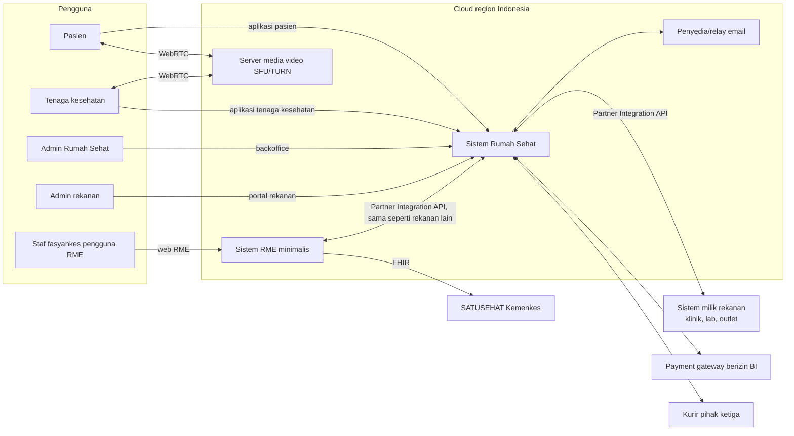
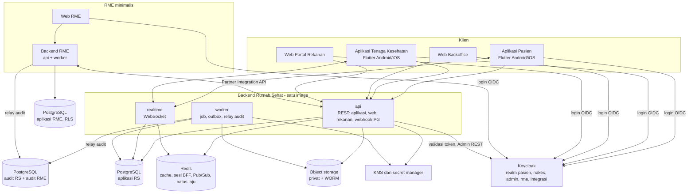
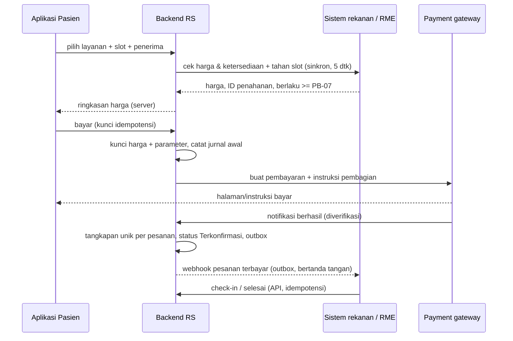
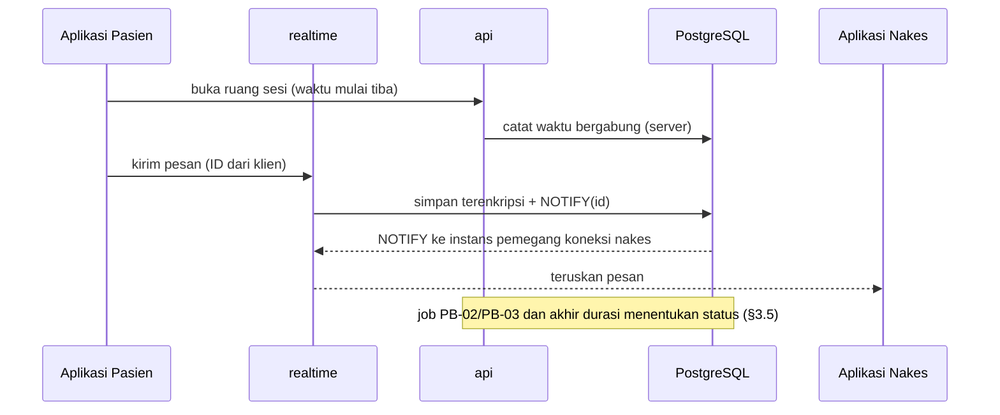
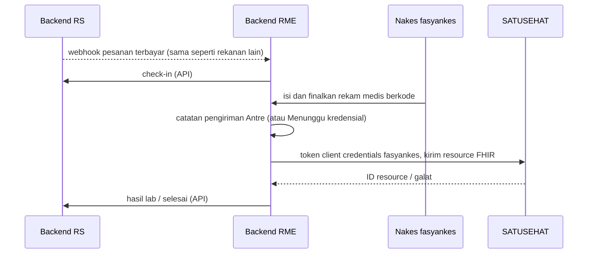
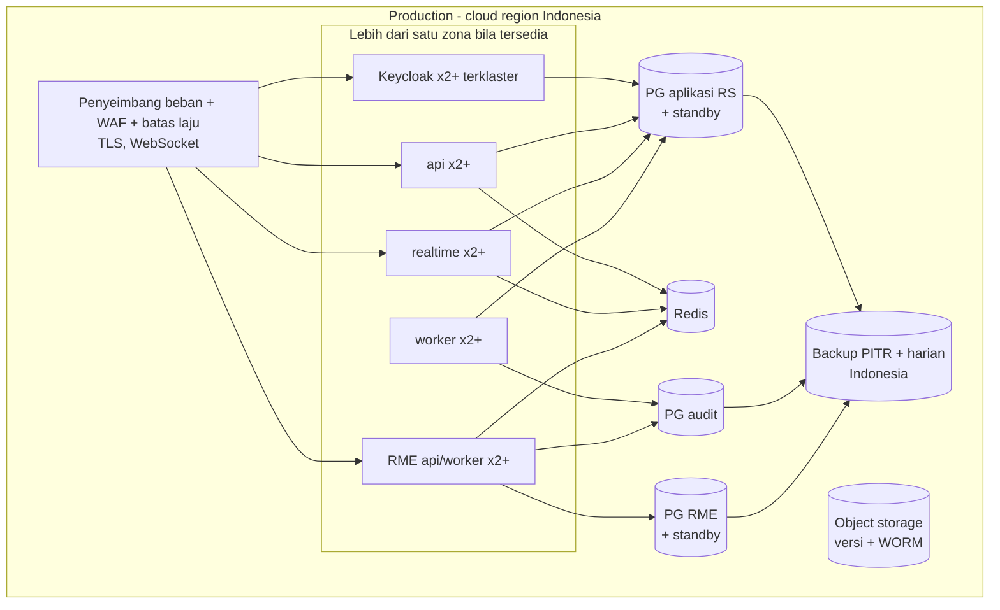

# Arsitektur Sistem: Rumah Sehat

Tanggal: 2026-11-18
Versi: 0.1 (draf untuk gate Tahap 4)
Penyusun: Claude (persona Solution Architect + DBA + Security Architect). Review DBA oleh subagent `dba-reviewer`, threat model oleh `security-architect`, dan pemeriksaan fakta oleh `fact-checker`
Pemilik dan penyetuju: user (project manager, meneruskan ke CEO dan CTO) `[DOK: 00-project-brief.md]`
Dasar: PRD v1.1 `[DOK: 03-prd.md]`, BRD v1.3 `[DOK: 02-brd.md]`, ADR-001–ADR-005 (diterima), wawancara Tahap 4 `[USER] T4-Qx` (`docs/04-catatan-arsitektur.md`)
Tingkat ketelitian: **T1 Kritis** untuk seluruh dokumen (keputusan arsitektur, model data, audit trail, keamanan; `aturan-kerja.md` §1)

Dokumen terkait: ADR-006–ADR-020 (`docs/adr/`), ERD (`docs/04-erd.md`), data dictionary (`docs/04-data-dictionary.md`), threat model (`docs/04-threat-model.md`), risk register (`docs/04-risk-register.md`).

**Label sumber.** `[DOK: ...]` adalah dokumen yang lulus gate. `[USER] T4-Qx` adalah jawaban user di Tahap 4. `[KEPUTUSAN-xx]` tercatat di `docs/decision-log.md` dan dirinci di ADR yang disebut. `[SRC-xx]` tercatat di `docs/sources.md`. Rujukan `US-`, `AB-`, `NFR-`, `PB-`, `E-` mengacu ke PRD; `BR-` mengacu ke BRD.

## 1. Ringkasan keputusan

| ADR | Keputusan | Keputusan di decision log |
| --- | --- | --- |
| ADR-006 | Backend Rumah Sehat berupa modular monolith dengan proses `api`, `realtime`, dan `worker`. RME minimalis adalah sistem terpisah. Ada dua aplikasi Flutter (pasien, tenaga kesehatan) dan dua web (backoffice, portal rekanan) | KEPUTUSAN-18, -19 |
| ADR-007 | PostgreSQL untuk semua database. Antrean job dan outbox di PostgreSQL. Redis sebagai komponen pendukung. Tanpa message broker | KEPUTUSAN-20 |
| ADR-008 | Lima kelas tabel. Status transaksi dicatat lewat riwayat status INSERT-only ditambah proyeksi | KEPUTUSAN-21 |
| ADR-009 | Audit trail: outbox atomik, database audit terpisah, hash berantai dengan jangkar WORM | KEPUTUSAN-22 |
| ADR-010 | Audit trail, application log, dan security log dikelola terpisah | KEPUTUSAN-23 |
| ADR-011 | Target ASVS 5.0.0 Level 2. Keycloak sebagai identity provider (realm per populasi), MFA TOTP termasuk untuk tenaga kesehatan, penolakan sesi seketika di aplikasi | KEPUTUSAN-24, -25, -26 |
| ADR-012 | Otorisasi berbasis peran dan relasi dengan default deny. RLS di RME minimalis | KEPUTUSAN-27 |
| ADR-013 | Enkripsi tingkat aplikasi untuk data spesifik, crypto-shredding, dan retensi yang dapat diatur | KEPUTUSAN-28, -29 |
| ADR-014 | Partner Integration API v1, webhook bertanda tangan, idempotensi | KEPUTUSAN-30 |
| ADR-015 | Adaptor payment gateway, harga terkunci, jurnal berpasangan, refund lewat job | KEPUTUSAN-31 |
| ADR-016 | Chat lewat WebSocket, video lewat SFU di Indonesia, notifikasi lewat email dan di dalam aplikasi | KEPUTUSAN-32 |
| ADR-017 | Waktu disimpan dalam UTC, zona waktu IANA, kalender hari kerja | KEPUTUSAN-33 |
| ADR-018 | Object storage privat dengan URL bertanda tangan | KEPUTUSAN-34 |
| ADR-019 | Tiga lingkungan di cloud Indonesia, PITR, standby, uji pemulihan | KEPUTUSAN-35 |
| ADR-020 | SATUSEHAT dikirim dari RME atas nama fasyankes, secara asinkron | KEPUTUSAN-36 |
| ADR-021 | Keamanan aplikasi mobile (data di perangkat, kendali SDK), akses administratif production (tanpa hak tetap, akses darurat), dan pipeline CI/CD | KEPUTUSAN-71 |

Keputusan user di tahap ini:

- **T4-Q1**: semua penyedia pihak ketiga memproses dan menyimpan data di Indonesia, tanpa kecuali. Ini menjawab PT-22 `[USER] T4-Q1`.
- **T4-Q4**: Keycloak sebagai identity provider dan Redis sebagai komponen pendukung, tanpa message broker `[USER] T4-Q4`.
- **T4-Q3**: aplikasi tenaga kesehatan tetap terpisah dari aplikasi pasien, dan RME minimalis tetap web khusus klinik/lab tanpa sistem `[USER] T4-Q3` (KEPUTUSAN-19).
- **T4-Q2**: CR-007 disetujui. Login Google/Apple, push notification, dan WhatsApp dihapus. Notifikasi dikirim lewat email dan di dalam aplikasi `[USER] T4-Q2`. BRD naik ke v1.3 dan PRD ke v1.1.

## 2. Konteks sistem



- Rumah Sehat hanya menjadi platform yang menghubungkan pasien dengan rekanan `[USER] T3-Q14`. RME minimalis berposisi sebagai salah satu "sistem rekanan" (AB-61) `[DOK: 03-prd.md]`.
- Semua komponen yang dijalankan atau dikontrak Rumah Sehat memproses data di Indonesia `[USER] T4-Q1`. Lokasi pemrosesan payment gateway, kurir, server video, dan email diverifikasi saat pemilihan penyedia di Tahap 5. Penyedia yang tidak memenuhinya tidak dipilih (US-1406 AC2) `[DOK: 03-prd.md]`.

## 3. Komponen dan modul



Pembagian komponen dan alasannya ada di ADR-006 `[KEPUTUSAN-18]` `[KEPUTUSAN-19]`.

**Modul backend Rumah Sehat.** Setiap modul hanya diakses lewat antarmuka publiknya (ADR-006):

| Modul | Tanggung jawab | Epic/story utama |
| --- | --- | --- |
| Identitas dan akses | Akun, registrasi, login, sesi, MFA, sub-peran, penonaktifan | EP-01 (US-101, US-103), EP-02 (US-206–US-208) |
| Profil dan verifikasi | Profil pasien, alamat, anggota keluarga, dokumen identitas, verifikasi KTP/KK | EP-01, EP-02 (US-201) |
| Tenaga kesehatan | Pendaftaran, dokumen izin, verifikasi, pemantauan SIP, tarif dan jadwal online | EP-02 (US-202–US-204), EP-03 (US-301, US-302) |
| Rekanan | Onboarding, rekening, dokumen izin, status integrasi | EP-02 (US-205), EP-14 (US-1405) |
| Katalog salinan | Salinan layanan, harga, jadwal, slot, katalog, dan stok dari rekanan, serta pencarian | EP-04, EP-05, EP-06, EP-07 |
| Pemesanan | Pesanan semua jenis, penahanan slot/stok, harga terkunci, status, pembatalan | EP-03–EP-07, US-805 |
| Konsultasi | Sesi, kehadiran, chat, video, catatan, resep, halaman verifikasi resep publik (CR-008) | EP-03 |
| Pembayaran | Adaptor PG, notifikasi PG, jurnal, refund, klaim, kewajiban, rekonsiliasi, pengaturan markup dan biaya | EP-08 |
| Hasil lab | Penerimaan dan penyajian hasil lab berversi | EP-09 |
| Notifikasi | Matriks kanal, templat, email, kotak notifikasi di dalam aplikasi | EP-10 |
| Konten dan layanan pelanggan | CMS, tiket keluhan | EP-11 |
| Portal rekanan | Laporan, profil, keluhan (hanya baca), pengaturan konsultasi | EP-12 |
| Gateway integrasi | Partner Integration API, webhook keluar, idempotensi, pemantauan | EP-14 |
| Audit | Pustaka audit, halaman Audit Log, export | EP-15 |
| Privasi | Persetujuan, hak subjek data, salinan data, anonimisasi, retensi, kunci data | EP-16 |
| KPI | Dasbor KPI | EP-17 |
| Platform | Berkas, job, outbox, kalender hari kerja, parameter bisnis | Lintas modul |

**Pemetaan modul ke data dictionary** (`docs/04-data-dictionary.md`): Identitas dan akses → A1; Profil dan verifikasi → A2; Tenaga kesehatan → A4; Rekanan → A5; Katalog salinan → A7; Pemesanan → A8, A10 (klinik, lab, home visit), A11 (produk); Konsultasi → A9; Hasil lab → A10; Pembayaran → A6 (markup, biaya rekanan, tarif metode), A12, A13, A14; Notifikasi, Konten dan layanan pelanggan → A15, A16; Portal rekanan → tanpa tabel sendiri (membaca A5, A14, A16); Gateway integrasi → A18; Privasi → A3, A6 (kebijakan retensi), A17, `data_key` di A19; Platform dan KPI → A6 (parameter bisnis, kalender hari kerja), A19; Audit → B; RME minimalis → C1–C6.

**Modul RME minimalis**: identitas dan akses RME, onboarding fasyankes (Operator RME), layanan/jadwal/harga, appointment dan check-in, antrean, rekam medis kunjungan, hasil lab, home visit, SATUSEHAT, klien integrasi ke Rumah Sehat, dan audit (EP-13) `[DOK: 03-prd.md]`.

## 4. Alur utama

### 4.1 Pemesanan dan pembayaran layanan terjadwal (klinik, lab, home visit)



Kegagalan ditangani sebagai berikut: rekanan tidak merespons membuat pembayaran tidak dibuat (KU-08); notifikasi ganda menjadi RF-12; nominal berbeda menjadi RF-14; pembayaran yang berhasil setelah kedaluwarsa tetap dikonfirmasi bila slot/stok masih tersedia, dan menjadi RF-13 bila tidak (US-802 AC5); pesanan belum diterima rekanan saat jadwal mulai menjadi RF-18 (ADR-014, ADR-015) `[KEPUTUSAN-30]` `[KEPUTUSAN-31]`.

### 4.2 Sesi konsultasi chat



### 4.3 Audit trail

```mermaid
sequenceDiagram
  participant M as Modul bisnis
  participant DB as DB aplikasi
  participant W as worker relay
  participant AU as DB audit
  participant WO as WORM
  M->>DB: BEGIN; ubah data; INSERT audit_outbox; COMMIT
  W->>DB: ambil outbox berurutan
  W->>AU: INSERT audit_event (seq, prev_hash, event_hash)
  W->>DB: hapus outbox terkirim
  W->>WO: tiap jam: kepala rantai
  Note over AU: job harian memverifikasi rantai terhadap WORM
```

### 4.4 RME minimalis, Rumah Sehat, dan SATUSEHAT



## 5. Titik integrasi

| Integrasi | Arah | Protokol dan keamanan | Data pribadi | Syarat lokasi | ADR |
| --- | --- | --- | --- | --- | --- |
| Sistem rekanan dan RME minimalis | Dua arah | REST/JSON v1, OAuth2 client credentials `[SRC-45]`, webhook HMAC-SHA256 `[SRC-46]`, idempotensi | Data penerima minimal (L-08), hasil lab | Sistem milik rekanan berada di luar kendali Rumah Sehat; data yang dikirim dibatasi dan dicatat E-17 | ADR-014 |
| Payment gateway | Dua arah | Adaptor; notifikasi diverifikasi (NFR-INT-04) | Nominal, ID pesanan, data pembayar minimal | Indonesia `[USER] T4-Q1` | ADR-015 |
| Kurir | Dua arah | Adaptor; status pengiriman | Nama, alamat, nomor HP penerima | Indonesia | ADR-014 (pola), Tahap 5 |
| Server media video | Klien ke SFU | WebRTC, token per peserta per sesi | Suara dan gambar konsultasi (tidak disimpan) | Indonesia | ADR-016 |
| Email | Keluar | Penyedia atau relay SMTP | Alamat email, isi tanpa data kesehatan rinci | Indonesia | ADR-016 |
| SATUSEHAT | RME ke Kemenkes | FHIR, OAuth2 client credentials per fasyankes `[SRC-56]` | Rekam medis, NIK pasien dan praktisi | Layanan Kemenkes | ADR-020 |
| Keycloak | Aplikasi/web ke Keycloak; backend ke Admin REST API | OIDC (Authorization Code + PKCE, BFF untuk web), client credentials untuk rekanan `[SRC-71]` | Email dan kredensial | Dijalankan sendiri di cloud Indonesia `[USER] T4-Q4` | ADR-011 |
| Redis | Internal | Terkelola atau dijalankan sendiri | Hanya ID internal | Region Indonesia | ADR-007 |
| KMS, secret manager, object storage, log | Internal cloud | Layanan terkelola | Kunci, berkas, log | Region Indonesia | ADR-013, ADR-018, ADR-010 |

Login Google/Apple, push notification, dan WhatsApp tidak diintegrasikan (CR-007) `[USER] T4-Q2`.

## 6. Lingkungan dan deployment

Tiga lingkungan: lokal, staging, dan production. Semuanya di cloud region Indonesia kecuali lokal, dan hanya production yang memuat data nyata (ADR-019) `[KEPUTUSAN-35]`.



Kriteria pemilihan penyedia cloud dan layanan pihak ketiga yang harus diverifikasi di Tahap 5 tercantum di §11.

## 7. Keamanan

- **Target verifikasi**: ASVS 5.0.0 Level 2 untuk semua komponen `[KEPUTUSAN-26]` `[SRC-48]`.
- **Batas kepercayaan (trust boundary)** untuk threat model:
  1. internet ke penyeimbang beban (aplikasi mobile, web, rekanan, notifikasi PG);
  2. proses aplikasi ke database aplikasi;
  3. worker relay ke database audit;
  4. Rumah Sehat ke sistem rekanan (keluar) dan sistem rekanan ke Rumah Sehat (masuk);
  5. RME minimalis ke Rumah Sehat;
  6. RME minimalis ke SATUSEHAT;
  7. aplikasi ke server media video;
  8. proses aplikasi ke KMS, secret manager, object storage, Redis, dan Admin REST API Keycloak;
  9. browser sistem dan aplikasi ke Keycloak (login OIDC);
  10. pipeline CI/CD ke lingkungan cloud;
  11. backend ke penyedia pihak ketiga (payment gateway, kurir, email, server media);
  12. perangkat pengguna (aplikasi mobile dan penyimpanan lokalnya);
  13. akses administratif manusia ke infrastruktur production (ADR-021 butir 3).
- Keycloak dipakai bersama Rumah Sehat dan RME dengan realm terpisah. Redis memakai instans terpisah per sistem (ADR-007).
- **Kontrol utama**:
  - Autentikasi dan sesi (ADR-011): Keycloak dengan realm per populasi, Argon2, MFA TOTP untuk semua peran non-pasien, Authorization Code + PKCE lewat browser sistem, BFF untuk web, penolakan seketika lewat status akun dan daftar pencabutan di Redis/DB.
  - Otorisasi (ADR-012): default deny, relasi, 404 untuk objek terlarang, RLS di RME.
  - Perlindungan data (ADR-013): TLS, KMS, enkripsi tingkat aplikasi untuk data spesifik, blind index NIK.
  - Integrasi (ADR-014): token per klien, HMAC dengan stempel waktu, idempotensi, validasi skema.
  - Berkas (ADR-018): URL bertanda tangan berumur pendek, validasi isi.
  - Audit (ADR-009): append-only, hash berantai, WORM.
  - Log (ADR-010): pemisahan dan redaksi.
- Rinciannya dinilai per ancaman di `docs/04-threat-model.md`.

## 8. Data

- **Lima database PostgreSQL**: aplikasi Rumah Sehat, Keycloak (berbagi instans dengan aplikasi Rumah Sehat), audit Rumah Sehat, audit RME (berbagi instans audit), dan aplikasi RME minimalis. Redis hanya menyimpan data turunan tanpa data pribadi selain ID (ADR-007). Database terpisah dan role terpisah (ADR-007, ADR-019) `[KEPUTUSAN-20]` `[KEPUTUSAN-35]`.
- **Kelas tabel** Master, Transaksi, Proyeksi, Operasional, dan Log, dengan hak role per kelas (ADR-008) `[KEPUTUSAN-21]`. Klasifikasi final setiap entitas ada di data dictionary, yang memfinalkan KEPUTUSAN-10.
- **Keputusan data Tahap 4** `[DOK: .claude/skills/runbook/references/tahap-04-arsitektur.md]`:
  - *Multi-tenancy*: Rumah Sehat memakai skema bersama dengan isolasi di lapisan repository dan test isolasi. RME minimalis memakai skema bersama dengan `fasyankes_id` dan RLS (ADR-012) `[KEPUTUSAN-27]`.
  - *Partisi*: hanya `audit_event`, per bulan, untuk arsip dan retensi (ADR-009) `[KEPUTUSAN-22]`. Tabel lain tidak dipartisi di rilis 1. Pemicu evaluasi ulang adalah hasil uji beban atau pertumbuhan tabel chat dan jurnal yang dipantau.
  - *Enkripsi kolom*: envelope encryption tingkat aplikasi dengan DEK per wadah data untuk kolom data spesifik, serta blind index untuk NIK (ADR-013) `[KEPUTUSAN-28]`.
- **ERD dan data dictionary**: `docs/04-erd.md`, `docs/04-data-dictionary.md`.

## 9. Tiga jenis log

Audit trail (akuntabilitas, fitur produk), application log (debugging), dan security log (deteksi ancaman) dikelola terpisah dalam tujuan, isi, penyimpanan, akses, dan retensi. Rinciannya ada di ADR-010 `[KEPUTUSAN-23]`, dan audit trail di ADR-009 `[KEPUTUSAN-22]`.

## 10. Pemenuhan NFR

Setiap NFR PRD §6 dan spesifikasi audit §7 dijawab arsitektur. Kolom "Bukti" menyebut cara pembuktiannya kelak.

| NFR | Jawaban arsitektur | ADR | Bukti |
| --- | --- | --- | --- |
| NFR-PERF-01/02 (API baca 500 ms, tulis 1 dtk p95) | Modular monolith tanpa lompatan jaringan antar-layanan; index sesuai data dictionary; pihak ketiga dipanggil lewat job, kecuali cek ketersediaan sinkron yang tidak dihitung di NFR | ADR-006, ADR-007, ADR-014 | Uji beban NFR-CAP-04 |
| NFR-PERF-03 (chat 2 dtk p95) | WebSocket, simpan lalu sinyal Redis Pub/Sub berisi ID, klien mengambil ulang yang terlewat | ADR-016, ADR-007 | Uji beban 100 sesi |
| NFR-PERF-04 (halaman web 3 dtk p95) | Web statis + API; tanpa render server untuk data besar | ADR-006 | Uji beban web |
| NFR-PERF-05 (notifikasi ≤ 1 menit) | Outbox notifikasi diproses worker; kotak notifikasi + WebSocket; email ke penyedia di Indonesia | ADR-016 | Metrik waktu kejadian ke penyerahan |
| NFR-CAP-01–03 (30.000 MAU, 1.000 bersamaan, 100 sesi) | Proses `api`, `realtime`, `worker` diskalakan horizontal; database terkelola dengan standby | ADR-006, ADR-019 | NFR-CAP-04 |
| NFR-CAP-04 (uji beban sebelum go-live) | Lingkungan staging setara production untuk uji beban | ADR-019 | Laporan uji beban |
| NFR-AVL-01/02 (99,0%) | Minimal 2 instans per proses, multi-zona bila tersedia, standby database aplikasi | ADR-019 | Pemeriksa ketersediaan (NFR-OBS-01) |
| NFR-AVL-03/04 (pemeliharaan; gangguan pihak ketiga terpisah) | Deploy tanpa henti layanan; status integrasi per rekanan dan penyedia dicatat terpisah | ADR-019, ADR-014 | Catatan insiden |
| NFR-DR-01 (RPO 15 menit) | PITR dengan interval arsip WAL ≤ 1 menit `[SRC-38]` | ADR-019 | Uji pemulihan |
| NFR-DR-02 (RTO 4/8 jam) | Runbook pemulihan + infrastruktur sebagai kode + standby | ADR-019 | Uji pemulihan |
| NFR-DR-03 (uji pemulihan) | Uji pemulihan penuh sebelum go-live | ADR-019 | Laporan uji |
| NFR-DR-04 (backup di Indonesia) | Backup di region Indonesia | ADR-019 | Konfigurasi penyedia (Tahap 5) |
| NFR-SEC-01 (ASVS) | Level 2; checklist di Tahap 5 | ADR-011 | Audit Tahap 10 |
| NFR-SEC-02 (MFA) | TOTP Keycloak wajib di realm `nakes`, `admin`, `rme`, dengan kode pemulihan | ADR-011 | Test autentikasi |
| NFR-SEC-03 (password, penguncian) | Argon2 Keycloak (≥ parameter OWASP); kebijakan ASVS L2; deteksi brute force 5 gagal, kunci 15 menit | ADR-011 | Test |
| NFR-SEC-04 (sesi web 30 menit) | BFF dan SSO Session Idle 30 menit, mutlak 12 jam | ADR-011 | Test |
| NFR-SEC-05 (enkripsi + perlindungan tambahan data spesifik) | TLS; enkripsi penyedia; envelope encryption tingkat aplikasi | ADR-013 | Review kode, audit Tahap 10 |
| NFR-SEC-06 (isolasi antar-rekanan/fasyankes) | Repository ber-tenant + test isolasi; RLS di RME | ADR-012 | Test isolasi otomatis |
| NFR-SEC-07 (hak minimum) | Kebijakan per endpoint; role database per kelas | ADR-012, ADR-008 | Review DBA, audit |
| NFR-SEC-08 (berkas) | Validasi jenis/ukuran/isi; URL bertanda tangan | ADR-018 | Test |
| NFR-SEC-09 (lulus audit keamanan) | Seluruh kontrol di atas; threat model Tahap 4 | Semua | Tahap 10 |
| NFR-PRIV-01 (data dan backup di Indonesia) | Semua penyimpanan di region Indonesia | ADR-019 | Konfigurasi |
| NFR-PRIV-02 (penyedia pihak ketiga di Indonesia) | Syarat pemilihan penyedia; inventaris dependensi mobile dan daftar izin host tujuan | ADR-010, ADR-016, ADR-019, ADR-021 | Evaluasi penyedia Tahap 5; uji lalu lintas jaringan build rilis (ADR-021 butir 2) |
| NFR-PRIV-03 (data keluar minimal) | Minimisasi per tujuan; E-17 | ADR-013, ADR-014 | Review kontrak integrasi |
| NFR-PRIV-04 (video tidak direkam) | Rekaman tidak dikonfigurasi + test konfigurasi | ADR-016 | Test |
| NFR-PRIV-05 (bukti persetujuan per versi) | Tabel versi teks + rekaman persetujuan (Log) | ADR-008 | Data dictionary |
| NFR-RET-01 (retensi dapat diatur, otomatis) | Tabel kebijakan retensi + job + crypto-shredding | ADR-013 | Test job retensi |
| NFR-RET-02 (angka retensi) | `[TIDAK DIKETAHUI]` (PT-24). Data aplikasi dan audit tidak dimusnahkan sebelum ditetapkan. Retensi application log, security log, dan backup juga keputusan bisnis: usulan nilai sementara diputuskan user di gate Tahap 4, dan sebelum itu tidak ada penghapusan otomatis | ADR-013, ADR-009, ADR-010, ADR-019 | — |
| NFR-COMP-01–03 | Flutter Android/iOS; web dua versi browser terakhir | ADR-006 | Uji kompatibilitas Tahap 9 |
| NFR-LOC-01/02 | Bahasa Indonesia; Rupiah `bigint`; zona waktu AB-40–42 | ADR-015, ADR-017 | Test |
| NFR-OBS-01 | Pemeriksa ketersediaan + metrik + peringatan | ADR-010 | Konfigurasi pemantauan |
| NFR-OBS-02/03 | Tiga log terpisah; redaksi otomatis | ADR-010 | Test redaksi |
| NFR-INT-01 (idempoten, coba ulang) | Kunci idempotensi masuk; outbox minimal sekali dengan `event_id`; job idempoten | ADR-014, ADR-007 | Test integrasi |
| NFR-INT-02 (15 menit) | Rekanan mengirim perubahan saat terjadi; snapshot penuh untuk rekonsiliasi | ADR-014 | Test kontrak |
| NFR-INT-03 (peringatan 30 menit) | Status Terganggu otomatis | ADR-014 | Test |
| NFR-INT-04 (verifikasi notifikasi PG) | Verifikasi sesuai mekanisme penyedia | ADR-015 | Test |
| Aksesibilitas (§6.11) | Ditetapkan di Tahap 6 dari WCAG; tidak memengaruhi arsitektur backend | — | Tahap 6 |
| Audit trail PRD §7.1–§7.6 | Event aplikasi, outbox atomik, store terpisah, hash berantai, masking di pustaka, akses Auditor/Super Admin/Admin Fasyankes | ADR-009 | Test pustaka audit, verifikasi rantai |

## 11. Ditetapkan di Tahap 5 (pemilihan stack dan penyedia)

Pemilihan berikut wajib diverifikasi ke dokumentasi resmi dan dibawa ke user. Syarat umumnya: memproses dan menyimpan data di Indonesia `[USER] T4-Q1`.

| Butir | Syarat dari arsitektur |
| --- | --- |
| Penyedia cloud | Region Indonesia dengan platform kontainer terkelola, PostgreSQL terkelola (PITR, standby), object storage (URL bertanda tangan, versi objek, WORM), KMS, secret manager, layanan log, dan sinkronisasi waktu (ADR-019, ADR-009, ADR-013, ADR-017) |
| Payment gateway | Berizin BI, pembagian dana langsung ke rekening rekanan, refund, data di Indonesia. Mekanisme penarikan dana rekanan (PT-27) dan ongkir (PT-31) (ADR-015) |
| Video | SFU/TURN di Indonesia (terkelola atau dijalankan sendiri), rekaman dapat dipastikan nonaktif (ADR-016) |
| Email | Penyedia atau relay di Indonesia (ADR-016) |
| Kurir | Integrasi status pengiriman; data di Indonesia |
| Bahasa, framework, ORM, pustaka UUIDv7 | Mendukung pola ADR-007, ADR-008, ADR-009 |
| Keycloak | Versi, pengaturan parameter Argon2, tema login, konfigurasi realm sebagai kode, mekanisme autentikasi ulang, rotasi token penyegar, pemetaan jenis event (ADR-011) |
| Redis | Distribusi dan lisensi `[SRC-76]`, layanan terkelola atau dijalankan sendiri di Indonesia (ADR-007) |
| Log, metrik, crash report | Di Indonesia atau dijalankan sendiri (ADR-010) |
| Checklist ASVS L2 | Pemetaan kontrol per bab (ADR-011), ditambah mitigasi Sedang/Rendah dan penguatan threat model (`docs/04-threat-model.md` §6.2–§6.3) |
| Keamanan pipeline dan akses admin | Identitas pipeline jangka pendek, proteksi branch, persetujuan deploy, IAM/KMS/log audit penyedia (ADR-021) |
| Penetralan PDF | Pustaka CDR atau render ulang yang berjalan di Indonesia (ADR-018 butir 6) |
| Biaya | Baseline biaya pihak ketiga dan infrastruktur (Business Case §9) |

## 12. Modul kritis (T1)

Dicatat di `CLAUDE.md` `[KEPUTUSAN-37]`: autentikasi/sesi/MFA, termasuk konfigurasi realm Keycloak dan validasi token; otorisasi dan isolasi (termasuk RLS RME); harga, pembayaran, jurnal, refund, klaim, dan kewajiban; pustaka dan database audit; enkripsi, kunci, pekerja privasi, dan retensi; persetujuan dan hak subjek data; gateway integrasi rekanan; berkas dokumen identitas dan klinis; rekam medis RME dan SATUSEHAT; migrasi skema dan hak role database.

## 13. Ketergantungan dan pertanyaan terbuka yang memengaruhi arsitektur

| # | Butir | Dampak ke arsitektur | Status |
| --- | --- | --- | --- |
| PT-05 | Kemampuan sistem rekanan | Rekanan yang tidak mampu mengikuti kontrak memerlukan keputusan bisnis: memakai RME minimalis atau dibuatkan adaptor (ADR-014) | Terbuka; risk register |
| PT-24 | Masa retensi per jenis data | Kebijakan retensi kosong, tidak ada pemusnahan; US-1605/1606 terblokir | Terbuka |
| PT-27, PT-31 | Penarikan dana rekanan; ongkir | Mekanisme ditetapkan di Tahap 5 sesuai penyedia; jurnal mencatat kewajiban apa pun mekanismenya | Terbuka |
| PT-28 | Pajak | Jurnal dapat menampung akun pajak; kolom tidak ditambahkan sebelum jelas | Terbuka |
| PT-32 | Registrasi SATUSEHAT | US-1309 dan terminologi SNOMED CT bergantung padanya | Status dilaporkan di gate |
| PT-18, PT-19, PT-25 | Biaya tim, developer, legal | Baseline biaya | Tenggat gate Tahap 4 |
| L-05, L-06, L-08 | Rekam medis, hak hapus, data minimal | Field NIK ke rekanan/RME, isi kontrak data penerima, kecukupan crypto-shredding | Menunggu legal (PT-20) |
| L-04, L-12 | Pembagian dana, refund, *merchant of record* | Mekanisme penarikan dana dan tampilan bukti bayar | Menunggu legal |

## 14. Perubahan terhadap dokumen yang sudah lulus gate

| CR | Ringkasan | Dokumen | Sumber |
| --- | --- | --- | --- |
| CR-007 | Semua penyedia pihak ketiga di Indonesia. Login Google/Apple, push, dan WhatsApp dihapus. Notifikasi lewat email dan di dalam aplikasi | BRD v1.3, PRD v1.1, backlog, traceability, catatan KEPUTUSAN-06 | `[USER] T4-Q1, T4-Q2` |

ADR-001–ADR-005 tidak diubah. ADR-008 menambah kelas Proyeksi dan Operasional, dan ADR-013 menetapkan cara anonimisasi (ADR-003) dan pemusnahan berjalan tanpa `UPDATE`/`DELETE` baris transaksi (ADR-004).
