# ERD (Model Data Logikal): Rumah Sehat

Tanggal: 2026-11-18
Versi: 0.2 (draf Tahap 4 untuk gate; sudah direview `dba-reviewer` dan `security-architect`). Tabel pencabutan sesi A1.4 dan C1.11 ditambahkan setelah fact-check; rinciannya di data dictionary
Penyusun: Claude (persona Solution Architect + DBA)
Tingkat ketelitian: **T1 Kritis**
Dasar: PRD v1.1 §8 `[DOK: 03-prd.md]`, ADR-001–ADR-020 `[DOK: adr/]`, keputusan Keycloak dan Redis `[USER] T4-Q4`. Atribut lengkap, tipe, constraint, dan label sumber per kolom ada di `docs/04-data-dictionary.md`; keputusan baru `[KEPUTUSAN-38]`–`[KEPUTUSAN-69]` dan temuan F-01–F-13 ada di §E dokumen itu. Putaran perbaikan 1 atas review DBA (`docs/review/tahap-04-dba.md`) sudah diterapkan.

## 0. Cara membaca

- Satu diagram per domain supaya terbaca. Entitas dari domain lain ditampilkan dengan atribut minimal sebagai penghubung.
- Atribut yang ditampilkan hanya PK, FK, kunci unik (UK), dan kolom penentu. Kolom standar per kelas (ADR-008; *STD-M*, *STD-T*, dan seterusnya di data dictionary §0.4) tidak digambar.
- Notasi Mermaid: `||` tepat satu, `o|` nol atau satu, `|{` satu atau banyak, `o{` nol atau banyak.
- Kelas tabel ditulis di komentar atribut pertama: M Master, M-snapshot Master snapshot (`[KEPUTUSAN-69]`), T Transaksi, R Riwayat status, P Proyeksi, O Operasional, L Log.
- Kredensial, MFA, token email, dan sesi IdP dikelola Keycloak; cache dan pencabutan sesi di Redis. Keduanya tidak digambar (data dictionary §0.10).
- Tiga database terpisah: (A) aplikasi Rumah Sehat, (B) audit (skema sama untuk audit Rumah Sehat dan audit RME), (C) aplikasi RME minimalis. Tidak ada FK lintas database.

### 0.1 Kardinalitas terhadap PRD §8.3

| Relasi PRD §8.3 | Model ini | Status |
| --- | --- | --- |
| Pasien – Anggota keluarga: nol atau banyak; satu NIK anggota keluarga dapat di lebih dari satu akun | `patient` 1 — 1..* `care_recipient` (pemilik akun sendiri = satu baris `is_account_owner`, ditambah 0..* anggota keluarga). NIK anggota keluarga unik per akun, tidak lintas akun | **Menyimpang struktur** `[KEPUTUSAN-41]`: pemilik akun dan anggota keluarga disatukan sebagai penerima layanan. Aturan PRD tetap |
| Pasien/Anggota keluarga – Dokumen identitas: satu aktif + riwayat pengajuan | `care_recipient` 1 — 0..* `identity_document`; 1 — 0..* `identity_verification_request`; status terkini = permintaan terbaru | Sesuai |
| Klinik – Tenaga kesehatan: satu klinik banyak nakes; satu nakes satu klinik (AB-50) | `partner` 1 — 0..* `health_worker` | Sesuai |
| Tenaga kesehatan – Slot – Sesi: satu slot paling banyak satu sesi terbayar (AB-52) | `consultation_slot` 1 — 0..* `consultation_session` (pesanan yang kedaluwarsa atau batal tetap merujuk slot); paling banyak satu terbayar lewat `booked_order_id` unik | Sesuai (penegakan lewat kolom unik) |
| Pesanan – Penerima layanan: satu pesanan terjadwal untuk satu orang | `patient_order` *..1 `care_recipient` (wajib untuk layanan terjadwal; kosong untuk produk) | Sesuai |
| Pesanan – Pembayaran – Pembagian dana: satu pembayaran berhasil; satu set pembagian dana | `patient_order` 1 — 0..* `payment_attempt`; 1 — 0..1 `payment_capture`; pembagian dana per harga terkunci percobaan | **Menyimpang dari diagram PRD** (`PESANAN ||--|| PEMBAYARAN`): pesanan boleh tanpa pembayaran (kedaluwarsa atau dibatalkan sebelum bayar) dan boleh punya beberapa percobaan `[KEPUTUSAN-48]` |
| Pesanan – Refund – Klaim: nol atau satu refund; nol atau satu klaim aktif | Refund: 0..1 per pesanan untuk refund atas pembayaran pesanan; RF-12, RF-13, RF-14 dikecualikan karena atas dana yang tidak menjadi pembayaran pesanan (partial unique, `[KEPUTUSAN-67]`, menunggu konfirmasi user). Klaim: 0..1 per pesanan, apa pun statusnya | **Lebih ketat untuk klaim** `[KEPUTUSAN-50]`: setara dengan UP-36 (tidak ada klaim baru setelah ditolak) dan AB-36 |
| Sesi – Catatan – Resep: nol atau satu catatan berversi; nol atau banyak resep | `consultation_session` 1 — 0..* `consultation_note_version` (satu catatan, banyak versi); 1 — 0..* `prescription` | Sesuai |
| Pendaftaran lab – Hasil lab: nol atau banyak (berversi) | `patient_order` 1 — 0..* `lab_result` 1 — 1..* `lab_result_version`; di RME `rme_visit` 1 — 0..* `rme_lab_result` 1 — 1..* `rme_lab_result_version` (review DBA B08) | Sesuai |
| Rekanan RME – Fasyankes: tepat satu | `fasyankes.rumah_sehat_partner_id` unik, tanpa FK lintas database | Sesuai |
| Kunjungan RME – Pesanan Rumah Sehat: tepat satu | `rme_visit.rumah_sehat_order_id` unik, tanpa FK lintas database | Sesuai |

---

## 1. Identitas dan akun (database A)

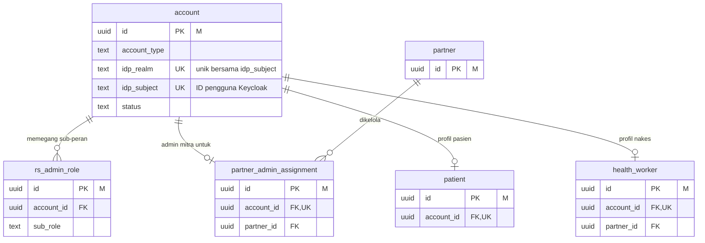

## 2. Pasien, penerima layanan, dan identitas (database A)

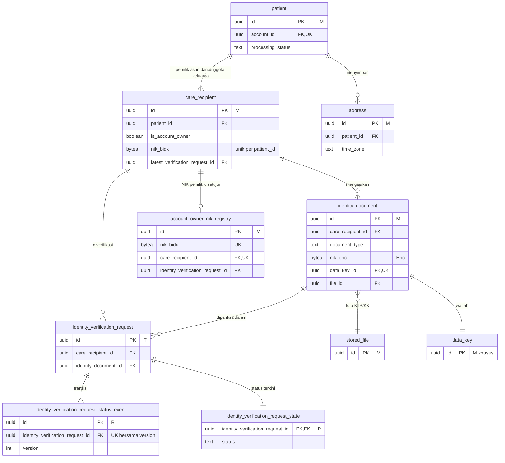

## 3. Tenaga kesehatan, rekanan, dan pengaturan (database A)

```mermaid
erDiagram
  partner {
    uuid id PK "M"
    text partner_type
    text system_source
    text integration_status
    text time_zone
  }
  partner_capability {
    uuid id PK "M"
    uuid partner_id FK
    text capability "clinic, lab, outlet"
  }
  partner_license_document {
    uuid id PK "M"
    uuid partner_id FK
    uuid file_id FK
  }
  partner_bank_account {
    uuid id PK "M"
    uuid partner_id FK
    bytea account_number_enc "Enc"
    text approval_status "satu active per partner"
  }
  partner_bank_account_decision {
    uuid id PK "T"
    uuid partner_bank_account_id FK, UK
  }
  health_worker {
    uuid id PK "M"
    uuid partner_id FK
    text profession
  }
  health_worker_license {
    uuid id PK "M"
    uuid health_worker_id FK
    date expires_on
  }
  health_worker_affiliation_confirmation {
    uuid id PK "M"
    uuid health_worker_id FK
  }
  health_worker_verification_decision {
    uuid id PK "T"
    uuid health_worker_id FK
    uuid affiliation_confirmation_id FK
  }
  consultation_rate {
    uuid id PK "M berlaku-mulai"
    uuid health_worker_id FK
    text consultation_mode
    bigint fee_idr
    timestamptz effective_from
  }
  practice_schedule {
    uuid id PK "M"
    uuid health_worker_id FK
    text consultation_mode
  }
  practice_schedule_exception {
    uuid id PK "M"
    uuid health_worker_id FK
  }
  consultation_slot {
    uuid id PK "M"
    uuid health_worker_id FK
    uuid practice_schedule_id FK
    uuid booked_order_id FK, UK
  }
  markup_rule {
    uuid id PK "M berlaku-mulai"
    uuid partner_id FK
    timestamptz effective_from
  }
  partner_fee_rule {
    uuid id PK "M berlaku-mulai"
    uuid partner_id FK
  }
  document_requirement {
    uuid id PK "M"
    text subject_kind
    text document_type_code
  }
  business_parameter {
    uuid id PK "M berlaku-mulai"
    text param_code
    text scope_key
  }
  payment_method_fee {
    uuid id PK "M berlaku-mulai"
    text method_code
  }
  workday_calendar {
    uuid id PK "M"
    date calendar_date UK
  }
  retention_policy {
    uuid id PK "M berlaku-mulai"
    text data_category
  }
  reason_code {
    uuid id PK "M"
    text context
    text code
  }
  partner ||--|{ partner_capability : "punya kemampuan"
  partner ||--o{ partner_license_document : "izin usaha"
  partner ||--o{ partner_bank_account : "rekening"
  partner_bank_account ||--o| partner_bank_account_decision : "disetujui Verifikator"
  partner ||--o{ health_worker : "menaungi (klinik)"
  health_worker ||--o{ health_worker_license : "STR, SIP, penugasan"
  health_worker ||--o{ health_worker_affiliation_confirmation : "konfirmasi klinik"
  health_worker ||--o{ health_worker_verification_decision : "diputuskan"
  health_worker_affiliation_confirmation |o--o{ health_worker_verification_decision : "dasar persetujuan"
  health_worker ||--o{ consultation_rate : "tarif per jenis"
  health_worker ||--o{ practice_schedule : "jadwal mingguan"
  health_worker ||--o{ practice_schedule_exception : "pengecualian"
  health_worker ||--o{ consultation_slot : "membuka"
  practice_schedule |o--o{ consultation_slot : "membentuk"
  partner ||--o{ markup_rule : "markup"
  partner ||--o{ partner_fee_rule : "biaya rekanan"
```

`document_requirement`, `business_parameter`, `payment_method_fee`, `workday_calendar`, `retention_policy`, dan `reason_code` adalah tabel acuan tanpa FK ke entitas lain di diagram ini; dirujuk dari harga terkunci (diagram 5), job retensi (diagram 9), dan riwayat status.

## 4. Katalog salinan rekanan (database A)

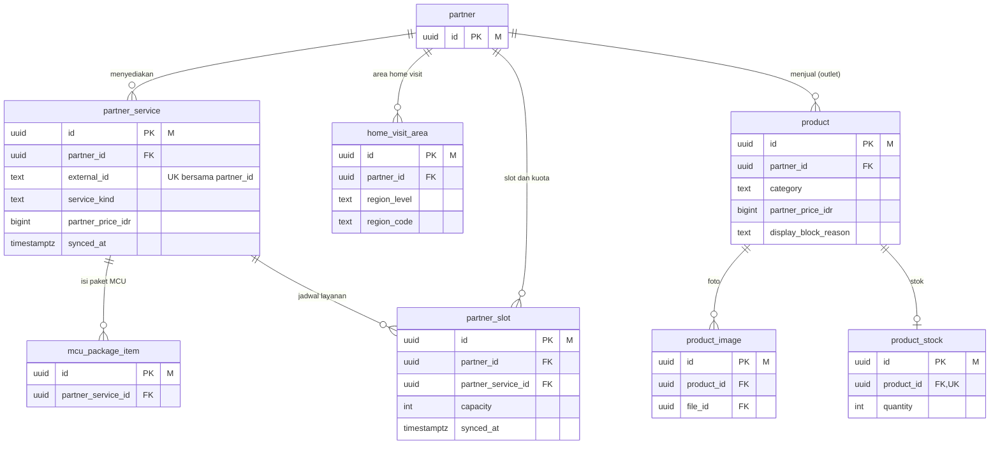

## 5. Pesanan, status, harga terkunci, dan pengiriman produk (database A)

```mermaid
erDiagram
  patient_order {
    uuid id PK "T"
    text order_number UK
    text order_kind
    uuid patient_id FK
    uuid care_recipient_id FK "wajib kecuali produk"
    uuid partner_id FK
    uuid client_request_id "UK bersama patient_id"
  }
  order_status_event {
    uuid id PK "R"
    uuid patient_order_id FK "UK bersama version"
    text order_kind FK "FK komposit ke patient_order dan transisi"
    int version
    text from_status FK
    text to_status FK
  }
  order_status_transition {
    uuid id PK "M acuan"
    text order_kind "UK bersama from_status, to_status"
    text from_status
    text to_status
  }
  order_state {
    uuid patient_order_id PK, FK "P"
    text status
  }
  order_personal_snapshot {
    uuid id PK "M-snapshot, hanya privacy_worker U"
    uuid patient_order_id FK, UK
  }
  partner_recipient_alias {
    uuid id PK "M"
    uuid partner_id FK
    uuid care_recipient_id FK
    uuid alias_id UK
  }
  order_price_lock {
    uuid id PK "T"
    uuid patient_order_id FK
    uuid markup_rule_id FK
    uuid payment_method_fee_id FK
    uuid consultation_rate_id FK
    bigint total_idr
  }
  order_price_lock_line {
    uuid id PK "T"
    uuid order_price_lock_id FK
    uuid product_id FK "UK bersama order_price_lock_id"
    int quantity "satu-satunya sumber jumlah barang"
    bigint unit_markup_idr
  }
  product {
    uuid id PK "M"
  }
  order_parameter_snapshot {
    uuid id PK "T"
    uuid order_price_lock_id FK
    uuid business_parameter_id FK
  }
  inventory_hold {
    uuid id PK "O"
    uuid patient_order_id FK
    uuid consultation_slot_id FK, UK
    uuid partner_slot_id FK
    uuid product_id FK
  }
  order_partner_acknowledgement {
    uuid id PK "T"
    uuid patient_order_id FK, UK
  }
  order_follow_up_flag {
    uuid id PK "L"
    uuid patient_order_id FK
  }
  order_follow_up_resolution {
    uuid id PK "L"
    uuid order_follow_up_flag_id FK, UK
  }
  product_order_detail {
    uuid id PK "T"
    uuid patient_order_id FK, UK
  }
  shipment {
    uuid id PK "T"
    uuid patient_order_id FK, UK
  }
  shipment_tracking_event {
    uuid id PK "L"
    uuid shipment_id FK
    bytea description_enc "Enc, wadah status_note"
  }
  patient {
    uuid id PK "M"
  }
  care_recipient {
    uuid id PK "M"
  }
  partner {
    uuid id PK "M"
  }
  patient ||--o{ patient_order : "memesan"
  care_recipient |o--o{ patient_order : "menerima layanan"
  partner ||--o{ patient_order : "melayani atau menjual"
  patient_order ||--|{ order_status_event : "transisi"
  order_status_transition |o--o{ order_status_event : "transisi yang diizinkan"
  patient_order ||--|| order_state : "status terkini"
  patient_order ||--|| order_personal_snapshot : "snapshot data pribadi"
  partner ||--o{ partner_recipient_alias : "alias penerima"
  care_recipient ||--o{ partner_recipient_alias : "dialiaskan"
  patient_order ||--o{ order_price_lock : "dikunci per percobaan bayar"
  order_price_lock ||--|{ order_price_lock_line : "rincian per unit"
  product |o--o{ order_price_lock_line : "barang"
  order_price_lock ||--o{ order_parameter_snapshot : "parameter terkunci"
  patient_order ||--o{ inventory_hold : "menahan slot atau stok"
  patient_order ||--o| order_partner_acknowledgement : "diterima rekanan"
  patient_order ||--o{ order_follow_up_flag : "ditandai"
  order_follow_up_flag ||--o| order_follow_up_resolution : "diselesaikan"
  patient_order ||--o| product_order_detail : "detail produk"
  patient_order ||--o| shipment : "dikirim"
  shipment ||--o{ shipment_tracking_event : "pelacakan"
```

Detail pesanan per jenis: `consultation_session` (diagram 6), `appointment` dan `home_visit_detail` (diagram 7), `product_order_detail` (di atas). Masing-masing 1:1 dengan `patient_order` lewat `patient_order_id` unik. Barang dan jumlah pesanan produk dibaca dari `order_price_lock_line` milik harga terkunci percobaan yang tertangkap; `product_order_item` dihapus di putaran perbaikan 1 (review DBA S04).

## 6. Konsultasi (database A)

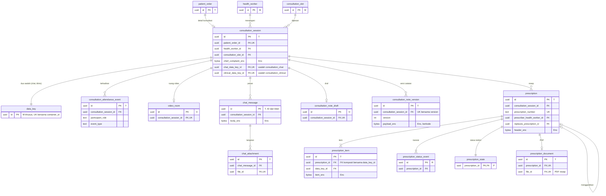

Wadah konsultasi dipecah dua `[KEPUTUSAN-68]`: `chat_message`, lampiran, dan keluhan awal memakai `chat_data_key_id`; draf dan versi catatan, resep, item resep, dan PDF resep memakai `clinical_data_key_id`. Kesesuaian DEK dengan sesinya ditegakkan FK komposit `(data_key_id, consultation_session_id)` → `data_key (id, container_id)`.

## 7. Klinik, lab, home visit, dan hasil lab (database A)

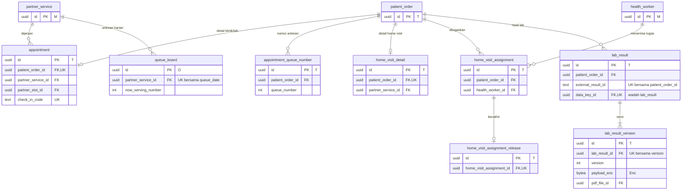

## 8. Pembayaran, jurnal, refund, klaim, dan kewajiban (database A)

```mermaid
erDiagram
  patient_order {
    uuid id PK "T"
  }
  order_price_lock {
    uuid id PK "T"
  }
  payment_attempt {
    uuid id PK "T, dibuat sebelum memanggil penyedia"
    uuid patient_order_id FK
    uuid order_price_lock_id FK, UK "FK komposit bersama patient_order_id"
    uuid idempotency_key UK
  }
  payment_attempt_gateway_ref {
    uuid id PK "T"
    uuid payment_attempt_id FK, UK
    text gateway_payment_ref UK
  }
  payment_attempt_status_event {
    uuid id PK "R"
    uuid payment_attempt_id FK
  }
  payment_attempt_state {
    uuid payment_attempt_id PK, FK "P"
  }
  payment_gateway_notification {
    uuid id PK "L"
    text gateway_event_id UK
  }
  payment_receipt {
    uuid id PK "T"
    uuid payment_attempt_id FK "banyak per percobaan"
    text gateway_transaction_ref UK "kunci idempotensi"
    uuid patient_order_id FK
    uuid payment_gateway_notification_id FK
    text outcome
  }
  payment_capture {
    uuid id PK "T"
    uuid patient_order_id FK, UK "RF-12 bila kedua"
    uuid payment_receipt_id FK, UK "FK komposit ke receipt"
    uuid payment_attempt_id FK
  }
  fund_split_instruction_line {
    uuid id PK "T"
    uuid order_price_lock_id FK
    uuid partner_bank_account_id FK
  }
  fund_split_report_line {
    uuid id PK "L"
    uuid payment_capture_id FK
  }
  journal_account {
    uuid id PK "M"
    text purpose_code
    uuid partner_id FK
  }
  journal_entry {
    uuid id PK "T"
    uuid reverses_journal_entry_id FK, UK
    bigint total_debit_idr "= total_credit_idr"
  }
  journal_line {
    uuid id PK "T"
    uuid journal_entry_id FK
    uuid journal_account_id FK
    text side
    timestamptz occurred_at "salinan entry, FK komposit"
  }
  refund {
    uuid id PK "T"
    uuid patient_order_id FK "UK kecuali rf_12, rf_13, rf_14"
    uuid payment_receipt_id FK, UK
    uuid claim_id FK, UK
    text refund_case
  }
  refund_status_event {
    uuid id PK "R"
    uuid refund_id FK
  }
  refund_state {
    uuid refund_id PK, FK "P"
  }
  refund_execution_attempt {
    uuid id PK "L"
    uuid refund_id FK
  }
  refund_cause_determination {
    uuid id PK "T"
    uuid refund_id FK, UK "RF-18"
  }
  claim {
    uuid id PK "T"
    uuid patient_order_id FK, UK
    bytea description_enc "Enc"
    uuid data_key_id FK, UK
  }
  claim_status_event {
    uuid id PK "R"
    uuid claim_id FK
  }
  claim_state {
    uuid claim_id PK, FK "P"
  }
  claim_evidence {
    uuid id PK "T"
    uuid claim_id FK
    uuid file_id FK, UK
  }
  claim_escalation {
    uuid id PK "T"
    uuid claim_id FK, UK
  }
  partner_obligation {
    uuid id PK "T"
    uuid refund_id FK
    uuid partner_id FK
    uuid journal_entry_id FK
  }
  partner_obligation_status_event {
    uuid id PK "R"
    uuid partner_obligation_id FK
  }
  partner_obligation_state {
    uuid partner_obligation_id PK, FK "P"
  }
  partner_fee_invoice {
    uuid id PK "T"
    uuid partner_id FK
    date period_month
  }
  reconciliation_run {
    uuid id PK "L"
  }
  reconciliation_item {
    uuid id PK "L"
    uuid reconciliation_run_id FK
  }
  reconciliation_item_resolution {
    uuid id PK "L"
    uuid reconciliation_item_id FK, UK
  }
  patient_order ||--o{ payment_attempt : "dicoba bayar"
  order_price_lock ||--o| payment_attempt : "harga percobaan"
  payment_attempt ||--|{ payment_attempt_status_event : "transisi"
  payment_attempt ||--|| payment_attempt_state : "status terkini"
  payment_attempt ||--o| payment_attempt_gateway_ref : "referensi penyedia"
  payment_attempt ||--o{ payment_receipt : "dana diterima"
  payment_attempt ||--o{ payment_capture : "percobaan yang tertangkap"
  payment_gateway_notification |o--o| payment_receipt : "sumber"
  patient_order ||--o| payment_capture : "dikonfirmasi"
  payment_receipt ||--o| payment_capture : "ditangkap"
  order_price_lock ||--|{ fund_split_instruction_line : "instruksi pembagian"
  payment_capture ||--o{ fund_split_report_line : "laporan pembagian"
  journal_entry ||--|{ journal_line : "debit dan kredit"
  journal_account ||--o{ journal_line : "dibukukan"
  journal_entry |o--o| journal_entry : "membalik"
  patient_order ||--o{ refund : "dikembalikan"
  payment_receipt ||--o| refund : "dana yang dikembalikan"
  refund ||--|{ refund_status_event : "transisi"
  refund ||--|| refund_state : "status terkini"
  refund ||--o{ refund_execution_attempt : "eksekusi"
  refund ||--o| refund_cause_determination : "penyebab RF-18"
  patient_order ||--o| claim : "klaim"
  claim ||--o| refund : "menghasilkan"
  claim ||--|{ claim_status_event : "transisi"
  claim ||--|| claim_state : "status terkini"
  claim ||--o{ claim_evidence : "bukti"
  claim ||--o| claim_escalation : "eskalasi"
  refund ||--o{ partner_obligation : "kewajiban rekanan"
  partner_obligation ||--|{ partner_obligation_status_event : "transisi"
  partner_obligation ||--|| partner_obligation_state : "status terkini"
  partner_obligation }o--|| journal_entry : "dicatat di"
  reconciliation_run ||--o{ reconciliation_item : "selisih"
  reconciliation_item ||--o| reconciliation_item_resolution : "tindak lanjut"
```

`journal_entry` juga punya FK opsional ke `patient_order`, `payment_capture`, `refund`, dan `partner_obligation`; `partner_fee_invoice` merujuk `partner` dan `partner_fee_rule`. Garis-garis itu tidak digambar supaya diagram terbaca.

Rantai FK komposit `payment_capture` → `payment_receipt` → `payment_attempt` → `order_price_lock` (setiap langkah menyertakan `patient_order_id` atau `payment_attempt_id`) menjamin semuanya milik pesanan yang sama (review DBA S04). Satu percobaan dapat menerima lebih dari satu penerimaan; penerimaan kedua dinilai `duplicate` (RF-12) (review DBA B06). Refund unik per pesanan kecuali RF-12, RF-13, dan RF-14 `[KEPUTUSAN-67]`.

## 9. Notifikasi, konten, tiket, hak subjek data, persetujuan, dan retensi (database A)

```mermaid
erDiagram
  account {
    uuid id PK "M"
  }
  patient {
    uuid id PK "M"
  }
  care_recipient {
    uuid id PK "M"
  }
  patient_order {
    uuid id PK "T"
  }
  partner {
    uuid id PK "M"
  }
  in_app_notification {
    uuid id PK "L"
    uuid recipient_account_id FK
    text template_code
  }
  in_app_notification_read {
    uuid id PK "L"
    uuid in_app_notification_id FK, UK
  }
  email_delivery {
    uuid id PK "L"
    uuid recipient_account_id FK
    uuid recipient_partner_id FK
  }
  cms_content {
    uuid id PK "M"
    text content_type
    text editorial_status
  }
  complaint_ticket {
    uuid id PK "T"
    text ticket_number UK
    uuid patient_id FK
    uuid patient_order_id FK
    uuid data_key_id FK, UK
  }
  complaint_ticket_status_event {
    uuid id PK "R"
    uuid complaint_ticket_id FK
  }
  complaint_ticket_state {
    uuid complaint_ticket_id PK, FK "P"
  }
  complaint_ticket_message {
    uuid id PK "T"
    uuid complaint_ticket_id FK
    bytea body_enc "Enc"
    boolean visible_to_partner
  }
  complaint_ticket_attachment {
    uuid id PK "T"
    uuid complaint_ticket_message_id FK
  }
  complaint_ticket_forward {
    uuid id PK "T"
    uuid complaint_ticket_id FK
    uuid partner_id FK
  }
  data_subject_request {
    uuid id PK "T"
    uuid patient_id FK
    uuid care_recipient_id FK
    text request_type
    timestamptz due_at
  }
  data_subject_request_status_event {
    uuid id PK "R"
    uuid data_subject_request_id FK
  }
  data_subject_request_state {
    uuid data_subject_request_id PK, FK "P"
  }
  data_subject_request_response {
    uuid id PK "T"
    uuid data_subject_request_id FK
  }
  data_export_package {
    uuid id PK "T"
    uuid data_subject_request_id FK
    uuid file_id FK
  }
  consent_text_version {
    uuid id PK "M"
    text consent_type
  }
  consent_item {
    uuid id PK "M"
    uuid consent_text_version_id FK
  }
  consent_record {
    uuid id PK "L"
    uuid patient_id FK
    uuid care_recipient_id FK
    uuid consent_item_id FK
    text action
  }
  retention_policy {
    uuid id PK "M"
  }
  retention_run {
    uuid id PK "L"
    uuid retention_policy_id FK
  }
  account ||--o{ in_app_notification : "menerima"
  in_app_notification ||--o| in_app_notification_read : "dibaca"
  account |o--o{ email_delivery : "dikirimi email"
  partner |o--o{ email_delivery : "kontak rekanan"
  patient ||--o{ complaint_ticket : "mengajukan"
  patient_order |o--o{ complaint_ticket : "terkait"
  complaint_ticket ||--|{ complaint_ticket_status_event : "transisi"
  complaint_ticket ||--|| complaint_ticket_state : "status terkini"
  complaint_ticket ||--|{ complaint_ticket_message : "pesan"
  complaint_ticket_message ||--o{ complaint_ticket_attachment : "lampiran"
  complaint_ticket ||--o{ complaint_ticket_forward : "diteruskan"
  partner ||--o{ complaint_ticket_forward : "melihat di portal"
  patient ||--o{ data_subject_request : "memohon"
  care_recipient ||--o{ data_subject_request : "subjek"
  data_subject_request ||--|{ data_subject_request_status_event : "transisi"
  data_subject_request ||--|| data_subject_request_state : "status terkini"
  data_subject_request ||--o{ data_subject_request_response : "tanggapan"
  data_subject_request ||--o{ data_export_package : "salinan data"
  consent_text_version ||--|{ consent_item : "butir"
  patient ||--o{ consent_record : "memberi atau menarik"
  care_recipient |o--o{ consent_record : "subjek pernyataan keluarga"
  consent_item ||--o{ consent_record : "atas butir"
  retention_policy ||--o{ retention_run : "dijalankan"
```

## 10. Integrasi dan operasional (database A)

```mermaid
erDiagram
  partner {
    uuid id PK "M"
  }
  integration_client {
    uuid id PK "M"
    uuid partner_id FK, UK
    text idp_client_id UK "client_id Keycloak realm integrasi"
    bytea webhook_signing_secret_enc "Enc"
  }
  partner_endpoint {
    uuid id PK "M"
    uuid partner_id FK
    text endpoint_kind
  }
  inbound_idempotency_key {
    uuid id PK "O"
    uuid integration_client_id FK "UK bersama idempotency_key"
  }
  integration_error_log {
    uuid id PK "L"
    uuid partner_id FK
    uuid patient_order_id FK
  }
  outbound_delivery_attempt {
    uuid id PK "L"
    uuid event_id "tanpa FK"
    uuid partner_id FK
  }
  partner_integration_health {
    uuid id PK "O"
    uuid partner_id FK, UK
  }
  integration_outbox {
    uuid id PK "O, hanya rujukan"
    uuid event_id UK
    uuid partner_id FK
    text entity_type
    uuid entity_id
    bytea payload_enc "Enc, opsional"
  }
  notification_outbox {
    uuid id PK "O"
    uuid recipient_account_id FK
    text channel
  }
  audit_outbox {
    uuid id PK "O, app INSERT saja"
  }
  job {
    uuid id PK "O"
    text job_type
    text dedupe_key UK
  }
  upload_slot {
    uuid id PK "O"
    text object_key UK
  }
  stored_file {
    uuid id PK "M"
    text bucket
    text object_key UK
  }
  data_key {
    uuid id PK "M khusus, UK bersama container_id"
    text container_type "UK bersama container_id"
    uuid container_id
    bytea wrapped_dek "dikosongkan saat crypto-shred, lalu terkunci"
    text kek_ref
  }
  kpi_snapshot {
    uuid id PK "L"
    text metric_code
  }
  patient_app_activity_month {
    uuid id PK "L"
    uuid patient_id FK
  }
  partner ||--o| integration_client : "klien integrasi"
  partner ||--o{ partner_endpoint : "endpoint"
  integration_client ||--o{ inbound_idempotency_key : "kunci idempotensi"
  partner |o--o{ integration_error_log : "galat"
  partner ||--o{ outbound_delivery_attempt : "pengiriman"
  partner ||--o| partner_integration_health : "kesehatan"
  partner ||--o{ integration_outbox : "pesan keluar"
```

`audit_outbox`, `notification_outbox`, `job`, `upload_slot`, `stored_file`, `data_key`, dan `kpi_snapshot` dirujuk dari banyak tabel di diagram lain (misalnya `data_key_id` dan `file_id`); garisnya tidak digambar ulang.

## 11. Database audit (database B; skema sama untuk audit Rumah Sehat dan audit RME)

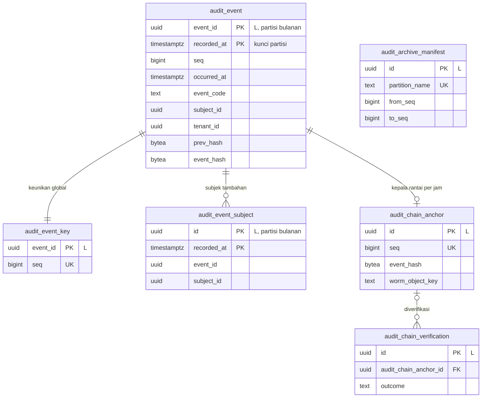

Relasi antar-tabel audit tidak memakai FK deklaratif (tabel terpartisi); konsistensi dijaga relay dalam satu transaksi (data dictionary B). `audit_event.prev_hash` merantai setiap event ke event dengan `seq` sebelumnya (ADR-009 butir 5). Di database audit RME, `audit_event` dan `audit_event_subject` diberi RLS per `tenant_id` untuk role `audit_tenant_reader` yang dipakai halaman log akses Admin Fasyankes (data dictionary §0.6 B, review DBA B03).

## 12. Database RME minimalis (database C)

Semua tabel tenant punya `fasyankes_id` dan RLS (ADR-012 butir 6). Kolom `fasyankes_id` tidak digambar di setiap entitas kecuali penghubung utama. Setiap garis antar-tabel tenant di bawah adalah FK komposit `(fasyankes_id, <induk>_id)` → `<induk> (fasyankes_id, id)`, termasuk ke `rme_data_key` (review DBA S01, `[KEPUTUSAN-68]`).

### 12.1 Fasyankes, pengguna, layanan, dan jadwal

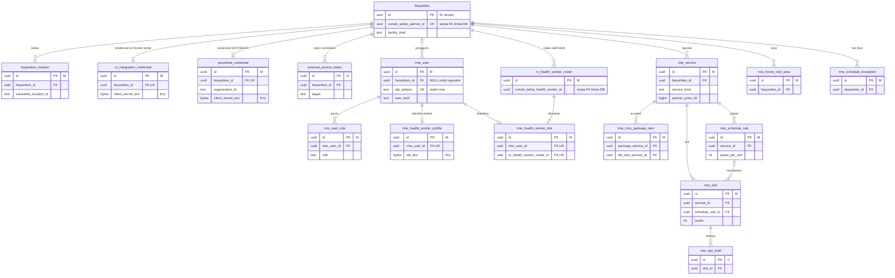

### 12.2 Pasien, kunjungan, rekam medis, hasil lab, dan SATUSEHAT

```mermaid
erDiagram
  fasyankes {
    uuid id PK "M, tenant"
  }
  rme_patient {
    uuid id PK "M"
    uuid fasyankes_id FK
    uuid rs_recipient_alias "UK bersama fasyankes_id"
    bytea nik_enc "Enc, kosong sampai L-05/L-08"
    text satusehat_patient_ihs
  }
  rme_visit {
    uuid id PK "T"
    uuid rme_patient_id FK
    uuid rumah_sehat_order_id UK "tanpa FK lintas DB"
    uuid service_id FK
    uuid location_id FK
    uuid data_key_id FK, UK "wadah rme_visit"
  }
  rme_visit_personal_snapshot {
    uuid id PK "M-snapshot, hanya privacy_worker U"
    uuid rme_visit_id FK, UK
  }
  rme_visit_status_event {
    uuid id PK "R"
    uuid rme_visit_id FK
  }
  rme_visit_state {
    uuid rme_visit_id PK, FK "P"
  }
  rme_queue_ticket {
    uuid id PK "T"
    uuid rme_visit_id FK, UK
    int queue_number
  }
  rme_queue_call_event {
    uuid id PK "T"
    uuid rme_queue_ticket_id FK
  }
  rme_home_visit_assignment {
    uuid id PK "T"
    uuid rme_visit_id FK
    uuid rs_health_worker_roster_id FK
  }
  rme_home_visit_assignment_result {
    uuid id PK "T"
    uuid rme_home_visit_assignment_id FK, UK
  }
  rme_medical_record_draft {
    uuid id PK "O"
    uuid rme_visit_id FK, UK
  }
  rme_medical_record_version {
    uuid id PK "T"
    uuid rme_visit_id FK "UK bersama version"
    int version
    uuid author_rme_user_id FK
    bytea payload_enc "Enc, berkode UP-27"
  }
  rme_lab_order_item {
    uuid id PK "T"
    uuid rme_visit_id FK
    uuid service_id FK
  }
  rme_lab_result {
    uuid id PK "T, dikirim sebagai external_result_id"
    uuid rme_visit_id FK
    uuid data_key_id FK "wadah kunjungan, FK komposit ke rme_visit"
  }
  rme_retention_policy {
    uuid id PK "M berlaku-mulai, global tanpa RLS"
    text data_category
    int retention_months "kosong sampai PT-24"
  }
  rme_retention_run {
    uuid id PK "L, RLS per fasyankes"
    uuid fasyankes_id FK
    uuid rme_retention_policy_id FK
  }
  rme_lab_result_version {
    uuid id PK "T"
    uuid rme_lab_result_id FK "UK bersama version"
    bytea payload_enc "Enc"
    uuid pdf_file_id FK
  }
  satusehat_submission {
    uuid id PK "L"
    uuid rme_medical_record_version_id FK, UK
    uuid rme_lab_result_version_id FK, UK
  }
  satusehat_submission_status_event {
    uuid id PK "R"
    uuid satusehat_submission_id FK
  }
  satusehat_submission_state {
    uuid satusehat_submission_id PK, FK "P"
    text status
  }
  satusehat_submission_attempt {
    uuid id PK "L"
    uuid satusehat_submission_id FK
  }
  satusehat_resource_ref {
    uuid id PK "L"
    uuid rme_visit_id FK
    text resource_type
    text satusehat_resource_id
  }
  terminology_code {
    uuid id PK "M, global tanpa RLS"
    text code_system
    text code
  }
  rme_record_export {
    uuid id PK "T"
    uuid fasyankes_id FK
    uuid file_id FK
  }
  rme_user {
    uuid id PK "M"
  }
  rs_health_worker_roster {
    uuid id PK "M"
  }
  fasyankes ||--o{ rme_patient : "pasien Rumah Sehat"
  rme_patient ||--o{ rme_visit : "berkunjung"
  rme_visit ||--o| rme_visit_personal_snapshot : "alamat home visit"
  rme_visit ||--|{ rme_visit_status_event : "transisi"
  rme_visit ||--|| rme_visit_state : "status terkini"
  rme_visit ||--o| rme_queue_ticket : "antrean"
  rme_queue_ticket ||--o{ rme_queue_call_event : "dipanggil"
  rme_visit ||--o{ rme_home_visit_assignment : "ditugaskan"
  rs_health_worker_roster ||--o{ rme_home_visit_assignment : "nakes"
  rme_home_visit_assignment ||--o| rme_home_visit_assignment_result : "jawaban Rumah Sehat"
  rme_visit ||--o| rme_medical_record_draft : "draf"
  rme_visit ||--o{ rme_medical_record_version : "rekam medis berversi"
  rme_user ||--o{ rme_medical_record_version : "menulis"
  rme_visit ||--o{ rme_lab_order_item : "permintaan lab"
  rme_visit ||--o{ rme_lab_result : "hasil lab"
  rme_lab_result ||--|{ rme_lab_result_version : "versi"
  rme_medical_record_version ||--o| satusehat_submission : "dikirim"
  rme_lab_result_version |o--o| satusehat_submission : "dikirim bila diwajibkan"
  satusehat_submission ||--|{ satusehat_submission_status_event : "transisi"
  satusehat_submission ||--|| satusehat_submission_state : "status terkini"
  satusehat_submission ||--o{ satusehat_submission_attempt : "percobaan"
  rme_visit ||--o{ satusehat_resource_ref : "ID resource SATUSEHAT"
  fasyankes ||--o{ rme_record_export : "ekspor"
  rme_retention_policy ||--o{ rme_retention_run : "dijalankan"
  fasyankes ||--o{ rme_retention_run : "laporan retensi"
```

Versi rekam medis, draf, dan hasil lab RME ber-FK komposit ke `rme_visit (fasyankes_id, id, data_key_id)` atau ke `rme_lab_result (id, data_key_id)`, sehingga DEK selalu milik kunjungan yang sama (review DBA S-N4). `rme_retention_policy` adalah acuan global; trigger DELETE Log RME dan `rme_data_key.retention_category` merujuk tabel ini (review DBA B10).

Tabel operasional RME (`rme_stored_file`, `rme_upload_slot`, `rme_data_key`, `rme_audit_outbox`, `rme_integration_outbox`, `rme_job`, `rme_inbound_event`) mengikuti pola diagram 10 dan tidak digambar ulang.

---

## 13. Ringkasan klasifikasi

Untuk review DBA dan threat model. Kolom: **Kelas** (§0.3 data dictionary), **PII** (memuat data pribadi), **Spesifik** (data pribadi spesifik AB-70 atau kolom Sensitif §3.1; `*` = bila penerima anak; `Keu` = keuangan pribadi bila dibuka per pasien), **Enc** (kolom dienkripsi aplikasi), **Anon** (punya kolom yang dianonimkan pekerja privasi). Tanda "—" berarti tidak. Tabel yang hanya memuat ID orang ditandai "ID" di kolom PII: tidak mengidentifikasi tanpa tabel master, tetapi termasuk dalam salinan data subjek.

### 13.1 Database aplikasi Rumah Sehat (138 tabel)

Perubahan putaran perbaikan 1: `product_order_item` dihapus (S04); `order_status_transition` (S05), `prescription_document` (B07), dan `payment_attempt_gateway_ref` (B07) ditambahkan.

| # | Tabel | Domain | Kelas | PII | Spesifik | Enc | Anon |
| --- | --- | --- | --- | --- | --- | --- | --- |
| 1 | account | Identitas | M | Ya | — | — | Ya |
| 2 | rs_admin_role | Identitas | M | ID | — | — | — |
| 3 | partner_admin_assignment | Identitas | M | ID | — | — | — |
| 4 | patient | Pasien | M | Ya | — | — | Ya |
| 5 | care_recipient | Pasien | M | Ya | Ya* | — | Ya |
| 6 | address | Pasien | M | Ya | — | — | Ya |
| 7 | identity_document | Pasien | M | Ya | Ya (NIK, foto) | Ya | Ya |
| 8 | identity_verification_request | Pasien | T | ID | — | — | — |
| 9 | identity_verification_request_status_event | Pasien | R | — | — | Ya (`note_enc`) | — |
| 10 | identity_verification_request_state | Pasien | P | — | — | — | — |
| 11 | account_owner_nik_registry | Pasien | M | Ya (blind index) | — | — | Ya |
| 12 | consent_text_version | Persetujuan | M | — | — | — | — |
| 13 | consent_item | Persetujuan | M | — | — | — | — |
| 14 | consent_record | Persetujuan | L | ID | — | — | — |
| 15 | health_worker | Nakes | M | Ya | — | — | Ya |
| 16 | health_worker_license | Nakes | M | Ya | — | — | Ya |
| 17 | health_worker_affiliation_confirmation | Nakes | M | Ya | — | — | Ya |
| 18 | health_worker_verification_decision | Nakes | T | ID | — | — | — |
| 19 | consultation_rate | Nakes | M | — | — | — | — |
| 20 | practice_schedule | Nakes | M | — | — | — | — |
| 21 | practice_schedule_exception | Nakes | M | — | — | — | — |
| 22 | consultation_slot | Nakes | M | — | — | — | — |
| 23 | partner | Rekanan | M | Ya (kontak) | — | — | Ya |
| 24 | partner_capability | Rekanan | M | — | — | — | — |
| 25 | partner_license_document | Rekanan | M | — | — | — | — |
| 26 | partner_bank_account | Rekanan | M | Ya | — | Ya | Ya |
| 27 | partner_bank_account_decision | Rekanan | T | — | — | — | — |
| 28 | document_requirement | Rekanan | M | — | — | — | — |
| 29 | markup_rule | Pengaturan | M | — | — | — | — |
| 30 | partner_fee_rule | Pengaturan | M | — | — | — | — |
| 31 | business_parameter | Pengaturan | M | — | — | — | — |
| 32 | payment_method_fee | Pengaturan | M | — | — | — | — |
| 33 | workday_calendar | Pengaturan | M | — | — | — | — |
| 34 | retention_policy | Pengaturan | M | — | — | — | — |
| 35 | reason_code | Pengaturan | M | — | — | — | — |
| 36 | partner_service | Katalog | M | — | — | — | — |
| 37 | mcu_package_item | Katalog | M | — | — | — | — |
| 38 | home_visit_area | Katalog | M | — | — | — | — |
| 39 | partner_slot | Katalog | M | — | — | — | — |
| 40 | product | Katalog | M | — | — | — | — |
| 41 | product_image | Katalog | M | — | — | — | — |
| 42 | product_stock | Katalog | M | — | — | — | — |
| 43 | patient_order | Pesanan | T | ID | Keu | — | — |
| 44 | order_status_event | Pesanan | R | — | — | Ya (`note_enc`) | — |
| 45 | order_state | Pesanan | P | — | — | — | — |
| 46 | order_personal_snapshot | Pesanan | M-snapshot | Ya | Ya* | — | Ya |
| 47 | partner_recipient_alias | Pesanan | M | Ya (pseudonim) | — | — | — |
| 48 | order_price_lock | Pesanan | T | — | Keu | — | — |
| 49 | order_price_lock_line | Pesanan | T | — | Keu | — | — |
| 50 | order_parameter_snapshot | Pesanan | T | — | — | — | — |
| 51 | inventory_hold | Pesanan | O | — | — | — | — |
| 52 | order_partner_acknowledgement | Pesanan | T | — | — | — | — |
| 53 | order_follow_up_flag | Pesanan | L | — | — | — | — |
| 54 | order_follow_up_resolution | Pesanan | L | — | — | — | — |
| 55 | order_status_transition | Pesanan | M (acuan, aplikasi S saja) | — | — | — | — |
| 56 | consultation_session | Konsultasi | T | ID | Ya (keluhan awal) | Ya | — |
| 57 | consultation_attendance_event | Konsultasi | T | ID | — | — | — |
| 58 | video_room | Konsultasi | O | — | — | — | — |
| 59 | chat_message | Konsultasi | T | ID | Ya | Ya | — |
| 60 | chat_attachment | Konsultasi | T | — | Ya (berkas) | — | — |
| 61 | consultation_note_draft | Konsultasi | O | — | Ya | Ya | — |
| 62 | consultation_note_version | Konsultasi | T | — | Ya | Ya | — |
| 63 | prescription | Konsultasi | T | Ya (terenkripsi) | Ya | Ya | — |
| 64 | prescription_item | Konsultasi | T | — | Ya | Ya | — |
| 65 | prescription_status_event | Konsultasi | R | — | — | Ya (`note_enc`) | — |
| 66 | prescription_state | Konsultasi | P | — | — | — | — |
| 67 | prescription_document | Konsultasi | T | Ya (berkas) | Ya (berkas) | — | — |
| 68 | appointment | Klinik/lab | T | — | — | — | — |
| 69 | appointment_queue_number | Klinik/lab | T | — | — | — | — |
| 70 | queue_board | Klinik/lab | O | — | — | — | — |
| 71 | home_visit_detail | Home visit | T | — | — | — | — |
| 72 | home_visit_assignment | Home visit | T | ID | — | — | — |
| 73 | home_visit_assignment_release | Home visit | T | — | — | — | — |
| 74 | lab_result | Hasil lab | T | — | — | — | — |
| 75 | lab_result_version | Hasil lab | T | — | Ya | Ya | — |
| 76 | product_order_detail | Produk | T | — | — | — | — |
| 77 | shipment | Produk | T | — | — | — | — |
| 78 | shipment_tracking_event | Produk | L | Ya (terenkripsi) | — | Ya (`description_enc`) | — |
| 79 | payment_attempt | Pembayaran | T | — | Keu | — | — |
| 80 | payment_attempt_gateway_ref | Pembayaran | T | — | — | — | — |
| 81 | payment_attempt_status_event | Pembayaran | R | — | — | — | — |
| 82 | payment_attempt_state | Pembayaran | P | — | — | — | — |
| 83 | payment_gateway_notification | Pembayaran | L | — | Keu | — | — |
| 84 | payment_receipt | Pembayaran | T | — | Keu | — | — |
| 85 | payment_capture | Pembayaran | T | — | Keu | — | — |
| 86 | fund_split_instruction_line | Pembayaran | T | — | Keu | — | — |
| 87 | fund_split_report_line | Pembayaran | L | — | Keu | — | — |
| 88 | journal_account | Jurnal | M | — | — | — | — |
| 89 | journal_entry | Jurnal | T | — | Keu | — | — |
| 90 | journal_line | Jurnal | T | — | Keu | — | — |
| 91 | refund | Refund | T | — | Keu | — | — |
| 92 | refund_status_event | Refund | R | — | — | Ya (`note_enc`) | — |
| 93 | refund_state | Refund | P | — | — | — | — |
| 94 | refund_execution_attempt | Refund | L | — | — | — | — |
| 95 | refund_cause_determination | Refund | T | — | — | — | — |
| 96 | claim | Klaim | T | Ya (terenkripsi) | Ya | Ya | — |
| 97 | claim_status_event | Klaim | R | — | — | Ya (`note_enc`) | — |
| 98 | claim_state | Klaim | P | — | — | — | — |
| 99 | claim_evidence | Klaim | T | — | Ya (foto bukti) | — | — |
| 100 | claim_escalation | Klaim | T | — | — | — | — |
| 101 | partner_obligation | Kewajiban | T | — | — | — | — |
| 102 | partner_obligation_status_event | Kewajiban | R | — | — | Ya (`note_enc`) | — |
| 103 | partner_obligation_state | Kewajiban | P | — | — | — | — |
| 104 | partner_fee_invoice | Kewajiban | T | — | — | — | — |
| 105 | reconciliation_run | Rekonsiliasi | L | — | — | — | — |
| 106 | reconciliation_item | Rekonsiliasi | L | — | — | — | — |
| 107 | reconciliation_item_resolution | Rekonsiliasi | L | — | — | — | — |
| 108 | in_app_notification | Notifikasi | L | ID | — | — | — |
| 109 | in_app_notification_read | Notifikasi | L | — | — | — | — |
| 110 | email_delivery | Notifikasi | L | ID | — | — | — |
| 111 | cms_content | Konten | M | — | — | — | — |
| 112 | complaint_ticket | Tiket | T | ID | — | — | — |
| 113 | complaint_ticket_status_event | Tiket | R | — | — | Ya (`note_enc`) | — |
| 114 | complaint_ticket_state | Tiket | P | — | — | — | — |
| 115 | complaint_ticket_message | Tiket | T | Ya (terenkripsi) | Mungkin (teks pasien) | Ya | — |
| 116 | complaint_ticket_attachment | Tiket | T | Ya (berkas) | — | — | — |
| 117 | complaint_ticket_forward | Tiket | T | — | — | — | — |
| 118 | data_subject_request | Hak subjek | T | Ya (terenkripsi) | — | Ya | — |
| 119 | data_subject_request_status_event | Hak subjek | R | — | — | Ya (`note_enc`) | — |
| 120 | data_subject_request_state | Hak subjek | P | — | — | — | — |
| 121 | data_subject_request_response | Hak subjek | T | Ya (terenkripsi) | — | Ya | — |
| 122 | data_export_package | Hak subjek | T | Ya (berkas) | Ya (berkas) | — | — |
| 123 | retention_run | Retensi | L | — | — | — | — |
| 124 | integration_client | Integrasi | M | — | — | Ya (rahasia) | — |
| 125 | partner_endpoint | Integrasi | M | — | — | — | — |
| 126 | inbound_idempotency_key | Integrasi | O | — | — | — | — |
| 127 | integration_error_log | Integrasi | L | — | — | — | — |
| 128 | outbound_delivery_attempt | Integrasi | L | — | — | — | — |
| 129 | partner_integration_health | Integrasi | O | — | — | — | — |
| 130 | audit_outbox | Platform | O | Ya (IP, ID) | — | — | — |
| 131 | integration_outbox | Platform | O | ID (rujukan entitas); isi beku hanya terenkripsi | Mungkin (hanya di `payload_enc`) | Ya (`payload_enc`, opsional) | — |
| 132 | notification_outbox | Platform | O | Ya (email tujuan) | — | — | — |
| 133 | job | Platform | O | — | — | — | — |
| 134 | upload_slot | Platform | O | — | — | — | — |
| 135 | stored_file | Platform | M | Mengikuti perujuk | Mengikuti perujuk | — | — |
| 136 | data_key | Platform | M khusus | — | — | Rahasia (DEK terbungkus) | — |
| 137 | kpi_snapshot | Analitik | L | — | — | — | — |
| 138 | patient_app_activity_month | Analitik | L | ID | — | — | — |

Kolom `note_enc` (wadah induk atau `status_note`) ada di semua tabel riwayat status; baris di atas menandainya hanya untuk entitas yang alasannya lazim berupa teks bebas.

### 13.2 Database audit (6 tabel, skema sama di audit Rumah Sehat dan audit RME)

| # | Tabel | Kelas | PII | Spesifik | Enc | Catatan |
| --- | --- | --- | --- | --- | --- | --- |
| 1 | audit_event | L (partisi bulanan) | Ya (aktor, subjek, IP, user agent, before/after termasking) | — (isi klinis dilarang, §7.3) | — | Retensi `[TIDAK DIKETAHUI]` (PT-24) |
| 2 | audit_event_key | L | — | — | — | |
| 3 | audit_event_subject | L (partisi bulanan) | ID | — | — | |
| 4 | audit_chain_anchor | L | — | — | — | |
| 5 | audit_chain_verification | L | — | — | — | |
| 6 | audit_archive_manifest | L | — | — | — | |

### 13.3 Database aplikasi RME minimalis (47 tabel)

Perubahan putaran perbaikan 1: `rme_lab_result` ditambahkan (B08). Putaran perbaikan 2: `rme_retention_policy` dan `rme_retention_run` ditambahkan (B10). Semua relasi antar-tabel tenant memakai FK komposit `(fasyankes_id, …)` (S01).

| # | Tabel | Kelas | RLS | PII | Spesifik | Enc | Anon |
| --- | --- | --- | --- | --- | --- | --- | --- |
| 1 | fasyankes | M | Ya | — | — | — | — |
| 2 | fasyankes_location | M | Ya | — | — | — | — |
| 3 | rs_integration_credential | M | Ya | — | — | Ya (rahasia) | — |
| 4 | satusehat_credential | M | Ya | — | — | Ya (rahasia) | — |
| 5 | external_access_token | O | Ya | — | — | Ya (rahasia) | — |
| 6 | rme_user | M | Ya (kebijakan pemetaan `rme_auth`) | Ya | — | — | Ya |
| 7 | rme_user_role | M | Ya | ID | — | — | — |
| 8 | rme_health_worker_profile | M | Ya | Ya | Ya (NIK) | Ya | Ya |
| 9 | rs_health_worker_roster | M | Ya | Ya | — | — | Ya |
| 10 | rme_health_worker_link | M | Ya | ID | — | — | — |
| 11 | rme_service | M | Ya | — | — | — | — |
| 12 | rme_mcu_package_item | M | Ya | — | — | — | — |
| 13 | rme_home_visit_area | M | Ya | — | — | — | — |
| 14 | rme_schedule_rule | M | Ya | — | — | — | — |
| 15 | rme_schedule_exception | M | Ya | — | — | — | — |
| 16 | rme_slot | M | Ya | — | — | — | — |
| 17 | rme_slot_hold | O | Ya | — | — | — | — |
| 18 | rme_patient | M | Ya | Ya | Ya* ; NIK bila diaktifkan | Ya (NIK) | Ya |
| 19 | rme_visit | T | Ya | ID | Ya (fakta kunjungan kesehatan) | — | — |
| 20 | rme_visit_personal_snapshot | M-snapshot | Ya | Ya | — | — | Ya |
| 21 | rme_visit_status_event | R | Ya | — | — | — | — |
| 22 | rme_visit_state | P | Ya | — | — | — | — |
| 23 | rme_queue_ticket | T | Ya | — | — | — | — |
| 24 | rme_queue_call_event | T | Ya | — | — | — | — |
| 25 | rme_home_visit_assignment | T | Ya | ID | — | — | — |
| 26 | rme_home_visit_assignment_result | T | Ya | — | — | — | — |
| 27 | rme_medical_record_draft | O | Ya | — | Ya | Ya | — |
| 28 | rme_medical_record_version | T | Ya | — | Ya | Ya | — |
| 29 | rme_lab_order_item | T | Ya | — | Ya (jenis pemeriksaan) | — | — |
| 30 | rme_lab_result | T | Ya | — | — | — | — |
| 31 | rme_lab_result_version | T | Ya | — | Ya | Ya | — |
| 32 | satusehat_submission | L | Ya | — | — | — | — |
| 33 | satusehat_submission_status_event | R | Ya | — | — | Ya (`note_enc`) | — |
| 34 | satusehat_submission_state | P | Ya | — | — | — | — |
| 35 | satusehat_submission_attempt | L | Ya | — | — | — | — |
| 36 | satusehat_resource_ref | L | Ya | ID (ID resource di SATUSEHAT) | — | — | — |
| 37 | terminology_code | M | Tidak (acuan global) | — | — | — | — |
| 38 | rme_record_export | T | Ya | — | Ya (berkas) | — | — |
| 39 | rme_stored_file | M | Ya | Mengikuti perujuk | Mengikuti perujuk | — | — |
| 40 | rme_upload_slot | O | Ya | — | — | — | — |
| 41 | rme_data_key | M khusus | Ya | — | — | Rahasia (DEK terbungkus) | — |
| 42 | rme_audit_outbox | O | Tidak (app INSERT saja) | Ya (IP, ID) | — | — | — |
| 43 | rme_integration_outbox | O | Ya | ID (rujukan entitas); isi beku hanya terenkripsi | Mungkin (hanya di `payload_enc`) | Ya (`payload_enc`, opsional) | — |
| 44 | rme_job | O | Ya | — | — | — | — |
| 45 | rme_inbound_event | O | Ya | — | — | — | — |
| 46 | rme_retention_policy | M (berlaku-mulai) | Tidak (acuan global) | — | — | — | — |
| 47 | rme_retention_run | L | Ya | — | — | — | — |

Catatan untuk threat model:
- `rme_lab_order_item` dan `rme_visit` tidak dienkripsi, tetapi jenis pemeriksaan dan fakta kunjungan adalah data kesehatan; perlindungannya lewat RLS, otorisasi, dan audit E-05. Hal yang sama berlaku untuk jenis pesanan dan profesi tenaga kesehatan di database Rumah Sehat (temuan F-09).
- Outbox integrasi (Rumah Sehat dan RME) hanya menyimpan rujukan entitas; nilai hasil lab dan data penerima disusun serta didekripsi saat pengiriman. Isi yang harus dibekukan disimpan terenkripsi (review DBA B04).
