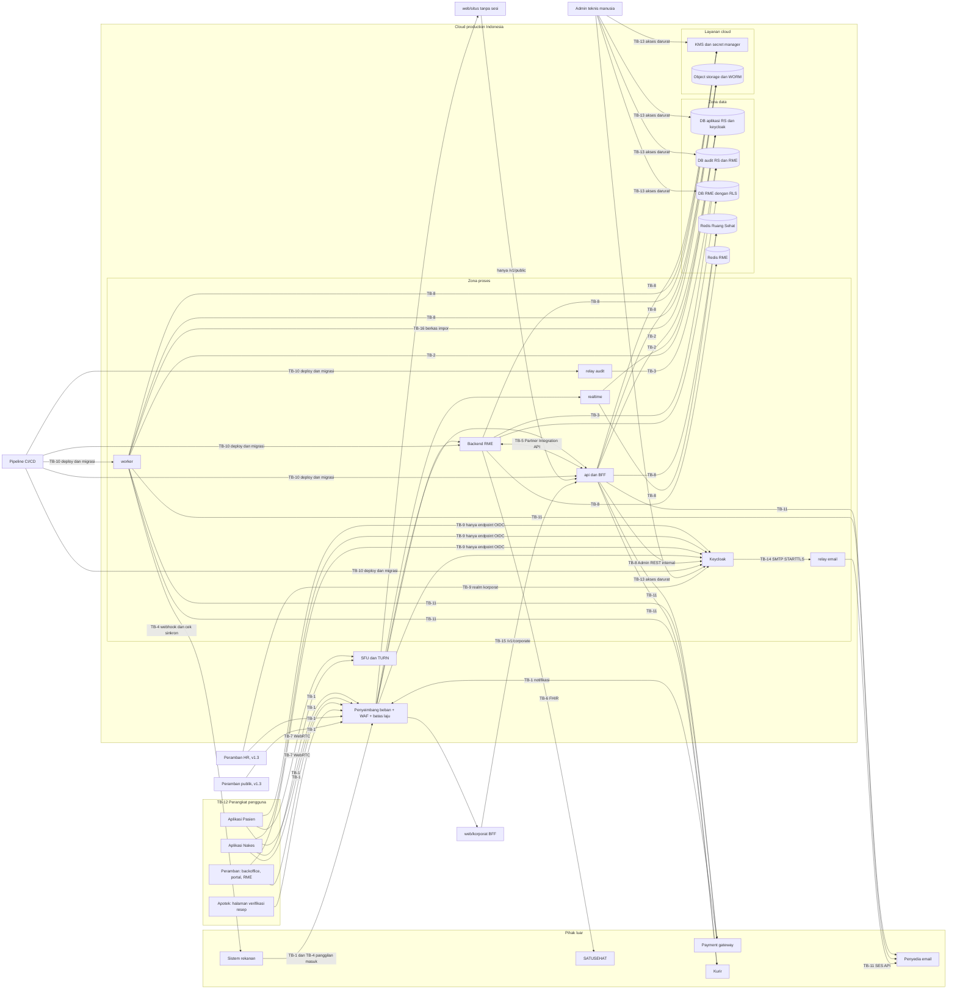

# Threat Model: Ruang Sehat

Tanggal: 2026-11-19
Versi: 1.3 (2026-11-19, review keamanan CR-021: situs publik, member area korporat, data peserta, invoice B2B; berlaku bila CR-021 disetujui). Sebelumnya 1.2 (2026-11-19, review keamanan F1-T02: jalur email Keycloak ADR-026 Diusulkan; menunggu gate berikutnya). Sebelumnya 1.1 (2026-11-18, tindak lanjut Checkpoint 2: MFA wajib pasien, pemulihan faktor, layar sesi aktif, UP-73 opsi B, UP-76; menunggu gate berikutnya). Sebelumnya 1.0, LULUS dan disetujui di gate Tahap 4, 2026-11-18 `[USER] T4-G5` (sebelumnya 0.2 (cek ulang setelah perbaikan desain M-01–M-09; draf untuk gate Tahap 4))
Penyusun: Claude (subagent `security-architect`)
Tingkat ketelitian: **T1 Kritis** (keamanan, autentikasi/otorisasi, data pribadi spesifik, uang, audit trail; `aturan-kerja.md` §1)
Dasar: PRD v1.1 `[DOK: 03-prd.md]` (termasuk CR-008 US-309 AC6–AC8 dan CR-009 NFR-SEC-10), arsitektur v0.1 `[DOK: 04-arsitektur.md]`, ADR-001–ADR-021 `[DOK: adr/]`, data dictionary v0.1 `[DOK: 04-data-dictionary.md]`, risk register v0.1 `[DOK: 04-risk-register.md]`, backlog `[DOK: backlog.md]`, catatan Tahap 4 `[DOK: 04-catatan-arsitektur.md]` (T4-Q1, T4-Q2, T4-Q4, T4-Q5, T4-Q6). Dasar tambahan v1.1: jawaban Checkpoint 2 `[DOK: checkpoint-2.md]` (C2-Q9, C2-Q10, C2-Q11, C2-B4, C2-B7, C2-B14), ADR-011 revisi Checkpoint 2, PRD v1.2, checklist ASVS v1.1 `[DOK: 05-asvs-checklist.md]`, risk register v1.3 (tabel "Catatan status ancaman threat model"), KEPUTUSAN-198–205 `[DOK: decision-log.md]`, review keamanan `[DOK: review/checkpoint-2-security.md]`. Dasar tambahan v1.2: `docs/spike/F1-T02-email-keycloak.md`, ADR-026 (Diusulkan), KEPUTUSAN-226–232 `[DOK: decision-log.md]`, review keamanan `[DOK: review/F1-T02-security.md]`. Dasar tambahan v1.3: `docs/cr/CR-021-analisis.md` v0.1 dan v0.2, ADR-027–ADR-029 (Diusulkan), KEPUTUSAN-250–269 `[DOK: decision-log.md]`, `docs/review/CR-021-security.md` (putaran 1 dan 2), `[SRC-405]`–`[SRC-409]`

Dokumen ini tidak mengubah arsitektur. Mitigasi yang belum ada di desain ditulis sebagai usulan (§6) untuk diterapkan pelaksana Tahap 4.

**Perubahan v0.2.** Status sembilan ancaman Tinggi (APP-02, APP-05, API-06, API-13, KC-06, RD-02, OS-03, KMS-01, CI-01) dinilai ulang terhadap perbaikan desain. Status ancaman Sedang yang mitigasinya ikut diterapkan (KC-04, KC-05, RD-01, WEB-08, INT-09, CI-05, AUD-01) ikut diperbarui. Tiga ancaman baru dari halaman verifikasi resep publik ditambahkan (§4.17). Rujukan ADR-012 digeser satu nomor karena butir 3 baru (endpoint publik) disisipkan.

**Perubahan v1.1 (Checkpoint 2).** Status ancaman dan mitigasi diperbarui sesuai tabel perubahan status di risk register v1.3 `[DOK: 04-risk-register.md]`:
- APP-04: risiko sisa "pasien tanpa MFA" tertutup karena MFA wajib untuk pasien `[USER] C2-Q9`.
- API-10/M-12: diterapkan lewat UP-73 opsi B `[USER] C2-B4`.
- KC-02/H-05: diperluas ke pasien.
- H-01 dan H-04: sebagian diterapkan.
- WEB-07/M-16: diterapkan `[USER] C2-B7`.
- Masukan DPIA di §7 disesuaikan.

Dua ancaman baru dari rancangan baru ditambahkan: KC-10 untuk jalur pemulihan MFA pasien lewat Layanan Pelanggan, dan KC-11 untuk layar sesi aktif US-110. Penguatan H-16 juga ditambahkan. Revisi ini **tidak** mencakup pembaruan topologi VPS setelah Tahap 5 (usulan U-09 di `docs/05-asvs-checklist.md`), sehingga istilah komponen Tahap 4 (KMS, secret manager, Redis) dipertahankan. Padanan Tahap 5-nya adalah OpenBao dan Valkey (ADR-024, ADR-025). Riwayat lengkap di §9.

**Perubahan v1.2 (F1-T02).** Komponen baru relay email Keycloak (ADR-026, berstatus Diusulkan) dinilai di §4.18 (EML-01–EML-09), dengan boundary baru TB-14 dan AS-10 yang diperluas. Ancaman berlaku bila ADR-026 diterima. Bila user memilih opsi lain, EML-01, EML-03, EML-05, dan EML-07 dinilai ulang. EML-02, EML-04, EML-06, EML-08, dan EML-09 berlaku untuk opsi mana pun. Tidak ada ancaman Tinggi baru. Status tetap LULUS.

**Perubahan v1.3 (CR-021).** Komponen baru `web/situs`, `web/korporat`, realm `korporat`, tenant perusahaan, impor berkas peserta, dan invoice B2B dinilai di §4.19–§4.22 (SIT, KOR, IMP, B2B). Ancaman berlaku bila CR-021 dan ADR-027–ADR-029 disetujui. Ancaman lama tidak berubah status. TB-15 dan TB-16 baru; AS-19–AS-21 baru; AK-08 baru; M-40–M-56 dan H-18 baru.

---

## 0. Metode dan konvensi

### 0.1 Label sumber

| Penanda | Arti |
| --- | --- |
| `ADR-xxx butir n` | Butir keputusan di ADR. Berfungsi sebagai label `[DOK: adr/ADR-xxx-....md]` |
| `US-`, `AB-`, `KU-`, `NFR-`, `PB-`, `E-`, `RF-`, `BR-`, `L-`, `PT-` | Butir PRD v1.1 (BR juga BRD). Berfungsi sebagai label `[DOK: 03-prd.md]`. Baris yang diubah di v1.1 merujuk PRD v1.2 |
| `A1.1`, `C1.4`, `§0.6`, `F-xx` | Bagian dan temuan data dictionary. Berfungsi sebagai label `[DOK: 04-data-dictionary.md]` |
| `arsitektur §n` | Bagian `docs/04-arsitektur.md`, label `[DOK: 04-arsitektur.md]` |
| `RT-xx` | Risiko di `docs/04-risk-register.md`, label `[DOK: 04-risk-register.md]` |
| `DoD`, `CR-xxx` | Definition of Done dan change request di `docs/backlog.md`, label `[DOK: backlog.md]` |
| `[USER] T4-Qx` | Jawaban user di Tahap 4 (`docs/04-catatan-arsitektur.md`) |
| `[USER] C2-Qx`, `[USER] C2-Bn` | Jawaban user di Checkpoint 2 (`docs/checkpoint-2.md` bagian "Jawaban user"); `C2-Bn` adalah butir n yang didelegasikan user ke usulan penyusun |
| `[SRC-xx]` | Fakta eksternal terverifikasi di `docs/sources.md`. SRC-78–SRC-83 berasal dari dokumen ini dan sudah tercatat |
| `[KEPUTUSAN-70]` | Keputusan metode dokumen ini (§0.2–§0.4) |
| `[TIDAK DIKETAHUI]` | Belum ada informasi |
| `M-xx`, `H-xx` | Usulan mitigasi penyusun di §6. Usulan **bukan keputusan**; menjadi keputusan setelah diterapkan ke ADR atau backlog oleh pelaksana tahap |

### 0.2 Metode

- Ancaman dikelompokkan dengan STRIDE: Spoofing, Tampering, Repudiation, Information Disclosure, Denial of Service, Elevation of Privilege. OWASP menyatakan STRIDE "groups threats into one of six general prompts", dan menganjurkan "Apply the six threat categories above to components, data flows, and trust boundaries" `[SRC-78]`.
- Analisis dilakukan per komponen yang diminta (§4.1–§4.17) dan dipetakan ke trust boundary (§3). Tiga boundary tambahan dokumen ini (TB-11–TB-13) kini juga tercantum di arsitektur §7 `[KEPUTUSAN-70]`.
- Aktor ancaman di §2 mengikuti daftar dari orkestrator, ditambah AK-07 (orang dalam teknis atau pipeline) yang dipisah dari admin aplikasi karena jalurnya berbeda `[KEPUTUSAN-70]`.

### 0.3 Skala dan tingkat

Kemungkinan (K) dan dampak (D) dinilai kualitatif **T**inggi/**S**edang/**R**endah oleh penyusun, mengikuti skala risk register `[KEPUTUSAN-02]`. Kemungkinan dinilai untuk desain **tanpa** mitigasi khusus ancaman itu (risiko bawaan), sehingga tingkat menunjukkan prioritas, bukan risiko sisa. Tingkat diturunkan dari matriks berikut `[KEPUTUSAN-70]`:

| Dampak \ Kemungkinan | Rendah | Sedang | Tinggi |
| --- | --- | --- | --- |
| **Tinggi** | Sedang | **Tinggi** | **Tinggi** |
| **Sedang** | Rendah | Sedang | **Tinggi** |
| **Rendah** | Rendah | Rendah | Sedang |

Dampak Tinggi dipakai untuk: kebocoran data pribadi spesifik (AB-70) banyak orang atau satu orang dengan akibat berat, kehilangan uang, hilangnya integritas audit trail, pengambilalihan akun berhak luas, atau gangguan layanan inti (NFR-AVL-01).

### 0.4 Status mitigasi dan kriteria kelulusan

| Status | Arti |
| --- | --- |
| **Tercermin** | Mitigasi utama sudah tertulis di arsitektur, ADR, NFR, AC story, atau backlog yang dirujuk |
| **Sebagian** | Sebagian mitigasi tertulis, tetapi bagian yang menangani inti ancaman belum ada |
| **Belum** | Tidak ada mitigasi tertulis |

**LULUS** bila setiap ancaman Tinggi berstatus Tercermin. Ancaman Tinggi berstatus Sebagian atau Belum adalah celah yang membuat status **TIDAK LULUS** `[KEPUTUSAN-70]`, sesuai checklist Tahap 4 `[DOK: .claude/skills/runbook/references/tahap-04-arsitektur.md]`.

Risiko sisa yang sudah dijelaskan ke user dan dipilih user secara tercatat (jawaban wawancara atau CR) dihitung Tercermin, dengan keterangan "risiko sisa diterima user" dan rujukan jawabannya. Keputusan itu milik user, bukan penyusun (`aturan-kerja.md` §2 butir 4) `[KEPUTUSAN-70]`.

---

## 1. Aset

Klasifikasi mengikuti legenda sensitivitas data dictionary §0.5 (`PII`, `Spesifik`, `Spesifik*`, `Keu`, `Enc`, `Rahasia`). Properti: K = kerahasiaan, I = integritas, A = ketersediaan.

| ID | Aset | Lokasi utama | Klasifikasi | Properti | Sumber |
| --- | --- | --- | --- | --- | --- |
| AS-01 | Data kesehatan Ruang Sehat: keluhan awal, isi chat dan lampiran, catatan konsultasi, resep, hasil lab | `consultation_session.chief_complaint_enc`, `chat_message`, `chat_attachment`, `consultation_note_version`, `prescription*`, `lab_result_version`; bucket `clinical` | Spesifik, Enc | K, I | A9, A10, §0.7; AB-70; PRD §3.1 |
| AS-02 | Rekam medis dan hasil lab RME minimalis | `rme_medical_record_*`, `rme_lab_result_version`; bucket RME `clinical` | Spesifik, Enc | K, I | C4; PRD §3.1 |
| AS-03 | Identitas resmi: NIK lengkap, foto KTP/KK; NIK tenaga kesehatan fasyankes | `identity_document.nik_enc`, bucket `identity_document`, `rme_health_worker_profile.nik_enc`; blind index `nik_bidx` | Spesifik, Enc; blind index PII | K | A2.4, C1.8; ADR-013 butir 4 |
| AS-04 | Data anak dan data pribadi umum: nama, tanggal lahir, kontak, alamat, koordinat, alamat IP, ID pengguna IdP | `care_recipient`, `patient`, `address`, `order_personal_snapshot`, `account`, `audit_event.source_ip`, database `keycloak` | PII; Spesifik* bila anak | K | A1, A2, A8.4; §0.5, §0.10 |
| AS-05 | Metadata yang dapat mengungkap kondisi kesehatan: jenis pesanan, profesi dan identitas tenaga kesehatan per sesi, nama layanan di harga terkunci | `patient_order.order_kind`, `health_worker.profession`, `consultation_session.health_worker_id`, `order_price_lock_line.description` | Tidak dienkripsi tingkat aplikasi | K | ADR-013 konsekuensi; F-09 |
| AS-06 | Uang dan catatan keuangan: harga terkunci, percobaan dan penerimaan pembayaran, jurnal, refund, kewajiban rekanan | A8.6–A8.8, A12, A13, A14 | Keu bila per pasien | I, K | ADR-015 |
| AS-07 | Instruksi pembagian dana dan rekening penerima rekanan | `fund_split_instruction_line`, `partner_bank_account.account_number_enc` | Keu; Enc (rekening) | I | A5.4, A12.7; AB-21 |
| AS-08 | Pengaturan yang memengaruhi uang dan aturan: markup, biaya rekanan, tarif metode bayar, parameter bisnis, tarif konsultasi | A6, A4.5 | — | I | E-14; §0.8 |
| AS-09 | Foto bukti klaim, teks tiket keluhan, rincian permintaan hak subjek data, salinan data pribadi | A14.9, A16, A17; bucket `claim_evidence`, `export` | Spesifik, Enc | K | §0.7 |
| AS-10 | Kredensial dan sesi pengguna: hash password, faktor TOTP dan kode pemulihan (sejak v1.1 juga milik pasien), sesi IdP, token di perangkat, data sesi BFF, tautan konfirmasi reset MFA pasien, token aksi Keycloak di badan email (verifikasi email, atur ulang password, undangan aktivasi) (v1.2) | Database `keycloak`, penyimpanan aman perangkat, Redis, memori relay email selama satu request, kotak surat penerima | Rahasia | K, I | §0.10; ADR-011 butir 5, 7 |
| AS-11 | Material kunci: KEK di KMS, DEK terbungkus, DEK di memori proses, kunci blind index NIK dan kode verifikasi resep | KMS, `data_key`, `rme_data_key`, secret manager | Rahasia | K, A | ADR-013 butir 3–4, 8; A19.7; A9.8 |
| AS-12 | Rahasia integrasi: rahasia klien realm `integrasi`, rahasia HMAC webhook, kredensial RME ke Ruang Sehat, kredensial API payment gateway, video, dan email, kredensial SATUSEHAT per fasyankes beserta token aksesnya, kredensial role database, kredensial Admin REST API Keycloak | Keycloak, `integration_client`, `rs_integration_credential`, `satusehat_credential`, `external_access_token`, secret manager | Rahasia, Enc | K | A18.1, C1.3–C1.5; ADR-013 butir 3, 8; ADR-020 butir 1 |
| AS-13 | Audit trail: outbox, event, subjek, kunci event, kepala rantai, arsip WORM | `audit_outbox`, `rme_audit_outbox`, B1–B6, object storage WORM | PII (ID, IP) | I, A sebagai bukti, K | ADR-005, ADR-009; §B |
| AS-14 | Security log dan application log | Layanan log di Indonesia | PII (IP, ID akun) | I, K | ADR-010 |
| AS-15 | Bukti status layanan: riwayat status, kehadiran sesi, penerimaan pesanan oleh rekanan | `*_status_event`, `consultation_attendance_event`, `order_partner_acknowledgement` | — | I | ADR-008; A8.10, A9.2 |
| AS-16 | Ketersediaan layanan inti (login, pemesanan, pembayaran, konsultasi, portal) dan RME | Semua proses | — | A | NFR-AVL-01, NFR-AVL-02 |
| AS-17 | Konfigurasi dan artefak: konfigurasi realm, konfigurasi server media, infrastruktur sebagai kode, image kontainer, biner aplikasi mobile dan kunci penandatangannya, dependensi | Repositori, pipeline, registri | — | I | ADR-011 konsekuensi; ADR-016 butir 4; ADR-019 butir 2; ADR-021 butir 4 |
| AS-18 | Keaslian resep digital dan halaman verifikasinya | PDF resep, `prescription.verification_code_*`, halaman verifikasi publik | Enc (kode); data resep Spesifik | I, K | US-309 AC6–AC8; A9.8; ADR-012 butir 3 |
| AS-19 | Data peserta korporat dan turunannya: nama, kontak, tanggal lahir, NIK opsional, status undangan dan kehadiran, persetujuan berbagi, ringkasan hasil (v1.3) | `corporate_participant`, `participant_import_row`, `corporate_invitation*`, `corporate_attendance_record`, `corporate_share_consent_record`, `corporate_result_summary`; berkas impor mentah | PII; NIK dan ringkasan Spesifik, Enc | K, I | CR-021 §5; ADR-028 butir 2–4 |
| AS-20 | Data dan dokumen perusahaan klien serta keanggotaan HR (v1.3) | `corporate_client`, `corporate_client_document`, `corporate_member`; bucket dokumen | Badan usaha; dokumen dapat memuat PII pengurus | K, I | CR-021 §5; US-1901–US-1904 |
| AS-21 | Konten dan gambar situs publik, integritas dan keaslian (v1.3) | `cms_content` kanal situs; endpoint `/v1/public/content/*` | — | I, A | ADR-027 butir 5; US-1801, US-1802 |

AS-06 diperluas (v1.3): invoice B2B, harga terkunci korporat, penerimaan transfer manual, jurnal korporat (ADR-029). AS-10 diperluas (v1.3): sesi BFF `web/korporat`, faktor TOTP HR, token undangan peserta (hash).

---

## 2. Aktor ancaman

| ID | Aktor | Kemampuan awal yang diasumsikan | Motif yang dinilai |
| --- | --- | --- | --- |
| AK-01 | Pasien jahat | Akun pasien sah; dapat memodifikasi aplikasi dan memanggil API langsung | Membuka data orang lain, layanan tanpa bayar, refund atau klaim curang, resep palsu |
| AK-02 | Tenaga kesehatan jahat atau akun tenaga kesehatan yang dikompromikan | Akun nakes aktif dengan sesi dan kunjungan yang ditugaskan | Ekstraksi data pasien, penyalahgunaan status kehadiran |
| AK-03 | Admin internal jahat | Salah satu dari tujuh sub-peran admin Ruang Sehat (PRD §1.2), atau Operator RME | Melihat isi klinis atau foto KTP, mengalihkan dana, menyalahgunakan refund, menaikkan hak |
| AK-04 | Rekanan jahat atau sistem rekanan terkompromi | Kredensial klien integrasi, akun admin portal, atau akun pengguna RME fasyankes | Data rekanan lain, status atau hasil palsu, beban berlebih |
| AK-05 | Penyerang internet | Tanpa akun; dapat melakukan credential stuffing, phishing, bot, dan pemindaian | Pengambilalihan akun, pencurian data, gangguan layanan, pemalsuan resep |
| AK-06 | Penyedia pihak ketiga terkompromi | Kendali atas payment gateway, email, kurir, penyedia video, penyedia cloud, pustaka/SDK, atau endpoint yang menyamar sebagai SATUSEHAT | Membaca atau memalsukan data yang melintas, mengirim data ke luar Indonesia |
| AK-07 | Orang dalam teknis atau identitas pipeline terkompromi | Akses konsol cloud, database, KMS, secret manager, atau pipeline CI/CD | Membaca data terenkripsi, mengubah transaksi atau audit, mendeploy kode jahat |
| AK-08 | HR perusahaan jahat atau akun HR terkompromi (v1.3) | Akun realm `korporat` aktif dengan keanggotaan di satu perusahaan; dapat memanggil API korporat langsung dan mengunggah berkas | Membaca hasil atau ringkasan karyawan tanpa persetujuan, data perusahaan lain, menyalahgunakan undangan, injeksi lewat berkas |

---

## 3. Trust boundary

### 3.1 Diagram

### 3.2 Daftar boundary

TB-1 sampai TB-13 tercantum di arsitektur §7.

| TB | Batas | Yang melintas | Kontrol utama di desain | Ancaman terkait |
| --- | --- | --- | --- | --- |
| TB-1 | Internet ke penyeimbang beban | Permintaan aplikasi mobile, web lewat BFF, panggilan masuk rekanan, notifikasi payment gateway, halaman verifikasi resep publik, tautan konfirmasi reset MFA pasien (v1.1) | TLS, WAF, batas laju (ADR-019 butir 3); token per kanal (ADR-011, ADR-014); verifikasi notifikasi (NFR-INT-04); endpoint publik terbatas (ADR-012 butir 3) | APP-03, API-01–API-15, WEB-01–WEB-11, INT-01–INT-05, PG-01–PG-03, PG-08, RX-01–RX-03, KC-10 |
| TB-2 | Proses aplikasi ke database aplikasi | Query dan transaksi | Role per kelas tabel dan trigger penolak (ADR-008, §0.6); TLS (ADR-013 butir 1) | DB-01–DB-06, AUD-01 |
| TB-3 | Relay audit ke database audit | Event audit | Deployment relay terpisah dengan kredensial audit saja (ADR-009 butir 3); `audit_writer` hanya INSERT, hash berantai, jangkar WORM (ADR-009 butir 4–5) | AUD-01–AUD-06 |
| TB-4 | Ruang Sehat ke dan dari sistem rekanan | Webhook keluar, cek ketersediaan sinkron, pesan masuk | OAuth2 client credentials, HMAC dengan stempel waktu, idempotensi, validasi skema, pencegahan SSRF (ADR-014) | INT-01–INT-10 |
| TB-5 | RME minimalis ke Ruang Sehat | Sama dengan TB-4 | Kontrak yang sama, satu klien per fasyankes (ADR-006 butir 2, ADR-014 butir 3) | INT-01–INT-05, RME-01–RME-05 |
| TB-6 | RME minimalis ke SATUSEHAT | Resource FHIR, NIK pasien dan praktisi | OAuth2 client credentials per fasyankes, TLS, antrean (ADR-020) | SS-01–SS-05 |
| TB-7 | Aplikasi ke server media video | Media WebRTC, token bergabung | Token per peserta per sesi, SFU/TURN di Indonesia, tanpa rekaman (ADR-016 butir 4) | VID-01–VID-05 |
| TB-8 | Proses aplikasi ke KMS, secret manager, object storage, Redis, Admin REST API Keycloak | Kunci, rahasia, berkas, cache dan sesi, operasi admin IdP (termasuk daftar dan pengakhiran sesi US-110, v1.1) | KMS dan secret manager (ADR-013, ADR-021 butir 3); URL bertanda tangan (ADR-018); Redis terpisah per sistem dengan autentikasi (ADR-007 butir 6); Admin REST hanya internal, klien per realm (ADR-011 butir 2) | OS-01–OS-06, KMS-01–KMS-05, RD-01–RD-02, KC-04–KC-05, KC-11 |
| TB-9 | Browser sistem dan aplikasi ke Keycloak | Kredensial, OTP, kode otorisasi, token | PKCE lewat browser sistem, BFF, MFA di semua realm pengguna (v1.1), deteksi brute force, hanya endpoint OIDC yang publik (ADR-011 butir 2, 4–7) | APP-01, APP-04, APP-06, KC-01–KC-03, KC-06–KC-07, KC-10 |
| TB-10 | Pipeline CI/CD ke lingkungan cloud | Image, migrasi skema, konfigurasi | Identitas pipeline berhak minimum, branch terlindung, kredensial migrasi hanya di langkah migrasi (ADR-021 butir 4); infrastruktur sebagai kode (ADR-019 butir 2) | CI-01–CI-05, KMS-05 |
| TB-11 | Backend ke penyedia pihak ketiga (API payment gateway, email, kurir, API server media) | Data pembayaran minimal, alamat email, alamat kirim, pembuatan ruang video, pesan MIME email Keycloak lewat relay (v1.2) | Adaptor dan minimisasi (ADR-013 butir 7, ADR-015 butir 2, ADR-016 butir 4–5) | PG-04–PG-07, VID-04, EXT-01–EXT-03, EML-02, EML-04, EML-06, EML-08 |
| TB-12 | Perangkat pengguna (penyimpanan aplikasi mobile dan peramban) | Token, antrean pesan offline, berkas yang diunduh | Token di penyimpanan aman platform (ADR-011 butir 7); isi klinis tidak persisten, kunci aplikasi nakes, kendali SDK (ADR-021 butir 1–2); cookie `HttpOnly` untuk web | APP-01, APP-02, APP-05, OS-01 |
| TB-13 | Akses administratif manusia ke infrastruktur production | Konsol cloud, superuser database, KMS, secret manager, admin Keycloak | MFA, tanpa hak tetap untuk manusia, akses darurat dengan persetujuan orang kedua, log audit cloud ke security log (ADR-021 butir 3, ADR-010 butir 5) | KMS-01, AUD-01, KC-06, DB-05 |
| TB-14 | Keycloak (dan Alertmanager) ke relay email, di jaringan Docker khusus per host (v1.2; relay per host app-1, app-2, ops, stg-app, KEPUTUSAN-232) | Pesan MIME berisi token aksi, alamat penerima, peringatan operasional | STARTTLS wajib dengan CA internal dan verifikasi hostname, `debug` dilarang (ADR-026 butir 6); jaringan khusus per host tanpa jalur antar-host, satu penerima, daftar izin `From`, batas ukuran dan laju, tanpa log isi (ADR-026 butir 1, 4) | EML-01, EML-03, EML-05, EML-07 |
| TB-15 | Domain pemberi kerja (HR, tenant perusahaan) ke data kesehatan peserta, batas logis di backend (v1.3) | Rekap kehadiran, status undangan, ringkasan berpersetujuan | `CorporateScope` dari sesi, 404, fungsi akses sensitif yang memeriksa persetujuan saat baca dan menulis E-05, tanpa jalur hasil lengkap (ADR-028 butir 1–3) | KOR-07, KOR-09, KOR-10, KOR-13 |
| TB-16 | Berkas CSV/XLSX tak tepercaya dari HR ke pengurai di backend (v1.3) | Isi berkas, baris pratinjau | Validasi isi, batas PB-23, berkas terenkripsi ditolak, pembatasan sumber daya, pratinjau terenkripsi berumur (ADR-028 butir 6) | IMP-01–IMP-04 |

TB-1 diperluas (v1.3): situs publik, member area korporat, endpoint konten dan gambar publik. TB-9 diperluas (v1.3): realm `korporat`.

Catatan lintas sistem: Ruang Sehat dan RME memakai instans Redis terpisah (ADR-007 butir 6, ADR-006 butir 4). Keycloak tetap dipakai bersama dengan realm, admin realm, dan klien Admin REST API terpisah per realm (ADR-011 butir 2, 11).

---

## 4. Ancaman STRIDE per komponen

Kolom: **K** kemungkinan, **D** dampak (T/S/R, §0.3). **Aktor** merujuk §2. Kolom "Tercermin di" menyebut tempat mitigasi tertulis; usulan untuk yang belum tertulis ada di §6.

### 4.1 Aplikasi pasien dan aplikasi tenaga kesehatan (TB-1, TB-7, TB-9, TB-12)

| ID | STRIDE | Aktor | Ancaman | K | D | Tingkat | Mitigasi dalam desain | Tercermin di | Status |
| --- | --- | --- | --- | --- | --- | --- | --- | --- | --- |
| APP-01 | S | AK-05, AK-02 | Token akses atau penyegar dicuri dari perangkat (malware, perangkat di-root, perangkat hilang), lalu dipakai masuk sebagai pasien atau tenaga kesehatan | S | T | **Tinggi** | Token di penyimpanan aman platform; token akses 5 menit; batas sesi nakes 7/30 hari; keluar mencabut sesi di Keycloak dan Redis; penonaktifan menolak akses walaupun token belum kedaluwarsa. Sejak v1.1: pemilik dapat melihat dan mengakhiri sesi perangkat yang hilang dari layar "Perangkat dan sesi aktif" (Fase 2) | ADR-011 butir 7–8, 12; KU-10; US-103 AC5; US-110 `[USER] C2-Q10` | Tercermin; penguatan H-01 (sebagian diterapkan) |
| APP-02 | I, S | AK-05 (pencuri perangkat), AK-02 | Perangkat tenaga kesehatan hilang atau dicuri saat sesi aplikasi masih aktif (batas tidak aktif 7 hari), sehingga riwayat chat, keluhan awal, nama pasien, serta alamat dan nomor HP home visit dapat dibuka; isi klinis yang tersimpan di perangkat atau cadangannya ikut terbaca | S | T | **Tinggi** | Isi klinis tidak disimpan persisten (kecuali berkas yang sengaja diunduh pasien dan kode appointment); antrean pesan offline terenkripsi dengan kunci penyimpanan aman platform; data dikecualikan dari cadangan dan layar disembunyikan di latar belakang; kunci aplikasi nakes setelah 15 menit tidak aktif; prosedur perangkat hilang dengan pencabutan semua sesi | ADR-021 butir 1; NFR-SEC-10; CR-009 `[USER] T4-Q6`; ADR-011 butir 8 | Tercermin. Risiko sisa: jendela 15 menit (user memilih 15, bukan 5 menit) dan kekuatan PIN perangkat |
| APP-03 | T, E | AK-01 | Aplikasi dimodifikasi atau API dipanggil langsung untuk mengubah harga, nominal, waktu bergabung, status, atau memanggil endpoint peran lain | T | T | **Tinggi** | Harga dihitung dan dikunci di server; waktu dari jam server; kebijakan per endpoint dengan default deny; realm pasien dan nakes terpisah; transisi status divalidasi terhadap tabel transisi | ADR-015 butir 1, 3; ADR-016 butir 3; ADR-017 butir 5; ADR-012 butir 1; ADR-011 butir 3, 8; ADR-008 aturan status 2 | Tercermin |
| APP-04 | S | AK-05 | Pengambilalihan akun pasien lewat credential stuffing atau phishing. Sejak v1.1 pasien wajib MFA, sehingga penyerang juga harus memperoleh kode TOTP atau kode pemulihan | S | T | **Tinggi** | MFA TOTP wajib di realm `pasien` dengan alur yang mewajibkan OTP, pendaftaran TOTP saat login pertama, dan 12 kode pemulihan sekali pakai; atur ulang password tidak melewati MFA; deteksi brute force 5 gagal/15 menit, berlaku juga untuk OTP dan kode pemulihan `[SRC-273]`; Argon2 dan kebijakan password ASVS L2; WAF dan batas laju; login di browser sistem; pesan seragam login gagal; autentikasi ulang untuk aksi berisiko | ADR-011 butir 3–5, 7, 9 (revisi Checkpoint 2); NFR-SEC-02, NFR-SEC-03; US-101 AC5; US-103 AC1, AC1b, AC2–AC3, AC4e `[USER] C2-Q9`; ADR-019 butir 3 | Tercermin. Risiko sisa "pasien tanpa MFA" **tertutup** (v1.1). Risiko sisa baru: (1) phishing seketika atas password dan kode TOTP, karena TOTP bukan faktor perangkat keras tahan phishing, yang baru diwajibkan 6.3.3 di L3 `[SRC-276]` (ADR-011 konsekuensi); (2) rekayasa sosial jalur pemulihan Layanan Pelanggan (KC-10, RT-36). Penguatan H-04 (sebagian diterapkan) |
| APP-05 | I | AK-06 | Pustaka atau SDK pihak ketiga di aplikasi (analitik, crash, plugin transitif) mengirim data pribadi atau kesehatan ke luar Indonesia `[USER] T4-Q1` | S | T | **Tinggi** | Larangan SDK yang mengirim data ke luar Indonesia; inventaris dependensi per rilis; review perilaku jaringan setiap dependensi baru; daftar izin host tujuan; uji lalu lintas jaringan build rilis sebagai syarat rilis dan butir DoD | ADR-021 butir 2; ADR-010 butir 4; DoD; NFR-PRIV-02; arsitektur §10 | Tercermin. Metode uji ditetapkan Tahap 5 |
| APP-06 | S | AK-05 (aplikasi jahat di perangkat) | Pembajakan redirect URI OIDC untuk mencuri authorization code | R | T | Sedang | Authorization Code dengan PKCE lewat browser sistem; RFC 8252 mewajibkan PKCE untuk klien native publik `[SRC-77]`; Keycloak menyediakan `pkce-enforcer` S256 `[SRC-71]` | ADR-011 butir 7 | Tercermin |
| APP-07 | R | AK-01, AK-02 | Pasien atau tenaga kesehatan menyangkal telah bergabung, membatalkan, atau menandai status | S | S | Sedang | Waktu bergabung dicatat server; riwayat status INSERT-only dengan aktor; event E-09 | ADR-016 butir 3; ADR-008; A9.2; PRD §7.1 | Tercermin |

### 4.2 Backend `api`, `realtime`, `worker` (TB-1, TB-2, TB-8)

| ID | STRIDE | Aktor | Ancaman | K | D | Tingkat | Mitigasi dalam desain | Tercermin di | Status |
| --- | --- | --- | --- | --- | --- | --- | --- | --- | --- |
| API-01 | E, I | AK-01 | IDOR: mengganti ID pesanan, sesi, hasil lab, penerima layanan, atau berkas untuk membuka data pasien lain | T | T | **Tinggi** | Pemeriksaan relasi kepemilikan per objek di satu modul otorisasi, default deny, 404 untuk objek terlarang, percobaan ke data sensitif dicatat; otorisasi tidak bergantung pada kerahasiaan UUID. Sejalan dengan OWASP: "implement access control checks for each object" dan "even with complex identifiers, access control checks are essential" `[SRC-80]`. Setiap endpoint baru wajib punya kebijakan dan test penolakan | ADR-012 butir 1–2, 4, alternatif ditolak, konsekuensi; KU-03; US-305 AC5; US-902 AC2 | Tercermin |
| API-02 | E | AK-02 | Tenaga kesehatan membuka sesi atau kunjungan yang tidak ditugaskan kepadanya, atau nomor HP pasien home visit di luar hari kunjungan | S | T | **Tinggi** | Relasi penugasan dengan batas waktu; akses riwayat chat setelah sesi dicatat E-05 | ADR-012 butir 1; ADR-016 butir 2; US-503 AC1; US-311 AC4 | Tercermin |
| API-03 | I | AK-02 | Tenaga kesehatan yang sah mengekstrak data pasiennya sendiri secara massal | S | T | **Tinggi** | Cakupan terbatas pada sesi yang ditanganinya; setiap akses detail dicatat E-05 sebelum data dikirim | ADR-012 butir 1–2; ADR-009 butir 2 | Tercermin; penguatan H-02 |
| API-04 | I | AK-07, AK-05 | Data pribadi, token, atau isi klinis bocor lewat application log, pesan galat, atau stack trace | S | T | **Tinggi** | Log terstruktur hanya ID; daftar tolak redaksi (password, token, header `Authorization`, cookie, NIK, rekening, body permintaan, nilai sesi, parameter tanda tangan URL) dengan test otomatis; galat Problem Details berkode. Sejalan dengan daftar "Data to exclude" OWASP `[SRC-83]` | ADR-010 tabel, butir 1, 5; NFR-OBS-03; ADR-014 butir 1 | Tercermin (H-10 diterapkan) |
| API-05 | I | AK-06 (penyedia email), orang lain yang membaca kotak email pasien | Notifikasi email atau pengingat menyebut profesi (misalnya psikolog), nama tenaga kesehatan, atau nama layanan yang mengungkap kondisi kesehatan (F-09). AB-73 hanya melarang diagnosis, nama obat, nilai hasil lab, dan isi chat | S | S | Sedang | Templat tanpa data kesehatan rinci; penyedia email di Indonesia | AB-73; ADR-016 butir 5; ADR-013 butir 7 | **Belum** (M-10) |
| API-06 | S, E | AK-02 (akun dinonaktifkan atau SIP berakhir), AK-01 (akun pasien dinonaktifkan), AK-05 (token dicuri) | Koneksi WebSocket yang sudah terbuka tetap menerima pesan chat, status, dan notifikasi setelah akun dinonaktifkan, peran diubah, sesi dicabut, atau token kedaluwarsa (KU-10) | S | T | **Tinggi** | Saat koneksi dibuka: token, status akun, dan daftar pencabutan diperiksa; setiap langganan kanal diotorisasi modul ADR-012; koneksi diputus saat token kedaluwarsa dan seketika saat sinyal penonaktifan atau pencabutan; cadangan `LISTEN/NOTIFY` dan pemeriksaan ulang status dari database setiap 60 detik karena Redis Pub/Sub at-most-once `[SRC-74]`; test otomatis KU-10 | ADR-016 butir 1; ADR-011 butir 8 | Tercermin. Risiko sisa: jendela paling lama 60 detik bila sinyal hilang |
| API-07 | D | AK-01, AK-05 | Bot membanjiri endpoint mahal (pencarian, cek ketersediaan sinkron, pembuatan pembayaran), atau akun pasien menahan banyak slot selama PB-07 tanpa membayar | S | S | Sedang | WAF dan batas laju; batas laju API di Redis dengan cadangan di penyeimbang beban; layanan terjadwal hanya untuk identitas yang disetujui; panggilan sinkron 5 detik tanpa coba ulang. Belum ada batas pesanan "Menunggu pembayaran" per akun | ADR-019 butir 3; ADR-007 butir 6; AB-01; ADR-014 butir 5 | **Sebagian** (M-11) |
| API-08 | T, I | AK-01, AK-04, AK-05 | Injeksi (SQL, perintah), mass assignment, atau deserialisasi tidak aman di API | S | T | **Tinggi** | Target ASVS 5.0.0 Level 2 untuk semua komponen dengan checklist Tahap 5 dan verifikasi Tahap 10; validasi masukan; pesan rekanan divalidasi skema | NFR-SEC-01; ADR-011 butir 1; KU-01; ADR-014 butir 4 | Tercermin; penguatan H-03 |
| API-09 | R | AK-02, AK-03 | Admin, tenaga kesehatan, atau proses otomatis menyangkal aksi (verifikasi, keputusan klaim, perubahan markup, resep) | S | T | **Tinggi** | Event E-01–E-17 dengan aktor, peran, IP, perangkat, korelasi, before/after; outbox atomik; aksi pengguna dibatalkan bila event gagal dicatat | ADR-009 butir 1–2, 7; PRD §7.1–§7.2; US-1501 AC1, AC3 | Tercermin |
| API-10 | I | AK-05 | Enumerasi akun pasien lewat pendaftaran, login, atau atur ulang password, yang mengungkap bahwa seseorang memakai layanan kesehatan | T | R | Sedang | Sejak v1.1 (UP-73 opsi B): pendaftaran dengan email terdaftar menampilkan layar yang sama dengan pendaftaran berhasil, dan petunjuknya dikirim ke email itu, dengan waktu respons ditahan 900 ms; satu pesan seragam untuk semua kegagalan login (password salah, akun tidak ada, terkunci, nonaktif) di semua realm; atur ulang password dan kirim ulang verifikasi memakai respons sama; halaman pendaftaran Keycloak OFF; batas laju diam per alamat; pengajuan NIK pemilik akun yang sudah dipakai ditolak dengan pesan umum dan batas berlapis | ADR-011 butir 4 (revisi Checkpoint 2); US-101 AC2b, AC3; US-103 AC2, AC4, AC4c; US-105 AC4e; US-106 AC4; KU-10 `[USER] C2-B4`; KEPUTUSAN-192, KEPUTUSAN-201 | Tercermin (M-12 diterapkan, v1.1). Risiko sisa: selisih waktu respons pendaftaran (6.3.8 berlevel L3 `[SRC-265]`), diukur di F1-T50 |
| API-11 | S | AK-01 | Pasien mendaftarkan identitas dengan NIK dan foto KTP/KK orang lain | S | S | Sedang | Verifikasi manual Verifikator; NIK pemilik akun unik lintas akun; KK harus memuat pemilik akun sebagai orang tua/wali; sejak v1.1 Verifikator tidak dapat memutuskan pengajuan akunnya sendiri | US-201 AC1–AC8; UP-40; A2.8 | Tercermin |
| API-12 | T | AK-01 | Klaim refund palsu (foto bukti diedit, laporan "tidak datang" palsu) | S | S | Sedang | Keputusan manual dengan bukti; satu klaim per pesanan; status nakes setelah laporan pasien ditolak dan keputusan memakai bukti kedua pihak | US-807 AC1–AC5; KEPUTUSAN-50; PRD §3.6 | Tercermin |
| API-13 | T, S | AK-01, AK-05 | Pasien atau pihak lain memalsukan PDF resep (mengubah obat atau jumlah, atau membuat resep tiruan) untuk menebus obat di apotek mana pun | S | T | **Tinggi** | Hanya dokter yang menerbitkan; resep bernomor unik dan tidak dapat diubah; PDF memuat kode verifikasi acak, QR ke halaman verifikasi di domain resmi, dan alamat halaman sebagai teks; halaman menampilkan status, tanggal, dokter dan SIP, klinik, daftar obat, dan nama pasien disamarkan untuk dicocokkan apotek; batas laju; setiap verifikasi dicatat E-05; tanda tangan elektronik setelah L-05 | US-309 AC1, AC3, AC6–AC8; CR-008 `[USER] T4-Q5`; ADR-012 butir 3; A9.8 | Tercermin. Ancaman turunan halaman verifikasi dinilai di §4.17 (RX-01–RX-03) |
| API-14 | I | AK-01 | Pemilik akun membuka data klinis anggota keluarga dewasa, atau meminta salinan data atas namanya, tanpa sepengetahuan yang bersangkutan | S | S | Sedang | Keputusan produk AB-71 dengan pencatatan E-05; kebolehannya ditanyakan ke legal (L-05, L-08); autentikasi ulang untuk permintaan hak subjek data | AB-71; US-1602 AC1, AC3; ADR-011 butir 9 | Tercermin (risiko sisa menunggu L-05, L-08) |
| API-15 | I | AK-05 (pengambil alih akun pasien) | Salinan data pribadi lengkap, termasuk isi klinis, diminta dan diunduh oleh pengambil alih akun | S | T | **Tinggi** | Autentikasi ulang dengan password sebelum mengajukan dan mengunduh; URL baru berumur pendek untuk setiap unduhan; unduhan dicatat E-12. Sejak v1.1 pengambilalihan akun pasien juga memerlukan faktor kedua (APP-04) | ADR-011 butir 5, 9; US-1602 AC1; US-1604 AC2; ADR-018 butir 3 | Tercermin; penguatan H-04 |

### 4.3 Keycloak (TB-9, TB-8)

| ID | STRIDE | Aktor | Ancaman | K | D | Tingkat | Mitigasi dalam desain | Tercermin di | Status |
| --- | --- | --- | --- | --- | --- | --- | --- | --- | --- |
| KC-01 | S | AK-05 | Pengambilalihan akun tenaga kesehatan, admin, atau pengguna RME (phishing kredensial dan TOTP secara langsung, credential stuffing) | S | T | **Tinggi** | MFA TOTP wajib di realm `nakes`, `admin`, `rme` (sejak v1.1 juga `pasien`, lihat APP-04) dengan alur yang mewajibkan OTP; atur ulang password tidak melewati MFA; deteksi brute force; login di browser sistem; penonaktifan seketika; event login ke audit dan security log | ADR-011 butir 4–5, 7–8, 10; NFR-SEC-02; KEPUTUSAN-25; KEPUTUSAN-199 | Tercermin; penguatan H-04 |
| KC-02 | S | AK-05 | Rekayasa sosial ke admin untuk mereset MFA atau password ("ponsel hilang"), lalu penyerang mendaftarkan TOTP sendiri | S | T | **Tinggi** | Reset MFA hanya oleh admin berwenang setelah verifikasi identitas, dicatat E-04; prosedur tertulis sebelum go-live; autentikasi ulang untuk reset MFA; reset MFA mengakhiri semua sesi. Sejak v1.1 untuk pasien: jalur mandiri dengan kode pemulihan lebih dulu; jalur Layanan Pelanggan hanya berlaku setelah konfirmasi lewat tautan sekali pakai ke email akun ditambah password, sehingga admin saja tidak cukup untuk mengambil alih; admin tidak melihat atau menetapkan kredensial (sejalan dengan 6.4.6 `[SRC-276]`). Ancaman khusus jalur pasien dinilai di KC-10 | ADR-011 butir 5, 9, konsekuensi; KEPUTUSAN-198 butir 4; KEPUTUSAN-204; US-103 AC8; US-207 AC5 `[USER] C2-Q9` | Tercermin; penguatan H-05 (sebagian diterapkan) |
| KC-03 | S, E | AK-01, AK-04 | Token realm atau klien lain diterima: token pasien di endpoint nakes atau admin, token realm `rme` di backend Ruang Sehat atau sebaliknya, token klien integrasi di API aplikasi, sesi portal di API backoffice | S | T | **Tinggi** | Validasi tanda tangan, audience, dan masa berlaku; hanya algoritma dalam daftar izin, kunci harus milik issuer realm yang diharapkan, token ditolak bila audience tidak ada atau bukan untuk API itu `[SRC-79]`; test negatif per kombinasi realm dan klien; backend Ruang Sehat menolak token realm `rme` dan sebaliknya; namespace dan audience sesi backoffice dan portal terpisah | ADR-011 butir 8, 11; ADR-006 butir 5; RT-17 | Tercermin (H-06 diterapkan) |
| KC-04 | E | AK-02, AK-03 | Penonaktifan atau perubahan peran tidak berlaku seketika karena cache status di Redis basi, atau langkah penonaktifan di Keycloak gagal | R | T | Sedang | Status di database sebagai sumber kebenaran; langkah Redis atau Keycloak yang gagal dicoba ulang lewat job dan memicu peringatan; entri cache ber-TTL pendek; aksi berisiko membaca status langsung dari database | ADR-011 butir 8; ADR-007 butir 6 | Tercermin (M-13 diterapkan) |
| KC-05 | E | AK-07, penyerang yang menguasai proses backend | Klien Admin REST API yang dipakai backend berhak lintas realm atau lebih dari yang dibutuhkan, sehingga kebocoran kredensialnya membuka pembuatan akun admin | R | T | Sedang | Klien Admin REST API terpisah per realm dengan peran admin minimum; backend Ruang Sehat tidak punya hak di realm `rme` dan sebaliknya; Admin REST API hanya dari jaringan internal; rahasia di secret manager | ADR-011 butir 2; ADR-013 butir 8 | Tercermin |
| KC-06 | E, I | AK-05 | Konsol admin, realm master, atau Admin REST API Keycloak dapat dicapai dari internet lewat penyeimbang beban publik | S | T | **Tinggi** | Hanya endpoint OIDC realm pengguna yang publik; konsol admin, realm master, dan Admin REST API hanya dari jaringan internal dan jalur administrasi ber-MFA; akun admin realm master minimal dan ber-MFA; admin event yang mengubah konfigurasi realm memicu peringatan. Cara pemisahan endpoint diverifikasi ke dokumentasi Keycloak di Tahap 5 | ADR-011 butir 2; ADR-021 butir 3 | Tercermin. Diagram arsitektur §6 belum menggambarkan pembatasan ini (§7 catatan 1) |
| KC-07 | D | AK-05 | Keycloak tidak tersedia, atau penyerang sengaja memicu penguncian akun tenaga kesehatan menjelang jadwal sesi | S | S | Sedang | Keycloak minimal 2 instans terklaster; penguncian sementara 15 menit; batas laju di WAF; penguncian masuk security log; sesi nakes yang sudah masuk tidak terpengaruh. Belum ada aturan peringatan dan prosedur buka kunci | ADR-011 butir 2, 4; ADR-019 butir 3; ADR-010 tabel; RT-18 | **Sebagian** (M-14) |
| KC-08 | R | AK-07 | Event autentikasi hilang dari audit karena pengambilan tertinggal melebihi masa simpan penyangga 7 hari | R | S | Rendah | Pengambilan tiap menit secara idempoten; peringatan bila terlambat lebih dari 5 menit | ADR-011 butir 10 | Tercermin |
| KC-09 | T, E | AK-05 | Kerentanan Keycloak yang diketahui tidak segera di-patch | S | T | **Tinggi** | Pemantauan rilis keamanan dan jadwal upgrade; pemindaian keamanan di CI | RT-17 mitigasi 4; DoD; ADR-021 butir 4 | Tercermin |
| KC-10 | S, E | AK-05 (penyerang yang tahu password pasien dari credential stuffing dan/atau menguasai email pasien), AK-03 (admin yang memulai reset) | **Baru v1.1.** Jalur pemulihan MFA pasien lewat Layanan Pelanggan (US-207 AC5) disalahgunakan untuk mengambil alih akun. Bentuknya: (a) penyerang menghubungi Layanan Pelanggan mengaku kehilangan ponsel; (b) penyerang yang menguasai email dan password korban menyelesaikan konfirmasi; (c) korban dibujuk membuka tautan konfirmasi dan memasukkan passwordnya; (d) setelah konfirmasi sah dan sebelum pasien mendaftarkan TOTP baru, pihak yang tahu password masuk lebih dulu dan mendaftarkan TOTP miliknya; (e) pemeriksaan password di langkah konfirmasi ditebak berulang di luar deteksi brute force Keycloak, yang hanya berlaku untuk "password, OTP and recovery codes" di alurnya sendiri `[SRC-273]` | S | T | **Tinggi** | Jalur mandiri kode pemulihan didahulukan; reset baru berlaku setelah tautan konfirmasi sekali pakai berumur 60 menit dikirim ke email akun (bukan kanal permintaan) dibuka dan password yang benar dimasukkan, setara pembuktian saat pendaftaran pasien (kendali email) ditambah password (6.4.4 `[SRC-276]`); TOTP lama tetap berlaku sampai konfirmasi; tautan kedaluwarsa atau terpakai tidak mengubah apa pun; Layanan Pelanggan tidak melihat, memilih, atau menetapkan kredensial; setelah reset semua sesi diakhiri, email pemberitahuan dikirim, dan E-04 tercatat; sub-peran lain ditolak (KU-03). Mekanisme pemeriksaan password `[TIDAK DIKETAHUI]`, dirancang di Tahap 8 lewat ADR. Pasien yang kehilangan semua faktor sekaligus belum punya jalur (RT-37) | ADR-011 butir 5 (revisi Checkpoint 2); KEPUTUSAN-204; US-103 AC8; US-207 AC5 `[USER] C2-Q9`; RT-36, RT-37 | Tercermin; penguatan H-16 untuk butir (b)–(e), disarankan masuk AC sebelum task US-207 AC5 (Fase 2). Peran pemula reset: hanya Layanan Pelanggan di US-207 AC5, ADR-011, dan KEPUTUSAN-204 (blokir B-01 `docs/review/checkpoint-2-security.md` ditutup di putaran 2) |
| KC-11 | I, T | AK-01, AK-05 (pemegang sesi curian) | **Baru v1.1.** Layar "Perangkat dan sesi aktif" (US-110) dipakai untuk melihat atau mengakhiri sesi milik akun lain lewat ID sesi, atau pemegang sesi curian mengakhiri sesi pemilik sah tanpa pembuktian ulang | S | S | Sedang | Daftar hanya sesi akun sendiri dari Keycloak `[SRC-275]`; permintaan dengan ID sesi akun lain ditolak tanpa membocorkan keberadaannya (KU-03); mengakhiri sesi mewajibkan autentikasi ulang dengan jendela 5 menit (7.5.2 `[SRC-277]`); setiap pengakhiran dicatat E-03; klien Admin REST API per realm dengan hak minimum (KC-05) | US-110 AC1–AC8 `[USER] C2-Q10`; ADR-011 butir 9, 12; KEPUTUSAN-195, KEPUTUSAN-205 | Tercermin |

### 4.4 Redis (TB-8)

| ID | STRIDE | Aktor | Ancaman | K | D | Tingkat | Mitigasi dalam desain | Tercermin di | Status |
| --- | --- | --- | --- | --- | --- | --- | --- | --- | --- |
| RD-01 | D | AK-05, gangguan | Redis tidak tersedia: sesi web hilang, sinyal chat tertunda, penghitung batas laju tidak bekerja | S | S | Sedang | Status akun dibaca dari database; pesan chat tersimpan dan diambil ulang; cadangan `LISTEN/NOTIFY`; pengguna web login ulang; batas laju beralih ke penyeimbang beban | ADR-007 butir 4, 6; ADR-011 butir 8; ADR-016 konsekuensi; RT-18 | Tercermin (M-15 diterapkan) |
| RD-02 | T, I, E | AK-04 (lewat RME terkompromi), AK-07, penyerang di jaringan internal | Redis diracuni atau dibaca: kunci Ruang Sehat dibaca atau ditulis dari RME, token sesi BFF dicuri, atau cache status dan daftar pencabutan diubah untuk menghidupkan kembali akun nonaktif atau membuat sesi admin palsu | S | T | **Tinggi** | Instans Redis terpisah untuk Ruang Sehat dan RME; autentikasi wajib; hanya dapat dicapai dari subnet proses aplikasi; TLS; cache status ber-TTL pendek; token di data sesi BFF dienkripsi dengan kunci dari secret manager dan diikat ke ID sesi; Redis bukan sumber kebenaran | ADR-007 butir 6; ADR-011 butir 7–8; ADR-006 butir 4; arsitektur §7 | Tercermin. Diagram arsitektur §6 masih menggambarkan satu Redis (§7 catatan 1) |

### 4.5 Web backoffice, portal rekanan, dan web RME dengan BFF (TB-1, TB-9)

| ID | STRIDE | Aktor | Ancaman | K | D | Tingkat | Mitigasi dalam desain | Tercermin di | Status |
| --- | --- | --- | --- | --- | --- | --- | --- | --- | --- |
| WEB-01 | E, I | AK-04 | IDOR lintas rekanan di portal: laporan, ekspor CSV, profil, atau tiket keluhan rekanan lain | S | T | **Tinggi** | `partner_id` dari sesi lewat repository ber-tenant; test isolasi otomatis per endpoint portal di `scripts/verify.sh`; 404 untuk objek rekanan lain | ADR-012 butir 4–5, konsekuensi; NFR-SEC-06; US-206 AC2; US-1201 AC4; US-1203 AC2; RT-07 | Tercermin |
| WEB-02 | I | AK-03 | Admin Ruang Sehat (termasuk Super Admin dan Petugas PDP) membuka isi chat, catatan, resep, atau hasil lab | S | T | **Tinggi** | Tidak ada kebijakan akses admin ke objek klinis; data sensitif hanya lewat fungsi akses beraudit; salinan hak subjek data dibuat otomatis tanpa dibuka Petugas PDP; isi klinis terenkripsi tingkat aplikasi; manusia tidak punya hak dekripsi KMS tetap | PRD §3.1; ADR-012 butir 1–2; ADR-013 butir 3; ADR-021 butir 3; US-305 AC5 | Tercermin |
| WEB-03 | I | AK-03 | Verifikator membuka atau menyalin foto KTP/KK dan NIK lengkap di luar kebutuhan verifikasi | S | T | **Tinggi** | Hanya Verifikator; setiap pembukaan dicatat E-05 sebelum data dikirim; URL unduh 5 menit sebagai lampiran; peran lain melihat NIK termasking | PRD §3.1; US-201 AC6; ADR-012 butir 2; ADR-018 butir 3; ADR-013 butir 4 | Tercermin; penguatan H-02 |
| WEB-04 | T | AK-05 | CSRF terhadap aksi BFF (refund, markup, perubahan peran) | S | T | **Tinggi** | Cookie `HttpOnly`, `Secure`, `SameSite`, dan perlindungan CSRF | ADR-011 butir 7 | Tercermin |
| WEB-05 | T, I | AK-04, AK-01, AK-03 (Konten) | XSS tersimpan dari data rekanan (nama atau deskripsi produk), teks pasien (tiket, keluhan), atau konten CMS yang tampil di web atau aplikasi | S | T | **Tinggi** | Target ASVS L2 untuk semua komponen; cookie `HttpOnly` membatasi pencurian sesi | NFR-SEC-01; ADR-011 butir 1, 7 | Tercermin; penguatan H-03 |
| WEB-06 | E | AK-04 | Sesi portal memanggil API backoffice, atau admin rekanan (realm `admin` yang sama) masuk ke backoffice | S | T | **Tinggi** | Namespace API dan audience sesi terpisah; sub-peran dari tabel aplikasi; akun `partner_admin` tidak punya sub-peran admin Ruang Sehat | ADR-006 butir 5; ADR-012 butir 1; A1.1–A1.3 | Tercermin |
| WEB-07 | E | AK-03 | Super Admin membuat akun baru bersub-peran Verifikator, Keuangan, atau Auditor yang dikendalikannya sendiri, melewati larangan mengubah peran sendiri | R | T | Sedang | Larangan mengubah peran sendiri dan menonaktifkan akun sendiri; E-10, E-11; MFA. Sejak v1.1 (UP-76): Auditor eksklusif (tidak digabung dengan sub-peran lain); Auditor terakhir dan Super Admin terakhir tidak dapat dicabut; pemberian sub-peran Super Admin, Auditor, Verifikator, Keuangan, atau Petugas PDP diberitahukan ke semua Super Admin dan Auditor (Fase 2); tinjauan akses berkala menurut prosedur operasi; bootstrap Super Admin pertama dengan persetujuan orang kedua; minimal dua Super Admin sebelum go-live | ADR-012 butir 7; US-208 AC2–AC8 `[USER] C2-B7`; PRD §7.1 | Tercermin (M-16 diterapkan, v1.1). Frekuensi tinjauan akses berkala `[TIDAK DIKETAHUI]` (PT-55); siapa Super Admin pertama dan penyetujunya `[TIDAK DIKETAHUI]` (PT-52) |
| WEB-08 | T | AK-03 (Keuangan) | Keuangan membuat refund manual RF-14 melebihi dana yang diterima, menandai kewajiban rekanan "Selesai" tanpa dasar, atau menetapkan penyebab RF-18 secara tidak benar | R | T | Sedang | Nominal refund tidak boleh melebihi dana yang diterima pada penerimaan itu; nominal RF-14 diisi sistem; jurnal immutable dan E-08; rujukan bukti wajib; rekonsiliasi harian | ADR-015 butir 4, 6, 9; US-808 AC5–AC6; A14.1 | Tercermin (M-17 diterapkan) |
| WEB-09 | T | AK-03, AK-05 (rekayasa sosial ke Layanan Pelanggan) | Rekening penerima rekanan diganti untuk mengalihkan bagian rekanan | S | T | **Tinggi** | Perubahan rekening berlaku setelah disetujui Verifikator, dengan pemisahan pemasuk data dan penyetuju; nomor rekening terenkripsi dan termasking; E-10 | US-1202 AC3; ADR-012 butir 7; A5.4–A5.5 | Tercermin; penguatan H-07 |
| WEB-10 | I, T | AK-04, AK-01 | Ekspor CSV memuat sel diawali karakter formula dari data rekanan atau pasien, yang dijalankan saat dibuka di aplikasi spreadsheet | S | S | Sedang | Tidak ada di desain. Fitur ekspor ada di US-811 AC3, US-1201 AC4, dan US-1503 AC1 | — | **Belum** (M-18) |
| WEB-11 | S | AK-05 | Pembajakan sesi BFF atau sesi terlalu lama | R | T | Sedang | Cookie `HttpOnly` dan `Secure`; tidak aktif 30 menit, mutlak 12 jam; MFA; token sesi terenkripsi di Redis; sejak v1.1 sesi web dapat diakhiri pemilik dari perangkat lain dan BFF menolak permintaan berikutnya (US-110 AC6) | ADR-011 butir 7, 12; NFR-SEC-04 | Tercermin |

### 4.6 Partner Integration API dan webhook (TB-4, TB-5)

| ID | STRIDE | Aktor | Ancaman | K | D | Tingkat | Mitigasi dalam desain | Tercermin di | Status |
| --- | --- | --- | --- | --- | --- | --- | --- | --- | --- |
| INT-01 | S, T | AK-04 | Kredensial klien integrasi dicuri dari sistem rekanan; penyerang mengirim check-in, pembatalan, hasil lab, atau harga palsu atas nama rekanan itu | S | T | **Tinggi** | Klien per rekanan di realm `integrasi` dengan token berumur pendek; status klien `revoked` dan waktu rotasi; validasi skema dan urutan transisi; batas laju; kredensial salah dicatat sebagai kejadian keamanan; mTLS dipertimbangkan Tahap 5 | ADR-014 butir 3–4; A18.1; US-1402 AC3; US-1404 AC2 | Tercermin |
| INT-02 | E, I | AK-04 | Rekanan A membaca atau menulis data pesanan rekanan B lewat API (misalnya hasil lab untuk pendaftaran rekanan lain) | S | T | **Tinggi** | ID rekanan dari kredensial, bukan dari isi pesan; hasil lab untuk pendaftaran rekanan lain ditolak | ADR-014 butir 3; ADR-012 butir 5; US-901 AC2 | Tercermin; penguatan H-08 |
| INT-03 | T | AK-05, AK-04 | Replay webhook Ruang Sehat ke rekanan (pesanan terbayar, pembatalan) | S | S | Sedang | HMAC-SHA256 atas stempel waktu dan isi `[SRC-46]`; rekanan menolak pesan lebih tua dari 5 menit; `event_id` unik untuk menolak duplikat; RME menyimpan `event_id` yang sudah diterima | ADR-014 butir 3–4; US-1403 AC2; C6.8 | Tercermin; penguatan H-08 |
| INT-04 | T | AK-04 | Replay atau pengiriman ganda pesan masuk dari rekanan | S | S | Sedang | Kunci idempotensi 7 hari dengan hash isi (kunci sama dengan isi berbeda ditolak); transisi tidak sah ditolak | ADR-014 butir 4; A18.3; AB-36 | Tercermin |
| INT-05 | S | AK-05 | Webhook "pesanan terbayar" palsu dikirim ke endpoint rekanan agar rekanan melayani tanpa pembayaran | S | S | Sedang | Tanda tangan HMAC dengan rahasia per rekanan; rahasia terenkripsi; skenario uji wajib | ADR-014 butir 3, 8; A18.1 | Tercermin |
| INT-06 | I | AK-07 | Rahasia HMAC webhook bocor dan tidak dirotasi | R | S | Rendah | Rahasia terenkripsi per wadah; kolom waktu rotasi. Prosedur rotasi tertulis baru untuk KEK dan kunci blind index | ADR-013 butir 3, 8; A18.1 | **Sebagian** (M-20) |
| INT-07 | I | AK-04, AK-06 | Data penerima layanan berlebih dikirim ke sistem rekanan, yang berada di luar kendali Ruang Sehat, lalu bocor | S | T | **Tinggi** | Field data pribadi ditandai dan dibatasi minimal setelah L-08; ID pseudonim per rekanan; NIK hanya setelah L-05/L-08; E-17 | ADR-014 butir 9; ADR-013 butir 7; ADR-020 butir 4; KEPUTUSAN-61; A8.5 | Tercermin |
| INT-08 | D | AK-04 | Rekanan membanjiri API (snapshot penuh berulang, pesan besar) atau endpoint cek ketersediaannya lambat | S | S | Sedang | Batas laju per rekanan dan batas ukuran pesan; batas waktu 5 detik | ADR-014 butir 3, 5 | Tercermin |
| INT-09 | I, E | AK-03, AK-04 | SSRF: URL webhook atau cek ketersediaan rekanan diarahkan ke alamat internal (layanan metadata cloud, Redis, Admin REST API Keycloak) | R | T | Sedang | Diperiksa saat disimpan dan saat dipanggil: HTTPS; semua alamat hasil resolve harus publik; rentang privat, loopback, link-local, dan metadata cloud ditolak; koneksi diikat ke alamat tervalidasi; redirect tidak diikuti; egress worker dibatasi `[SRC-81]` | ADR-014 butir 3; A18.2 | Tercermin (M-19 diterapkan) |
| INT-10 | R | AK-04 | Rekanan menyangkal telah mengirim status atau pembatalan (sengketa penyebab RF-18) | S | S | Sedang | E-09 dengan `actor_partner_id`; log galat integrasi; percobaan pengiriman keluar tercatat | PRD §7.1; STD-R; A18.4–A18.5; US-808 AC6 | Tercermin |

### 4.7 Payment gateway: notifikasi masuk dan panggilan keluar (TB-1, TB-11)

| ID | STRIDE | Aktor | Ancaman | K | D | Tingkat | Mitigasi dalam desain | Tercermin di | Status |
| --- | --- | --- | --- | --- | --- | --- | --- | --- | --- |
| PG-01 | S | AK-05 | Notifikasi pembayaran palsu untuk mengonfirmasi pesanan tanpa membayar | S | T | **Tinggi** | Verifikasi keaslian sesuai mekanisme penyedia sebelum diproses; notifikasi tidak valid tidak disimpan dan dicatat security log; penerimaan dana wajib merujuk percobaan pembayaran yang dibuat sistem. Mekanisme verifikasi penyedia `[TIDAK DIKETAHUI]` sampai Tahap 5 | NFR-INT-04; ADR-015 butir 5; US-802 AC2; A12.1, A12.4, A12.5 | Tercermin; penguatan H-09 |
| PG-02 | T | AK-01 | Manipulasi nominal: total diubah di klien, atau dibayar lebih kecil dari nominal pesanan | S | T | **Tinggi** | Harga dihitung dan dikunci di server; nominal pembayaran sama dengan total terkunci; nominal notifikasi berbeda berarti pesanan tidak dikonfirmasi dan berlaku RF-14 | ADR-015 butir 1, 3, 5; US-802 AC1, AC3; A8.6, A12.1 | Tercermin |
| PG-03 | T | AK-05 | Replay notifikasi sah yang lama | S | S | Sedang | Notifikasi unik per ID kejadian penyedia; tangkapan unik per pesanan; tangkapan kedua dialihkan ke RF-12 | ADR-015 butir 5; A12.4, A12.6 | Tercermin |
| PG-04 | T | AK-01, kondisi balapan, coba ulang | Refund ganda: dua kejadian hampir bersamaan, job diulang, atau Keuangan memproses ulang refund yang ternyata sudah berhasil | S | T | **Tinggi** | Satu refund per pesanan dengan pengecualian yang ditetapkan (partial unique index) dan satu refund per penerimaan dana; kunci idempotensi = ID refund; status "Perlu dicek" tanpa eksekusi ulang; versi riwayat status; jurnal berkunci idempotensi | ADR-015 butir 6; ADR-008 aturan status 3; AB-35, AB-36; US-806 AC2; US-808 AC4; A13.2, A14.1 | Tercermin; penguatan H-09 |
| PG-05 | T | AK-03, AK-07 | Instruksi pembagian dana diubah (porsi atau rekening tujuan) | R | T | Sedang | Instruksi dibentuk server dari harga terkunci; hanya rekening aktif setelah persetujuan; baris transaksi immutable; rekonsiliasi harian dengan laporan pembagian | ADR-015 butir 2–4, 9; A12.7; US-1202 AC3 | Tercermin |
| PG-06 | I | AK-06 | Data pembayar berlebih dikirim ke payment gateway atau tersimpan di log notifikasi | S | S | Sedang | Data minimal (ID pesanan, nominal, deskripsi umum); isi notifikasi disimpan tanpa rahasia dan tanpa data pembayar | ADR-013 butir 7; AB-75; A12.4 | Tercermin |
| PG-07 | S, I | AK-07 | Kredensial API payment gateway bocor | R | T | Sedang | Secret manager; tidak di repositori, image, atau log; manusia tanpa hak baca secret tetap | ADR-013 butir 8; ADR-010 butir 1; ADR-021 butir 3 | Tercermin |
| PG-08 | D | AK-05, AK-06 | Payment gateway tidak tersedia atau endpoint notifikasi dibanjiri | S | S | Sedang | Pembayaran tidak dibuat bila tidak dapat dikonfirmasi; gangguan penyedia dicatat terpisah; WAF dan batas laju | KU-08; NFR-AVL-04; ADR-019 butir 3 | Tercermin |

### 4.8 Object storage dan URL bertanda tangan (TB-8, TB-1)

| ID | STRIDE | Aktor | Ancaman | K | D | Tingkat | Mitigasi dalam desain | Tercermin di | Status |
| --- | --- | --- | --- | --- | --- | --- | --- | --- | --- |
| OS-01 | I | AK-01, AK-07 | URL unduh bertanda tangan bocor (dibagikan, terekam di log proxy, riwayat browser, atau crash report) sehingga foto KTP atau hasil lab dibuka pihak lain | S | T | **Tinggi** | Umur URL 5 menit; header unduhan sebagai lampiran; URL tidak disimpan atau ditampilkan permanen; diterbitkan setelah otorisasi dan audit; parameter tanda tangan URL masuk daftar tolak logger | ADR-018 butir 3; ADR-010 tabel, butir 5 | Tercermin (H-10 diterapkan) |
| OS-02 | I | AK-05 | Bucket privat salah dikonfigurasi menjadi publik | S | T | **Tinggi** | Bucket privat per sensitivitas; hanya konten CMS dan katalog yang publik, tanpa data pribadi; infrastruktur sebagai kode | ADR-018 butir 1; ADR-019 butir 2 | Tercermin; penguatan H-11 |
| OS-03 | T, E | AK-04, AK-02, AK-01 | PDF berbahaya diunggah (hasil lab dari rekanan, dokumen izin tenaga kesehatan dan rekanan) lalu dibuka Verifikator, admin, pasien, atau tenaga kesehatan, sehingga perangkatnya terkompromi | S | T | **Tinggi** | PDF dari pengguna dan rekanan diproses Content Disarm & Reconstruct atau dirender ulang di server sendiri di Indonesia sebelum dapat dirujuk; bila belum tersedia, PDF berkonten aktif ditolak; antivirus atau sandbox bila tersedia di Indonesia `[SRC-50]`; penampil tanpa eksekusi skrip atau gambar hasil render; unduhan sebagai lampiran; validasi jenis dari isi dan batas ukuran | ADR-018 butir 2, 6; NFR-SEC-08 | Tercermin |
| OS-04 | T | AK-01, AK-04 | Pengunggah menimpa objek setelah lolos validasi selama URL unggah masih berlaku, sehingga berkas yang disajikan berbeda dari yang divalidasi | S | S | Sedang | Validasi setelah unggah; checksum disimpan. Belum ada larangan penimpaan setelah validasi | ADR-018 butir 2, 4; A19.5–A19.6 | **Belum** (M-21) |
| OS-05 | I | AK-07 | Versi objek lama tetap tersimpan setelah pemusnahan | R | T | Sedang | Pemusnahan menghapus objek beserta seluruh versinya, dicatat E-16 | ADR-018 butir 5; ADR-013 butir 5 | Tercermin |
| OS-06 | T, E | AK-04 | Rekanan mengunggah PDF hasil lab ke pesanan rekanan lain atau memakai slot unggah milik pihak lain | S | T | **Tinggi** | Slot unggah mencatat akun atau rekanan pemilik; hak diperiksa saat meminta slot; hasil untuk pendaftaran milik rekanan lain ditolak | ADR-018 butir 2; A19.5; US-901 AC2 | Tercermin |

### 4.9 Database aplikasi Ruang Sehat (TB-2)

| ID | STRIDE | Aktor | Ancaman | K | D | Tingkat | Mitigasi dalam desain | Tercermin di | Status |
| --- | --- | --- | --- | --- | --- | --- | --- | --- | --- |
| DB-01 | T | AK-05 (lewat injeksi), AK-07 | Pemegang kredensial role aplikasi mengubah atau menghapus transaksi, jurnal, riwayat status, atau log | S | T | **Tinggi** | `rs_app` hanya `SELECT` dan `INSERT` pada kelas Transaksi, Riwayat status, dan Log; trigger penolak `UPDATE`/`DELETE`/`TRUNCATE`, yang membatalkan statement pemicunya `[SRC-40]`; pemilik skema hanya untuk langkah migrasi pipeline | ADR-008; §0.3, §0.6; ADR-009 butir 4; ADR-021 butir 4 | Tercermin |
| DB-02 | I | AK-07, AK-06 (penyedia cloud) | Administrator database, salinan backup, atau log query membaca isi klinis dan NIK | S | T | **Tinggi** | Enkripsi tingkat aplikasi dengan DEK per wadah dan KEK di KMS; enkripsi lapis penyedia; manusia tanpa hak dekripsi KEK tetap, superuser hanya lewat akses darurat | ADR-013 butir 2–3; ADR-021 butir 3 | Tercermin |
| DB-03 | I | AK-03, AK-07 | Metadata yang tidak dienkripsi (jenis pesanan, profesi tenaga kesehatan per sesi, nama layanan di harga terkunci) mengungkap kondisi kesehatan, misalnya konsultasi psikolog (F-09) | S | T | **Tinggi** | Otorisasi per peran; E-05 saat admin membuka detail transaksi seorang pasien; enkripsi lapis penyedia; dibawa ke DPIA (BR-110) | ADR-013 konsekuensi; PRD §3.1 baris Transaksi; F-09 | Tercermin (risiko sisa dibawa ke gate dan DPIA); pengurangan lewat M-10 |
| DB-04 | T, D | AK-07 | Role pekerja privasi disalahgunakan untuk memusnahkan DEK atau menganonimkan data di luar kebijakan | R | T | Sedang | Role terpisah dengan hak per kolom; setiap tindakan E-16; kebijakan retensi kosong berarti tidak ada pemusnahan; hapus Log hanya untuk baris yang retensinya habis | ADR-013 butir 5–6; §0.6 | Tercermin |
| DB-05 | T | AK-07 | Pemegang kredensial `rs_app` menyisipkan refund, jurnal, atau riwayat status langsung ke database tanpa event audit yang sah | R | T | Sedang | Proyeksi dibandingkan harian dengan riwayat; rekonsiliasi dengan laporan penyedia; akses database administratif dicatat ke security log. Belum ada pencocokan baris bisnis dengan event audit | ADR-008 aturan status 4; ADR-015 butir 9; ADR-021 butir 3 | **Sebagian** (M-22) |
| DB-06 | D | AK-04, AK-05 | Antrean job dan outbox membebani database saat banjir pesan | S | S | Sedang | Batas laju; pemantauan panjang antrean dan umur outbox; uji beban | ADR-007 konsekuensi; ADR-010 butir 3; ADR-014 butir 3; NFR-CAP-04 | Tercermin |

### 4.10 Database audit dan relay audit (TB-3)

| ID | STRIDE | Aktor | Ancaman | K | D | Tingkat | Mitigasi dalam desain | Tercermin di | Status |
| --- | --- | --- | --- | --- | --- | --- | --- | --- | --- |
| AUD-01 | T, R | AK-07 | Manipulasi di jendela outbox sebelum relay: pemegang kredensial relay atau superuser database aplikasi menghapus baris `audit_outbox` sebelum dikirim; pemegang `rs_app` menyisipkan event palsu; relay yang terkompromi menulis event rekaan dengan rantai hash yang tetap sah. Rantai hash dan WORM hanya melindungi event yang sudah direlay | R | T | Sedang | Role aplikasi hanya `INSERT` di outbox; relay sebagai deployment terpisah yang hanya memegang kredensial audit; jeda di bawah 1 menit dengan peringatan bila lebih dari 5 menit; superuser hanya lewat akses darurat yang dicatat. Belum ada pencocokan event dengan data bisnis | ADR-009 butir 2–3; ADR-006 butir 4; ADR-021 butir 3; A19.1 | **Sebagian** (M-22; M-23 diterapkan) |
| AUD-02 | T | AK-07 | Event di audit store diubah atau dihapus | R | T | Sedang | Tanpa hak `UPDATE`/`DELETE`/`TRUNCATE`; trigger penolak dengan peringatan `[SRC-40]`; hash berantai; kepala rantai tiap jam ke WORM dan security log; verifikasi harian | ADR-009 butir 4–5; US-1504 | Tercermin |
| AUD-03 | T | AK-07 | Partisi audit dilepas lalu dibuang untuk menghilangkan event | R | T | Sedang | Ekspor ke WORM dengan hash berkas dan kepala rantai batas partisi sebelum dilepas; manifest arsip; `audit_event_key` dipertahankan; verifikasi rantai | ADR-009 butir 9; B2, B6 | Tercermin |
| AUD-04 | I | AK-04 (Admin Fasyankes) | Admin Fasyankes membaca log akses fasyankes lain di database audit RME (F-06) | S | T | **Tinggi** | Role `audit_tenant_reader` yang dibatasi RLS per `tenant_id`, atau fungsi baca per tenant bila RLS pada tabel terpartisi tidak memadai (diverifikasi Tahap 5); Admin Fasyankes hanya membaca E-05 fasyankesnya | ADR-012 butir 9; ADR-009 butir 8; PRD §7.5; F-06 | Tercermin; penguatan H-13 |
| AUD-05 | D | gangguan, AK-07 | Relay berhenti sehingga halaman Audit Log tertinggal | R | S | Rendah | Event tertahan di outbox; peringatan bila lebih dari 5 menit; halaman menampilkan waktu sinkron terakhir | ADR-009 butir 3, konsekuensi; RT-12 | Tercermin |
| AUD-06 | I | AK-03 | Event audit memuat data terlarang atau data pribadi berlebih yang terbaca Auditor dan Super Admin | S | S | Sedang | Masking dan daftar izin di pustaka dengan test otomatis; isi klinis hanya referensi dan versi; export hanya Auditor | ADR-009 butir 7–8; PRD §7.3; US-1501 AC2; US-1503 | Tercermin |

### 4.11 Aplikasi dan database RME minimalis, termasuk RLS dan role (TB-5)

| ID | STRIDE | Aktor | Ancaman | K | D | Tingkat | Mitigasi dalam desain | Tercermin di | Status |
| --- | --- | --- | --- | --- | --- | --- | --- | --- | --- |
| RME-01 | E, I | AK-04 | Pengguna fasyankes A membuka rekam medis fasyankes B | S | T | **Tinggi** | Pemeriksaan aplikasi ditambah RLS dengan `FORCE ROW LEVEL SECURITY`; role aplikasi bukan pemilik dan tanpa `BYPASSRLS`, karena superuser, role `BYPASSRLS`, dan pemilik tabel normalnya melewati RLS `[SRC-34]`; test isolasi RME | ADR-012 butir 6, konsekuensi; US-1302 AC3; NFR-SEC-06 | Tercermin |
| RME-02 | E | AK-04 | Konteks tenant RLS terbawa ke transaksi lain di pool koneksi, tidak terpasang, atau diambil dari parameter permintaan | S | T | **Tinggi** | Konteks tenant dipasang per transaksi oleh aplikasi dari sesi pengguna | ADR-012 butir 6 | Tercermin; penguatan H-12 |
| RME-03 | E | AK-07 | Role lintas tenant `rme_worker` atau `rme_auth` disalahgunakan untuk membaca data semua fasyankes | R | T | Sedang | Cakupan sempit: `rme_auth` hanya kolom pemetaan; `rme_worker` memasang konteks tenant per job dan tidak punya akses rekam medis kecuali yang diperlukan job-nya | ADR-012 butir 8; §0.6 (C); KEPUTUSAN-55 | Tercermin |
| RME-04 | E, I | AK-03 (Operator RME) | Operator RME, yang berhak membuat akun dan peran Admin Fasyankes pertama, membuat akun Admin Fasyankes untuk dirinya sendiri lalu membaca rekam medis fasyankes itu | R | T | Sedang | Role operator tanpa `SELECT` tabel klinis; E-10, E-11; MFA. Batas "hanya Admin Fasyankes pertama" ditegakkan aplikasi saja, sedangkan role `rme_operator` punya `INSERT`/`UPDATE` atas `rme_user` dan `rme_user_role` | ADR-012 butir 6; §0.6 (C); C1.6–C1.7; US-1301 AC3 | **Sebagian** (M-24) |
| RME-05 | T, R | AK-04 | Rekam medis diubah tanpa jejak atau oleh bukan penulis | R | T | Sedang | Versi immutable dengan alasan koreksi wajib; hanya Tenaga Kesehatan Fasyankes yang menulis; E-06 | C4.2; US-1306 AC3, AC5; PRD §7.1 | Tercermin |

### 4.12 KMS dan secret manager (TB-8, TB-13)

| ID | STRIDE | Aktor | Ancaman | K | D | Tingkat | Mitigasi dalam desain | Tercermin di | Status |
| --- | --- | --- | --- | --- | --- | --- | --- | --- | --- |
| KMS-01 | I, E | AK-07 | Identitas manusia (anggota tim teknis, akun konsol cloud yang terkena phishing) punya hak tetap untuk mendekripsi dengan KEK, membaca secret production, atau menjadi superuser database, sehingga enkripsi tingkat aplikasi tidak melindungi dari orang dalam | S | T | **Tinggi** | MFA untuk semua identitas manusia di akun production; hak dekripsi KEK dan baca secret hanya untuk identitas proses; tanpa hak tetap untuk manusia; akses darurat dengan persetujuan orang kedua, berjangka waktu, dan peringatan otomatis; superuser database hanya lewat akses darurat; log audit cloud (KMS, secret manager, IAM, akses database administratif) ke security log; tinjauan akses berkala. Kemampuan penyedia diverifikasi Tahap 5 | ADR-021 butir 3; ADR-010 butir 5; arsitektur §7 (TB-13); RT-06 | Tercermin |
| KMS-02 | D | AK-07, kesalahan | KEK terhapus, hilang, atau KMS tidak tersedia | R | T | Sedang | Hak hapus dibatasi dengan persetujuan ganda bila didukung; prosedur cadangan kunci; uji pemulihan mencakup dekripsi | RT-06; ADR-013 konsekuensi; NFR-DR-03 | Tercermin |
| KMS-03 | I | AK-07 | DEK yang disimpan sementara di memori proses terbaca lewat dump memori atau crash dump | R | T | Sedang | DEK di memori dengan batas waktu; crash report aplikasi mobile tanpa data pribadi. Perlakuan dump memori backend belum diatur | ADR-013 konsekuensi; ADR-010 butir 4 | **Sebagian** (M-25) |
| KMS-04 | I | AK-07 | Kunci blind index NIK bocor sehingga NIK dapat ditebak dari blind index | R | T | Sedang | HMAC-SHA256 `[SRC-46]` dengan kunci rahasia terpisah di secret manager; versi kunci; prosedur rotasi sebelum go-live | ADR-013 butir 4, 8; §0.2 | Tercermin |
| KMS-05 | I | AK-07, AK-05 | Rahasia tersimpan di repositori, image, log, atau konfigurasi CI | S | T | **Tinggi** | Rahasia di secret manager, tidak di repositori, image, log, atau berkas konfigurasi CI; redaksi log; pemindaian rahasia di CI | ADR-013 butir 8; ADR-010 butir 1; ADR-021 butir 4; DoD | Tercermin |

### 4.13 Server media video (TB-7, TB-11)

| ID | STRIDE | Aktor | Ancaman | K | D | Tingkat | Mitigasi dalam desain | Tercermin di | Status |
| --- | --- | --- | --- | --- | --- | --- | --- | --- | --- |
| VID-01 | I | AK-06, AK-07 | Panggilan video direkam (fitur rekam penyedia aktif atau konfigurasi berubah) | S | T | **Tinggi** | Rekaman tidak diaktifkan; konfigurasi sebagai kode dan review; test otomatis ruang tanpa rekaman; penyimpanan rekaman tidak dikonfigurasi pada server sendiri; aplikasi tanpa tombol rekam | ADR-016 butir 4; NFR-PRIV-04; US-306 AC4; A9.3 | Tercermin; penguatan H-14. Risiko sisa: perekaman layar oleh peserta |
| VID-02 | S, E | AK-05, AK-02 | Pihak ketiga bergabung ke ruang video (token bocor, tenaga kesehatan lain) | S | T | **Tinggi** | Token bergabung berumur pendek hanya untuk dua peserta sesi dalam jendela waktu sesi; ruang ditutup saat durasi habis | ADR-016 butir 4 | Tercermin; penguatan H-14 |
| VID-03 | I | AK-06 | Media atau relay TURN diproses di luar Indonesia `[USER] T4-Q1` | S | T | **Tinggi** | SFU dan TURN di Indonesia; penyedia yang tidak memenuhi tidak dipilih; bukti lokasi dari dokumentasi resmi di Tahap 5 | ADR-016 butir 4, konsekuensi; NFR-PRIV-02; US-1406 AC2; arsitektur §11 | Tercermin |
| VID-04 | S, I | AK-07 | Kredensial API penyedia video bocor, lalu dipakai membuat ruang atau mengaktifkan rekaman | R | T | Sedang | Secret manager. Belum ada syarat rekaman dinonaktifkan di tingkat akun penyedia | ADR-013 butir 8; ADR-016 butir 4 | **Sebagian** (M-26) |
| VID-05 | D | AK-05 | Server media kehabisan kapasitas atau dibanjiri | S | S | Sedang | Uji beban 100 sesi; chat tetap tersedia bila video gangguan | RT-03; ADR-016 konsekuensi; NFR-CAP-03 | Tercermin |

### 4.14 RME ke SATUSEHAT (TB-6)

| ID | STRIDE | Aktor | Ancaman | K | D | Tingkat | Mitigasi dalam desain | Tercermin di | Status |
| --- | --- | --- | --- | --- | --- | --- | --- | --- | --- |
| SS-01 | S, E | AK-04, kesalahan job | Kredensial SATUSEHAT fasyankes A dipakai untuk data fasyankes B (misalnya konteks tenant salah di job), sehingga rekam medis terkirim atas nama organisasi yang salah | S | T | **Tinggi** | Kredensial per fasyankes di tabel ber-RLS; job memasang konteks tenant per job; token akses disimpan per fasyankes | ADR-020 butir 1; ADR-012 butir 6, 8; C1.4–C1.5 | Tercermin; penguatan H-15 |
| SS-02 | I | AK-04, AK-07 | Client Secret SATUSEHAT bocor karena dapat ditampilkan ulang di UI, atau perubahannya tidak teraudit | R | T | Sedang | Tersimpan terenkripsi di tabel ber-RLS. Belum ditetapkan: rahasia tulis-saja di UI dan jenis event audit untuk perubahan kredensial | ADR-020 butir 1; ADR-013 butir 3; C1.4 | **Sebagian** (M-27) |
| SS-03 | S | AK-05, AK-06 | Endpoint yang menyamar sebagai SATUSEHAT (URL dasar salah, serangan jaringan) menerima rekam medis | R | T | Sedang | TLS untuk SATUSEHAT; URL dasar production dari portal resmi saat registrasi; staging hanya ke Sandbox | ADR-013 butir 1; ADR-020 butir 2 | Tercermin |
| SS-04 | T, I | kesalahan data, AK-04 | Pencarian pasien dengan NIK yang salah menghasilkan nomor IHS orang lain, sehingga rekam medis tercatat atas nama orang lain di SATUSEHAT | R | T | Sedang | NIK baru dikirim setelah L-05/L-08; galat identitas ditangani Admin Fasyankes. Belum ada pencocokan identitas hasil pencarian | ADR-020 butir 3–4, 6 | **Sebagian** (M-28) |
| SS-05 | D | gangguan | SATUSEHAT tidak tersedia | S | R | Rendah | Pengiriman asinkron dengan coba ulang sampai 24 jam | ADR-020 butir 6; US-1309 AC2 | Tercermin |

### 4.15 Pipeline CI/CD dan rantai pasok (TB-10)

| ID | STRIDE | Aktor | Ancaman | K | D | Tingkat | Mitigasi dalam desain | Tercermin di | Status |
| --- | --- | --- | --- | --- | --- | --- | --- | --- | --- |
| CI-01 | T, E | AK-07, AK-05 | Identitas atau runner pipeline terkompromi, lalu dipakai mendeploy kode jahat, membaca secret, atau menjalankan migrasi sebagai pemilik skema (termasuk database audit, yang dapat mencabut trigger penolak) | S | T | **Tinggi** | Identitas pipeline per lingkungan dengan hak minimum dan kredensial jangka pendek; rahasia dari secret manager `[SRC-82]`; deploy production hanya dari `main` terlindung dengan review yang tidak dapat dilewati dan persetujuan manual `[SRC-82]`; kredensial pemilik skema hanya pada langkah migrasi; migrasi audit, role, grant, trigger penolak, atau RLS wajib direview DBA dan keamanan; pin versi dan cek integritas hash; pemindaian rahasia, dependensi, dan image; image lewat digest | ADR-021 butir 4; DoD; ADR-019 butir 2; ADR-009 butir 4 | Tercermin. Pengaturan proteksi branch dibuat user atau tim di Tahap 5/12 (ADR-021 konsekuensi) |
| CI-02 | T | AK-06 | Dependensi jahat atau typosquatting (backend, web, plugin Flutter) | S | T | **Tinggi** | Paket dipastikan ada di registry resmi sebelum ditambah; lockfile di-commit; versi dipin dan integritas diperiksa dengan hash; pemindaian dependensi di CI; dependensi mobile baru direview | ADR-021 butir 2, 4; DoD; `[DOK: .claude/skills/runbook/references/anti-halu.md]` §5 | Tercermin |
| CI-03 | I | AK-07 | Data production disalin ke staging, lokal, atau CI | R | T | Sedang | Data production tidak pernah disalin; CI hanya memproses data sintetis | ADR-019 butir 1–2 | Tercermin |
| CI-04 | T | AK-07 | Konfigurasi realm Keycloak atau server media diubah sehingga MFA tidak wajib, penguncian mati, atau rekaman aktif | S | T | **Tinggi** | Konfigurasi sebagai kode dan review; test otomatis untuk MFA wajib (sejak v1.1 juga realm `pasien`), Reset Credentials yang meminta OTP, pendaftaran Keycloak OFF, penguncian, batas sesi, penolakan token realm lain, dan ruang tanpa rekaman; peringatan admin event perubahan realm | RT-17; ADR-011 butir 2, 5, konsekuensi; KEPUTUSAN-199, KEPUTUSAN-201; ADR-016 butir 4 | Tercermin |
| CI-05 | S | AK-05, AK-07 | Aplikasi tiruan atau di-repackage, atau kunci penandatangan aplikasi mobile bocor sehingga pembaruan palsu dapat diterbitkan | R | T | Sedang | Kunci penandatangan disimpan di secret manager atau layanan penandatanganan dengan akses minimal yang tercatat. Belum ada pengumuman tautan listing resmi | ADR-021 butir 4 | **Sebagian** (M-29) |

### 4.16 Penyedia pihak ketiga lain: email dan kurir (TB-11)

| ID | STRIDE | Aktor | Ancaman | K | D | Tingkat | Mitigasi dalam desain | Tercermin di | Status |
| --- | --- | --- | --- | --- | --- | --- | --- | --- | --- |
| EXT-01 | S | AK-05 | Email palsu atas nama Ruang Sehat (phishing refund, verifikasi, atau sejak v1.1 konfirmasi reset MFA) | S | S | Sedang | Autentikasi domain pengirim sesuai panduan penyedia (Tahap 5) | RT-13 mitigasi 1 | Tercermin |
| EXT-02 | S, T | AK-05, AK-06 | Notifikasi status kurir palsu (terkirim atau gagal) memicu status "Diterima" atau refund RF-09 | S | S | Sedang | Hanya pola adaptor (arsitektur §5). Verifikasi keaslian notifikasi kurir tidak ditetapkan; NFR-INT-04 hanya untuk payment gateway | — | **Belum** (M-30) |
| EXT-03 | I | AK-06 | Penyedia email terkompromi membaca isi notifikasi | R | S | Rendah | Isi tanpa data kesehatan rinci; penyedia di Indonesia | AB-73; ADR-016 butir 5 | Tercermin |

### 4.17 Halaman verifikasi resep publik (TB-1), baru di v0.2

Halaman ini muncul dari mitigasi API-13 (CR-008). Ia adalah satu-satunya endpoint tanpa login yang menampilkan data kesehatan (ADR-012 butir 3).

| ID | STRIDE | Aktor | Ancaman | K | D | Tingkat | Mitigasi dalam desain | Tercermin di | Status |
| --- | --- | --- | --- | --- | --- | --- | --- | --- | --- |
| RX-01 | I, D | AK-05 | Enumerasi kode verifikasi dari banyak alamat IP untuk mengumpulkan data resep orang lain (daftar obat, dokter, klinik, tanggal, nama disamarkan), atau scraping yang membebani halaman. Panjang dan entropi kode tidak ditetapkan; kode yang diketik manual cenderung pendek; batas laju hanya per sumber | S | S | Sedang | Kode acak; pencarian lewat blind index tanpa mendekripsi; batas laju per sumber; data minimal dengan nama pasien disamarkan; setiap verifikasi dicatat E-05 dengan alamat IP | US-309 AC6–AC8; ADR-012 butir 3; A9.8 | **Sebagian** (M-31) |
| RX-02 | S, T | AK-01, AK-05 | Pemalsu membuat PDF resep tiruan dengan QR dan alamat teks yang mengarah ke domain mirip, yang selalu menampilkan "Terbit". Alamat teks di PDF tidak menolong bila pemalsu mengendalikan seluruh isi PDF; yang menolong hanya apotek yang mengenali domain resmi dari sumber lain | S | T | **Tinggi** | Verifikasi hanya di domain resmi Ruang Sehat; alamat dicetak sebagai teks agar dapat diketik manual; halaman menampilkan rincian untuk dicocokkan dengan PDF; tanda tangan elektronik dipertimbangkan setelah L-05. Risiko QR ke situs tiruan dijelaskan ke user sebelum user memilih opsi ini | US-309 AC6–AC7; CR-008; `[USER] T4-Q5` (catatan penyusun T4-Q5) | Tercermin (risiko sisa diterima user, T4-Q5); pengurangan lewat M-32 |
| RX-03 | T | AK-01 | Resep asli dicetak atau dikirim berulang kali untuk ditebus di beberapa apotek; halaman verifikasi tetap menampilkan "Terbit" karena tidak ada penandaan "sudah ditebus" | S | T | **Tinggi** | Status Terbit atau Dibatalkan; tanggal terbit tampil; setiap verifikasi dicatat E-05 dengan alamat IP. Opsi penandaan "sudah ditebus" ditawarkan untuk mencegah penebusan berulang dan tidak dipilih user | US-309 AC7–AC8; CR-008; `[USER] T4-Q5` | Tercermin (risiko sisa diterima user, T4-Q5); M-33 |

### 4.18 Relay email Keycloak dan jalur SES (TB-14, TB-11), baru di v1.2

Dasar: ADR-026 (Diusulkan), spike F1-T02 (eksperimen E1: token aksi `login-actions/action-token?key=...` ada di badan email), `docs/review/F1-T02-security.md` (B-01, B-02, C-01–C-05). Revisi ADR-026 setelah review sudah memuat sebagian mitigasi M-34–M-37; status di bawah tetap mengikuti penilaian reviewer sampai ADR-026 diterima dan cek ulang review selesai.

| ID | STRIDE | Aktor | Ancaman | K | D | Tingkat | Mitigasi dalam desain | Tercermin di | Status |
| --- | --- | --- | --- | --- | --- | --- | --- | --- | --- |
| EML-01 | S, E | AK-07, penyerang yang sudah menguasai satu kontainer di jaringan internal | Relay disalahgunakan sebagai open relay internal untuk mengirim phishing ber-DKIM sah atas nama Ruang Sehat ke alamat sembarang, termasuk lewat header To/Cc/Bcc tambahan atau header `X-SES-*` yang dibaca SES dari pesan Raw `[SRC-365]` | R | T | Sedang | Jaringan kontainer khusus per host; satu penerima; daftar izin `From`; batas ukuran dan laju; IAM `ses:FromAddress`, ARN identitas Jakarta, `aws:SourceIp`, penolakan `ses:MultiRegionEndpointId` `[SRC-298]`. Revisi ADR-026 (Diusulkan): topologi per host (KEPUTUSAN-232); permintaan SES disusun dari amplop dan header divalidasi | ADR-026 butir 1, 4–5 (Diusulkan) | **Sebagian** (M-34) |
| EML-02 | I | AK-05 dengan posisi jaringan antara SES dan server penerima, AK-06 | Token aksi di badan email terbaca selama pengiriman (TLS oportunistik bawaan SES `[SRC-296]`) atau lewat domain pelacakan tautan `[SRC-294]`. Undangan aktivasi nakes atau admin yang dicuri memungkinkan penyerang menetapkan password dan TOTP sendiri | R | T | Sedang | Pelacakan klik dan buka dimatikan `[SRC-297]`; configuration set wajib TLS diusulkan (menunggu user); atur ulang password tetap meminta OTP (ADR-011 butir 5); undangan Super Admin pertama sekali pakai 24 jam (US-208 AC4). Belum: masa berlaku undangan umum di semua realm | ADR-026 butir 5 (Diusulkan); ADR-011 butir 5; US-208 AC4 | **Sebagian** (M-38; bila user memilih TLS oportunistik, dicatat sebagai risiko sisa diterima user) |
| EML-03 | I | AK-07 | Isi email atau token bocor lewat log relay, opsi `debug` SMTP Keycloak (`mail.debug` `[SRC-301]`), atau teks balasan galat relay yang terbawa ke log server Keycloak dan detail `REASON` event `EMAIL_SEND_FAILED` lalu diambil ke audit `[SRC-364]` | R | T | Sedang | Relay tidak mencatat badan, subjek, alamat; `debug` dilarang dan diperiksa (ADR-005, ADR-010). Revisi ADR-026 (Diusulkan): teks balasan SMTP tetap tanpa menggemakan masukan | ADR-026 butir 4, 6 (Diusulkan) | **Sebagian** (M-35) |
| EML-04 | D | AK-05 | Banjir permintaan "lupa password" atau kirim ulang verifikasi, atau lonjakan notifikasi aplikasi pada akun SES yang sama, menghabiskan kuota/laju SES `[SRC-294]`. Registrasi gagal, dan reset password gagal **diam-diam** karena Keycloak tetap menampilkan pesan sukses `[SRC-364]`; email bombing ke satu korban | S | S | Sedang | Kenaikan kuota sebelum staging dipakai (prasyarat spike §7); batas laju relay; WAF (ADR-019 butir 3). Revisi ADR-026 (Diusulkan): batas per penerima, peringatan `EMAIL_SEND_FAILED` dan laju galat relay (butir 4, 8) | ADR-026 butir 4, 8, Konsekuensi (Diusulkan) | **Sebagian** (M-36) |
| EML-05 | S, I | AK-07, kontainer terkompromi | Relay palsu atau penyadap di jaringan internal menerima email Keycloak dan memanen token aksi | R | T | Sedang | `starttls` memaksa `mail.smtp.starttls.required`, sertifikat relay dari CA internal lewat `truststore-paths`, `tls-hostname-verifier` `DEFAULT` `[SRC-301]`; test negatif koneksi tanpa STARTTLS | ADR-026 butir 6, Konsekuensi (Diusulkan) | Tercermin (bersyarat ADR-026 diterima; kompatibilitas Alertmanager diverifikasi F1-T36) |
| EML-06 | S, I | AK-07, AK-05 | Kunci akses AWS akun email bocor, lalu dipakai mengirim email atas nama domain resmi | R | T | Sedang | Akun AWS khusus email `[USER] T5-Q4`; kunci di OpenBao KV hanya untuk relay dan modul notifikasi `[KEPUTUSAN-79]`; IAM hanya kirim, ARN identitas, `ses:FromAddress`, `aws:SourceIp` `[SRC-298]` | ADR-026 butir 5 (Diusulkan); ADR-013 butir 8 | Tercermin; penguatan H-17 |
| EML-07 | T, D | AK-01, AK-05 (lewat nilai yang dikendalikan pengguna, misalnya nama dan alamat email, yang masuk ke pesan) | Pengurai SMTP buatan sendiri salah menangani batas baris, akhir DATA, atau ukuran, sehingga terjadi injeksi perintah atau relay berhenti (semua email autentikasi gagal) | R | S | Rendah | Subset perintah kecil; batas ukuran; hanya terjangkau dari jaringan internal; test negatif wajib (modul T1) | ADR-026 butir 2, 4, Konsekuensi (Diusulkan) | Tercermin; detail CRLF ketat di M-34 |
| EML-08 | I | AK-06 | Alamat dan isi email diproses atau disimpan di luar Indonesia: komitmen AWS bersifat umum dengan pengecualian "necessary to provide the services you initiated" `[SRC-295]`; daftar supresi menyimpan alamat sampai dihapus `[SRC-296]`; server penerima di lokasi `[TIDAK DIKETAHUI]` `[USER] T4-Q1` | S | S | Sedang | Region `ap-southeast-3`; tanpa `EndpointId` multi-region dan penolakan IAM-nya `[SRC-297]` `[SRC-298]`. Kesesuaian dengan T4-Q1/CR-007 dibawa ke user dan tim legal | ADR-026 butir 4–5 (Diusulkan); KEPUTUSAN-230 | **Sebagian** (menunggu user dan legal; M-39) |
| EML-09 | I | AK-07, AK-05 | Email aplikasi bertoken (tautan konfirmasi reset MFA KEPUTUSAN-204) dikirim modul notifikasi lewat outbox dengan coba ulang (ADR-016), sehingga token tersimpan di database dan backup, dan dikirim dengan TLS oportunistik karena configuration set wajib TLS hanya untuk email Keycloak | S | S | Sedang | Tautan sekali pakai 60 menit dan password tetap diminta (KEPUTUSAN-204), sehingga token saja tidak cukup. Usulan di ADR-026 butir 7 (Diusulkan) untuk rancangan US-207 AC5 | KEPUTUSAN-204; ADR-026 butir 7 (Diusulkan) | **Belum** (M-37) |

### 4.19 Situs publik `web/situs` dan konten publik (TB-1), baru di v1.3

Dasar §4.19–§4.22: `docs/cr/CR-021-analisis.md` v0.1, ADR-027–ADR-029 (Diusulkan), `docs/review/CR-021-security.md` (B-01–B-05). Status mengikuti cek ulang putaran 2 atas analisis v0.2 (`docs/review/CR-021-security.md` §5.3).

| ID | STRIDE | Aktor | Ancaman | K | D | Tingkat | Mitigasi dalam desain | Tercermin di | Status |
| --- | --- | --- | --- | --- | --- | --- | --- | --- | --- |
| SIT-01 | T, I, E | AK-03 (Konten), AK-05 (akun Konten terkompromi) | XSS tersimpan dari Markdown CMS (HTML mentah, tautan `javascript:`, sumber gambar eksternal) di situs publik dan di pratinjau CMS backoffice. Di backoffice, skrip berjalan di origin sesi admin lain dan memanggil BFF dengan token CSRF yang sah | S | T | **Tinggi** | Target ASVS L2; cookie `HttpOnly`; CSP situs disebut di F1-T89; sanitasi CMS "Tertunda Tahap 8" | WEB-05; H-03; F1-T89; `05-asvs-checklist.md` V1 | Tercermin (putaran 2: ADR-027 butir 5; US-1802 AC6–AC9; F1-T111; KEPUTUSAN-264) |
| SIT-02 | I | AK-05 | Konten draf, terjadwal, atau terhapus bocor lewat endpoint publik, ID gambar yang ditebak, atau cache basi setelah konten diturunkan | S | S | Sedang | Hanya konten Tayang; gambar lewat endpoint yang memeriksa status; object storage privat; tanpa `use cache`; test draf tidak bocor | ADR-027 butir 5; US-1801 AC3; F1-T93, F1-T94; KEPUTUSAN-252 | Tercermin |
| SIT-03 | E, T | AK-05 | RCE di `web/situs` `[SRC-246]` dipakai untuk menjangkau layanan internal di jaringan Docker yang sama, atau untuk menanam cookie di domain induk (cookie tossing) terhadap `web/korporat` | S | S | Sedang | Tanpa identitas OpenBao, Valkey, atau kunci JWE; patch ≤ 7 hari; cookie host terpisah (F1-T90). Belum ada: segmentasi jaringan dan prefiks cookie | ADR-027 butir 1, 6; KEPUTUSAN-75 | Tercermin (putaran 2: ADR-027 butir 6; KEPUTUSAN-269) |
| SIT-04 | D | AK-05 | Scraping atau banjir permintaan ke halaman yang dirender server tanpa cache dan ke endpoint gambar, membebani proses `api` yang sama dengan layanan pasien (NFR-AVL-01) | S | S | Sedang | Batas laju endpoint publik; cache HTTP ditetapkan Tahap 8 dengan review keamanan | ADR-027 butir 5; ADR-019 butir 3 | **Sebagian** (M-47) |
| SIT-05 | I | AK-06 | Skrip analitik, peta, font, atau sematan pihak ketiga di situs mengirim data pengunjung (IP, perilaku) ke luar Indonesia, atau disusupi sebagai rantai pasok skrip | S | S | Sedang | Tidak ada aturan pihak ketiga untuk situs | — | Tercermin (putaran 2: ADR-027 butir 5; US-1802 AC9) |

### 4.20 Realm `korporat`, BFF `web/korporat`, dan tenant perusahaan (TB-1, TB-9, TB-15), baru di v1.3

| ID | STRIDE | Aktor | Ancaman | K | D | Tingkat | Mitigasi dalam desain | Tercermin di | Status |
| --- | --- | --- | --- | --- | --- | --- | --- | --- | --- |
| KOR-01 | S | AK-05 | Pengambilalihan akun HR lewat credential stuffing atau phishing | S | T | **Tinggi** | MFA TOTP wajib dengan kode pemulihan sejak login pertama; deteksi brute force 5/15 menit; pesan seragam; atur ulang password ber-OTP; sesi web 30 menit/12 jam; penonaktifan seketika | ADR-027 butir 3; US-1904 AC1, AC5, AC6; KEPUTUSAN-253; F1-T85, F1-T88 | Tercermin (risiko sisa seperti APP-04: TOTP tidak tahan phishing `[SRC-276]`) |
| KOR-02 | S, E | AK-05 (rekayasa sosial ke staf Ruang Sehat) | HR yang mengaku kehilangan TOTP dan kode pemulihan meminta reset MFA ke Ruang Sehat, lalu penyerang mendaftarkan TOTP miliknya. Paling rawan untuk HR aktif terakhir | S | T | **Tinggi** | Tidak ada jalur reset MFA untuk realm `korporat`; ADR-011 baris 84 hanya mencakup nakes, admin, dan RME | — | Tercermin (putaran 2: ADR-027 butir 3; US-1904 AC7–AC9; KEPUTUSAN-265; dibangun Fase 2; sub-peran PT-67) |
| KOR-03 | S | AK-05, AK-03 | Penyerang mendaftarkan perusahaan nyata dengan salinan NIB/NPWP (dokumen tidak membuktikan kewenangan pendaftar), atau admin/sales membuat perusahaan Aktif tanpa verifikasi kedua, lalu menerima persetujuan berbagi ringkasan atas nama perusahaan itu | R | T | Sedang | Verifikasi admin atas NIB/NPWP; invoice harus lunas sebelum layanan; E-10 mencatat sumber pembuatan. Sub-peran (PT-67) dan NIB ganda (PT-72) `[TIDAK DIKETAHUI]` | US-1901–US-1903; AB-83 | **Sebagian** (M-49; keputusan user) |
| KOR-04 | D, S | AK-08, AK-05 | Undangan peserta dan kirim ulang dipakai sebagai meriam email ber-DKIM sah (spam, email bombing, phishing berlabel nama perusahaan), menghabiskan kuota SES yang dipakai bersama email autentikasi (EML-04); injeksi HTML dari nama peserta ke templat email; pendaftaran perusahaan palsu massal mengisi antrean verifikasi dan penyimpanan dokumen | S | S | Sedang | Templat tanpa data kesehatan (AB-73); batas laju pendaftaran (RT-45). Waktu pengiriman undangan `[TIDAK DIKETAHUI]` (PT-63) | US-1908 AC1, AC7; US-1901 | **Sebagian** (putaran 2: US-1908 AC1b; ADR-028 butir 2. Sisa: waktu kirim setelah Lunas masih usulan untuk PT-63) |
| KOR-05 | E | AK-01, AK-04, AK-08 | Token realm `korporat` diterima di API pasien, backoffice, atau portal, atau sebaliknya | S | T | **Tinggi** | Validasi issuer dan audience; namespace `/v1/corporate/*` dengan audience sendiri; test dua arah | ADR-027 butir 2; US-1904 AC4; F1-T86, F1-T90; ADR-011 butir 8 | Tercermin |
| KOR-06 | E, I | AK-08 | `CorporateScope` ambigu bila satu akun punya lebih dari satu keanggotaan, bila keanggotaan dipindah atau dicabut saat sesi masih terbuka, atau bila HR yang keluar dari perusahaan adalah HR terakhir | R | T | Sedang | Scope dari keanggotaan aktif di sesi; penolakan sesi seketika (KU-10); HR terakhir tidak dapat dinonaktifkan. Kardinalitas keanggotaan tidak dinyatakan | ADR-028 butir 1; US-1904 AC2, AC5 | Tercermin (putaran 2: ADR-028 butir 1, UQ parsial dan pencabutan sesi) |
| KOR-07 | I, E | AK-08 | IDOR lintas perusahaan pada perusahaan, anggota HR, pesanan, peserta, batch impor, pratinjau, undangan, invoice, unduhan berkas, rekap, dan ekspor, termasuk lewat ID anak dan job asinkron | S | T | **Tinggi** | `CorporateScope` dari sesi; 404; test isolasi otomatis semua endpoint `/v1/corporate/*` di `scripts/verify.sh` | ADR-028 butir 1; US-1904 AC3; US-1907 AC8; US-1909 AC4; US-1912 AC4; F1-T100; KEPUTUSAN-254 | Tercermin; penguatan H-18 |
| KOR-08 | I | AK-05, AK-08 | Enumerasi: tanggapan atas NIB/NPWP yang sudah terdaftar membocorkan daftar klien; undangan HR ke email yang sudah menjadi HR perusahaan lain membocorkan keanggotaan; status token undangan membocorkan nama perusahaan | S | S | Sedang | Pesan seragam untuk email terdaftar; tautan undangan yang tidak valid tidak membocorkan perusahaan. NIB ganda dan undangan HR lintas perusahaan belum diatur | US-1901 AC4; US-1908 AC5; ADR-011 butir 4 | **Sebagian** (M-52) |
| KOR-09 | I | AK-08 | HR memperoleh status kesehatan peserta tanpa persetujuan lewat kanal turunan: agregat atau statistik pada kelompok kecil, status "hasil tersedia" atau "tindak lanjut", baris invoice tambahan yang bergantung pada hasil, ringkasan yang tersimpan di cache BFF atau ekspor lama | S | T | **Tinggi** | Jalur langsung, detail, dan ekspor memeriksa persetujuan saat baca; teks seragam UP-85; hasil lengkap tanpa jalur HR | ADR-028 butir 3; AB-84; US-1912 AC2; US-1914 AC2, AC5 | Tercermin (putaran 2: ADR-028 butir 3, AB-87; US-1909 AC6; US-1912 AC5–AC6; US-1914 AC7–AC8; KEPUTUSAN-266) |
| KOR-10 | I | AK-03, AK-04, AK-07 | Admin Ruang Sehat atau rekanan membaca ringkasan atau hasil peserta korporat | S | T | **Tinggi** | Tanpa kebijakan baca admin; wadah enkripsi `corporate_result_summary`; hanya fungsi akses sensitif; E-05 | ADR-028 butir 3–4; US-1914 AC4; US-1915 AC2; KEPUTUSAN-258 | Tercermin |
| KOR-11 | S, T, R | AK-08, AK-03, AK-07 | Persetujuan berbagi dipalsukan (diberikan HR atau admin atas nama peserta), diubah, atau disangkal | R | T | Sedang | Hanya akun pasien yang tertaut dapat memberi atau menarik; tabel Log append-only dengan versi teks; E-13 | ADR-028 butir 3; US-1913 AC2–AC3; ADR-008 | Tercermin |
| KOR-12 | S, I | AK-05, kesalahan HR | Undangan tertaut ke orang yang salah: tautan diteruskan atau disadap; HR salah ketik email ke alamat milik orang lain yang nyata (lolos syarat email sama); deep link skema kustom ditangkap aplikasi lain. Jadwal dan kemudian hasil lengkap mengalir ke akun itu | S | T | **Tinggi** | Penautan hanya oleh peserta yang sudah masuk; token sekali pakai di-hash; masa berlaku PB-24 `[TIDAK DIKETAHUI]`; UP-83 masih usulan | ADR-028 butir 2; AB-85; US-1908 AC3–AC5; UP-83 | **Sebagian** (putaran 2: desain lengkap di ADR-028 butir 2, US-1908 AC1a, AC4a, US-1915 AC4, KEPUTUSAN-267; menunggu user: UP-83, PT-78/UP-87; menjadi Tercermin bila disetujui atau risiko sisa diterima secara tercatat) |
| KOR-13 | I | AK-08 | HR membaca data akun pasien peserta (profil, identitas, riwayat layanan lain) | R | T | Sedang | HR hanya melihat data yang diunggahnya dan status undangan | ADR-028 butir 2; US-1908 AC8 | Tercermin |

### 4.21 Impor berkas peserta (TB-16), baru di v1.3

| ID | STRIDE | Aktor | Ancaman | K | D | Tingkat | Mitigasi dalam desain | Tercermin di | Status |
| --- | --- | --- | --- | --- | --- | --- | --- | --- | --- |
| IMP-01 | D, I | AK-08 | XLSX (arsip ZIP berisi XML) berupa zip bomb atau XML bomb/"billion laughs" `[SRC-409]` `[SRC-405]`, entitas eksternal (XXE) `[SRC-406]`, atau shared strings dan baris raksasa yang menghabiskan memori atau CPU proses `api` | S | S | Sedang | Batas ukuran dan baris PB-23; berkas terenkripsi ditolak; "pembacaan XLSX dibatasi sumber dayanya". Belum ada: batas setelah dekompresi, DTD mati, isolasi worker | ADR-028 butir 6; US-1907 AC3; KEPUTUSAN-256 | Tercermin (putaran 2: ADR-028 butir 6; US-1907 AC11) |
| IMP-02 | T | AK-08 | Sel diawali `=`, `+`, `-`, `@`, tab, CR, atau LF `[SRC-407]` dijalankan saat ekspor dibuka di spreadsheet oleh HR lain, Keuangan, Layanan Pelanggan, atau rekanan; nama peserta berisi HTML/skrip tampil di web korporat, backoffice, portal, atau email (XSS tersimpan) | S | S | Sedang | Isi sel diperlakukan sebagai teks dan dinetralkan saat ekspor rekap | ADR-028 butir 6; US-1907 AC6; US-1912 AC3; M-18 (Terbuka) | Tercermin (putaran 2: ADR-028 butir 6, semua ekspor; US-1908 AC1b) |
| IMP-03 | I | AK-07 | Berkas mentah (dengan NIK tanpa enkripsi tingkat aplikasi) tertinggal sebagai versi objek lama, di backup object storage, di log, atau dalam pesan galat yang menggemakan isi sel | S | S | Sedang | Berkas asli dan pratinjau dihapus setelah impor, pembatalan, atau kedaluwarsa; log tanpa isi baris; pratinjau terenkripsi. ADR-018 butir 5 mengaktifkan versi objek | ADR-028 butir 6; US-1907 AC7; ADR-018 butir 5 | Tercermin (putaran 2: ADR-028 butir 6, bucket impor tanpa versi; US-1907 AC12) |
| IMP-04 | T | AK-08 | Berkas berjenis lain disamarkan sebagai CSV/XLSX (makro `.xlsm`, wadah OLE, poliglot) | R | S | Rendah | Validasi isi, bukan ekstensi; berkas terenkripsi ditolak; berkas tidak pernah disajikan kembali ke siapa pun | ADR-028 butir 6; US-1907 AC3; ADR-018 butir 2 | Tercermin |

### 4.22 Invoice B2B dan penerimaan manual (TB-1), baru di v1.3

| ID | STRIDE | Aktor | Ancaman | K | D | Tingkat | Mitigasi dalam desain | Tercermin di | Status |
| --- | --- | --- | --- | --- | --- | --- | --- | --- | --- |
| B2B-01 | T | AK-03 (Keuangan), kolusi dengan perusahaan | Penerimaan fiktif atau salah dicatat (termasuk berdasarkan bukti transfer palsu kiriman perusahaan), sehingga invoice Lunas dan layanan dilaksanakan tanpa dana masuk | S | T | **Tinggi** | Penerimaan immutable dengan bukti; jurnal berpasangan; entri pembalik; E-08; status Lunas hanya dari penerimaan tercatat. Pemisahan tugas menunggu UP-84 | ADR-029 butir 3–5; US-1910 AC1–AC7; UP-84 | **Sebagian** (M-45; menjadi Tercermin bila user menerima UP-84 atau menerima risiko sisa secara tercatat) |
| B2B-02 | T | AK-03, kesalahan Keuangan | Satu transfer bank yang sama dicatat sebagai pelunasan beberapa invoice, karena keunikan referensi hanya per invoice | S | T | **Tinggi** | UQ referensi bank per invoice | ADR-029 butir 3; US-1910 AC4; CR-021 §5 `b2b_payment_receipt` | Tercermin (putaran 2: ADR-029 butir 3; US-1910 AC1, AC1a, AC4; KEPUTUSAN-268; catatan DBA R2-01) |
| B2B-03 | T, S | AK-03, AK-05 (business email compromise) | Rekening tujuan di invoice diganti, atau invoice palsu dengan rekening lain dikirim ke perusahaan atas nama Ruang Sehat | S | S | Sedang | Invoice diunduh dari member area (E-12). Rekening tujuan `[TIDAK DIKETAHUI]` (PT-59) | US-1909 AC1, AC3 | **Sebagian** (putaran 2: US-1909 AC7, berlaku setelah PT-59. Sisa: DMARC belum tertulis) |
| B2B-04 | T | AK-08, AK-03 | Manipulasi harga dari klien, pesanan dan invoice ganda, atau penjadwalan sebelum lunas | S | T | **Tinggi** | Harga dihitung server dan dikunci saat konfirmasi; idempotensi; AB-83 ditegakkan server; nilai berubah harus disetujui ulang | ADR-029 butir 2, 5; AB-80, AB-81, AB-83; US-1906 AC2–AC4; US-1911 AC2 | Tercermin |
| B2B-05 | R | AK-03 | Pencatat atau pembalik penerimaan menyangkal tindakannya | R | S | Rendah | Baris immutable dengan pelaku; E-08; koreksi lewat pembalik | ADR-029 butir 3–4; ADR-004; ADR-005 | Tercermin |

---

## 5. Ringkasan

### 5.1 Jumlah ancaman per tingkat dan status

Angka v1.3 setelah cek ulang putaran 2 CR-021. Dibanding v1.2: 27 ancaman ditambahkan (11 Tinggi, 14 Sedang, 2 Rendah), semuanya di §4.19–§4.22 (lingkup CR-021). Dua ancaman Tinggi yang belum Tercermin (KOR-12, B2B-01) hanya menunggu keputusan user. Angka v1.2 dibanding v1.1: EML-01–EML-09 ditambahkan (8 Sedang, 1 Rendah). Angka v1.1 dibanding v1.0: API-10 dan WEB-07 (Sedang) berubah dari Sebagian ke Tercermin; KC-10 (Tinggi) dan KC-11 (Sedang) ditambahkan.

| Tingkat | Jumlah | Tercermin | Sebagian | Belum |
| --- | --- | --- | --- | --- |
| Tinggi | 66 | 64 | 2 | 0 |
| Sedang | 75 | 50 | 20 | 5 |
| Rendah | 8 | 7 | 1 | 0 |
| **Total** | **149** | **121** | **23** | **5** |

Angka v1.2 sebagai pembanding: Tinggi 55 (55/0/0), Sedang 61 (40/16/5), Rendah 6 (5/1/0), total 122 (100/17/5).

Enam ancaman Tinggi berstatus Tercermin dengan risiko sisa yang dicatat:
- RX-02 dan RX-03 (diterima user, T4-Q5);
- DB-03 (dibawa ke gate dan DPIA);
- APP-02 (jendela kunci 15 menit, T4-Q6);
- APP-04: sejak v1.1 risiko sisanya bukan lagi "pasien tanpa MFA", melainkan phishing seketika atas TOTP dan rekayasa sosial Layanan Pelanggan;
- KC-10 (jalur pemulihan MFA pasien; penguatan H-16 dan kasus RT-37 terbuka).

### 5.2 Per komponen

| Komponen | Jumlah | Tinggi | Tinggi belum tercermin |
| --- | --- | --- | --- |
| 4.1 Aplikasi mobile | 7 | 5 | — |
| 4.2 Backend | 15 | 9 | — |
| 4.3 Keycloak | 11 | 6 | — |
| 4.4 Redis | 2 | 1 | — |
| 4.5 Web dan BFF | 11 | 7 | — |
| 4.6 Partner Integration API | 10 | 3 | — |
| 4.7 Payment gateway | 8 | 3 | — |
| 4.8 Object storage | 6 | 4 | — |
| 4.9 Database aplikasi | 6 | 3 | — |
| 4.10 Database audit dan relay | 6 | 1 | — |
| 4.11 RME | 5 | 2 | — |
| 4.12 KMS dan secret manager | 5 | 2 | — |
| 4.13 Server media video | 5 | 3 | — |
| 4.14 RME ke SATUSEHAT | 5 | 1 | — |
| 4.15 Pipeline CI/CD | 5 | 3 | — |
| 4.16 Email dan kurir | 3 | 0 | — |
| 4.17 Halaman verifikasi resep | 3 | 2 | — |
| 4.18 Relay email Keycloak dan SES | 9 | 0 | — |
| 4.19 Situs publik (v1.3) | 5 | 1 | — |
| 4.20 Realm korporat, BFF, tenant perusahaan (v1.3) | 13 | 7 | KOR-12 (menunggu user) |
| 4.21 Impor berkas peserta (v1.3) | 4 | 0 | — |
| 4.22 Invoice B2B (v1.3) | 5 | 3 | B2B-01 (menunggu user) |

### 5.3 Butir yang diminta khusus

| Butir | Ancaman | Tingkat tertinggi | Status |
| --- | --- | --- | --- |
| IDOR lintas rekanan/fasyankes | WEB-01, INT-02, RME-01, RME-02 | Tinggi | Tercermin |
| Pengambilalihan akun nakes | KC-01, KC-02, APP-01, APP-02 | Tinggi | Tercermin |
| Pengambilalihan akun pasien dan pemulihan MFA (v1.1) | APP-04, KC-02, KC-10, API-15 | Tinggi | Tercermin; H-16 disarankan sebelum task US-207 AC5; RT-37 terbuka |
| Penyalahgunaan admin (isi klinis, foto KTP) | WEB-02, WEB-03, KMS-01 | Tinggi | Tercermin |
| Pemalsuan notifikasi PG dan manipulasi nominal | PG-01, PG-02, PG-03 | Tinggi | Tercermin |
| Replay webhook rekanan | INT-03, INT-04 | Sedang | Tercermin |
| Refund ganda | PG-04 | Tinggi | Tercermin |
| Manipulasi audit, termasuk jendela outbox | AUD-01, AUD-02, AUD-03, DB-05 | Sedang | AUD-01 dan DB-05 Sebagian (M-22) |
| Kebocoran lewat log, notifikasi, URL bertanda tangan | API-04, API-05, OS-01, EML-03, EML-09 | Tinggi | API-05 Belum (Sedang); EML-03 Sebagian, EML-09 Belum (Sedang) |
| Token Keycloak dicuri, realm/audience tertukar, penonaktifan tidak seketika | APP-01, KC-03, KC-04, API-06, KC-11 | Tinggi | Tercermin |
| Redis tidak tersedia atau diracuni | RD-01, RD-02 | Tinggi | Tercermin |
| Isolasi log akses audit RME (F-06) | AUD-04 | Tinggi | Tercermin |
| Jenis pesanan/profesi mengungkap kondisi (F-09) | DB-03, API-05 | Tinggi | DB-03 Tercermin dengan risiko sisa; API-05 Belum (Sedang) |
| Rekaman video | VID-01, VID-04 | Tinggi | VID-01 Tercermin; VID-04 Sebagian (Sedang) |
| Malware di unggahan PDF | OS-03 | Tinggi | Tercermin |
| Penyalahgunaan kredensial SATUSEHAT per fasyankes | SS-01, SS-02 | Tinggi | SS-01 Tercermin; SS-02 Sebagian (Sedang) |
| SDK mobile mengirim data ke luar Indonesia (T4-Q1) | APP-05, CI-02 | Tinggi | Tercermin |
| Pemalsuan resep dan halaman verifikasi | API-13, RX-01, RX-02, RX-03 | Tinggi | Tercermin; RX-02 dan RX-03 dengan risiko sisa diterima user; RX-01 Sebagian (Sedang) |
| Isolasi antar-perusahaan dan HR vs hasil peserta (v1.3) | KOR-07, KOR-09, KOR-10, KOR-13 | Tinggi | Tercermin |
| Pengambilalihan akun HR dan pemulihan MFA (v1.3) | KOR-01, KOR-02 | Tinggi | Tercermin |
| Penautan undangan ke akun pasien (v1.3) | KOR-12 | Tinggi | Sebagian, menunggu user (UP-83, PT-78/UP-87) |
| Impor CSV/XLSX (v1.3) | IMP-01–IMP-04 | Sedang | Tercermin |
| XSS dari CMS di situs publik (v1.3) | SIT-01, WEB-05 | Tinggi | Tercermin |
| Pencatatan pembayaran manual (v1.3) | B2B-01, B2B-02 | Tinggi | B2B-02 Tercermin; B2B-01 menunggu UP-84 |

---

## 6. Mitigasi

### 6.1 Mitigasi wajib M-01–M-09: status penerapan

| ID | Ancaman | Diterapkan di | Penilaian cek ulang |
| --- | --- | --- | --- |
| M-01 | APP-02 | ADR-021 butir 1; NFR-SEC-10; CR-009 `[USER] T4-Q6` | Memadai. Kunci aplikasi 15 menit (user memilih 15, bukan 5 menit) |
| M-02 | APP-05 | ADR-021 butir 2; ADR-010 butir 4; DoD | Memadai. Metode uji ditetapkan Tahap 5 |
| M-03 | API-06 | ADR-016 butir 1 | Memadai. Pemeriksaan ulang berkala 60 detik |
| M-04 | API-13 | CR-008 `[USER] T4-Q5`; US-309 AC6–AC8; ADR-012 butir 3; A9.8 | Memadai untuk API-13. Ancaman turunan dinilai di RX-01–RX-03 |
| M-05 | KC-06, KC-05 | ADR-011 butir 2 | Memadai. Diagram arsitektur §6 belum disamakan (§7 catatan 1) |
| M-06 | RD-02 | ADR-007 butir 6; ADR-011 butir 7; ADR-006 butir 4 | Memadai. Diagram arsitektur §6 belum disamakan (§7 catatan 1) |
| M-07 | OS-03 | ADR-018 butir 6 | Memadai |
| M-08 | KMS-01 | ADR-021 butir 3; ADR-010 butir 5; arsitektur §7 | Memadai |
| M-09 | CI-01 | ADR-021 butir 4; DoD | Memadai |

### 6.2 Disarankan (ancaman Sedang dan Rendah), termasuk usulan baru v0.2

| ID | Ancaman | Mitigasi konkret yang diusulkan | Usulan penempatan | Status |
| --- | --- | --- | --- | --- |
| M-10 | API-05, DB-03 | Templat email dan notifikasi tidak menyebut profesi, nama tenaga kesehatan, atau nama layanan (cukup "jadwal layanan Anda"; rincian di aplikasi). Daftar dan laporan backoffice memakai kategori umum kecuali rincian dibutuhkan peran itu | Revisi ADR-016 butir 5; Tahap 6 (teks); masukan DPIA BR-110 | Terbuka |
| M-11 | API-07 | Batas jumlah pesanan "Menunggu pembayaran" dan penahanan aktif per akun, serta batas laju cek ketersediaan per akun. Nilai batas adalah keputusan bisnis | CR ke user; revisi ADR-014 butir 5 atau ADR-007 butir 6 | Terbuka |
| M-12 | API-10 | Layar pendaftaran menampilkan pesan sama untuk email baru dan terdaftar; arahan "masuk atau atur ulang password" untuk email terdaftar dikirim ke email itu. Perlu dicek terhadap bunyi US-101 AC3; bila dianggap mengubah AC, ajukan CR | ADR-011 butir 4 (revisi Checkpoint 2); US-101 AC3; US-103 AC2; KEPUTUSAN-192, KEPUTUSAN-201 `[USER] C2-B4` | Diterapkan (v1.1). Sisa: selisih waktu respons, diukur F1-T50 |
| M-13 | KC-04 | Urutan dan penanganan kegagalan alur penonaktifan | ADR-011 butir 8 | Diterapkan |
| M-14 | KC-07 | Aturan peringatan untuk penguncian beruntun pada akun tenaga kesehatan dan admin; prosedur membuka penguncian setelah verifikasi | Tabel ADR-010; prosedur operasional | Terbuka |
| M-15 | RD-01 | Perilaku batas laju saat Redis tidak tersedia | ADR-007 butir 6 | Diterapkan |
| M-16 | WEB-07 | Pemberian sub-peran Super Admin, Verifikator, Keuangan, Auditor, dan Petugas PDP memicu pemberitahuan ke semua Super Admin dan Auditor; tinjauan akses berkala yang tercatat | US-208 AC6–AC8 (Fase 2, bersama US-1003) `[USER] C2-B7`; KEPUTUSAN-220 | Diterapkan (v1.1). Frekuensi tinjauan `[TIDAK DIKETAHUI]` (PT-55) |
| M-17 | WEB-08 | Nominal refund dibatasi dana yang diterima; nominal RF-14 diisi sistem | ADR-015 butir 6 | Diterapkan |
| M-18 | WEB-10 | Ekspor CSV menetralkan sel yang diawali karakter formula dan hanya memuat kolom yang dibutuhkan | Coding standards Tahap 5 | Terbuka |
| M-19 | INT-09 | Pencegahan SSRF pada URL endpoint rekanan `[SRC-81]` | ADR-014 butir 3 | Diterapkan |
| M-20 | INT-06 | Prosedur rotasi rahasia HMAC webhook dan rahasia klien integrasi: masa tumpang tindih dua rahasia, pencabutan segera bila dicurigai bocor | Revisi ADR-013 butir 8 dan ADR-014 butir 3 | Terbuka |
| M-21 | OS-04 | Setelah validasi, objek disalin ke kunci final yang tidak pernah punya URL unggah, dan checksum objek yang disajikan dicocokkan dengan `stored_file.sha256` | Revisi ADR-018 butir 2 | Terbuka |
| M-22 | DB-05, AUD-01 | Job harian mencocokkan baris bisnis yang membawa `correlation_id` (riwayat status, jurnal, refund, keputusan verifikasi) dengan event audit yang sesuai, dan sebaliknya; selisih memicu peringatan keamanan | Revisi ADR-009 butir 5 dan ADR-008 aturan status 4 | Terbuka |
| M-23 | AUD-01 | Relay audit sebagai deployment terpisah yang hanya memegang kredensial audit | ADR-009 butir 3; ADR-006 butir 4 | Diterapkan |
| M-24 | RME-04 | Batas hak Operator RME ditegakkan database: `rme_operator` hanya dapat membuat peran `facility_admin` untuk fasyankes berstatus `onboarding` yang belum punya Admin Fasyankes aktif; setelah fasyankes aktif, operator tidak dapat menambah pengguna; pembuatan Admin Fasyankes diberitahukan ke kontak resmi fasyankes | Revisi ADR-012 butir 6; §0.6 (C), C1.6–C1.7 | Terbuka |
| M-25 | KMS-03 | Dump memori dan core dump proses backend dinonaktifkan, atau hanya disimpan di lingkungan production dengan akses terbatas, dan tidak dikirim ke layanan log | Konsekuensi ADR-013; ADR-010 butir 4 | Terbuka |
| M-26 | VID-04 | Syarat pemilihan penyedia video: rekaman dapat dinonaktifkan di tingkat akun atau proyek sehingga kredensial API tidak dapat mengaktifkannya; bila server media dijalankan sendiri, fitur rekam tidak dipasang | Revisi ADR-016 butir 4; arsitektur §11 | Terbuka |
| M-27 | SS-02 | Client Secret SATUSEHAT tulis-saja di UI RME; perubahan kredensial dicatat sebagai event audit (jenis event dipetakan ke PRD §7.1, misalnya E-14, perlu konfirmasi); galat kredensial berulang memicu peringatan | Revisi ADR-020 butir 1; CR kecil bila jenis event baru diperlukan | Terbuka |
| M-28 | SS-04 | Identitas hasil pencarian pasien SATUSEHAT (nama, tanggal lahir) dicocokkan dengan data pasien di RME sebelum nomor IHS disimpan; ketidakcocokan menjadi galat identitas untuk Admin Fasyankes | Revisi ADR-020 butir 3 dan 6 | Terbuka |
| M-29 | CI-05 | Kunci penandatangan aplikasi di secret manager (diterapkan, ADR-021 butir 4). Sisa: tautan listing resmi diumumkan di kanal resmi Ruang Sehat | Prosedur rilis Tahap 12 | Sebagian diterapkan |
| M-30 | EXT-02 | Notifikasi status dari kurir diverifikasi keasliannya sebelum diproses, setara NFR-INT-04, dan status pemicu refund diperiksa terhadap urutan transisi | Arsitektur §5 baris kurir; syarat pemilihan kurir Tahap 5; CR bila NFR-INT-04 diperluas | Terbuka |
| M-31 | RX-01 | (a) Kode di tautan QR dibangkitkan pembangkit acak kriptografis dengan entropi minimal 128 bit. (b) Kode yang diketik manual boleh lebih pendek hanya bila dipasangkan dengan nomor resep, dengan batas percobaan per nomor resep. (c) Batas laju global selain per sumber, dan peringatan security log saat lonjakan "resep tidak ditemukan". (d) Kode diredaksi dari log akses dan log aplikasi. (e) Halaman tidak di-cache, tidak diindeks mesin pencari, tidak memuat sumber daya pihak ketiga, dan tidak meneruskan kode lewat header perujuk; mekanisme header ditetapkan Tahap 5 | Revisi ADR-012 butir 3; A9.8; ADR-010 butir 1 | Baru |
| M-32 | RX-02 | (a) Satu domain verifikasi resmi yang pendek, dipublikasikan di kanal resmi Ruang Sehat (situs dan listing toko aplikasi) dan materi untuk apotek. (b) PDF dan halaman menyatakan bahwa verifikasi sah hanya di domain itu dan menganjurkan apotek mengetik alamatnya sendiri. (c) Pemantauan domain mirip dan prosedur penurunan. (d) Tanda tangan elektronik setelah L-05 sebagai jangkar yang tidak bergantung pada domain | Revisi ADR-012 butir 3; prosedur operasional; risk register | Baru, disarankan sebelum go-live |
| M-33 | RX-03 | Catat penebusan berulang sebagai risiko yang diterima user di risk register; evaluasi ulang setelah L-05 (penandaan "sudah ditebus" atau integrasi resep elektronik) | Risk register; pertanyaan terbuka L-05 | Baru |
| M-34 | EML-01, EML-07 | (a) Satu relay per host di jaringan kontainer khusus yang hanya berisi relay dan Keycloak (di ops: relay dan Alertmanager), atau bila relay lintas host, AUTH wajib dan daftar izin firewall KEPUTUSAN-144. (b) Relay mengisi `Destination.ToAddresses` dari RCPT, `FromEmailAddress` dari daftar izin, dan `ConfigurationSetName` secara eksplisit. (c) Pesan ditolak bila header `From` tidak cocok, To/Cc/Bcc memuat alamat selain penerima amplop, atau ada header `X-SES-*` `[SRC-365]`. (d) CRLF ketat dan batas panjang baris. (e) Test negatif untuk (b)–(d) | Revisi ADR-026 butir 1, 4 (B-02, C-01; (a) dipilih sebagai relay per host, KEPUTUSAN-232); AC F1-T36 | Baru (dimuat revisi ADR-026 Diusulkan) |
| M-35 | EML-03 | Kode dan teks balasan SMTP relay tetap per kelas galat ditambah ID korelasi acak, tanpa potongan header, badan, atau alamat; test bahwa detail event `EMAIL_SEND_FAILED` Keycloak tidak memuat alamat atau token | Revisi ADR-026 butir 4 (C-02); AC F1-T36 | Baru (dimuat revisi ADR-026 Diusulkan) |
| M-36 | EML-04 | Batas laju per penerima di memori relay (kunci di-hash); saat batas tercapai, relay membalas 250 dan membuang pesan supaya tidak muncul sinyal berbeda; peringatan Alertmanager untuk laju galat relay/SES, event `EMAIL_SEND_FAILED`, dan pemakaian kuota; batas laju di endpoint reset Keycloak | Revisi ADR-026 (B-01, C-03); tabel ADR-010; ADR-019 butir 3 | Baru (dimuat revisi ADR-026 butir 4, 8, Diusulkan) |
| M-37 | EML-09 | Outbox notifikasi hanya menyimpan referensi, token dibangkitkan saat pengiriman dan database hanya menyimpan hash; configuration set wajib TLS (bila dipilih user) juga untuk email bertoken aplikasi; kalimat ADR-026 Konsekuensi dipersempit ke token Keycloak | Revisi ADR-026 butir 7 (C-04); rancangan US-207 AC5 bersama H-16 (Fase 2) | Baru |
| M-38 | EML-02 | Masa berlaku undangan `execute-actions-email` untuk semua realm ditetapkan (usulan ≤ 24 jam, setara US-208 AC4) dan sifat sekali pakainya diverifikasi di Keycloak 26.8.2; aktivasi undangan memberi tahu admin pembuat; keputusan TLS wajib dari user | ADR-011 butir 4 atau ADR-026; F1-T50/F1-T51; keputusan user ADR-026 butir 3 | Baru |
| M-39 | EML-08 | Penilaian lokasi data oleh user dan legal (KEPUTUSAN-230); alamat di daftar supresi SES dihapus sebagai bagian dari penghapusan/anonimisasi hak subjek data; event publishing SES hanya ke tujuan di region Jakarta, bila dipakai | Keputusan user; EP-16; ADR-013 | Baru |
| M-40 | SIT-01 | (a) Markdown tanpa HTML mentah; (b) daftar izin skema URL `https`, `mailto`, relatif; (c) gambar hanya dari endpoint gambar publik backend; (d) validasi saat simpan di backend dan render aman yang sama di situs dan pratinjau; (e) pratinjau backoffice di iframe `sandbox` tanpa `allow-same-origin` atau di origin terpisah; (f) CSP tanpa skrip inline untuk `web/situs` dan backoffice; (g) test payload XSS | ADR-027 butir 5; AC baru US-1802; F1-T89, F1-T92, F1-T95, F1-T111; U-03 | Diterapkan (di ADR Diusulkan, CR-021 v0.2) |
| M-41 | KOR-02 | Kode pemulihan didahulukan; reset oleh sub-peran berwenang (PT-67) setelah konfirmasi lewat kanal berbeda (HR aktif lain atau kontak resmi perusahaan); tautan sekali pakai ke email akun ditambah password (KEPUTUSAN-204); TOTP lama berlaku sampai TOTP baru tersimpan (H-16 a); cabut semua sesi; beri tahu semua HR aktif; E-04 | ADR-027 butir 3; AC baru US-1904; prosedur H-05 | Diterapkan (di ADR Diusulkan, CR-021 v0.2) |
| M-42 | KOR-09 | Invarian: HR hanya menerima data turunan hasil (nilai, ringkasan, ketersediaan hasil, status tindak lanjut, agregat, baris tagihan yang bergantung pada hasil) untuk peserta dengan persetujuan aktif saat permintaan; agregat hanya atas data yang memang terlihat oleh HR; rekap tanpa status hasil; BFF tidak menyimpan ringkasan di cache; test negatif per kanal | ADR-028 butir 3; AC US-1912, US-1914; masukan PT-63, PT-65, DPIA | Diterapkan (di ADR Diusulkan, CR-021 v0.2) |
| M-43 | KOR-12 | (1) UP-83 sebagai syarat keamanan, atau risiko sisa diterima user; (2) usulan ke user: konfirmasi tanggal lahir saat menerima undangan dengan batas percobaan; (3) hasil dirilis setelah identitas dicocokkan di lokasi layanan (PT-66); (4) App Links/Universal Links terverifikasi, token ditukar setelah login realm `pasien`; masa berlaku PB-24 ditetapkan | ADR-028 butir 2; US-1908 AC3–AC4; US-1915; UP baru | Diterapkan (di ADR Diusulkan, CR-021 v0.2); keputusan user UP-83, PT-78/UP-87 |
| M-44 | B2B-02 | Mutasi bank sebagai baris tersendiri dengan kunci unik global (rekening tujuan, tanggal valuta, referensi, nominal; diverifikasi terhadap format mutasi saat task); alokasi ke invoice dengan jumlah ≤ nominal mutasi (aplikasi dan constraint); test alokasi ganda | ADR-029 butir 3; data dictionary A20; US-1910 AC4 | Diterapkan (di ADR Diusulkan, CR-021 v0.2); catatan DBA R2-01 |
| M-45 | B2B-01 | Empat mata (UP-84); rekonsiliasi harian terhadap mutasi bank oleh orang selain pencatat; Lunas hanya dari mutasi bank yang diperiksa Keuangan, bukan dari bukti kiriman perusahaan; laporan piutang ke Auditor | Keputusan user UP-84; ADR-029 butir 3; prosedur Keuangan | Menunggu user (UP-84) |
| M-46 | SIT-03 | `web/situs` di jaringan Docker sendiri, hanya menjangkau backend lewat Caddy pada `/v1/public/*`, tanpa egress lain; cookie `web/korporat` berprefiks `__Host-` `[SRC-408]`; CSRF dengan synchronizer token, bukan double-submit cookie | ADR-027 butir 6; ADR-025; F1-T89, F1-T90 | Diterapkan (di ADR Diusulkan, CR-021 v0.2) |
| M-47 | SIT-04 | Respons konten publik tanpa personalisasi di-cache Caddy dengan TTL pendek dan dibuang saat konten berubah status; anggaran batas laju publik terpisah dari API pasien | ADR-027 butir 5 (keputusan cache Tahap 8); ADR-019 butir 3 | Sebagian |
| M-48 | SIT-05 | Situs tanpa skrip, font, atau sematan pihak ketiga; CSP `default-src 'self'`; penambahan pihak ketiga lewat CR dengan penilaian lokasi data (T4-Q1) | ADR-027 butir 1; U-03 | Diterapkan (di ADR Diusulkan, CR-021 v0.2) |
| M-49 | KOR-03 | Verifikasi menuntut bukti kewenangan pendaftar (misalnya surat penunjukan atau konfirmasi lewat telepon kantor dari sumber independen) — keputusan user; perusahaan buatan admin/sales disetujui orang kedua; aturan NIB ganda (PT-72) tanpa membocorkan keanggotaan | Keputusan user (PT-67, PT-72, PT baru); US-1902, US-1903 | Menunggu user (PT-79) |
| M-50 | KOR-04 | Undangan dikirim setelah Lunas (usulan untuk PT-63); jumlah undangan ≤ jumlah peserta pesanan; batas kirim ulang per peserta dan per perusahaan per hari; templat tanpa teks bebas dari HR dan pengodean keluaran HTML; verifikasi email sebelum unggah dokumen; pendaftaran tak terverifikasi kedaluwarsa (PT-24) | US-1908; US-1901; PT-63; ADR-016 butir 5 | Sebagian |
| M-51 | KOR-06 | Satu keanggotaan aktif per akun HR (UQ parsial); perpindahan atau pencabutan keanggotaan mencabut sesi; HR terakhir yang keluar ditangani lewat M-41 | ADR-028 butir 1; data dictionary A20 | Diterapkan (di ADR Diusulkan, CR-021 v0.2) |
| M-52 | KOR-08 | Tanggapan generik untuk NIB/NPWP terdaftar dan undangan HR ke akun yang sudah menjadi HR perusahaan lain; konflik diselesaikan admin di luar layar | US-1901 AC7 (PT-72); US-1904 AC2 | Terbuka |
| M-53 | IMP-01 | Penguraian di worker dengan batas waktu dan memori; batas ukuran setelah dekompresi, jumlah entri, dan rasio kompresi sebelum mengurai `[SRC-409]`; DTD dimatikan `[SRC-405]` `[SRC-406]`; tolak `.xlsm`, OLE, dan `vbaProject.bin` | ADR-028 butir 6; pemilihan pustaka saat task | Diterapkan (di ADR Diusulkan, CR-021 v0.2) |
| M-54 | IMP-02 | Penetralan formula `[SRC-407]` di semua ekspor CSV (rekap, backoffice, portal) dan pengodean keluaran field peserta di web dan email; memperluas M-18 | Coding standards; ADR-028 butir 6 | Diterapkan (di ADR Diusulkan, CR-021 v0.2) |
| M-55 | IMP-03 | Bucket impor tanpa versi objek dengan aturan kedaluwarsa siklus hidup; dikecualikan dari backup object storage atau berumur sama; pesan galat per baris tanpa menggemakan isi sel | ADR-018 butir 1, 5 (revisi); ADR-028 butir 6 | Diterapkan (di ADR Diusulkan, CR-021 v0.2) |
| M-56 | B2B-03 | Rekening tujuan invoice sebagai konfigurasi dengan persetujuan orang kedua dan E-14; email invoice tanpa lampiran dan mengarah ke member area; DMARC ditegakkan untuk domain pengirim | ADR-029 butir 6 (setelah PT-59); ADR-012 butir 7; ADR-026 | Sebagian |

### 6.3 Penguatan untuk ancaman yang sudah tercermin (checklist Tahap 5, tidak memblokir)

| ID | Ancaman | Penguatan | Penempatan | Status |
| --- | --- | --- | --- | --- |
| H-01 | APP-01 | Rotasi token penyegar dengan pencabutan rantai bila token lama dipakai ulang, sejauh didukung Keycloak (verifikasi Tahap 5); pertimbangkan daftar sesi aktif dan "keluar dari semua perangkat" | ADR-011 butir 7, 12; US-110 `[USER] C2-Q10`; KEPUTUSAN-198, KEPUTUSAN-205 | Sebagian diterapkan (v1.1): daftar sesi dan pengakhiran sesi dirancang (US-110, Fase 2); sesi lain diakhiri setelah perubahan kredensial. Rotasi token dan pencabutan rantai diverifikasi Tahap 8 |
| H-02 | API-03, WEB-03 | Aturan peringatan untuk volume akses data sensitif (E-05) yang tidak wajar per aktor; tinjauan berkala oleh Auditor. Pertimbangkan membatasi pembukaan foto KTP/KK oleh Verifikator ke permintaan yang sedang diperiksa (perlu konfirmasi produk karena PRD §3.1 tidak membatasinya) | Tabel ADR-010; prosedur; konfirmasi user | Terbuka |
| H-03 | API-08, WEB-05 | Checklist ASVS Tahap 5 menyebut eksplisit: query berparameter, validasi skema masukan untuk API aplikasi, pengodean keluaran, Content Security Policy untuk ketiga web, sanitasi konten CMS | Checklist Tahap 5 (ADR-011 butir 1) | Terbuka |
| H-04 | APP-04, KC-01, API-15 | Email pemberitahuan saat login dari perangkat baru, perubahan password atau MFA, dan saat salinan data pribadi dibuat atau diunduh; opsi MFA sukarela untuk pasien (keputusan user) | ADR-011 butir 4–5; US-103 AC4d; US-105 AC4d; US-207 AC5; KEPUTUSAN-200, KEPUTUSAN-204 `[USER] C2-Q9, C2-B4` | Sebagian diterapkan (v1.1): MFA pasien kini **wajib**, melampaui usulan MFA sukarela; pemberitahuan setelah atur ulang password, ubah email, dan reset MFA dirancang. Pemberitahuan login perangkat baru dan penguncian tidak dibangun di rilis 1 `[USER] C2-B4`; pemberitahuan pembuatan atau unduhan salinan data belum ditetapkan |
| H-05 | KC-02 | Prosedur reset MFA menyebut sub-peran yang berwenang, verifikasi identitas lewat kanal berbeda dari kanal permintaan, pemberitahuan ke email akun, dan pencabutan semua sesi setelah reset | Prosedur sebelum go-live (konsekuensi ADR-011); ADR-011 butir 5; KEPUTUSAN-204; US-207 AC5 `[USER] C2-Q9` | Sebagian diterapkan (v1.1): prosedur meluas ke pasien lewat Layanan Pelanggan dengan konfirmasi email akun ditambah password, tanpa admin memilih kredensial, pencabutan semua sesi, dan pemberitahuan. Sisa: prosedur tertulis sebelum go-live; nama sub-peran berwenang untuk realm `nakes`, `admin`, `rme`; bukti identitas pengganti kasus RT-37 (PT-54) |
| H-06 | KC-03 | Validasi issuer, audience, dan daftar algoritma menurut RFC 8725 `[SRC-79]`; test negatif per kombinasi realm dan klien | ADR-011 butir 8 | Diterapkan |
| H-07 | WEB-09 | Pemberitahuan perubahan rekening ke kontak resmi rekanan yang terdaftar sebelum rekening baru berlaku | Konfirmasi produk; ADR-012 butir 7 | Terbuka |
| H-08 | INT-02, INT-03 | Test isolasi otomatis juga mencakup endpoint Partner Integration API; skenario uji wajib rekanan mencakup penolakan tanda tangan salah, stempel waktu kedaluwarsa, dan `event_id` ganda | Konsekuensi ADR-012; ADR-014 butir 8 | Terbuka |
| H-09 | PG-01, PG-04 | Syarat pemilihan payment gateway ditambah: verifikasi notifikasi berbasis kriptografi dan dukungan idempotensi refund. Bila verifikasi penyedia lemah, status dikonfirmasi lewat operasi "tanya status" adaptor sebelum pesanan dikonfirmasi | ADR-015 butir 2, 5; arsitektur §11 | Terbuka |
| H-10 | API-04, OS-01 | Daftar tolak logger mencakup nilai sesi, token akses, dan parameter tanda tangan URL `[SRC-83]` | ADR-010 butir 5 | Diterapkan |
| H-11 | OS-02 | Pemeriksaan kebijakan infrastruktur sebagai kode atau test otomatis memastikan hanya bucket konten CMS dan katalog yang dapat dibaca publik | ADR-018 butir 1; ADR-019 butir 2 | Terbuka |
| H-12 | RME-02 | Kebijakan RLS gagal-tertutup bila konteks tenant kosong; test kebocoran konteks antar-transaksi di pool koneksi. Bentuk kebijakan diverifikasi ke dokumentasi Row Security Policies di Tahap 5 (§0.6 C) | ADR-012 butir 6 | Terbuka |
| H-13 | AUD-04 | Kebijakan baca Admin Fasyankes membatasi `tenant_id` dan jenis event (E-05 rekam medis); `tenant_id` diisi pustaka audit dari konteks tenant server, bukan dari masukan pengguna | ADR-012 butir 9; ADR-009 butir 7 | Terbuka |
| H-14 | VID-01, VID-02 | Batas peserta ruang dua orang di konfigurasi, sejauh didukung produk terpilih; pemeriksaan berkala bahwa tidak ada berkas rekaman di server media atau akun penyedia | ADR-016 butir 4 | Terbuka |
| H-15 | SS-01 | Job SATUSEHAT mencocokkan Organization ID pada resource dengan kredensial fasyankes yang dipakai sebelum mengirim; test lintas fasyankes untuk job | ADR-020 butir 6 | Terbuka |
| H-16 | KC-10 | **Baru v1.1.** (a) Konfirmasi reset berlanjut langsung ke pendaftaran TOTP baru di peramban yang sama; TOTP lama baru diganti dan reset baru berlaku setelah TOTP baru dan kode pemulihan baru tersimpan, sehingga tidak ada keadaan akun berpassword tanpa MFA. (b) Pemberitahuan permintaan reset dikirim saat reset dimulai (email akun dan sesi aktif lain bila ada), dengan tautan pembatalan. (c) Satu permintaan tertunda per akun; permintaan baru membatalkan tautan lama. (d) Pemeriksaan password di langkah konfirmasi didokumentasikan sebagai jalur autentikasi (6.3.4 `[SRC-265]`), kegagalannya dihitung ke penguncian yang sama dengan login, tanpa grant password langsung pada klien publik (ADR-011 Alternatif ditolak). (e) Batas jumlah reset per staf per hari dengan peringatan security log; reset atas akun milik staf sendiri ditolak. (f) E-04 mencatat "reset dimulai" (aktor admin) dan "reset dikonfirmasi" (aktor pasien) | KEPUTUSAN-204 butir 2; US-207 AC5; ADR jalur email (KEPUTUSAN-183) atau ADR baru yang dijanjikan KEPUTUSAN-204; prosedur H-05. Rinciannya `docs/review/checkpoint-2-security.md` C-01–C-03, C-05 | Terbuka; (a)–(d) disarankan masuk AC sebelum task US-207 AC5 (Fase 2) |
| H-17 | EML-06 | Prosedur rotasi dan pencabutan kunci akses AWS akun email; policy OpenBao per proses/host hanya membaca kunci SES; `aws:SourceIp` memuat semua IP keluar host relay dan notifikasi; kemungkinan kredensial AWS dinamis dari OpenBao diperiksa (`[TIDAK DIKETAHUI]`) | ADR-026 butir 1, 5; ADR-025; F1-T36 | Terbuka |
| H-18 | KOR-07 | **Baru v1.3.** Harness isolasi mencakup ekspor, unduhan invoice dan berkas, pratinjau impor, endpoint ID anak (`corporate_order_participant`, undangan), job asinkron yang membangkitkan berkas, dan route handler BFF `web/korporat` | F1-T100; NFR-SEC-06 | Diterapkan (di ADR Diusulkan, CR-021 v0.2) |

---

## 7. Catatan untuk dokumen lain dan DPIA

Catatan berikut tidak memblokir.

1. **Arsitektur §6 (diagram deployment)**: masih menggambarkan satu Redis yang dipakai `api`, `realtime`, dan RME, serta penyeimbang beban ke Keycloak tanpa pembatasan endpoint admin. Samakan dengan ADR-007 butir 6, ADR-011 butir 2, dan arsitektur §7, termasuk deployment relay audit terpisah (ADR-009 butir 3).
2. **Penomoran ADR-012**: butir 3 baru menggeser butir lama 3–8 menjadi 4–9. Rujukan "ADR-012 butir 3–8" di data dictionary (10 tempat), ERD (1), catatan arsitektur (1), dan review DBA (1) perlu diperiksa dan digeser. Dokumen ini sudah memakai nomor baru.
3. **Data dictionary A8.2**: bila masih menyebut `reason_code` + `note`, samakan dengan STD-R yang memakai `note_enc` (keputusan F-10).
4. **Risk register**: tambahkan RX-02 (QR ke domain tiruan) dan RX-03 (penebusan berulang) sebagai risiko yang diterima user di T4-Q5, dengan rencana evaluasi ulang setelah L-05.
5. **Masukan DPIA (BR-110)**: risiko sisa F-09 (DB-03, API-05), akses pemilik akun ke data klinis anggota keluarga dewasa (API-14), perekaman layar oleh peserta video (VID-01), dan data resep yang tampil di halaman verifikasi publik (RX-01). Sejak v1.1, butir "pasien tanpa MFA (APP-04)" **diganti** dengan tiga butir `[DOK: 04-risk-register.md]` (catatan status v1.3, baris APP-04):
   - (a) phishing seketika atas password dan kode TOTP, karena TOTP bukan faktor tahan phishing `[SRC-276]`;
   - (b) rekayasa sosial jalur pemulihan Layanan Pelanggan (KC-10, RT-36);
   - (c) pasien yang kehilangan semua faktor tidak dapat mengakses akun dan hak subjek datanya lewat aplikasi (RT-37).
6. **Review keamanan Checkpoint 2** (`docs/review/checkpoint-2-security.md`): blokir B-01 menyangkut peran pemula reset MFA pasien (US-207 AC5 dan ADR-011/KEPUTUSAN-204). **Ditutup di putaran 2 (2026-11-18)**: hanya Layanan Pelanggan yang dapat memulai reset; Super Admin ditolak. Status KC-10 di sini tidak bergantung pada pilihan perbaikannya, karena konfirmasi lewat email dan password tetap berlaku untuk pemula mana pun.

---

## 8. Status

**LULUS**

Versi 1.0: seluruh 54 ancaman Tinggi punya mitigasi yang tercermin di arsitektur, ADR, NFR, AC story, atau backlog. Sembilan celah Tinggi di v0.1 tertutup oleh M-01–M-09 (§6.1). Dua ancaman Tinggi baru dari halaman verifikasi resep (RX-02, RX-03) berstatus Tercermin karena mitigasinya ada di US-309 AC6–AC8 dan risiko sisanya sudah dijelaskan ke serta dipilih user di T4-Q5 (§0.4).

Versi 1.1: seluruh 55 ancaman Tinggi berstatus Tercermin.
- APP-04 kini dimitigasi MFA wajib untuk pasien `[USER] C2-Q9`.
- Ancaman Tinggi baru KC-10 (jalur pemulihan MFA pasien) tercermin di ADR-011 butir 5, KEPUTUSAN-204, dan US-207 AC5. Penguatan H-16 disarankan masuk AC sebelum task US-207 AC5 di Fase 2.
- API-10 dan WEB-07 naik ke Tercermin lewat M-12 dan M-16 `[USER] C2-B4, C2-B7`.

Yang tetap terbuka dan tidak memblokir:
- 11 ancaman Sedang berstatus Sebagian, 4 ancaman Sedang berstatus Belum, dan 1 ancaman Rendah berstatus Sebagian. Mitigasinya ada di §6.2 (termasuk usulan baru M-31–M-33) dan §6.3, untuk checklist Tahap 5 sesuai rujukan arsitektur §11. M-32 dan M-33 disarankan selesai sebelum go-live.
- Prosedur H-05 tertulis (mencakup pasien) dan bukti identitas pengganti RT-37 (PT-54) sebelum go-live.
- Pembaruan topologi VPS (U-09) sebelum Tahap 8 Fase 1.

Versi 1.2: seluruh 55 ancaman Tinggi tetap berstatus Tercermin. Sembilan ancaman relay email (EML-01–EML-09, 8 Sedang dan 1 Rendah) ditambahkan. Lima di antaranya Sebagian dan satu Belum, dengan mitigasi M-34–M-39 dan H-17. Butir yang bergantung pada keputusan user: penerimaan ADR-026, TLS wajib (EML-02), dan lokasi data (EML-08). Status **LULUS**.

Versi 1.3 (setelah cek ulang review keamanan CR-021 putaran 2): ancaman lama tidak berubah status; lingkup yang sudah disetujui tetap **LULUS**. Di lingkup CR-021, blokir B-01–B-05 tertutup. Dua ancaman Tinggi masih Sebagian dan hanya menunggu keputusan user: KOR-12 (UP-83, PT-78/UP-87) dan B2B-01 (UP-84). Bila user menyetujui usulan itu atau menerima risiko sisanya secara tercatat, keduanya menjadi Tercermin (§0.4) dan lingkup CR-021 **LULUS**. Sampai saat itu lingkup CR-021 berstatus **LULUS BERSYARAT keputusan user**, tanpa celah desain yang tersisa bagi penyusun. ADR-029 tetap tidak dapat Diterima sebelum PT-59, L-21, dan UP-84 diputuskan.

---

## 9. Riwayat revisi

| Versi | Tanggal | Perubahan | Sumber |
| --- | --- | --- | --- |
| 0.1 | 2026-11-18 | Draf awal Tahap 4 | Dokumen Tahap 4 (lihat Dasar) |
| 0.2 | 2026-11-18 | Cek ulang setelah perbaikan desain M-01–M-09; §4.17 baru (RX-01–RX-03) | Lihat "Perubahan v0.2" |
| 1.0 | 2026-11-18 | LULUS dan disetujui di gate Tahap 4 | `[USER] T4-G5` |
| 1.1 | 2026-11-18 | Tindak lanjut Checkpoint 2: - APP-04: MFA wajib pasien, risiko sisa diganti; - API-10: Tercermin (M-12 diterapkan); - KC-02: jalur pasien; - KC-10 dan KC-11 baru; - WEB-07: Tercermin (M-16 diterapkan); - APP-01, API-11, API-15, KC-01, WEB-11, CI-04, EXT-01: mitigasi ditambah; - H-01, H-04, H-05: sebagian diterapkan; H-16 baru; - §5 dihitung ulang (113 ancaman); - §7 butir 5 (DPIA) dan butir 6; - §0.1 label `[USER] C2-*`; - AS-10 dan TB-1/TB-8/TB-9 disesuaikan. Topologi VPS (U-09) tidak tercakup | `[USER] C2-Q9, C2-Q10, C2-Q11, C2-B4, C2-B7` (`docs/checkpoint-2.md`); risk register v1.3 catatan status ancaman; ADR-011 revisi Checkpoint 2; PRD v1.2; KEPUTUSAN-198–205; `docs/review/checkpoint-2-security.md` |
| 1.2 | 2026-11-19 | Review keamanan F1-T02: - §4.18 baru (EML-01–EML-09); - TB-14 baru, TB-11 diperluas; - AS-10 diperluas; - M-34–M-39 dan H-17 baru; - §5 dihitung ulang (122 ancaman). Status tetap LULUS | `docs/spike/F1-T02-email-keycloak.md`; ADR-026 (Diusulkan); KEPUTUSAN-226–232; `docs/review/F1-T02-security.md` |
| 1.3 | 2026-11-19 | Review keamanan CR-021: - §4.19–§4.22 baru (SIT-01–05, KOR-01–13, IMP-01–04, B2B-01–05); - AS-19–AS-21, AK-08, TB-15, TB-16 baru; TB-1, TB-9, AS-06, AS-10 diperluas; - M-40–M-56 dan H-18 baru; - §5 dihitung ulang (149 ancaman). Putaran 1: lingkup lama tetap LULUS; lingkup CR-021 TIDAK LULUS (B-01–B-05, UP-84). Cek ulang putaran 2: SIT-01, KOR-02, KOR-09, B2B-02, SIT-03, SIT-05, KOR-06, IMP-01–03 ke Tercermin; KOR-04, B2B-03 ke Sebagian; KOR-12 dan B2B-01 menunggu user; §5.1 menjadi 121/23/5; lingkup CR-021 LULUS BERSYARAT keputusan user | `docs/cr/CR-021-analisis.md` v0.1 dan v0.2; ADR-027–ADR-029 (Diusulkan); KEPUTUSAN-250–269; `docs/review/CR-021-security.md` putaran 1 dan 2 |
