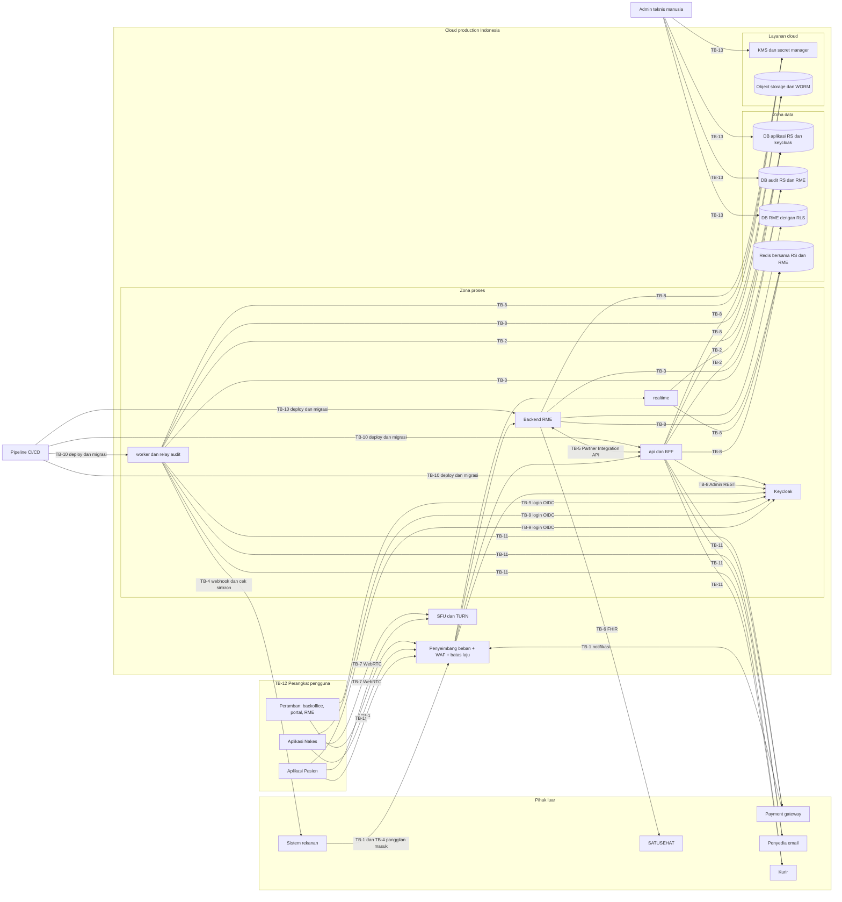

# Threat Model: Rumah Sehat

Tanggal: 2026-11-18
Versi: 0.1 (draf untuk gate Tahap 4)
Penyusun: Claude (subagent `security-architect`)
Tingkat ketelitian: **T1 Kritis** (keamanan, autentikasi/otorisasi, data pribadi spesifik, uang, audit trail; `aturan-kerja.md` §1)
Dasar: PRD v1.1 `[DOK: 03-prd.md]`, arsitektur v0.1 `[DOK: 04-arsitektur.md]`, ADR-001–ADR-020 `[DOK: adr/]`, data dictionary v0.1 `[DOK: 04-data-dictionary.md]`, risk register v0.1 `[DOK: 04-risk-register.md]`, catatan Tahap 4 `[DOK: 04-catatan-arsitektur.md]` (T4-Q1, T4-Q2, T4-Q4)

Dokumen ini tidak mengubah arsitektur. Mitigasi yang belum ada di desain ditulis sebagai usulan (§6) untuk diterapkan pelaksana Tahap 4.

---

## 0. Metode dan konvensi

### 0.1 Label sumber

| Penanda | Arti |
| --- | --- |
| `ADR-xxx butir n` | Butir keputusan di ADR. Berfungsi sebagai label `[DOK: adr/ADR-xxx-....md]` |
| `US-`, `AB-`, `KU-`, `NFR-`, `PB-`, `E-`, `RF-`, `BR-`, `L-`, `PT-` | Butir PRD v1.1 (BR juga BRD). Berfungsi sebagai label `[DOK: 03-prd.md]` |
| `A1.1`, `C1.4`, `§0.6`, `F-xx` | Bagian dan temuan data dictionary. Berfungsi sebagai label `[DOK: 04-data-dictionary.md]` |
| `arsitektur §n` | Bagian `docs/04-arsitektur.md`, label `[DOK: 04-arsitektur.md]` |
| `RT-xx` | Risiko di `docs/04-risk-register.md`, label `[DOK: 04-risk-register.md]` |
| `DoD` | Definition of Done di `docs/backlog.md`, label `[DOK: backlog.md]` |
| `[USER] T4-Qx` | Jawaban user di Tahap 4 (`docs/04-catatan-arsitektur.md`) |
| `[SRC-xx]` | Fakta eksternal terverifikasi di `docs/sources.md`. SRC-78–SRC-83 adalah entri baru dari dokumen ini (lihat laporan ke orkestrator) |
| `[KEPUTUSAN-70]` | Keputusan metode dokumen ini (§0.2–§0.4), diajukan untuk dicatat di `docs/decision-log.md` |
| `[TIDAK DIKETAHUI]` | Belum ada informasi |
| `M-xx`, `H-xx` | Usulan mitigasi penyusun di §6. Usulan **bukan keputusan**; menjadi keputusan setelah diterapkan ke ADR atau backlog oleh pelaksana tahap |

### 0.2 Metode

- Ancaman dikelompokkan dengan STRIDE: Spoofing, Tampering, Repudiation, Information Disclosure, Denial of Service, Elevation of Privilege. OWASP menyatakan STRIDE "groups threats into one of six general prompts", dan menganjurkan "Apply the six threat categories above to components, data flows, and trust boundaries" `[SRC-78]`.
- Analisis dilakukan per komponen yang diminta (§4.1–§4.16) dan dipetakan ke trust boundary (§3). Selain 10 boundary arsitektur §7, dokumen ini memakai tiga boundary tambahan (TB-11–TB-13) yang dilewati data tetapi belum tercantum di arsitektur `[KEPUTUSAN-70]`.
- Aktor ancaman di §2 mengikuti daftar dari orkestrator, ditambah AK-07 (orang dalam teknis atau pipeline) yang dipisah dari admin aplikasi karena jalurnya berbeda `[KEPUTUSAN-70]`.

### 0.3 Skala dan tingkat

Kemungkinan (K) dan dampak (D) dinilai kualitatif **T**inggi/**S**edang/**R**endah oleh penyusun, mengikuti skala risk register `[KEPUTUSAN-02]`. Kemungkinan dinilai untuk desain **tanpa** mitigasi khusus ancaman itu (risiko bawaan), sehingga tingkat menunjukkan prioritas, bukan risiko sisa. Tingkat diturunkan dari matriks berikut `[KEPUTUSAN-70]`:

| Dampak \ Kemungkinan | Rendah | Sedang | Tinggi |
| --- | --- | --- | --- |
| **Tinggi** | Sedang | **Tinggi** | **Tinggi** |
| **Sedang** | Rendah | Sedang | **Tinggi** |
| **Rendah** | Rendah | Rendah | Sedang |

Dampak Tinggi dipakai untuk: kebocoran data pribadi spesifik (AB-70) banyak orang atau satu orang dengan akibat berat, kehilangan uang, hilangnya integritas audit trail, pengambilalihan akun berhak luas, atau gangguan layanan inti (NFR-AVL-01).

### 0.4 Status mitigasi dan kriteria kelulusan

| Status | Arti |
| --- | --- |
| **Tercermin** | Mitigasi utama sudah tertulis di arsitektur, ADR, NFR, AC story, atau backlog yang dirujuk |
| **Sebagian** | Sebagian mitigasi tertulis, tetapi bagian yang menangani inti ancaman belum ada |
| **Belum** | Tidak ada mitigasi tertulis |

**LULUS** bila setiap ancaman Tinggi berstatus Tercermin. Ancaman Tinggi berstatus Sebagian atau Belum adalah celah yang membuat status **TIDAK LULUS** `[KEPUTUSAN-70]`, sesuai checklist Tahap 4 `[DOK: .claude/skills/runbook/references/tahap-04-arsitektur.md]`.

---

## 1. Aset

Klasifikasi mengikuti legenda sensitivitas data dictionary §0.5 (`PII`, `Spesifik`, `Spesifik*`, `Keu`, `Enc`, `Rahasia`). Properti: K = kerahasiaan, I = integritas, A = ketersediaan.

| ID | Aset | Lokasi utama | Klasifikasi | Properti | Sumber |
| --- | --- | --- | --- | --- | --- |
| AS-01 | Data kesehatan Rumah Sehat: keluhan awal, isi chat dan lampiran, catatan konsultasi, resep, hasil lab | `consultation_session.chief_complaint_enc`, `chat_message`, `chat_attachment`, `consultation_note_version`, `prescription*`, `lab_result_version`; bucket `clinical` | Spesifik, Enc | K, I | A9, A10, §0.7; AB-70; PRD §3.1 |
| AS-02 | Rekam medis dan hasil lab RME minimalis | `rme_medical_record_*`, `rme_lab_result_version`; bucket RME `clinical` | Spesifik, Enc | K, I | C4; PRD §3.1 |
| AS-03 | Identitas resmi: NIK lengkap, foto KTP/KK; NIK tenaga kesehatan fasyankes | `identity_document.nik_enc`, bucket `identity_document`, `rme_health_worker_profile.nik_enc`; blind index `nik_bidx` | Spesifik, Enc; blind index PII | K | A2.4, C1.8; ADR-013 butir 4 |
| AS-04 | Data anak dan data pribadi umum: nama, tanggal lahir, kontak, alamat, koordinat, alamat IP, ID pengguna IdP | `care_recipient`, `patient`, `address`, `order_personal_snapshot`, `account`, `audit_event.source_ip`, database `keycloak` | PII; Spesifik* bila anak | K | A1, A2, A8.4; §0.5, §0.10 |
| AS-05 | Metadata yang dapat mengungkap kondisi kesehatan: jenis pesanan, profesi dan identitas tenaga kesehatan per sesi, nama layanan di harga terkunci | `patient_order.order_kind`, `health_worker.profession`, `consultation_session.health_worker_id`, `order_price_lock_line.description` | Tidak dienkripsi tingkat aplikasi | K | ADR-013 konsekuensi; F-09 |
| AS-06 | Uang dan catatan keuangan: harga terkunci, percobaan dan penerimaan pembayaran, jurnal, refund, kewajiban rekanan | A8.6–A8.8, A12, A13, A14 | Keu bila per pasien | I, K | ADR-015 |
| AS-07 | Instruksi pembagian dana dan rekening penerima rekanan | `fund_split_instruction_line`, `partner_bank_account.account_number_enc` | Keu; Enc (rekening) | I | A5.4, A12.7; AB-21 |
| AS-08 | Pengaturan yang memengaruhi uang dan aturan: markup, biaya rekanan, tarif metode bayar, parameter bisnis, tarif konsultasi | A6, A4.5 | — | I | E-14; §0.8 |
| AS-09 | Foto bukti klaim, teks tiket keluhan, rincian permintaan hak subjek data, salinan data pribadi | A14.9, A16, A17; bucket `claim_evidence`, `export` | Spesifik, Enc | K | §0.7 |
| AS-10 | Kredensial dan sesi pengguna: hash password, faktor TOTP dan kode pemulihan, sesi IdP, token di perangkat, data sesi BFF | Database `keycloak`, penyimpanan aman perangkat, Redis | Rahasia | K, I | §0.10; ADR-011 butir 7 |
| AS-11 | Material kunci: KEK di KMS, DEK terbungkus, DEK di memori proses, kunci blind index NIK | KMS, `data_key`, `rme_data_key`, secret manager | Rahasia | K, A | ADR-013 butir 3–4, 8; A19.7 |
| AS-12 | Rahasia integrasi: rahasia klien realm `integrasi`, rahasia HMAC webhook, kredensial RME ke Rumah Sehat, kredensial API payment gateway, video, dan email, kredensial SATUSEHAT per fasyankes beserta token aksesnya, kredensial role database, kredensial Admin REST API Keycloak | Keycloak, `integration_client`, `rs_integration_credential`, `satusehat_credential`, `external_access_token`, secret manager | Rahasia, Enc | K | A18.1, C1.3–C1.5; ADR-013 butir 3, 8; ADR-020 butir 1 |
| AS-13 | Audit trail: outbox, event, subjek, kunci event, kepala rantai, arsip WORM | `audit_outbox`, `rme_audit_outbox`, B1–B6, object storage WORM | PII (ID, IP) | I, A sebagai bukti, K | ADR-005, ADR-009; §B |
| AS-14 | Security log dan application log | Layanan log di Indonesia | PII (IP, ID akun) | I, K | ADR-010 |
| AS-15 | Bukti status layanan: riwayat status, kehadiran sesi, penerimaan pesanan oleh rekanan | `*_status_event`, `consultation_attendance_event`, `order_partner_acknowledgement` | — | I | ADR-008; A8.10, A9.2 |
| AS-16 | Ketersediaan layanan inti (login, pemesanan, pembayaran, konsultasi, portal) dan RME | Semua proses | — | A | NFR-AVL-01, NFR-AVL-02 |
| AS-17 | Konfigurasi dan artefak: konfigurasi realm, konfigurasi server media, infrastruktur sebagai kode, image kontainer, biner aplikasi mobile dan kunci penandatangannya, dependensi | Repositori, pipeline, registri | — | I | ADR-011 konsekuensi; ADR-016 butir 4; ADR-019 butir 2 |

---

## 2. Aktor ancaman

| ID | Aktor | Kemampuan awal yang diasumsikan | Motif yang dinilai |
| --- | --- | --- | --- |
| AK-01 | Pasien jahat | Akun pasien sah; dapat memodifikasi aplikasi dan memanggil API langsung | Membuka data orang lain, layanan tanpa bayar, refund atau klaim curang, resep palsu |
| AK-02 | Tenaga kesehatan jahat atau akun tenaga kesehatan yang dikompromikan | Akun nakes aktif dengan sesi dan kunjungan yang ditugaskan | Ekstraksi data pasien, penyalahgunaan status kehadiran |
| AK-03 | Admin internal jahat | Salah satu dari tujuh sub-peran admin Rumah Sehat (PRD §1.2), atau Operator RME | Melihat isi klinis atau foto KTP, mengalihkan dana, menyalahgunakan refund, menaikkan hak |
| AK-04 | Rekanan jahat atau sistem rekanan terkompromi | Kredensial klien integrasi, akun admin portal, atau akun pengguna RME fasyankes | Data rekanan lain, status atau hasil palsu, beban berlebih |
| AK-05 | Penyerang internet | Tanpa akun; dapat melakukan credential stuffing, phishing, bot, dan pemindaian | Pengambilalihan akun, pencurian data, gangguan layanan |
| AK-06 | Penyedia pihak ketiga terkompromi | Kendali atas payment gateway, email, kurir, penyedia video, penyedia cloud, pustaka/SDK, atau endpoint yang menyamar sebagai SATUSEHAT | Membaca atau memalsukan data yang melintas, mengirim data ke luar Indonesia |
| AK-07 | Orang dalam teknis atau identitas pipeline terkompromi | Akses konsol cloud, database, KMS, secret manager, atau pipeline CI/CD | Membaca data terenkripsi, mengubah transaksi atau audit, mendeploy kode jahat |

---

## 3. Trust boundary

### 3.1 Diagram

### 3.2 Daftar boundary

TB-1 sampai TB-10 adalah daftar arsitektur §7. TB-11 sampai TB-13 adalah tambahan dokumen ini `[KEPUTUSAN-70]`.

| TB | Batas | Yang melintas | Kontrol utama di desain | Ancaman terkait |
| --- | --- | --- | --- | --- |
| TB-1 | Internet ke penyeimbang beban | Permintaan aplikasi mobile, web lewat BFF, panggilan masuk rekanan, notifikasi payment gateway | TLS, WAF, batas laju (ADR-019 butir 3); token per kanal (ADR-011, ADR-014); verifikasi notifikasi (NFR-INT-04) | APP-03, API-01–API-15, WEB-01–WEB-11, INT-01–INT-05, PG-01–PG-03, PG-08 |
| TB-2 | Proses aplikasi ke database aplikasi | Query dan transaksi | Role per kelas tabel dan trigger penolak (ADR-008, §0.6); TLS (ADR-013 butir 1) | DB-01–DB-06, AUD-01 |
| TB-3 | Worker relay ke database audit | Event audit | `audit_writer` hanya INSERT, hash berantai, jangkar WORM (ADR-009 butir 4–5) | AUD-01–AUD-06 |
| TB-4 | Rumah Sehat ke dan dari sistem rekanan | Webhook keluar, cek ketersediaan sinkron, pesan masuk | OAuth2 client credentials, HMAC dengan stempel waktu, idempotensi, validasi skema (ADR-014) | INT-01–INT-10 |
| TB-5 | RME minimalis ke Rumah Sehat | Sama dengan TB-4 | Kontrak yang sama, satu klien per fasyankes (ADR-006 butir 2, ADR-014 butir 3) | INT-01–INT-05, RME-01–RME-05 |
| TB-6 | RME minimalis ke SATUSEHAT | Resource FHIR, NIK pasien dan praktisi | OAuth2 client credentials per fasyankes, TLS, antrean (ADR-020) | SS-01–SS-05 |
| TB-7 | Aplikasi ke server media video | Media WebRTC, token bergabung | Token per peserta per sesi, SFU/TURN di Indonesia, tanpa rekaman (ADR-016 butir 4) | VID-01–VID-05 |
| TB-8 | Proses aplikasi ke KMS, secret manager, object storage, Redis, Admin REST API Keycloak | Kunci, rahasia, berkas, cache dan sesi, operasi admin IdP | KMS dan secret manager (ADR-013); URL bertanda tangan (ADR-018); Redis bukan sumber kebenaran (ADR-007 butir 6); Admin REST (ADR-011 butir 6, 8) | OS-01–OS-06, KMS-01–KMS-05, RD-01–RD-02, KC-04–KC-05 |
| TB-9 | Browser sistem dan aplikasi ke Keycloak | Kredensial, OTP, kode otorisasi, token | PKCE lewat browser sistem, BFF, MFA, deteksi brute force (ADR-011 butir 4–7) | APP-01, APP-04, APP-06, KC-01–KC-03, KC-06–KC-07 |
| TB-10 | Pipeline CI/CD ke lingkungan cloud | Image, migrasi skema, konfigurasi | Infrastruktur sebagai kode, data sintetis, pemilik skema hanya untuk pipeline migrasi (ADR-019 butir 2, ADR-009 butir 4) | CI-01–CI-05, KMS-05 |
| TB-11 | Backend ke penyedia pihak ketiga (API payment gateway, email, kurir, API server media) | Data pembayaran minimal, alamat email, alamat kirim, pembuatan ruang video | Adaptor dan minimisasi (ADR-013 butir 7, ADR-015 butir 2, ADR-016 butir 4–5) | PG-04–PG-07, VID-04, EXT-01–EXT-03 |
| TB-12 | Perangkat pengguna (penyimpanan aplikasi mobile dan peramban) | Token, cache data, berkas yang diunduh | Token di penyimpanan aman platform (ADR-011 butir 7); cookie `HttpOnly` untuk web | APP-01, APP-02, APP-05, OS-01 |
| TB-13 | Akses administratif manusia ke infrastruktur production | Konsol cloud, superuser database, KMS, secret manager, admin Keycloak | Akun production terpisah (ADR-019 butir 1); pembatasan hapus KEK (RT-06) | KMS-01, AUD-01, KC-06, DB-05 |

Catatan lintas sistem: Redis dipakai bersama proses Rumah Sehat dan RME (ADR-006 butir 4, arsitektur §6), dan Keycloak dipakai bersama dengan realm serta admin realm terpisah (ADR-011 butir 11). Keduanya adalah batas antara dua sistem dengan tingkat kepercayaan berbeda di dalam TB-8 dan TB-9.

---

## 4. Ancaman STRIDE per komponen

Kolom: **K** kemungkinan, **D** dampak (T/S/R, §0.3). **Aktor** merujuk §2. Kolom "Tercermin di" menyebut tempat mitigasi tertulis; usulan untuk yang belum tertulis ada di §6.

### 4.1 Aplikasi pasien dan aplikasi tenaga kesehatan (TB-1, TB-7, TB-9, TB-12)

| ID | STRIDE | Aktor | Ancaman | K | D | Tingkat | Mitigasi dalam desain | Tercermin di | Status |
| --- | --- | --- | --- | --- | --- | --- | --- | --- | --- |
| APP-01 | S | AK-05, AK-02 | Token akses atau penyegar dicuri dari perangkat (malware, perangkat di-root, perangkat hilang), lalu dipakai masuk sebagai pasien atau tenaga kesehatan | S | T | **Tinggi** | Token di penyimpanan aman platform; token akses 5 menit; batas sesi nakes 7/30 hari; keluar mencabut sesi di Keycloak dan Redis; penonaktifan menolak akses walaupun token belum kedaluwarsa | ADR-011 butir 7–8; KU-10; US-103 AC5 | Tercermin; penguatan H-01 |
| APP-02 | I, S | AK-05 (pencuri perangkat), AK-02 | Perangkat tenaga kesehatan hilang atau dicuri saat sesi aplikasi masih aktif (batas tidak aktif 7 hari), sehingga riwayat chat, keluhan awal, nama pasien, serta alamat dan nomor HP home visit dapat dibuka; isi klinis di cache atau berkas lokal juga terbaca dari perangkat atau cadangannya. Desain hanya mengatur penyimpanan token | S | T | **Tinggi** | Ada: pencabutan sesi oleh admin setelah dilaporkan; akses riwayat chat dicatat E-05. Belum ada: aturan data klinis di penyimpanan lokal, pengecualian dari cadangan perangkat, kunci aplikasi saat dibuka kembali | ADR-011 butir 7–8 (sebagian) | **Belum** (M-01) |
| APP-03 | T, E | AK-01 | Aplikasi dimodifikasi atau API dipanggil langsung untuk mengubah harga, nominal, waktu bergabung, status, atau memanggil endpoint peran lain | T | T | **Tinggi** | Harga dihitung dan dikunci di server; waktu dari jam server; kebijakan per endpoint dengan default deny; realm pasien dan nakes terpisah; transisi status divalidasi terhadap tabel transisi | ADR-015 butir 1, 3; ADR-016 butir 3; ADR-017 butir 5; ADR-012 butir 1; ADR-011 butir 3, 8; ADR-008 aturan status 2 | Tercermin |
| APP-04 | S | AK-05 | Pengambilalihan akun pasien lewat credential stuffing atau phishing; pasien tidak diwajibkan MFA | S | T | **Tinggi** | Deteksi brute force 5 gagal/15 menit; Argon2 dan kebijakan password ASVS L2; WAF dan batas laju; login di browser sistem; pesan galat umum; autentikasi ulang untuk aksi berisiko | ADR-011 butir 4, 7, 9; ADR-019 butir 3; NFR-SEC-03; US-103 AC2–AC3 | Tercermin; risiko sisa pasien tanpa MFA (ADR-011 butir 5; NFR-SEC-02 tidak mewajibkan MFA untuk pasien); penguatan H-04 |
| APP-05 | I | AK-06 | Pustaka atau SDK pihak ketiga di aplikasi (analitik, crash, plugin transitif) mengirim data pribadi atau kesehatan ke luar Indonesia `[USER] T4-Q1` | S | T | **Tinggi** | Ada: larangan memasang SDK analitik atau crash yang mengirim data ke luar Indonesia; laporan crash ke layanan di Indonesia tanpa data pribadi. Belum ada: mekanisme verifikasi (inventaris dependensi, daftar izin host tujuan, uji lalu lintas jaringan) | ADR-010 butir 4; NFR-PRIV-02; US-1406 AC2; arsitektur §10 | **Sebagian** (M-02) |
| APP-06 | S | AK-05 (aplikasi jahat di perangkat) | Pembajakan redirect URI OIDC untuk mencuri authorization code | R | T | Sedang | Authorization Code dengan PKCE lewat browser sistem; RFC 8252 mewajibkan PKCE untuk klien native publik `[SRC-77]`; Keycloak menyediakan `pkce-enforcer` S256 `[SRC-71]` | ADR-011 butir 7 | Tercermin |
| APP-07 | R | AK-01, AK-02 | Pasien atau tenaga kesehatan menyangkal telah bergabung, membatalkan, atau menandai status | S | S | Sedang | Waktu bergabung dicatat server; riwayat status INSERT-only dengan aktor; event E-09 | ADR-016 butir 3; ADR-008; A9.2; PRD §7.1 | Tercermin |

### 4.2 Backend `api`, `realtime`, `worker` (TB-1, TB-2, TB-8)

| ID | STRIDE | Aktor | Ancaman | K | D | Tingkat | Mitigasi dalam desain | Tercermin di | Status |
| --- | --- | --- | --- | --- | --- | --- | --- | --- | --- |
| API-01 | E, I | AK-01 | IDOR: mengganti ID pesanan, sesi, hasil lab, penerima layanan, atau berkas untuk membuka data pasien lain | T | T | **Tinggi** | Pemeriksaan relasi kepemilikan per objek di satu modul otorisasi, default deny, 404 untuk objek terlarang, percobaan ke data sensitif dicatat; otorisasi tidak bergantung pada kerahasiaan UUID. Sejalan dengan OWASP: "implement access control checks for each object" dan "even with complex identifiers, access control checks are essential" `[SRC-80]`. Setiap endpoint baru wajib punya kebijakan dan test penolakan | ADR-012 butir 1–3, alternatif ditolak, konsekuensi; KU-03; US-305 AC5; US-902 AC2 | Tercermin |
| API-02 | E | AK-02 | Tenaga kesehatan membuka sesi atau kunjungan yang tidak ditugaskan kepadanya, atau nomor HP pasien home visit di luar hari kunjungan | S | T | **Tinggi** | Relasi penugasan dengan batas waktu; akses riwayat chat setelah sesi dicatat E-05 | ADR-012 butir 1; ADR-016 butir 2; US-503 AC1; US-311 AC4 | Tercermin |
| API-03 | I | AK-02 | Tenaga kesehatan yang sah mengekstrak data pasiennya sendiri secara massal | S | T | **Tinggi** | Cakupan terbatas pada sesi yang ditanganinya; setiap akses detail dicatat E-05 sebelum data dikirim | ADR-012 butir 1–2; ADR-009 butir 2 | Tercermin; penguatan H-02 |
| API-04 | I | AK-07, AK-05 | Data pribadi, token, atau isi klinis bocor lewat application log, pesan galat, atau stack trace | S | T | **Tinggi** | Log terstruktur hanya ID; daftar tolak redaksi (password, token, header `Authorization`, cookie, NIK, rekening, body permintaan) dengan test otomatis; galat Problem Details berkode. Sejalan dengan daftar "Data to exclude" OWASP (antara lain access tokens, data kesehatan, identitas pemerintah, data rekening) `[SRC-83]` | ADR-010 tabel dan butir 1; NFR-OBS-03; ADR-014 butir 1 | Tercermin; penguatan H-10 |
| API-05 | I | AK-06 (penyedia email), orang lain yang membaca kotak email pasien | Notifikasi email atau pengingat menyebut profesi (misalnya psikolog), nama tenaga kesehatan, atau nama layanan yang mengungkap kondisi kesehatan (F-09). AB-73 hanya melarang diagnosis, nama obat, nilai hasil lab, dan isi chat | S | S | Sedang | Templat tanpa data kesehatan rinci; penyedia email di Indonesia | AB-73; ADR-016 butir 5; ADR-013 butir 7 | **Belum** (M-10) |
| API-06 | S, E | AK-02 (akun dinonaktifkan atau SIP berakhir), AK-01 (akun pasien dinonaktifkan), AK-05 (token dicuri) | Koneksi WebSocket yang sudah terbuka tetap menerima pesan chat, status, dan notifikasi setelah akun dinonaktifkan, peran diubah, sesi dicabut, atau token kedaluwarsa (KU-10). ADR-016 hanya menyatakan koneksi diautentikasi saat dibuka; pemeriksaan "setiap permintaan" ADR-011 butir 8 tidak menjangkau koneksi panjang | S | T | **Tinggi** | Ada: koneksi diautentikasi dengan token; pengirim pesan diperiksa sebagai peserta sesi dan sesi masih dalam waktunya. Belum ada: pemeriksaan status akun dan pencabutan pada koneksi berjalan, pemutusan koneksi, dan otorisasi langganan kanal | ADR-016 butir 1–2; ADR-011 butir 8 | **Sebagian** (M-03) |
| API-07 | D | AK-01, AK-05 | Bot membanjiri endpoint mahal (pencarian, cek ketersediaan sinkron, pembuatan pembayaran), atau akun pasien menahan banyak slot selama PB-07 tanpa membayar | S | S | Sedang | WAF dan batas laju; batas laju API di Redis; layanan terjadwal hanya untuk identitas yang disetujui; panggilan sinkron 5 detik tanpa coba ulang. Belum ada batas pesanan "Menunggu pembayaran" per akun | ADR-019 butir 3; ADR-007 butir 6; AB-01; ADR-014 butir 5 | **Sebagian** (M-11) |
| API-08 | T, I | AK-01, AK-04, AK-05 | Injeksi (SQL, perintah), mass assignment, atau deserialisasi tidak aman di API | S | T | **Tinggi** | Target ASVS 5.0.0 Level 2 untuk semua komponen dengan checklist Tahap 5 dan verifikasi Tahap 10; validasi masukan; pesan rekanan divalidasi skema | NFR-SEC-01; ADR-011 butir 1; KU-01; ADR-014 butir 4 | Tercermin; penguatan H-03 |
| API-09 | R | AK-02, AK-03 | Admin, tenaga kesehatan, atau proses otomatis menyangkal aksi (verifikasi, keputusan klaim, perubahan markup, resep) | S | T | **Tinggi** | Event E-01–E-17 dengan aktor, peran, IP, perangkat, korelasi, before/after; outbox atomik; aksi pengguna dibatalkan bila event gagal dicatat | ADR-009 butir 1–2, 7; PRD §7.1–§7.2; US-1501 AC1, AC3 | Tercermin |
| API-10 | I | AK-05 | Enumerasi akun pasien lewat pendaftaran (email terdaftar diarahkan ke masuk atau atur ulang), yang mengungkap bahwa seseorang memakai layanan kesehatan | T | R | Sedang | Atur ulang password memakai pesan sama untuk email terdaftar dan tidak; batas laju. Pendaftaran mengikuti US-101 AC3 | ADR-011 butir 4; US-101 AC3; US-103 AC4 | **Sebagian** (M-12) |
| API-11 | S | AK-01 | Pasien mendaftarkan identitas dengan NIK dan foto KTP/KK orang lain | S | S | Sedang | Verifikasi manual Verifikator; NIK pemilik akun unik lintas akun; KK harus memuat pemilik akun sebagai orang tua/wali | US-201 AC1–AC7; UP-40; A2.8 | Tercermin |
| API-12 | T | AK-01 | Klaim refund palsu (foto bukti diedit, laporan "tidak datang" palsu) | S | S | Sedang | Keputusan manual dengan bukti; satu klaim per pesanan; status nakes setelah laporan pasien ditolak dan keputusan memakai bukti kedua pihak | US-807 AC1–AC5; KEPUTUSAN-50; PRD §3.6 | Tercermin |
| API-13 | T, S | AK-01 | Pasien memalsukan PDF resep (mengubah obat atau jumlah, atau membuat resep tiruan) untuk menebus obat di apotek mana pun; apotek tidak punya kanal untuk memeriksa keaslian | S | T | **Tinggi** | Hanya dokter yang menerbitkan; resep bernomor unik dan tidak dapat diubah; E-06. Format, tanda tangan elektronik, dan kanal pemeriksaan apotek `[TIDAK DIKETAHUI]` (L-05) | AB-53; US-309 AC1, AC3, AC5 | **Belum** (M-04) |
| API-14 | I | AK-01 | Pemilik akun membuka data klinis anggota keluarga dewasa, atau meminta salinan data atas namanya, tanpa sepengetahuan yang bersangkutan | S | S | Sedang | Keputusan produk AB-71 dengan pencatatan E-05; kebolehannya ditanyakan ke legal (L-05, L-08); autentikasi ulang untuk permintaan hak subjek data | AB-71; US-1602 AC1, AC3; ADR-011 butir 9 | Tercermin (risiko sisa menunggu L-05, L-08) |
| API-15 | I | AK-05 (pengambil alih akun pasien) | Salinan data pribadi lengkap, termasuk isi klinis, diminta dan diunduh oleh pengambil alih akun | S | T | **Tinggi** | Autentikasi ulang dengan password sebelum mengajukan dan mengunduh; URL baru berumur pendek untuk setiap unduhan; unduhan dicatat E-12 | ADR-011 butir 9; US-1602 AC1; US-1604 AC2; ADR-018 butir 3 | Tercermin; penguatan H-04 |

### 4.3 Keycloak (TB-9, TB-8)

| ID | STRIDE | Aktor | Ancaman | K | D | Tingkat | Mitigasi dalam desain | Tercermin di | Status |
| --- | --- | --- | --- | --- | --- | --- | --- | --- | --- |
| KC-01 | S | AK-05 | Pengambilalihan akun tenaga kesehatan, admin, atau pengguna RME (phishing kredensial dan TOTP secara langsung, credential stuffing) | S | T | **Tinggi** | MFA TOTP wajib di realm `nakes`, `admin`, `rme` dengan alur yang mewajibkan OTP; deteksi brute force; login di browser sistem; penonaktifan seketika; event login ke audit dan security log | ADR-011 butir 4–5, 7–8, 10; NFR-SEC-02; KEPUTUSAN-25 | Tercermin; penguatan H-04 |
| KC-02 | S | AK-05 | Rekayasa sosial ke admin untuk mereset MFA atau password ("ponsel hilang"), lalu penyerang mendaftarkan TOTP sendiri | S | T | **Tinggi** | Reset MFA hanya oleh admin berwenang setelah verifikasi identitas, dicatat E-04; prosedur tertulis sebelum go-live; autentikasi ulang untuk reset MFA | ADR-011 butir 5, 9, konsekuensi | Tercermin; penguatan H-05 |
| KC-03 | S, E | AK-01, AK-04 | Token realm atau klien lain diterima: token pasien di endpoint nakes atau admin, token realm `rme` di backend Rumah Sehat atau sebaliknya, token klien integrasi di API aplikasi, sesi portal di API backoffice | S | T | **Tinggi** | Backend memvalidasi tanda tangan, audience realm, dan masa berlaku; backend Rumah Sehat menolak token realm `rme` dan sebaliknya; namespace dan audience sesi backoffice dan portal terpisah; test otomatis penolakan token realm lain | ADR-011 butir 8, 11; ADR-006 butir 5; RT-17 | Tercermin; penguatan H-06 `[SRC-79]` |
| KC-04 | E | AK-02, AK-03 | Penonaktifan atau perubahan peran tidak berlaku seketika karena cache status di Redis basi (pembaruan gagal saat Redis tetap tersedia, tanpa TTL), atau langkah penonaktifan di Keycloak gagal | R | T | Sedang | Status di database aplikasi sebagai sumber kebenaran; cache diperbarui saat status berubah; fallback ke database bila Redis tidak tersedia. Urutan dan penanganan kegagalan alur belum ditetapkan | ADR-011 butir 8; A1.1; §0.10 | **Sebagian** (M-13) |
| KC-05 | E | AK-07, penyerang yang menguasai proses backend | Klien Admin REST API yang dipakai backend (membuat pengguna, mengubah `enabled`, menghapus sesi) berhak lintas realm atau lebih dari yang dibutuhkan, sehingga kebocoran kredensialnya membuka pembuatan akun admin | R | T | Sedang | Rahasia di secret manager. Cakupan hak klien admin per realm belum ditetapkan | ADR-013 butir 8; ADR-011 butir 6 | **Belum** (M-05) |
| KC-06 | E, I | AK-05 | Konsol admin, realm master, atau Admin REST API Keycloak dapat dicapai dari internet lewat penyeimbang beban publik | S | T | **Tinggi** | Ada: konfigurasi realm sebagai kode dan review; checklist ASVS L2 mencakup Keycloak. Belum ada: pembatasan endpoint admin dari jaringan publik. Arsitektur §6 merutekan penyeimbang beban ke Keycloak dan tidak menyebut pembatasan endpoint admin | ADR-011 butir 1, konsekuensi; RT-17; arsitektur §6 | **Belum** (M-05) |
| KC-07 | D | AK-05 | Keycloak tidak tersedia, atau penyerang sengaja memicu penguncian akun tenaga kesehatan menjelang jadwal sesi | S | S | Sedang | Keycloak minimal 2 instans terklaster; penguncian sementara 15 menit; batas laju di WAF; penguncian masuk security log; sesi nakes yang sudah masuk tidak terpengaruh. Belum ada aturan peringatan dan prosedur buka kunci | ADR-011 butir 2, 4; ADR-019 butir 3; ADR-010 tabel; RT-18 | **Sebagian** (M-14) |
| KC-08 | R | AK-07 | Event autentikasi hilang dari audit karena pengambilan tertinggal melebihi masa simpan penyangga 7 hari | R | S | Rendah | Pengambilan tiap menit secara idempoten; peringatan bila terlambat lebih dari 5 menit | ADR-011 butir 10 | Tercermin |
| KC-09 | T, E | AK-05 | Kerentanan Keycloak yang diketahui tidak segera di-patch | S | T | **Tinggi** | Pemantauan rilis keamanan dan jadwal upgrade; pemindaian keamanan di CI | RT-17 mitigasi 4; DoD | Tercermin |

### 4.4 Redis (TB-8)

| ID | STRIDE | Aktor | Ancaman | K | D | Tingkat | Mitigasi dalam desain | Tercermin di | Status |
| --- | --- | --- | --- | --- | --- | --- | --- | --- | --- |
| RD-01 | D | AK-05, gangguan | Redis tidak tersedia: sesi web hilang, sinyal chat tertunda, penghitung batas laju tidak bekerja | S | S | Sedang | Status akun dibaca dari database; pesan chat tersimpan dan diambil ulang; cadangan `LISTEN/NOTIFY`; pengguna web login ulang. Perilaku batas laju saat Redis tidak tersedia belum ditetapkan | ADR-007 butir 4, 6; ADR-011 butir 8; ADR-016 konsekuensi; RT-18 | **Sebagian** (M-15) |
| RD-02 | T, I, E | AK-04 (lewat RME terkompromi), AK-07, penyerang di jaringan internal | Redis diracuni atau dibaca: (a) satu Redis dipakai bersama proses Rumah Sehat dan RME, sehingga RME yang terkompromi dapat membaca atau menulis kunci Rumah Sehat; (b) data sesi BFF backoffice dan portal tersimpan di Redis, dan menurut pola BFF token tidak dikirim ke browser melainkan dipegang server; (c) cache status akun dan daftar pencabutan dapat diubah untuk menghidupkan kembali akun nonaktif atau membuat sesi admin palsu | S | T | **Tinggi** | Ada: TLS untuk lalu lintas internal; Redis bukan sumber kebenaran dan hanya berisi ID. Belum ada: autentikasi dan ACL, pemisahan Rumah Sehat dan RME, perlindungan data sesi BFF, TTL cache status | ADR-006 butir 4; arsitektur §6; ADR-007 butir 6; ADR-013 butir 1; ADR-011 butir 7–8; C1.6 | **Belum** (M-06) |

### 4.5 Web backoffice, portal rekanan, dan web RME dengan BFF (TB-1, TB-9)

| ID | STRIDE | Aktor | Ancaman | K | D | Tingkat | Mitigasi dalam desain | Tercermin di | Status |
| --- | --- | --- | --- | --- | --- | --- | --- | --- | --- |
| WEB-01 | E, I | AK-04 | IDOR lintas rekanan di portal: laporan, ekspor CSV, profil, atau tiket keluhan rekanan lain | S | T | **Tinggi** | `partner_id` dari sesi lewat repository ber-tenant; test isolasi otomatis per endpoint portal di `scripts/verify.sh`; 404 untuk objek rekanan lain | ADR-012 butir 3–4, konsekuensi; NFR-SEC-06; US-206 AC2; US-1201 AC4; US-1203 AC2; RT-07 | Tercermin |
| WEB-02 | I | AK-03 | Admin Rumah Sehat (termasuk Super Admin dan Petugas PDP) membuka isi chat, catatan, resep, atau hasil lab | S | T | **Tinggi** | Tidak ada kebijakan akses admin ke objek klinis; data sensitif hanya lewat fungsi akses beraudit; salinan hak subjek data dibuat otomatis tanpa dibuka Petugas PDP; isi klinis terenkripsi tingkat aplikasi | PRD §3.1; ADR-012 butir 1–2; ADR-013 butir 3; US-305 AC5 | Tercermin (perlindungan dari jalur infrastruktur bergantung pada M-08) |
| WEB-03 | I | AK-03 | Verifikator membuka atau menyalin foto KTP/KK dan NIK lengkap di luar kebutuhan verifikasi | S | T | **Tinggi** | Hanya Verifikator; setiap pembukaan dicatat E-05 sebelum data dikirim; URL unduh 5 menit sebagai lampiran; peran lain melihat NIK termasking | PRD §3.1; US-201 AC6; ADR-012 butir 2; ADR-018 butir 3; ADR-013 butir 4 | Tercermin; penguatan H-02 |
| WEB-04 | T | AK-05 | CSRF terhadap aksi BFF (refund, markup, perubahan peran) | S | T | **Tinggi** | Cookie `HttpOnly`, `Secure`, `SameSite`, dan perlindungan CSRF | ADR-011 butir 7 | Tercermin |
| WEB-05 | T, I | AK-04, AK-01, AK-03 (Konten) | XSS tersimpan dari data rekanan (nama atau deskripsi produk), teks pasien (tiket, keluhan), atau konten CMS yang tampil di web atau aplikasi | S | T | **Tinggi** | Target ASVS L2 untuk semua komponen; cookie `HttpOnly` membatasi pencurian sesi | NFR-SEC-01; ADR-011 butir 1, 7 | Tercermin; penguatan H-03 |
| WEB-06 | E | AK-04 | Sesi portal memanggil API backoffice, atau admin rekanan (realm `admin` yang sama) masuk ke backoffice | S | T | **Tinggi** | Namespace API dan audience sesi terpisah; sub-peran dari tabel aplikasi; akun `partner_admin` tidak punya sub-peran admin Rumah Sehat | ADR-006 butir 5; ADR-012 butir 1; A1.1–A1.3 | Tercermin |
| WEB-07 | E | AK-03 | Super Admin membuat akun baru bersub-peran Verifikator, Keuangan, atau Auditor yang dikendalikannya sendiri, melewati larangan mengubah peran sendiri | R | T | Sedang | Larangan mengubah peran sendiri; E-10, E-11; MFA. Belum ada pemberitahuan atau tinjauan pemberian sub-peran sensitif | ADR-012 butir 6; US-208 AC3; PRD §7.1 | **Sebagian** (M-16) |
| WEB-08 | T | AK-03 (Keuangan) | Keuangan membuat refund manual RF-14 melebihi dana yang diterima, menandai kewajiban rekanan "Selesai" tanpa dasar, atau menetapkan penyebab RF-18 secara tidak benar | R | T | Sedang | Jurnal immutable dan E-08; rujukan bukti wajib; rekonsiliasi harian; refund ke metode bayar asal bila penyedia mendukung (AB-30, `[TIDAK DIKETAHUI]`). Belum ada batas nominal refund terhadap dana yang diterima (`refund.amount_idr` hanya CHECK `> 0`) | ADR-015 butir 4, 6, 9; US-808 AC5–AC6; A14.1 | **Sebagian** (M-17) |
| WEB-09 | T | AK-03, AK-05 (rekayasa sosial ke Layanan Pelanggan) | Rekening penerima rekanan diganti untuk mengalihkan bagian rekanan | S | T | **Tinggi** | Perubahan rekening berlaku setelah disetujui Verifikator, dengan pemisahan pemasuk data dan penyetuju; nomor rekening terenkripsi dan termasking; E-10 | US-1202 AC3; ADR-012 butir 6; A5.4–A5.5 | Tercermin; penguatan H-07 |
| WEB-10 | I, T | AK-04, AK-01 | Ekspor CSV memuat sel diawali karakter formula dari data rekanan atau pasien, yang dijalankan saat dibuka di aplikasi spreadsheet | S | S | Sedang | Tidak ada di desain. Fitur ekspor ada di US-811 AC3, US-1201 AC4, dan US-1503 AC1 | — | **Belum** (M-18) |
| WEB-11 | S | AK-05 | Pembajakan sesi BFF atau sesi terlalu lama | R | T | Sedang | Cookie `HttpOnly` dan `Secure`; tidak aktif 30 menit, mutlak 12 jam; MFA | ADR-011 butir 7; NFR-SEC-04 | Tercermin |

### 4.6 Partner Integration API dan webhook (TB-4, TB-5)

| ID | STRIDE | Aktor | Ancaman | K | D | Tingkat | Mitigasi dalam desain | Tercermin di | Status |
| --- | --- | --- | --- | --- | --- | --- | --- | --- | --- |
| INT-01 | S, T | AK-04 | Kredensial klien integrasi dicuri dari sistem rekanan; penyerang mengirim check-in, pembatalan, hasil lab, atau harga palsu atas nama rekanan itu | S | T | **Tinggi** | Klien per rekanan di realm `integrasi` dengan token berumur pendek; status klien `revoked` dan waktu rotasi; validasi skema dan urutan transisi; batas laju; kredensial salah dicatat sebagai kejadian keamanan; mTLS dipertimbangkan Tahap 5 | ADR-014 butir 3–4; A18.1; US-1402 AC3; US-1404 AC2 | Tercermin |
| INT-02 | E, I | AK-04 | Rekanan A membaca atau menulis data pesanan rekanan B lewat API (misalnya hasil lab untuk pendaftaran rekanan lain) | S | T | **Tinggi** | ID rekanan dari kredensial, bukan dari isi pesan; hasil lab untuk pendaftaran rekanan lain ditolak | ADR-014 butir 3; ADR-012 butir 4; US-901 AC2 | Tercermin; penguatan H-08 |
| INT-03 | T | AK-05, AK-04 | Replay webhook Rumah Sehat ke rekanan (pesanan terbayar, pembatalan) | S | S | Sedang | HMAC-SHA256 atas stempel waktu dan isi `[SRC-46]`; rekanan menolak pesan lebih tua dari 5 menit; `event_id` unik untuk menolak duplikat; RME menyimpan `event_id` yang sudah diterima | ADR-014 butir 3–4; US-1403 AC2; C6.8 | Tercermin; penguatan H-08 |
| INT-04 | T | AK-04 | Replay atau pengiriman ganda pesan masuk dari rekanan | S | S | Sedang | Kunci idempotensi 7 hari dengan hash isi (kunci sama dengan isi berbeda ditolak); transisi tidak sah ditolak | ADR-014 butir 4; A18.3; AB-36 | Tercermin |
| INT-05 | S | AK-05 | Webhook "pesanan terbayar" palsu dikirim ke endpoint rekanan agar rekanan melayani tanpa pembayaran | S | S | Sedang | Tanda tangan HMAC dengan rahasia per rekanan; rahasia terenkripsi; skenario uji wajib | ADR-014 butir 3, 8; A18.1 | Tercermin |
| INT-06 | I | AK-07 | Rahasia HMAC webhook bocor dan tidak dirotasi | R | S | Rendah | Rahasia terenkripsi per wadah; kolom waktu rotasi. Prosedur rotasi tertulis baru untuk KEK dan kunci blind index | ADR-013 butir 3, 8; A18.1 | **Sebagian** (M-20) |
| INT-07 | I | AK-04, AK-06 | Data penerima layanan berlebih dikirim ke sistem rekanan, yang berada di luar kendali Rumah Sehat, lalu bocor | S | T | **Tinggi** | Field data pribadi ditandai dan dibatasi minimal setelah L-08; ID pseudonim per rekanan; NIK hanya setelah L-05/L-08; E-17 | ADR-014 butir 9; ADR-013 butir 7; ADR-020 butir 4; KEPUTUSAN-61; A8.5 | Tercermin |
| INT-08 | D | AK-04 | Rekanan membanjiri API (snapshot penuh berulang, pesan besar) atau endpoint cek ketersediaannya lambat | S | S | Sedang | Batas laju per rekanan dan batas ukuran pesan; batas waktu 5 detik | ADR-014 butir 3, 5 | Tercermin |
| INT-09 | I, E | AK-03, AK-04 | SSRF: URL webhook atau cek ketersediaan rekanan diarahkan ke alamat internal (layanan metadata cloud, Redis, Admin REST API Keycloak) | R | T | Sedang | URL wajib HTTPS. Belum ada validasi alamat tujuan, penolakan rentang privat dan metadata, pengikatan ke alamat tervalidasi, dan larangan redirect yang dianjurkan OWASP `[SRC-81]` | A18.2 | **Belum** (M-19) |
| INT-10 | R | AK-04 | Rekanan menyangkal telah mengirim status atau pembatalan (sengketa penyebab RF-18) | S | S | Sedang | E-09 dengan `actor_partner_id`; log galat integrasi; percobaan pengiriman keluar tercatat | PRD §7.1; STD-R; A18.4–A18.5; US-808 AC6 | Tercermin |

### 4.7 Payment gateway: notifikasi masuk dan panggilan keluar (TB-1, TB-11)

| ID | STRIDE | Aktor | Ancaman | K | D | Tingkat | Mitigasi dalam desain | Tercermin di | Status |
| --- | --- | --- | --- | --- | --- | --- | --- | --- | --- |
| PG-01 | S | AK-05 | Notifikasi pembayaran palsu untuk mengonfirmasi pesanan tanpa membayar | S | T | **Tinggi** | Verifikasi keaslian sesuai mekanisme penyedia sebelum diproses; notifikasi tidak valid tidak disimpan dan dicatat security log; penerimaan dana wajib merujuk percobaan pembayaran yang dibuat sistem. Mekanisme verifikasi penyedia `[TIDAK DIKETAHUI]` sampai Tahap 5 | NFR-INT-04; ADR-015 butir 5; US-802 AC2; A12.1, A12.4, A12.5 | Tercermin; penguatan H-09 |
| PG-02 | T | AK-01 | Manipulasi nominal: total diubah di klien, atau dibayar lebih kecil dari nominal pesanan | S | T | **Tinggi** | Harga dihitung dan dikunci di server; nominal pembayaran sama dengan total terkunci; nominal notifikasi berbeda berarti pesanan tidak dikonfirmasi dan berlaku RF-14 | ADR-015 butir 1, 3, 5; US-802 AC1, AC3; A8.6, A12.1 | Tercermin |
| PG-03 | T | AK-05 | Replay notifikasi sah yang lama | S | S | Sedang | Notifikasi unik per ID kejadian penyedia; tangkapan unik per pesanan; tangkapan kedua dialihkan ke RF-12 | ADR-015 butir 5; A12.4, A12.6 | Tercermin |
| PG-04 | T | AK-01, kondisi balapan, coba ulang | Refund ganda: dua kejadian hampir bersamaan, job diulang, atau Keuangan memproses ulang refund yang ternyata sudah berhasil | S | T | **Tinggi** | Satu refund per pesanan kecuali RF-12 (partial unique index) dan satu refund per penerimaan dana; kunci idempotensi = ID refund; status "Perlu dicek" tanpa eksekusi ulang; versi riwayat status; jurnal berkunci idempotensi | ADR-015 butir 6; ADR-008 aturan status 3; AB-35, AB-36; US-806 AC2; US-808 AC4; A13.2, A14.1 | Tercermin; penguatan H-09 |
| PG-05 | T | AK-03, AK-07 | Instruksi pembagian dana diubah (porsi atau rekening tujuan) | R | T | Sedang | Instruksi dibentuk server dari harga terkunci; hanya rekening aktif setelah persetujuan; baris transaksi immutable; rekonsiliasi harian dengan laporan pembagian | ADR-015 butir 2–4, 9; A12.7; US-1202 AC3 | Tercermin |
| PG-06 | I | AK-06 | Data pembayar berlebih dikirim ke payment gateway atau tersimpan di log notifikasi | S | S | Sedang | Data minimal (ID pesanan, nominal, deskripsi umum); isi notifikasi disimpan tanpa rahasia dan tanpa data pembayar | ADR-013 butir 7; AB-75; A12.4 | Tercermin |
| PG-07 | S, I | AK-07 | Kredensial API payment gateway bocor | R | T | Sedang | Secret manager; tidak di repositori, image, atau log | ADR-013 butir 8; ADR-010 butir 1 | Tercermin |
| PG-08 | D | AK-05, AK-06 | Payment gateway tidak tersedia atau endpoint notifikasi dibanjiri | S | S | Sedang | Pembayaran tidak dibuat bila tidak dapat dikonfirmasi; gangguan penyedia dicatat terpisah; WAF dan batas laju | KU-08; NFR-AVL-04; ADR-019 butir 3 | Tercermin |

### 4.8 Object storage dan URL bertanda tangan (TB-8, TB-1)

| ID | STRIDE | Aktor | Ancaman | K | D | Tingkat | Mitigasi dalam desain | Tercermin di | Status |
| --- | --- | --- | --- | --- | --- | --- | --- | --- | --- |
| OS-01 | I | AK-01, AK-07 | URL unduh bertanda tangan bocor (dibagikan, terekam di log proxy, riwayat browser, atau crash report) sehingga foto KTP atau hasil lab dibuka pihak lain | S | T | **Tinggi** | Umur URL 5 menit; header unduhan sebagai lampiran; URL tidak disimpan atau ditampilkan permanen; URL diterbitkan setelah otorisasi dan audit; log mencatat pola rute, bukan URL berisi ID | ADR-018 butir 3; ADR-010 tabel | Tercermin; penguatan H-10 |
| OS-02 | I | AK-05 | Bucket privat salah dikonfigurasi menjadi publik | S | T | **Tinggi** | Bucket privat per sensitivitas; hanya konten CMS dan katalog yang publik, tanpa data pribadi; infrastruktur sebagai kode | ADR-018 butir 1; ADR-019 butir 2 | Tercermin; penguatan H-11 |
| OS-03 | T, E | AK-04, AK-02, AK-01 | PDF berbahaya diunggah (hasil lab dari rekanan, dokumen izin tenaga kesehatan dan rekanan) lalu dibuka Verifikator, admin, pasien, atau tenaga kesehatan, sehingga perangkatnya terkompromi | S | T | **Tinggi** | Ada: validasi jenis dari isi, batas ukuran, nama objek UUID, foto dikode ulang; pemindaian malware "dievaluasi di Tahap 5", dan bila tidak tersedia PDF hanya disajikan sebagai unduhan. Belum ada: perlakuan yang menetralkan konten PDF. OWASP menganjurkan "Run the file through CDR (Content Disarm & Reconstruct) if applicable type (PDF, DOCX, etc...)" `[SRC-50]` | ADR-018 butir 2, 6; NFR-SEC-08 | **Sebagian** (M-07) |
| OS-04 | T | AK-01, AK-04 | Pengunggah menimpa objek setelah lolos validasi selama URL unggah masih berlaku, sehingga berkas yang disajikan berbeda dari yang divalidasi | S | S | Sedang | Validasi setelah unggah; checksum disimpan. Belum ada larangan penimpaan setelah validasi | ADR-018 butir 2, 4; A19.5–A19.6 | **Belum** (M-21) |
| OS-05 | I | AK-07 | Versi objek lama tetap tersimpan setelah pemusnahan | R | T | Sedang | Pemusnahan menghapus objek beserta seluruh versinya, dicatat E-16 | ADR-018 butir 5; ADR-013 butir 5 | Tercermin |
| OS-06 | T, E | AK-04 | Rekanan mengunggah PDF hasil lab ke pesanan rekanan lain atau memakai slot unggah milik pihak lain | S | T | **Tinggi** | Slot unggah mencatat akun atau rekanan pemilik; hak diperiksa saat meminta slot; hasil untuk pendaftaran milik rekanan lain ditolak | ADR-018 butir 2; A19.5; US-901 AC2 | Tercermin |

### 4.9 Database aplikasi Rumah Sehat (TB-2)

| ID | STRIDE | Aktor | Ancaman | K | D | Tingkat | Mitigasi dalam desain | Tercermin di | Status |
| --- | --- | --- | --- | --- | --- | --- | --- | --- | --- |
| DB-01 | T | AK-05 (lewat injeksi), AK-07 | Pemegang kredensial role aplikasi mengubah atau menghapus transaksi, jurnal, riwayat status, atau log | S | T | **Tinggi** | `rs_app` hanya `SELECT` dan `INSERT` pada kelas Transaksi, Riwayat status, dan Log; trigger penolak `UPDATE`/`DELETE`/`TRUNCATE`, yang membatalkan statement pemicunya `[SRC-40]`; pemilik skema hanya untuk pipeline migrasi | ADR-008; §0.3, §0.6; ADR-009 butir 4 | Tercermin |
| DB-02 | I | AK-07, AK-06 (penyedia cloud) | Administrator database, salinan backup, atau log query membaca isi klinis dan NIK | S | T | **Tinggi** | Enkripsi tingkat aplikasi dengan DEK per wadah dan KEK di KMS; enkripsi lapis penyedia | ADR-013 butir 2–3 | Tercermin (efektif hanya bila akses KMS manusia dibatasi, lihat KMS-01 dan M-08) |
| DB-03 | I | AK-03, AK-07 | Metadata yang tidak dienkripsi (jenis pesanan, profesi tenaga kesehatan per sesi, nama layanan di harga terkunci) mengungkap kondisi kesehatan, misalnya konsultasi psikolog (F-09) | S | T | **Tinggi** | Otorisasi per peran; E-05 saat admin membuka detail transaksi seorang pasien; enkripsi lapis penyedia; dibawa ke DPIA (BR-110) | ADR-013 konsekuensi; PRD §3.1 baris Transaksi; F-09 | Tercermin (risiko sisa dibawa ke gate dan DPIA); pengurangan lewat M-10 |
| DB-04 | T, D | AK-07 | Role pekerja privasi disalahgunakan untuk memusnahkan DEK atau menganonimkan data di luar kebijakan | R | T | Sedang | Role terpisah dengan hak per kolom; setiap tindakan E-16; kebijakan retensi kosong berarti tidak ada pemusnahan; hapus Log hanya untuk baris yang retensinya habis | ADR-013 butir 5–6; §0.6 | Tercermin |
| DB-05 | T | AK-07 | Pemegang kredensial `rs_app` menyisipkan refund, jurnal, atau riwayat status langsung ke database tanpa event audit yang sah | R | T | Sedang | Proyeksi dibandingkan harian dengan riwayat; rekonsiliasi dengan laporan penyedia. Belum ada pencocokan baris bisnis dengan event audit | ADR-008 aturan status 4; ADR-015 butir 9 | **Sebagian** (M-22) |
| DB-06 | D | AK-04, AK-05 | Antrean job dan outbox membebani database saat banjir pesan | S | S | Sedang | Batas laju; pemantauan panjang antrean dan umur outbox; uji beban | ADR-007 konsekuensi; ADR-010 butir 3; ADR-014 butir 3; NFR-CAP-04 | Tercermin |

### 4.10 Database audit dan relay audit (TB-3)

| ID | STRIDE | Aktor | Ancaman | K | D | Tingkat | Mitigasi dalam desain | Tercermin di | Status |
| --- | --- | --- | --- | --- | --- | --- | --- | --- | --- |
| AUD-01 | T, R | AK-07 | Manipulasi di jendela outbox sebelum relay: pemegang `audit_relay` atau superuser database aplikasi menghapus baris `audit_outbox` sebelum dikirim; pemegang `rs_app` menyisipkan event palsu; relay yang terkompromi menulis event rekaan dengan rantai hash yang tetap sah. Rantai hash dan WORM hanya melindungi event yang sudah direlay | R | T | Sedang | Role aplikasi hanya `INSERT` di outbox; jeda relay di bawah 1 menit dengan peringatan bila lebih dari 5 menit; relay satu instans. Belum ada pencocokan event dengan data bisnis, pemisahan kredensial relay dari worker bisnis, dan pencatatan akses administratif ke outbox | ADR-009 butir 2–3; A19.1 | **Sebagian** (M-22, M-23) |
| AUD-02 | T | AK-07 | Event di audit store diubah atau dihapus | R | T | Sedang | Tanpa hak `UPDATE`/`DELETE`/`TRUNCATE`; trigger penolak dengan peringatan `[SRC-40]`; hash berantai; kepala rantai tiap jam ke WORM dan security log; verifikasi harian | ADR-009 butir 4–5; US-1504 | Tercermin |
| AUD-03 | T | AK-07 | Partisi audit dilepas lalu dibuang untuk menghilangkan event | R | T | Sedang | Ekspor ke WORM dengan hash berkas dan kepala rantai batas partisi sebelum dilepas; manifest arsip; `audit_event_key` dipertahankan; verifikasi rantai | ADR-009 butir 9; B2, B6 | Tercermin |
| AUD-04 | I | AK-04 (Admin Fasyankes) | Admin Fasyankes membaca log akses fasyankes lain di database audit RME (F-06) | S | T | **Tinggi** | Role pembaca khusus tenant dengan RLS per `tenant_id`, atau fungsi baca per tenant bila RLS pada tabel terpartisi tidak memadai (diverifikasi Tahap 5); Admin Fasyankes hanya membaca E-05 fasyankesnya | ADR-012 butir 8; ADR-009 butir 8; PRD §7.5; F-06 | Tercermin; penguatan H-13 |
| AUD-05 | D | gangguan, AK-07 | Relay berhenti sehingga halaman Audit Log tertinggal | R | S | Rendah | Event tertahan di outbox; peringatan bila lebih dari 5 menit; halaman menampilkan waktu sinkron terakhir | ADR-009 butir 3, konsekuensi; RT-12 | Tercermin |
| AUD-06 | I | AK-03 | Event audit memuat data terlarang atau data pribadi berlebih yang terbaca Auditor dan Super Admin | S | S | Sedang | Masking dan daftar izin di pustaka dengan test otomatis; isi klinis hanya referensi dan versi; export hanya Auditor | ADR-009 butir 7–8; PRD §7.3; US-1501 AC2; US-1503 | Tercermin |

### 4.11 Aplikasi dan database RME minimalis, termasuk RLS dan role (TB-5)

| ID | STRIDE | Aktor | Ancaman | K | D | Tingkat | Mitigasi dalam desain | Tercermin di | Status |
| --- | --- | --- | --- | --- | --- | --- | --- | --- | --- |
| RME-01 | E, I | AK-04 | Pengguna fasyankes A membuka rekam medis fasyankes B | S | T | **Tinggi** | Pemeriksaan aplikasi ditambah RLS dengan `FORCE ROW LEVEL SECURITY`; role aplikasi bukan pemilik dan tanpa `BYPASSRLS`, karena superuser, role `BYPASSRLS`, dan pemilik tabel normalnya melewati RLS `[SRC-34]`; test isolasi RME | ADR-012 butir 5, konsekuensi; US-1302 AC3; NFR-SEC-06 | Tercermin |
| RME-02 | E | AK-04 | Konteks tenant RLS terbawa ke transaksi lain di pool koneksi, tidak terpasang, atau diambil dari parameter permintaan | S | T | **Tinggi** | Konteks tenant dipasang per transaksi oleh aplikasi dari sesi pengguna | ADR-012 butir 5 | Tercermin; penguatan H-12 |
| RME-03 | E | AK-07 | Role lintas tenant `rme_worker` atau `rme_auth` disalahgunakan untuk membaca data semua fasyankes | R | T | Sedang | Cakupan sempit: `rme_auth` hanya kolom pemetaan; `rme_worker` memasang konteks tenant per job dan tidak punya akses rekam medis kecuali yang diperlukan job-nya | ADR-012 butir 7; §0.6 (C); KEPUTUSAN-55 | Tercermin |
| RME-04 | E, I | AK-03 (Operator RME) | Operator RME, yang berhak membuat akun dan peran Admin Fasyankes pertama, membuat akun Admin Fasyankes untuk dirinya sendiri lalu membaca rekam medis fasyankes itu | R | T | Sedang | Role operator tanpa `SELECT` tabel klinis; E-10, E-11; MFA. Batas "hanya Admin Fasyankes pertama" ditegakkan aplikasi saja, sedangkan role `rme_operator` punya `INSERT`/`UPDATE` atas `rme_user` dan `rme_user_role` | ADR-012 butir 5; §0.6 (C); C1.6–C1.7; US-1301 AC3 | **Sebagian** (M-24) |
| RME-05 | T, R | AK-04 | Rekam medis diubah tanpa jejak atau oleh bukan penulis | R | T | Sedang | Versi immutable dengan alasan koreksi wajib; hanya Tenaga Kesehatan Fasyankes yang menulis; E-06 | C4.2; US-1306 AC3, AC5; PRD §7.1 | Tercermin |

### 4.12 KMS dan secret manager (TB-8, TB-13)

| ID | STRIDE | Aktor | Ancaman | K | D | Tingkat | Mitigasi dalam desain | Tercermin di | Status |
| --- | --- | --- | --- | --- | --- | --- | --- | --- | --- |
| KMS-01 | I, E | AK-07 | Identitas manusia (anggota tim teknis, akun konsol cloud yang terkena phishing) punya hak tetap untuk mendekripsi dengan KEK, membaca secret production, atau menjadi superuser database, tanpa persetujuan dan tanpa pencatatan yang dipantau. Hal ini meniadakan manfaat enkripsi tingkat aplikasi (DB-02, WEB-02). Tim kecil (ADR-006 konteks) menaikkan kemungkinan hak luas yang permanen | S | T | **Tinggi** | Ada: akun cloud production terpisah; hak hapus dan nonaktif KEK dibatasi. Belum ada: kebijakan hak dekripsi KMS dan baca secret untuk manusia, akses darurat dengan persetujuan, log audit penyedia cloud ke security log | ADR-019 butir 1; RT-06; ADR-013 butir 8 | **Belum** (M-08) |
| KMS-02 | D | AK-07, kesalahan | KEK terhapus, hilang, atau KMS tidak tersedia | R | T | Sedang | Hak hapus dibatasi dengan persetujuan ganda bila didukung; prosedur cadangan kunci; uji pemulihan mencakup dekripsi | RT-06; ADR-013 konsekuensi; NFR-DR-03 | Tercermin |
| KMS-03 | I | AK-07 | DEK yang disimpan sementara di memori proses terbaca lewat dump memori atau crash dump | R | T | Sedang | DEK di memori dengan batas waktu; crash report aplikasi mobile tanpa data pribadi. Perlakuan dump memori backend belum diatur | ADR-013 konsekuensi; ADR-010 butir 4 | **Sebagian** (M-25) |
| KMS-04 | I | AK-07 | Kunci blind index NIK bocor sehingga NIK dapat ditebak dari blind index | R | T | Sedang | HMAC-SHA256 `[SRC-46]` dengan kunci rahasia terpisah di secret manager; versi kunci; prosedur rotasi sebelum go-live | ADR-013 butir 4, 8; §0.2 | Tercermin |
| KMS-05 | I | AK-07, AK-05 | Rahasia tersimpan di repositori, image, log, atau konfigurasi CI | S | T | **Tinggi** | Rahasia di secret manager, tidak di repositori, image, atau log; redaksi log; pemindaian keamanan di CI | ADR-013 butir 8; ADR-010 butir 1; DoD | Tercermin; penguatan M-09 |

### 4.13 Server media video (TB-7, TB-11)

| ID | STRIDE | Aktor | Ancaman | K | D | Tingkat | Mitigasi dalam desain | Tercermin di | Status |
| --- | --- | --- | --- | --- | --- | --- | --- | --- | --- |
| VID-01 | I | AK-06, AK-07 | Panggilan video direkam (fitur rekam penyedia aktif atau konfigurasi berubah) | S | T | **Tinggi** | Rekaman tidak diaktifkan; konfigurasi sebagai kode dan review; test otomatis ruang tanpa rekaman; penyimpanan rekaman tidak dikonfigurasi pada server sendiri; aplikasi tanpa tombol rekam | ADR-016 butir 4; NFR-PRIV-04; US-306 AC4; A9.3 | Tercermin; penguatan H-14. Risiko sisa: perekaman layar oleh peserta |
| VID-02 | S, E | AK-05, AK-02 | Pihak ketiga bergabung ke ruang video (token bocor, tenaga kesehatan lain) | S | T | **Tinggi** | Token bergabung berumur pendek hanya untuk dua peserta sesi dalam jendela waktu sesi; ruang ditutup saat durasi habis | ADR-016 butir 4 | Tercermin; penguatan H-14 |
| VID-03 | I | AK-06 | Media atau relay TURN diproses di luar Indonesia `[USER] T4-Q1` | S | T | **Tinggi** | SFU dan TURN di Indonesia; penyedia yang tidak memenuhi tidak dipilih; bukti lokasi dari dokumentasi resmi di Tahap 5 | ADR-016 butir 4, konsekuensi; NFR-PRIV-02; US-1406 AC2; arsitektur §11 | Tercermin |
| VID-04 | S, I | AK-07 | Kredensial API penyedia video bocor, lalu dipakai membuat ruang atau mengaktifkan rekaman | R | T | Sedang | Secret manager. Belum ada syarat rekaman dinonaktifkan di tingkat akun penyedia | ADR-013 butir 8; ADR-016 butir 4 | **Sebagian** (M-26) |
| VID-05 | D | AK-05 | Server media kehabisan kapasitas atau dibanjiri | S | S | Sedang | Uji beban 100 sesi; chat tetap tersedia bila video gangguan | RT-03; ADR-016 konsekuensi; NFR-CAP-03 | Tercermin |

### 4.14 RME ke SATUSEHAT (TB-6)

| ID | STRIDE | Aktor | Ancaman | K | D | Tingkat | Mitigasi dalam desain | Tercermin di | Status |
| --- | --- | --- | --- | --- | --- | --- | --- | --- | --- |
| SS-01 | S, E | AK-04, kesalahan job | Kredensial SATUSEHAT fasyankes A dipakai untuk data fasyankes B (misalnya konteks tenant salah di job), sehingga rekam medis terkirim atas nama organisasi yang salah | S | T | **Tinggi** | Kredensial per fasyankes di tabel ber-RLS; job memasang konteks tenant per job; token akses disimpan per fasyankes | ADR-020 butir 1; ADR-012 butir 5, 7; C1.4–C1.5 | Tercermin; penguatan H-15 |
| SS-02 | I | AK-04, AK-07 | Client Secret SATUSEHAT bocor karena dapat ditampilkan ulang di UI, atau perubahannya tidak teraudit | R | T | Sedang | Tersimpan terenkripsi di tabel ber-RLS. Belum ditetapkan: rahasia tulis-saja di UI dan jenis event audit untuk perubahan kredensial | ADR-020 butir 1; ADR-013 butir 3; C1.4 | **Sebagian** (M-27) |
| SS-03 | S | AK-05, AK-06 | Endpoint yang menyamar sebagai SATUSEHAT (URL dasar salah, serangan jaringan) menerima rekam medis | R | T | Sedang | TLS untuk SATUSEHAT; URL dasar production dari portal resmi saat registrasi; staging hanya ke Sandbox | ADR-013 butir 1; ADR-020 butir 2 | Tercermin |
| SS-04 | T, I | kesalahan data, AK-04 | Pencarian pasien dengan NIK yang salah menghasilkan nomor IHS orang lain, sehingga rekam medis tercatat atas nama orang lain di SATUSEHAT | R | T | Sedang | NIK baru dikirim setelah L-05/L-08; galat identitas ditangani Admin Fasyankes. Belum ada pencocokan identitas hasil pencarian | ADR-020 butir 3–4, 6 | **Sebagian** (M-28) |
| SS-05 | D | gangguan | SATUSEHAT tidak tersedia | S | R | Rendah | Pengiriman asinkron dengan coba ulang sampai 24 jam | ADR-020 butir 6; US-1309 AC2 | Tercermin |

### 4.15 Pipeline CI/CD dan rantai pasok (TB-10)

| ID | STRIDE | Aktor | Ancaman | K | D | Tingkat | Mitigasi dalam desain | Tercermin di | Status |
| --- | --- | --- | --- | --- | --- | --- | --- | --- | --- |
| CI-01 | T, E | AK-07, AK-05 | Identitas atau runner pipeline terkompromi, lalu dipakai mendeploy kode jahat, membaca secret, atau menjalankan migrasi sebagai pemilik skema (termasuk database audit, yang dapat mencabut trigger penolak) | S | T | **Tinggi** | Ada: image dibangun di CI; infrastruktur sebagai kode; pipeline hanya data sintetis; pemilik skema hanya dipakai pipeline migrasi; review kode dan pemindaian keamanan di DoD; hook menolak commit merah `[DOK: CLAUDE.md]`. Belum ada: hak minimum dan kredensial jangka pendek identitas pipeline, branch terlindung dengan review yang tidak dapat dilewati, persetujuan deploy production, perlakuan khusus migrasi audit, role, dan RLS. OWASP: "Any identities used within the pipeline must be assigned only the minimum permissions necessary to do its job" dan "Require pull requests to be reviewed before merging and ensure this review step cannot be bypassed" `[SRC-82]` | ADR-019 butir 2; ADR-009 butir 4; DoD | **Sebagian** (M-09) |
| CI-02 | T | AK-06 | Dependensi jahat atau typosquatting (backend, web, plugin Flutter) | S | T | **Tinggi** | Paket dipastikan ada di registry resmi sebelum ditambah; lockfile di-commit; pemindaian keamanan di CI | DoD; `[DOK: .claude/skills/runbook/references/anti-halu.md]` §5 | Tercermin; penguatan M-09 butir (d) |
| CI-03 | I | AK-07 | Data production disalin ke staging, lokal, atau CI | R | T | Sedang | Data production tidak pernah disalin; CI hanya memproses data sintetis | ADR-019 butir 1–2 | Tercermin |
| CI-04 | T | AK-07 | Konfigurasi realm Keycloak atau server media diubah sehingga MFA tidak wajib, penguncian mati, atau rekaman aktif | S | T | **Tinggi** | Konfigurasi sebagai kode dan review; test otomatis untuk MFA wajib, penguncian, batas sesi, penolakan token realm lain, dan ruang tanpa rekaman | RT-17; ADR-011 konsekuensi; ADR-016 butir 4 | Tercermin |
| CI-05 | S | AK-05, AK-07 | Aplikasi tiruan atau di-repackage, atau kunci penandatangan aplikasi mobile bocor sehingga pembaruan palsu dapat diterbitkan | R | T | Sedang | Tidak ada di desain | — | **Belum** (M-29) |

### 4.16 Penyedia pihak ketiga lain: email dan kurir (TB-11)

| ID | STRIDE | Aktor | Ancaman | K | D | Tingkat | Mitigasi dalam desain | Tercermin di | Status |
| --- | --- | --- | --- | --- | --- | --- | --- | --- | --- |
| EXT-01 | S | AK-05 | Email palsu atas nama Rumah Sehat (phishing refund atau verifikasi) | S | S | Sedang | Autentikasi domain pengirim sesuai panduan penyedia (Tahap 5) | RT-13 mitigasi 1 | Tercermin |
| EXT-02 | S, T | AK-05, AK-06 | Notifikasi status kurir palsu (terkirim atau gagal) memicu status "Diterima" atau refund RF-09 | S | S | Sedang | Hanya pola adaptor (arsitektur §5). Verifikasi keaslian notifikasi kurir tidak ditetapkan; NFR-INT-04 hanya untuk payment gateway | — | **Belum** (M-30) |
| EXT-03 | I | AK-06 | Penyedia email terkompromi membaca isi notifikasi | R | S | Rendah | Isi tanpa data kesehatan rinci; penyedia di Indonesia | AB-73; ADR-016 butir 5 | Tercermin |

---

## 5. Ringkasan

### 5.1 Jumlah ancaman per tingkat dan status

| Tingkat | Jumlah | Tercermin | Sebagian | Belum |
| --- | --- | --- | --- | --- |
| Tinggi | 52 | 43 | 4 | 5 |
| Sedang | 51 | 30 | 14 | 7 |
| Rendah | 5 | 4 | 1 | 0 |
| **Total** | **108** | **77** | **19** | **12** |

### 5.2 Per komponen

| Komponen | Jumlah | Tinggi | Tinggi belum tercermin |
| --- | --- | --- | --- |
| 4.1 Aplikasi mobile | 7 | 5 | APP-02, APP-05 |
| 4.2 Backend | 15 | 9 | API-06, API-13 |
| 4.3 Keycloak | 9 | 5 | KC-06 |
| 4.4 Redis | 2 | 1 | RD-02 |
| 4.5 Web dan BFF | 11 | 7 | — |
| 4.6 Partner Integration API | 10 | 3 | — |
| 4.7 Payment gateway | 8 | 3 | — |
| 4.8 Object storage | 6 | 4 | OS-03 |
| 4.9 Database aplikasi | 6 | 3 | — |
| 4.10 Database audit dan relay | 6 | 1 | — |
| 4.11 RME | 5 | 2 | — |
| 4.12 KMS dan secret manager | 5 | 2 | KMS-01 |
| 4.13 Server media video | 5 | 3 | — |
| 4.14 RME ke SATUSEHAT | 5 | 1 | — |
| 4.15 Pipeline CI/CD | 5 | 3 | CI-01 |
| 4.16 Email dan kurir | 3 | 0 | — |

### 5.3 Butir yang diminta khusus

| Butir | Ancaman | Tingkat tertinggi | Status |
| --- | --- | --- | --- |
| IDOR lintas rekanan/fasyankes | WEB-01, INT-02, RME-01, RME-02 | Tinggi | Tercermin |
| Pengambilalihan akun nakes | KC-01, KC-02, APP-01, APP-02 | Tinggi | APP-02 Belum |
| Penyalahgunaan admin (isi klinis, foto KTP) | WEB-02, WEB-03, KMS-01 | Tinggi | KMS-01 Belum |
| Pemalsuan notifikasi PG dan manipulasi nominal | PG-01, PG-02, PG-03 | Tinggi | Tercermin |
| Replay webhook rekanan | INT-03, INT-04 | Sedang | Tercermin |
| Refund ganda | PG-04 | Tinggi | Tercermin |
| Manipulasi audit, termasuk jendela outbox | AUD-01, AUD-02, AUD-03, DB-05 | Sedang | AUD-01 dan DB-05 Sebagian |
| Kebocoran lewat log, notifikasi, URL bertanda tangan | API-04, API-05, OS-01 | Tinggi | API-05 Belum (Sedang) |
| Token Keycloak dicuri, realm/audience tertukar, penonaktifan tidak seketika | APP-01, KC-03, KC-04, API-06 | Tinggi | API-06 Sebagian; KC-04 Sebagian (Sedang) |
| Redis tidak tersedia atau diracuni | RD-01, RD-02 | Tinggi | RD-02 Belum |
| Isolasi log akses audit RME (F-06) | AUD-04 | Tinggi | Tercermin |
| Jenis pesanan/profesi mengungkap kondisi (F-09) | DB-03, API-05 | Tinggi | DB-03 Tercermin dengan risiko sisa; API-05 Belum (Sedang) |
| Rekaman video | VID-01, VID-04 | Tinggi | VID-01 Tercermin |
| Malware di unggahan PDF | OS-03 | Tinggi | Sebagian |
| Penyalahgunaan kredensial SATUSEHAT per fasyankes | SS-01, SS-02 | Tinggi | SS-01 Tercermin; SS-02 Sebagian (Sedang) |
| SDK mobile mengirim data ke luar Indonesia (T4-Q1) | APP-05, CI-02 | Tinggi | APP-05 Sebagian |

---

## 6. Mitigasi yang belum tercermin di desain

### 6.1 Wajib untuk LULUS (menutup ancaman Tinggi)

| ID | Ancaman | Mitigasi konkret yang diusulkan | Usulan penempatan |
| --- | --- | --- | --- |
| M-01 | APP-02 | (a) Aplikasi tenaga kesehatan tidak menyimpan isi klinis (chat, keluhan awal, catatan, resep, hasil lab, lampiran) di penyimpanan persisten. Antrean pesan keluar yang belum terkirim (US-305 AC3) disimpan terenkripsi dengan kunci dari penyimpanan aman platform dan dihapus setelah terkirim atau saat keluar. Aplikasi pasien mengikuti aturan yang sama, kecuali berkas yang sengaja diunduh pasien (US-309 AC4, US-902 AC1). (b) Data aplikasi dikecualikan dari cadangan perangkat dan disembunyikan saat aplikasi di latar belakang, sejauh platform mendukungnya (verifikasi Tahap 5). (c) Kunci aplikasi tenaga kesehatan: membuka kembali aplikasi setelah tidak aktif meminta verifikasi pemilik perangkat; batas waktunya diputuskan bersama user. (d) Prosedur "perangkat hilang" yang memakai pencabutan semua sesi (ADR-011 butir 8) | Revisi ADR-011 butir 7 (atau ADR baru keamanan klien mobile); checklist Tahap 5; item backlog untuk kunci aplikasi (mengubah pengalaman pengguna, dibawa ke user, kemungkinan CR) |
| M-02 | APP-05 | (a) Inventaris dependensi dan plugin kedua aplikasi mobile per rilis. (b) Setiap penambahan dependensi mobile direview perilaku jaringannya dan data yang dikumpulkannya. (c) Daftar izin host tujuan jaringan aplikasi (backend Rumah Sehat, Keycloak, server media, layanan crash di Indonesia). (d) Uji lalu lintas jaringan build rilis membuktikan tidak ada koneksi ke host di luar daftar izin, sebagai syarat rilis. Metode uji mobile dari sumber resmi ditetapkan di Tahap 5 (halaman OWASP MASTG yang dicari belum dapat dibuka) | Revisi ADR-010 butir 4; butir baru di DoD backlog; skenario uji Tahap 9/10 dan syarat rilis Tahap 12 |
| M-03 | API-06 | (a) Saat koneksi WebSocket dibuka: validasi token seperti ADR-011 butir 8, status akun, dan daftar pencabutan. (b) Setiap langganan kanal (sesi, pesanan, antrean, kotak notifikasi) diperiksa modul otorisasi ADR-012. (c) Koneksi diputus saat token akses kedaluwarsa (klien menyambung ulang dengan token baru) dan segera saat sinyal penonaktifan, perubahan peran, atau pencabutan sesi diterima. Karena Redis Pub/Sub bersifat at-most-once `[SRC-74]`, sinyal dilengkapi cadangan `LISTEN/NOTIFY` dan pemeriksaan ulang status berkala dari database. (d) Test otomatis: akun yang dinonaktifkan saat terhubung tidak menerima pesan berikutnya dan koneksinya terputus (KU-10) | Revisi ADR-016 butir 1, dirujuk dari ADR-011 butir 8 |
| M-04 | API-13 | PDF resep memuat kode verifikasi acak (dan QR) yang dapat diperiksa apotek di halaman verifikasi Rumah Sehat. Halaman menampilkan data minimal dan status resep (Terbit atau Dibatalkan) dengan batas laju. Isi yang ditampilkan dan tanda tangan elektronik mengikuti jawaban L-05/L-08. Ini mengubah perilaku produk, sehingga keputusannya milik user. Bila user menunda, risiko dicatat di risk register sebagai risiko Tinggi yang diputuskan user di gate Tahap 4 | Change request baru atas US-309 di `docs/backlog.md`; ADR menyusul setelah diputuskan; tambahan risk register |
| M-05 | KC-06, KC-05 | (a) Penyeimbang beban publik hanya meneruskan endpoint OIDC realm pengguna (login, token, logout, dan halaman akun yang diperlukan). Konsol admin, realm master, dan Admin REST API hanya dapat dicapai dari jaringan internal (proses backend dan jalur administrasi ber-MFA). Cara pemisahan endpoint admin diverifikasi ke dokumentasi Keycloak di Tahap 5. (b) Akun admin realm master seminimal mungkin dan ber-MFA. (c) Backend Rumah Sehat dan backend RME memakai klien Admin REST API terpisah per realm dengan peran admin minimum yang tersedia; backend Rumah Sehat tidak punya hak di realm `rme`, dan sebaliknya. (d) Aturan peringatan security log untuk admin event yang mengubah konfigurasi realm | Revisi ADR-011 butir 2, 6, 10; arsitektur §6 (rute penyeimbang beban) |
| M-06 | RD-02 (juga KC-04) | (a) Rumah Sehat dan RME tidak berbagi ruang kunci Redis: instans terpisah, atau minimal pengguna ACL terpisah yang hanya berhak atas prefiks kuncinya sendiri (kemampuan ACL distribusi terpilih diverifikasi Tahap 5). (b) Autentikasi wajib; Redis hanya dapat dicapai dari subnet proses aplikasi; TLS sesuai ADR-013 butir 1. (c) Data sesi BFF yang memuat token dienkripsi dengan kunci dari secret manager dan diikat ke ID sesi, sehingga pembaca Redis tidak memperoleh token yang dapat dipakai dan penulis Redis tidak dapat membuat sesi sah. (d) Cache status akun dan daftar pencabutan ber-TTL pendek dan dapat dibangun ulang dari database (M-13) | Revisi ADR-007 butir 6, ADR-006 butir 4, ADR-011 butir 7; arsitektur §6 dan §8 |
| M-07 | OS-03 | (a) PDF dari pengguna dan rekanan diproses Content Disarm & Reconstruct atau dirender ulang di server sendiri di Indonesia sebelum dapat dirujuk `[SRC-50]`. Bila belum tersedia, PDF yang memuat konten aktif ditolak; cara deteksinya mengikuti pustaka yang dipilih di Tahap 5. (b) Pemindaian antivirus atau sandbox bila tersedia layanan atau perangkat lunak yang berjalan di Indonesia `[SRC-50]`. (c) Aplikasi dan web menampilkan PDF dengan penampil yang tidak menjalankan skrip, atau sebagai gambar hasil render server; unduhan tetap sebagai lampiran | Revisi ADR-018 butir 6; syarat pemilihan pustaka di arsitektur §11 |
| M-08 | KMS-01 (juga DB-02, WEB-02) | (a) MFA wajib untuk semua identitas manusia di akun cloud production. (b) Hak dekripsi KEK dan baca secret production hanya untuk identitas proses (`api`, `realtime`, `worker`, RME, pekerja privasi) sesuai kebutuhan; tidak ada identitas manusia dengan hak tetap. (c) Akses darurat (*break-glass*) dengan persetujuan orang kedua, berjangka waktu, dan peringatan otomatis. (d) Superuser database production hanya lewat akses darurat; operasi rutin memakai role berhak minimum. (e) Log audit penyedia cloud untuk KMS, secret manager, IAM, dan akses database admin dikirim ke security log dengan aturan peringatan. (f) Tinjauan hak akses berkala yang tercatat. Kemampuan IAM, KMS, dan log audit penyedia diverifikasi saat pemilihan penyedia Tahap 5 | Butir baru di ADR-019 (akses administratif production); revisi ADR-013 butir 8 dan tabel ADR-010; TB-13 di arsitektur §7; syarat penyedia cloud di arsitektur §11 |
| M-09 | CI-01 (juga CI-02, KMS-05) | (a) Identitas pipeline per lingkungan dengan hak minimum dan kredensial cloud jangka pendek; rahasia diambil dari secret manager, tidak di file konfigurasi CI; OWASP: "Secrets should never be hardcoded in code repositories or CI/CD configuration files" `[SRC-82]`. (b) Deploy production hanya dari branch `main` yang dilindungi, dengan review yang tidak dapat dilewati `[SRC-82]` dan persetujuan manual untuk production. (c) Kredensial pemilik skema (`rs_migration`, `audit_migration`, `rme_migration`) hanya tersedia pada langkah migrasi production; migrasi yang menyentuh database audit, role, grant, trigger penolak, atau kebijakan RLS wajib direview DBA dan keamanan. (d) Versi dependensi dipin dan integritasnya diperiksa dengan hash `[SRC-82]`. (e) Pemindaian rahasia, dependensi, dan image di CI, melengkapi DoD "security scan". (f) Image dirujuk lewat digest dan ditandatangani bila platform mendukung (verifikasi Tahap 5) | Revisi ADR-019 butir 2 (atau ADR baru keamanan pipeline); DoD backlog |

### 6.2 Disarankan (ancaman Sedang dan Rendah yang belum atau sebagian tercermin)

| ID | Ancaman | Mitigasi konkret yang diusulkan | Usulan penempatan |
| --- | --- | --- | --- |
| M-10 | API-05, DB-03 | Templat email dan notifikasi tidak menyebut profesi, nama tenaga kesehatan, atau nama layanan (cukup "jadwal layanan Anda"; rincian di aplikasi). Daftar dan laporan backoffice memakai kategori umum kecuali rincian dibutuhkan peran itu | Revisi ADR-016 butir 5; Tahap 6 (teks); masukan DPIA BR-110 |
| M-11 | API-07 | Batas jumlah pesanan "Menunggu pembayaran" dan penahanan aktif per akun, serta batas laju cek ketersediaan per akun. Nilai batas adalah keputusan bisnis | CR ke user; revisi ADR-014 butir 5 atau ADR-007 butir 6 |
| M-12 | API-10 | Layar pendaftaran menampilkan pesan sama untuk email baru dan terdaftar; arahan "masuk atau atur ulang password" untuk email terdaftar dikirim ke email itu. Perlu dicek terhadap bunyi US-101 AC3; bila dianggap mengubah AC, ajukan CR | Revisi ADR-011 butir 4; kemungkinan CR kecil |
| M-13 | KC-04 | Urutan dan penanganan kegagalan alur penonaktifan: tulis database dulu; hapus atau timpa entri cache; entri cache ber-TTL pendek; kegagalan langkah Redis atau Keycloak dicoba ulang lewat job dan memicu peringatan; aksi berisiko (ekspor, refund, perubahan peran, akses dokumen identitas) membaca status langsung dari database | Revisi ADR-011 butir 8; catatan A1.1 |
| M-14 | KC-07 | Aturan peringatan untuk penguncian beruntun pada akun tenaga kesehatan dan admin; prosedur membuka penguncian setelah verifikasi | Tabel ADR-010 (aturan peringatan); prosedur operasional |
| M-15 | RD-01 | Perilaku batas laju saat Redis tidak tersedia ditetapkan per kelompok endpoint, dengan batas laju penyeimbang beban sebagai cadangan | Revisi ADR-007 butir 6 |
| M-16 | WEB-07 | Pemberian sub-peran Super Admin, Verifikator, Keuangan, Auditor, dan Petugas PDP memicu pemberitahuan ke semua Super Admin dan Auditor; tinjauan akses berkala yang tercatat | Revisi ADR-012 butir 6 |
| M-17 | WEB-08 | Jumlah refund per penerimaan dana tidak boleh melebihi `amount_received_idr` (ditegakkan pustaka refund dan pemeriksaan database); nominal RF-14 diisi sistem dari penerimaan, bukan diketik | A14.1; revisi ADR-015 butir 6 |
| M-18 | WEB-10 | Ekspor CSV menetralkan sel yang diawali karakter formula dan hanya memuat kolom yang dibutuhkan | Coding standards Tahap 5 |
| M-19 | INT-09 | Validasi URL endpoint rekanan saat disimpan dan saat dipanggil: HTTPS; nama domain di-resolve lalu semua alamat harus publik; tolak rentang privat, loopback, link-local, dan alamat metadata cloud; ikat koneksi ke alamat yang divalidasi karena "checking DNS answers separately does not prevent DNS rebinding"; matikan pengikutan redirect; batasi egress jaringan proses worker `[SRC-81]` | Revisi ADR-014 butir 3 |
| M-20 | INT-06 | Prosedur rotasi rahasia HMAC webhook dan rahasia klien integrasi: masa tumpang tindih dua rahasia, pencabutan segera bila dicurigai bocor | Revisi ADR-013 butir 8 dan ADR-014 butir 3 |
| M-21 | OS-04 | Setelah validasi, objek disalin ke kunci final yang tidak pernah punya URL unggah, dan checksum objek yang disajikan dicocokkan dengan `stored_file.sha256` | Revisi ADR-018 butir 2 |
| M-22 | DB-05, AUD-01 | Job harian mencocokkan baris bisnis yang membawa `correlation_id` (riwayat status, jurnal, refund, keputusan verifikasi) dengan event audit yang sesuai, dan sebaliknya; selisih memicu peringatan keamanan | Revisi ADR-009 butir 5 dan ADR-008 aturan status 4 |
| M-23 | AUD-01 | Relay audit berjalan sebagai deployment terpisah yang hanya memegang kredensial `audit_relay` dan `audit_writer`; worker bisnis tidak memegangnya. Akses administratif selain relay ke `audit_outbox` dicatat log database dan diteruskan ke security log | Revisi ADR-009 butir 3 dan ADR-006 butir 1 |
| M-24 | RME-04 | Batas hak Operator RME ditegakkan database: `rme_operator` hanya dapat membuat peran `facility_admin` untuk fasyankes berstatus `onboarding` yang belum punya Admin Fasyankes aktif; setelah fasyankes aktif, operator tidak dapat menambah pengguna; pembuatan Admin Fasyankes diberitahukan ke kontak resmi fasyankes | Revisi ADR-012 butir 5; §0.6 (C), C1.6–C1.7 |
| M-25 | KMS-03 | Dump memori dan core dump proses backend dinonaktifkan, atau hanya disimpan di lingkungan production dengan akses terbatas, dan tidak dikirim ke layanan log | Konsekuensi ADR-013; ADR-010 butir 4 |
| M-26 | VID-04 | Syarat pemilihan penyedia video: rekaman dapat dinonaktifkan di tingkat akun atau proyek sehingga kredensial API tidak dapat mengaktifkannya; bila server media dijalankan sendiri, fitur rekam tidak dipasang | Revisi ADR-016 butir 4; arsitektur §11 |
| M-27 | SS-02 | Client Secret SATUSEHAT tulis-saja di UI RME; perubahan kredensial dicatat sebagai event audit (jenis event dipetakan ke PRD §7.1, misalnya E-14, perlu konfirmasi); galat kredensial berulang memicu peringatan | Revisi ADR-020 butir 1; CR kecil bila jenis event baru diperlukan |
| M-28 | SS-04 | Identitas hasil pencarian pasien SATUSEHAT (nama, tanggal lahir) dicocokkan dengan data pasien di RME sebelum nomor IHS disimpan; ketidakcocokan menjadi galat identitas untuk Admin Fasyankes | Revisi ADR-020 butir 3 dan 6 |
| M-29 | CI-05 | Kunci penandatangan aplikasi mobile disimpan di secret manager atau layanan penandatanganan dengan akses minimal yang tercatat; tautan listing resmi diumumkan di kanal resmi Rumah Sehat | Revisi ADR-019 butir 2 (atau ADR pipeline M-09) |
| M-30 | EXT-02 | Notifikasi status dari kurir diverifikasi keasliannya sebelum diproses, setara NFR-INT-04, dan status pemicu refund diperiksa terhadap urutan transisi | Arsitektur §5 baris kurir; syarat pemilihan kurir Tahap 5; CR bila NFR-INT-04 diperluas |

### 6.3 Penguatan untuk ancaman yang sudah tercermin (masuk checklist Tahap 5, tidak memblokir)

| ID | Ancaman | Penguatan | Penempatan |
| --- | --- | --- | --- |
| H-01 | APP-01 | Rotasi token penyegar dengan pencabutan rantai bila token lama dipakai ulang, sejauh didukung Keycloak (verifikasi Tahap 5); pertimbangkan daftar sesi aktif dan "keluar dari semua perangkat" | ADR-011 butir 7; CR opsional |
| H-02 | API-03, WEB-03 | Aturan peringatan untuk volume akses data sensitif (E-05) yang tidak wajar per aktor; tinjauan berkala oleh Auditor. Pertimbangkan membatasi pembukaan foto KTP/KK oleh Verifikator ke permintaan yang sedang diperiksa (perlu konfirmasi produk karena PRD §3.1 tidak membatasinya) | Tabel ADR-010; prosedur; konfirmasi user |
| H-03 | API-08, WEB-05 | Checklist ASVS Tahap 5 menyebut eksplisit: query berparameter, validasi skema masukan untuk API aplikasi (bukan hanya API rekanan), pengodean keluaran, Content Security Policy untuk ketiga web, sanitasi konten CMS | Checklist Tahap 5 (ADR-011 butir 1) |
| H-04 | APP-04, KC-01, API-15 | Email pemberitahuan saat login dari perangkat baru, perubahan password atau MFA, dan saat salinan data pribadi dibuat atau diunduh; opsi MFA sukarela untuk pasien (keputusan user) | ADR-011; CR untuk MFA sukarela |
| H-05 | KC-02 | Prosedur reset MFA menyebut sub-peran yang berwenang, verifikasi identitas lewat kanal berbeda dari kanal permintaan, pemberitahuan ke email akun, dan pencabutan semua sesi setelah reset | Prosedur sebelum go-live (konsekuensi ADR-011) |
| H-06 | KC-03 | ADR-011 butir 8 menyebut eksplisit: kunci tanda tangan harus milik issuer realm yang diharapkan dan JWT ditolak bila tidak; audience divalidasi per API dan ditolak bila "not present or not associated with the recipient"; hanya algoritma dalam daftar izin `[SRC-79]`. Test negatif untuk setiap kombinasi realm dan klien (RT-17) | Revisi kecil ADR-011 butir 8 |
| H-07 | WEB-09 | Pemberitahuan perubahan rekening ke kontak resmi rekanan yang terdaftar sebelum rekening baru berlaku | Konfirmasi produk; ADR-012 butir 6 |
| H-08 | INT-02, INT-03 | Test isolasi otomatis juga mencakup endpoint Partner Integration API, bukan hanya portal dan RME; skenario uji wajib rekanan mencakup penolakan tanda tangan salah, stempel waktu kedaluwarsa, dan `event_id` ganda | Konsekuensi ADR-012; ADR-014 butir 8 |
| H-09 | PG-01, PG-04 | Syarat pemilihan payment gateway ditambah: verifikasi notifikasi berbasis kriptografi dan dukungan idempotensi refund. Bila verifikasi penyedia lemah, status dikonfirmasi lewat operasi "tanya status" adaptor sebelum pesanan dikonfirmasi | ADR-015 butir 2, 5; arsitektur §11 |
| H-10 | API-04, OS-01 | Daftar tolak logger dan crash report mencakup parameter tanda tangan URL bertanda tangan dan nilai sesi, selaras dengan "Session identification values" dan "Access tokens" di daftar "Data to exclude" `[SRC-83]` | ADR-010 butir 1 |
| H-11 | OS-02 | Pemeriksaan kebijakan infrastruktur sebagai kode atau test otomatis memastikan hanya bucket konten CMS dan katalog yang dapat dibaca publik | ADR-018 butir 1; ADR-019 butir 2 |
| H-12 | RME-02 | Kebijakan RLS gagal-tertutup bila konteks tenant kosong; test kebocoran konteks antar-transaksi di pool koneksi. Bentuk kebijakan diverifikasi ke dokumentasi Row Security Policies di Tahap 5 (§0.6 C) | ADR-012 butir 5 |
| H-13 | AUD-04 | Kebijakan baca Admin Fasyankes membatasi `tenant_id` dan jenis event (E-05 rekam medis); `tenant_id` diisi pustaka audit dari konteks tenant server, bukan dari masukan pengguna | ADR-012 butir 8; ADR-009 butir 7 |
| H-14 | VID-01, VID-02 | Batas peserta ruang dua orang di konfigurasi, sejauh didukung produk terpilih; pemeriksaan berkala bahwa tidak ada berkas rekaman di server media atau akun penyedia | ADR-016 butir 4 |
| H-15 | SS-01 | Job SATUSEHAT mencocokkan Organization ID pada resource dengan kredensial fasyankes yang dipakai sebelum mengirim; test lintas fasyankes untuk job | ADR-020 butir 6 |

---

## 7. Catatan untuk dokumen lain dan DPIA

Catatan berikut tidak memblokir, tetapi sebaiknya diselesaikan bersama perbaikan §6.1.

1. **Arsitektur §7**: tambahkan TB-11 (backend ke penyedia pihak ketiga), TB-12 (perangkat pengguna), dan TB-13 (akses administratif manusia), serta catat Redis dan Keycloak sebagai komponen bersama Rumah Sehat dan RME.
2. **Arsitektur §10, baris NFR-PRIV-02**: jawaban "tidak ada SDK yang mengirim data ke luar" baru berupa larangan. Kolom bukti perlu menyebut uji M-02.
3. **Data dictionary A8.2**: teks menyebut `reason_code` + `note`, padahal STD-R sudah memakai `note_enc` sesuai keputusan F-10. Samakan.
4. **Risk register**: pertimbangkan risiko baru untuk resep palsu (API-13) bila user menunda M-04, dan untuk Redis bersama (RD-02) sampai M-06 diterapkan.
5. **Masukan DPIA (BR-110)**: risiko sisa F-09 (DB-03, API-05), pasien tanpa MFA (APP-04), akses pemilik akun ke data klinis anggota keluarga dewasa (API-14), dan perekaman layar oleh peserta video (VID-01).

---

## 8. Status

**TIDAK LULUS**

Dari 52 ancaman Tinggi, 43 punya mitigasi yang tercermin di desain. Sembilan ancaman Tinggi belum:

| ID | Ancaman | Status | Perubahan desain yang dibutuhkan |
| --- | --- | --- | --- |
| APP-02 | Perangkat tenaga kesehatan hilang dengan sesi aktif dan data klinis lokal | Belum | M-01: revisi ADR-011 butir 7 (penyimpanan lokal, cadangan, kunci aplikasi); item backlog kunci aplikasi |
| APP-05 | SDK mobile mengirim data ke luar Indonesia tanpa mekanisme verifikasi | Sebagian | M-02: revisi ADR-010 butir 4; butir DoD; uji lalu lintas jaringan sebagai syarat rilis |
| API-06 | Koneksi WebSocket tidak terputus saat penonaktifan atau pencabutan | Sebagian | M-03: revisi ADR-016 butir 1 |
| API-13 | Resep PDF dapat dipalsukan dan tidak dapat diverifikasi apotek | Belum | M-04: CR atas US-309 (keputusan user) atau risiko diterima user secara tercatat |
| KC-06 | Endpoint admin Keycloak dapat dicapai dari internet | Belum | M-05: revisi ADR-011 butir 2, 6, 10; rute penyeimbang beban di arsitektur §6 |
| RD-02 | Redis bersama RS dan RME tanpa ACL, sesi BFF tanpa perlindungan | Belum | M-06: revisi ADR-007 butir 6, ADR-006 butir 4, ADR-011 butir 7; arsitektur §6 dan §8 |
| OS-03 | PDF berbahaya tanpa netralisasi konten | Sebagian | M-07: revisi ADR-018 butir 6 |
| KMS-01 | Akses manusia ke KMS, secret, dan superuser database tidak dibatasi dan tidak dipantau | Belum | M-08: butir baru ADR-019, revisi ADR-013 butir 8 dan ADR-010; TB-13 di arsitektur §7 |
| CI-01 | Pipeline tanpa hak minimum, branch terlindung, dan perlakuan migrasi audit | Sebagian | M-09: revisi ADR-019 butir 2 (atau ADR baru); DoD |

Setelah M-01–M-09 tercermin di ADR, arsitektur, atau backlog (M-04 boleh berupa CR yang tercatat atau keputusan risiko yang tercatat dari user), threat model diperiksa ulang pada baris yang berubah saja.
