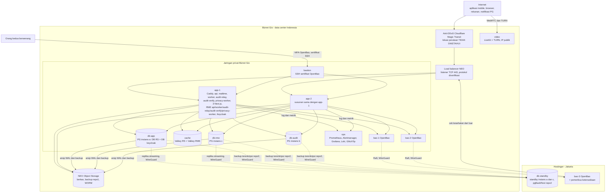

# Stack Teknologi dan Platform: Rumah Sehat

Tanggal: 2026-11-18
Versi: 0.2, draf menunggu gate Tahap 5 (perbaikan setelah review keamanan dan DBA putaran 1–2 serta fact-check)
Penyusun: Claude (persona Principal Engineer + DevOps/Platform Engineer)
Pemilik dan penyetuju: user (project manager, meneruskan ke CEO dan CTO) `[DOK: 00-project-brief.md]`
Dasar: Arsitektur v1.0 `[DOK: 04-arsitektur.md]`, ADR-001–ADR-023 (diterima), jawaban user Tahap 5 `[USER] T5-Q1`–`T5-Q8` (`docs/05-catatan-stack.md`), KEPUTUSAN-74–KEPUTUSAN-89 (`docs/decision-log.md`), sumber SRC-84–SRC-247 (`docs/sources.md`)
Tingkat ketelitian: **T1 Kritis** untuk §2 (hosting dan lingkungan), §3 (CI/CD), dan §5 (secrets). **T2 Standar** untuk bagian lain (`aturan-kerja.md` §1). Konfigurasi realm Keycloak (§7) adalah modul kritis T1 saat diimplementasikan di Tahap 8 `[DOK: CLAUDE.md]`.

Dokumen terkait: ADR-024 (stack aplikasi) dan ADR-025 (hosting VPS, OpenBao, observability, dan pipeline), keduanya draf menunggu gate Tahap 5; CR-012 di `docs/backlog.md`; registry kode respons `docs/05-response-codes.md`; `docs/coding-standards.md`.

**Label sumber.** `[USER] T5-Qx` adalah jawaban user di Tahap 5 (`docs/05-catatan-stack.md`). `[DOK: ...]` adalah dokumen yang lulus gate. `[KEPUTUSAN-xx]` tercatat di `docs/decision-log.md`. `[SRC-xx]` tercatat di `docs/sources.md` dengan URL dan tanggal akses 2026-11-18. `[TIDAK DIKETAHUI]` masuk daftar pertanyaan terbuka atau butir verifikasi Tahap 8 Fase 1 (§13).

**Catatan versi.** Versi di dokumen ini adalah versi stabil terbaru yang diperiksa di registry atau rilis resmi pada 2026-11-18 (sumber per baris). Versi yang benar-benar dipakai dikunci dengan lockfile yang di-commit saat dependensi ditambahkan di Tahap 8 `[DOK: .claude/skills/runbook/references/anti-halu.md]`. Klaim kemampuan pustaka yang belum terdaftar di `docs/sources.md` ditandai "diverifikasi Tahap 8 Fase 1", sesuai aturan bahwa API pustaka diverifikasi saat dipakai.

---

## 1. Ringkasan stack

### 1.1 Backend Rumah Sehat dan RME minimalis (Rust)

Bahasa backend dipilih user: Rust untuk backend Rumah Sehat dan backend RME minimalis `[USER] T5-Q1`.

| Komponen | Pilihan | Versi | Lisensi | Alasan singkat | Sumber |
| --- | --- | --- | --- | --- | --- |
| Bahasa | Rust stable, edisi 2024 | 1.100.0 (2026-11-12) | Apache-2.0 (spdx repo; dwi-lisensi MIT belum diverifikasi) | Pilihan user. Toolchain dipin di berkas toolchain repo. Upgrade toolchain dievaluasi tiap rilis stabil (interval 6 minggu menurut tanggal rilis), tidak otomatis | `[USER] T5-Q1` `[SRC-161]` `[KEPUTUSAN-74]` |
| Runtime async | tokio | 1.54.1 | MIT | Semua advisory yang tercatat sudah ditambal di versi ini | `[SRC-162]` |
| Framework HTTP | axum | 0.8.9 | MIT | Rilis terakhir sekitar 7 bulan lalu, dipantau | `[SRC-163]` |
| Middleware HTTP | tower-http | 0.7.1 | MIT | Lapisan middleware untuk axum | `[SRC-164]` |
| Akses database | sqlx (PostgreSQL) | 0.9.1 | MIT OR Apache-2.0 | SQL eksplisit dengan query diperiksa saat compile, tanpa DSL. Metadata mode offline `.sqlx` di-commit, dan `cargo sqlx prepare --check` dijalankan di CI. MSRV 1.94.0 | `[SRC-165]` `[SRC-166]` `[KEPUTUSAN-74]` |
| Migrasi skema | sqlx-cli | 0.9.1 | MIT OR Apache-2.0 | Migrasi SQL murni, maju saja (forward-only), pola *expand/contract* (ADR-019). Perintah migrasinya diverifikasi Tahap 8 Fase 1 | `[SRC-182]` `[KEPUTUSAN-74]` |
| Serialisasi | serde | 1.0.229 | MIT OR Apache-2.0 | Standar ekosistem | `[SRC-167]` |
| Klien HTTP keluar | reqwest | 0.13.5 | MIT OR Apache-2.0 | Adaptor payment gateway, kurir, email, SATUSEHAT | `[SRC-170]` |
| Pembangkit OpenAPI | utoipa | 6.0.0 | MIT OR Apache-2.0 | Menghasilkan OpenAPI 3.1 dari kode (ADR-022) | `[SRC-168]` `[KEPUTUSAN-83]` |
| Validasi JWT | jsonwebtoken | 12.0.0 | MIT | Validasi token Keycloak dengan daftar izin algoritma, issuer per realm, dan audience sesuai RFC 8725. JWKS realm diambil dari Keycloak dan di-cache. Fungsi pustaka untuk ketiga pemeriksaan diverifikasi Tahap 8 Fase 1 | `[SRC-169]` `[SRC-79]` `[KEPUTUSAN-74]` |
| Kriptografi | aws-lc-rs | 1.19.0 | ISC AND (Apache-2.0 OR ISC) | Satu pustaka kripto untuk AES-256-GCM, HMAC-SHA256 (blind index, webhook), SHA-256 (hash berantai audit), dan RNG. `aes-gcm` dan `ring` tidak dipakai. Ketersediaan API per algoritma diverifikasi Tahap 8 Fase 1 | `[SRC-173]` `[KEPUTUSAN-74]` |
| UUIDv7 | uuid, fitur `std` + `v7` | 1.29.3 | Apache-2.0 OR MIT | `Uuid::now_v7` tersedia dengan fitur `std` dan `v7`. UUIDv7 dibuat aplikasi (ADR-002), bukan default kolom | `[SRC-176]` `[SRC-238]` `[KEPUTUSAN-74]` |
| Waktu | time | 0.3.55 | MIT OR Apache-2.0 | Advisory yang tercatat (RUSTSEC-2026-0009, RUSTSEC-2020-0071) tidak terbuka di versi ini | `[SRC-177]` |
| Logging | tracing + tracing-subscriber, fitur `json` | 0.1.44 / 0.3.23 | MIT | Log JSON per baris (ADR-010) | `[SRC-174]` `[SRC-175]` `[SRC-238]` |
| Klien Valkey | crate `redis` | 1.8.2 (stabil; bukan 2.0.0-rc.3) | BSD-3-Clause | Kompatibilitas dengan Valkey dibuktikan test integrasi Tahap 8 | `[SRC-171]` `[KEPUTUSAN-77]` |
| Test | `cargo test` + testcontainers | 0.28.0 | MIT OR Apache-2.0 | PostgreSQL 18, Valkey, dan Keycloak efemeral untuk test integrasi | `[SRC-181]` `[KEPUTUSAN-74]` |
| Lint | `cargo fmt --check`, `cargo clippy -- -D warnings` | ikut toolchain | — | Peringatan dianggap galat | `[KEPUTUSAN-74]` |
| Rantai pasok | cargo-deny / cargo-audit | 0.21.0 / 0.23.0 | MIT OR Apache-2.0 / Apache-2.0 OR MIT | Lisensi, advisory, dan sumber crate | `[SRC-183]` `[SRC-184]` |
| Antrean job (ADR-007) | Implementasi tipis sendiri di modul Platform | — | — | Tabel job + `SELECT ... FOR UPDATE SKIP LOCKED`. Job tunggal (relay audit, pengambil event Keycloak) memakai `pg_try_advisory_lock` tingkat sesi, sehingga hanya satu instans yang aktif. Ini menjawab "mekanisme penguncinya ditetapkan di Tahap 5" (ADR-007) | `[SRC-36]` `[SRC-234]` `[KEPUTUSAN-74]` |

**Struktur workspace Cargo** `[KEPUTUSAN-74]` `[KEPUTUSAN-89]`:
- `apps/rs-backend`: satu binary Rumah Sehat dengan subcommand `api`, `realtime`, `worker`, `audit-relay`, `audit-verify`, `privacy-worker`; `apps/rme-backend`: `api`, `worker`, `audit-relay`, `audit-verify`, `privacy-worker`. Setiap subcommand adalah deployment dengan identitas OpenBao sendiri (ADR-025, review DBA Tahap 5).
- `crates/`: pustaka bersama `audit`, `crypto`, `authz`, `envelope` (format respons ADR-023), `platform-jobs`, `integration-contract`, `test-support`. RME memakai pustaka ini lewat workspace, tanpa ketergantungan runtime ke Rumah Sehat (ADR-006 butir 2).

**Batas modul** (konsekuensi ADR-006) `[KEPUTUSAN-74]`: setiap modul bisnis Rumah Sehat (arsitektur §3) adalah modul Rust yang hanya mengekspos antarmuka publiknya. Tabel milik modul hanya diakses dari repository modul itu. Batas ini ditegakkan dengan visibilitas Rust (`pub(crate)`), checklist code review, dan test arsitektur di `scripts/verify.sh` yang memeriksa nama tabel di SQL per modul (§6).

### 1.2 Web: backoffice, portal rekanan, web RME (Next.js)

Tiga aplikasi web memakai Next.js, dengan server Next.js berperan sebagai BFF `[USER] T5-Q1`.

| Komponen | Pilihan | Versi | Lisensi | Alasan singkat | Sumber |
| --- | --- | --- | --- | --- | --- |
| Runtime | Node.js 26 "Lithium", Active LTS | v26.13.1 | `[TIDAK DIKETAHUI]` (GitHub API "Other"/NOASSERTION; teks lisensi belum dibuka) | LTS sejak 2026-10-28, EOL 2029-04-30, melewati 12 bulan operasi | `[SRC-107]` |
| Framework | Next.js App Router | 16.4.6 | MIT | Pilihan user. `engines` node ≥ 20.9.0 | `[USER] T5-Q1` `[SRC-156]` |
| Mode build | `output: 'standalone'`, self-hosted, satu kontainer per aplikasi | — | — | Folder standalone hanya berisi berkas yang diperlukan untuk production. Tidak memakai Vercel | `[SRC-157]` `[SRC-158]` `[KEPUTUSAN-75]` |
| Pustaka UI | React | 19.3.1 | MIT | Pasangan Next.js | `[SRC-160]` |
| Bahasa | TypeScript | 7.0.2 | Apache-2.0 | Dist-tag `latest` | `[SRC-112]` |
| Package manager | pnpm | 12.21.0 | MIT | Lockfile di-commit, `--frozen-lockfile` di CI | `[SRC-113]` `[KEPUTUSAN-82]` |
| Klien OIDC BFF | openid-client | 6.9.0 | MIT | Authorization Code sebagai klien rahasia | `[SRC-115]` `[KEPUTUSAN-75]` |
| Enkripsi token di sesi | jose | 6.2.17 | MIT | Token dienkripsi (JWE) dengan kunci dari OpenBao dan diikat ke ID sesi (ADR-011 butir 7). Fungsi JWE diverifikasi Tahap 8 Fase 1 | `[SRC-114]` `[KEPUTUSAN-75]` |
| Klien Valkey untuk sesi | ioredis | 6.0.0 | MIT | Penyimpanan data sesi BFF. Kompatibilitas dengan Valkey dibuktikan test integrasi Tahap 8 | `[SRC-116]` `[KEPUTUSAN-75]` |
| Klien API bertipe | openapi-typescript + openapi-fetch | 7.13.0 / 0.17.0 | MIT | Tipe dari spesifikasi OpenAPI. openapi-fetch masih 0.x dan rilis terakhir keduanya sekitar 9 bulan lalu, dipantau | `[SRC-131]` `[SRC-132]` |
| Pengambilan data | TanStack Query (`@tanstack/react-query`) | 5.108.0 | MIT | Cache dan sinkronisasi data di klien | `[SRC-130]` |
| Test e2e | Playwright (`@playwright/test`) | 1.65.1 | Apache-2.0 | Alur utama web | `[SRC-133]` |
| Pustaka komponen UI, design token | Ditetapkan Tahap 6 | — | — | — | `[KEPUTUSAN-75]` |
| ESLint dan test unit web | `[TIDAK DIKETAHUI]` | — | — | Diverifikasi saat ditambahkan di Tahap 8 | `[KEPUTUSAN-75]` |

**Pengerasan Next.js** `[KEPUTUSAN-75]`. Halaman advisory resmi mencatat dua advisory Critical (RCE di Image Optimization API dengan SVG, 14 Okt 2026; RCE di `next/og` ImageResponse, 22 Sep 2026) dan tujuh advisory Moderate pada 3 Nov 2026 `[SRC-246]`. Karena itu:
- Image optimization dimatikan global dengan `images: { unoptimized: true }` `[SRC-159]`.
- Tidak memakai `next/og`, Edge runtime, `use cache`/Cache Components, maupun middleware untuk keputusan otorisasi.
- Versi dipin. Patch keamanan Next.js untuk advisory Critical/High dipasang paling lambat 7 hari.
- Advisory GHSA-pc58-hwjq-p385 (kekacauan respons antar-klien pada aplikasi self-hosted yang meneruskan respons upstream di belakang reverse proxy HTTP/1.1 dengan pipelining) memengaruhi versi 16.0.0 sampai 16.4.4 dan ditambal sejak 16.4.5 `[SRC-248]`. Versi yang dipilih (16.4.6) sudah memuat tambalan itu.

**BFF di server Next.js** (tafsiran ADR-011 butir 7, ditampilkan di gate; §14) `[KEPUTUSAN-75]`:
- Server Next.js menjalankan OIDC Authorization Code sebagai klien rahasia. Token tidak pernah sampai ke browser.
- Data sesi disimpan di Valkey. Token di dalamnya dienkripsi dengan kunci dari OpenBao dan diikat ke ID sesi.
- Browser memegang cookie `HttpOnly`, `Secure`, `SameSite`, ditambah token CSRF.
- Route Handler meneruskan panggilan ke API Rust dengan token akses. Otorisasi data tetap di backend Rust (ADR-012). Server Next.js tidak menyimpan data bisnis.
- Server Next.js masuk modul kritis T1 (autentikasi dan sesi).

### 1.3 Mobile: aplikasi pasien dan aplikasi tenaga kesehatan (Flutter)

| Komponen | Pilihan | Versi | Lisensi | Alasan singkat | Sumber |
| --- | --- | --- | --- | --- | --- |
| SDK | Flutter stable / Dart | 3.50.0 / 3.14.0 | BSD-3-Clause | Flutter wajib untuk mobile. Stable terbaru | `[SRC-134]` `[KEPUTUSAN-76]` |
| Monorepo mobile | Dart pub workspaces | — | — | Dua aplikasi + paket bersama (`resolution: workspace`) | `[SRC-144]` `[KEPUTUSAN-76]` |
| Login OIDC | flutter_appauth | 13.0.0 | BSD-3-Clause | Authorization Code + PKCE lewat browser sistem (RFC 8252). Butuh Flutter ≥ 3.44.0 | `[SRC-135]` `[SRC-77]` |
| Penyimpanan token | flutter_secure_storage | 11.2.0 | BSD-3-Clause | Penyimpanan aman platform (ADR-011 butir 7, ADR-021 butir 1) | `[SRC-136]` |
| Kunci aplikasi tenaga kesehatan | local_auth | 3.0.2 | BSD-3-Clause | Biometrik/PIN perangkat setelah 15 menit tidak aktif (CR-009) | `[SRC-137]` `[DOK: adr/ADR-021-keamanan-klien-akses-admin-pipeline.md]` |
| Video | livekit_client | 2.13.2 | Apache-2.0 | Klien untuk LiveKit server yang dijalankan sendiri (§9) | `[SRC-138]` |
| HTTP | dio | 5.11.1 | MIT | Klien HTTP | `[SRC-139]` |
| Navigasi | go_router | 18.1.4 | BSD-3-Clause | Flutter Favorite | `[SRC-140]` |
| State management | flutter_riverpod | 3.5.0 | MIT | Mobile developer boleh mengusulkan pengganti lewat CR sebelum Tahap 8 | `[SRC-141]` `[KEPUTUSAN-76]` |
| WebSocket (chat) | web_socket_channel | 3.0.3 | BSD-3-Clause | Rilis terakhir 2025-04-17 (sekitar 19 bulan), dipantau | `[SRC-142]` |
| Laporan crash | sentry_flutter → GlitchTip | 10.5.0 | MIT | GlitchTip kompatibel dengan SDK klien Sentry. Pengiriman data pribadi bawaan SDK dimatikan (`sendDefaultPii`, default `false` `[SRC-255]`) | `[SRC-143]` `[SRC-150]` `[SRC-255]` `[KEPUTUSAN-76]` |
| Generator klien API Dart dari OpenAPI | `[TIDAK DIKETAHUI]` | — | — | Diverifikasi dan dipilih Tahap 8 Fase 1 | `[KEPUTUSAN-76]` |

Pengecualian data aplikasi dari cadangan perangkat dan penyembunyian layar di latar belakang (ADR-021 butir 1): mekanisme platformnya `[TIDAK DIKETAHUI]`, diverifikasi Tahap 8 Fase 1 `[KEPUTUSAN-76]`. Metode uji lalu lintas jaringan build rilis (ADR-021 butir 2) juga `[TIDAK DIKETAHUI]`, ditetapkan Tahap 8 Fase 1 (§13).

### 1.4 Data dan platform

| Komponen | Pilihan | Versi | Lisensi | Alasan singkat | Sumber |
| --- | --- | --- | --- | --- | --- |
| Database | PostgreSQL, dijalankan sendiri di VPS | 18.7 | PostgreSQL License (belum diverifikasi di SRC-118) | Didukung sampai 2030-11-14. Keycloak 26.8.2 mendukung PostgreSQL 14.x–18.x dan diuji dengan 18. Ekstensi `pg_trgm` untuk pencarian | `[SRC-118]` `[SRC-121]` `[SRC-42]` `[KEPUTUSAN-77]` |
| Cache, sesi BFF, Pub/Sub, batas laju | Valkey, dua instans terpisah (Rumah Sehat, RME) | 9.1.3 | BSD-3-Clause | Implementasi komponen "Redis" ADR-007. Redis 8+ memakai tri-lisensi RSALv2/SSPLv1/AGPLv3, sedangkan Valkey BSD-3 dan memuat kode Redis berlisensi BSD-3. **Perlu konfirmasi user di gate** (§14) | `[SRC-124]` `[SRC-247]` `[SRC-125]` `[SRC-76]` `[KEPUTUSAN-77]` |
| Identity provider | Keycloak, 2 node terklaster | 26.8.2 | Apache-2.0 | Keputusan T4-Q4. Rincian konfigurasi di §7 | `[SRC-121]` `[SRC-64]` `[KEPUTUSAN-85]` |
| Konfigurasi realm sebagai kode | keycloak-config-cli | 6.5.1 | Apache-2.0 | Tanpa berkas state. Rilis terakhir sekitar 6 bulan lalu, dipantau | `[SRC-122]` `[KEPUTUSAN-85]` |
| KMS dan secret manager | OpenBao, Raft 3 node | 2.7.2 | MPL-2.0 | Pengganti KMS dan secret manager penyedia cloud (CR-012). Rincian di §5 | `[SRC-185]` `[KEPUTUSAN-79]` |
| Server media video | LiveKit server dengan TURN bawaan | 1.13.11 | Apache-2.0 | Dijalankan sendiri di Indonesia; Egress tidak dipasang (§9) | `[SRC-126]` `[SRC-219]` `[SRC-220]` `[KEPUTUSAN-87]` |
| Reverse proxy dan TLS | Caddy | 2.11.9 | Apache-2.0 | `reverse_proxy` mendukung WebSocket; HTTPS otomatis | `[SRC-189]` `[SRC-237]` `[KEPUTUSAN-78]` |
| Kontainer | Docker Engine + Docker Compose per host | 29.10.0 / 5.8.0 | Apache-2.0 | Tanpa Kubernetes (ADR-019 alternatif ditolak tetap berlaku) | `[SRC-187]` `[SRC-188]` `[KEPUTUSAN-78]` |
| Backup dan PITR | pgBackRest | 2.60.1 | MIT | PITR `--type=time`, dua repositori (repo1, repo2), enkripsi `repo-cipher-type` aes-256-cbc, dukungan PostgreSQL 18 sejak 2.55.0 | `[SRC-186]` `[SRC-235]` `[KEPUTUSAN-78]` |
| Object storage | NEO Object Storage (Biznet Gio) | layanan | — | Kompatibel S3, presigned URL (contoh GET), Object Lock mode Governance/Compliance/Legal Hold | `[SRC-97]` `[SRC-98]` `[SRC-99]` `[KEPUTUSAN-78]` |
| Pemeriksa PDF | qpdf `--json` | 12.4.2 | Apache-2.0 | Memeriksa objek PDF dan menolak PDF berkonten aktif (fallback ADR-018 butir 6) | `[SRC-155]` `[KEPUTUSAN-86]` |
| Provisioning VM (IaC) | `[TIDAK DIKETAHUI]` | — | — | Dipilih Tahap 8 Fase 1. Kandidat: OpenTofu 1.13.9 (MPL-2.0) bila ada provider untuk Biznet Gio/Hostinger, atau skrip idempoten di `infra/` | `[SRC-127]` `[KEPUTUSAN-78]` |
| Jalur terenkripsi antar-penyedia | WireGuard (rencana) | `[TIDAK DIKETAHUI]` | `[TIDAK DIKETAHUI]` | Belum terdaftar di SRC. Diverifikasi Tahap 8 Fase 1 | `[KEPUTUSAN-78]` |
| Sinkronisasi waktu | NTP dengan chrony (rencana) | `[TIDAK DIKETAHUI]` | `[TIDAK DIKETAHUI]` | Menggantikan "layanan waktu penyedia cloud" (ADR-009, ADR-017). Perangkat dan sumber waktu diverifikasi Tahap 8 Fase 1 | `[KEPUTUSAN-78]` |

**Penetralan PDF** `[KEPUTUSAN-86]`: qpdf `--json` membuat representasi JSON objek PDF `[SRC-155]`. Backend menolak PDF yang memuat konten aktif (JavaScript, OpenAction, Launch, EmbeddedFile, AcroForm/XFA). CDR atau render ulang penuh belum tersedia saat go-live, sehingga yang berlaku jalur penolakan sesuai fallback ADR-018 butir 6. Penampil di aplikasi dan web tidak menjalankan skrip. Antivirus `[TIDAK DIKETAHUI]`: belum ada layanan atau perangkat lunak terverifikasi yang berjalan di Indonesia.

### 1.5 Observability

| Komponen | Pilihan | Versi | Lisensi | Alasan singkat | Sumber |
| --- | --- | --- | --- | --- | --- |
| Metrik | Prometheus | 3.16.0 | Apache-2.0 | Dijalankan sendiri di host `ops` | `[SRC-190]` `[KEPUTUSAN-80]` |
| Peringatan | Alertmanager | `[TIDAK DIKETAHUI]` | `[TIDAK DIKETAHUI]` | Versi diverifikasi Tahap 8 | `[KEPUTUSAN-80]` |
| Dasbor | Grafana | 13.3.1 | AGPL-3.0 | Dipakai tanpa modifikasi untuk keperluan internal. Bila dimodifikasi, ditanyakan ke legal | `[SRC-191]` `[KEPUTUSAN-80]` |
| Application log dan security log | Loki, multi-tenant | 3.7.10 | AGPL-3.0 | Tenant terpisah lewat `X-Scope-OrgID`; retensi per tenant (§4) | `[SRC-192]` `[SRC-236]` `[KEPUTUSAN-80]` |
| Crash mobile dan galat backend/web | GlitchTip | 7.0.0 | MIT | Kompatibel SDK klien Sentry; dijalankan sendiri | `[SRC-150]` `[KEPUTUSAN-80]` |
| Agen pengirim log dan metrik | `[TIDAK DIKETAHUI]` | — | — | Dipilih dan diverifikasi Tahap 8 Fase 1 | `[KEPUTUSAN-80]` |
| Pemeriksa ketersediaan dari luar | `[TIDAK DIKETAHUI]` (perangkat) | — | — | Berjalan di host Hostinger | `[KEPUTUSAN-80]` |

### 1.6 CI/CD dan keamanan rantai pasok

| Komponen | Pilihan | Versi | Lisensi | Alasan singkat | Sumber |
| --- | --- | --- | --- | --- | --- |
| Repositori, CI, registry image | GitHub, GitHub Actions, GHCR | layanan | — | Pilihan user, hanya kode dan data sintetis | `[USER] T5-Q6` `[SRC-242]` |
| Identitas runner staging ke OpenBao | Token OIDC GitHub Actions | layanan | — | Issuer `https://token.actions.githubusercontent.com`; klaim `sub` dapat dibatasi ke repo | `[SRC-239]` `[SRC-223]` |
| Pemindai rahasia | gitleaks | 8.30.1 | MIT | Rilis terakhir sekitar 8 bulan lalu; repo masih aktif | `[SRC-151]` |
| Pemindai dependensi | osv-scanner | 2.7.1 | Apache-2.0 | Lockfile npm/pnpm, Dart, Cargo | `[SRC-152]` |
| Pemindai image | Trivy | 0.76.2 | Apache-2.0 | Masih 0.x | `[SRC-153]` |
| Tanda tangan image | cosign, pasangan kunci | 3.1.4 | Apache-2.0 | Verifikasi di host sebelum deploy | `[SRC-154]` `[KEPUTUSAN-81]` |
| Contract test | Schemathesis | 4.33.4 | MIT | Uji respons terhadap spesifikasi OpenAPI | `[SRC-148]` `[KEPUTUSAN-82]` |

### 1.7 Dokumentasi API

| Komponen | Pilihan | Versi | Lisensi | Alasan singkat | Sumber |
| --- | --- | --- | --- | --- | --- |
| Format spesifikasi HTTP | OpenAPI 3.1 (hasil utoipa) | 3.1 | Apache-2.0 (spesifikasi) | Spesifikasi terbaru 3.2.1, tetapi pembangkit menghasilkan 3.1 | `[SRC-168]` `[SRC-145]` `[KEPUTUSAN-83]` |
| UI interaktif | Swagger UI, hanya lokal dan staging | 5.35.0 | Apache-2.0 | Permintaan user (Swagger) | `[USER] T4-masukan` `[SRC-146]` |
| Format spesifikasi WebSocket | AsyncAPI | 3.1.0 | Apache-2.0 | Menjawab ADR-022 butir 5 | `[SRC-147]` `[KEPUTUSAN-83]` |
| Registry `response_code` | `docs/05-response-codes.md` | — | — | Menjawab ADR-023 butir 6 | `[KEPUTUSAN-84]` |

### 1.8 Penyedia pihak ketiga

| Fungsi | Pilihan | Status | Sumber |
| --- | --- | --- | --- |
| Hosting utama | Biznet Gio (NEO Lite, NEO Lite Pro, NEO Object Storage) | Dipilih user | `[USER] T5-Q2` `[SRC-91]` `[SRC-93]` `[SRC-94]` `[SRC-97]` |
| Hosting cadangan | Hostinger, lokasi Jakarta (KVM) | Dipilih user | `[USER] T5-Q2` `[SRC-85]` `[SRC-86]` `[SRC-87]` |
| Payment gateway | DOKU utama, Xendit cadangan | Kandidat; final setelah konfirmasi tertulis (PT-36) | `[USER] T5-Q3` `[SRC-203]`–`[SRC-207]` `[SRC-193]`–`[SRC-199]` |
| Email | Amazon SES, region Jakarta `ap-southeast-3`, lewat API | Dipilih user. Endpoint SMTP tidak tersedia di Jakarta | `[USER] T5-Q4` `[SRC-84]` `[SRC-209]` `[SRC-210]` |
| Kurir | Lalamove saja | Dipilih user; final setelah konfirmasi tertulis lokasi data (PT-37) | `[USER] T5-Q5` `[SRC-216]` |
| Toko aplikasi | Apple Developer Program, Google Play Console | Wajib untuk rilis | `[SRC-244]` `[SRC-01]` |

Rinciannya, termasuk syarat konfirmasi tertulis, ada di §10.

### 1.9 Opsi yang ditolak

| Opsi | Alasan | Sumber |
| --- | --- | --- |
| Backend TypeScript/NestJS (rekomendasi awal penyusun) | User memilih Rust + Next.js | `[USER] T5-Q1` |
| `chrono` | Satu pustaka waktu (`time`) cukup, dan chrono berstatus *unmaintained* tanpa versi perbaikan: RUSTSEC-2026-0543 "The chrono crate is unmaintained; all versions are affected." `[SRC-250]` | `[KEPUTUSAN-74]` |
| apalis / apalis-postgres (antrean job) | Lisensi apalis-postgres di crates.io tercatat "non-standard" sementara berkas LICENSE di repo MIT. Relay audit juga butuh pemrosesan berurutan yang spesifik | `[SRC-179]` `[KEPUTUSAN-74]` |
| `aes-gcm`, `ring` | Satu pustaka kripto saja (aws-lc-rs) | `[KEPUTUSAN-74]` |
| Crate `redis` 2.0.0-rc | Masih release candidate | `[SRC-171]` |
| Redis Open Source 8.x | Tri-lisensi RSALv2/SSPLv1/AGPLv3 | `[SRC-125]` `[SRC-76]` `[KEPUTUSAN-77]` |
| LiveKit Cloud | Daftar region pinning tidak memuat Indonesia | `[SRC-217]` `[KEPUTUSAN-87]` |
| Agora | Tidak menyatakan pusat data atau residensi di Indonesia | `[SRC-221]` `[KEPUTUSAN-87]` |
| Terraform provider Keycloak (v5.10.0, aktif) | Memerlukan berkas state; keycloak-config-cli dipilih | `[SRC-123]` `[KEPUTUSAN-85]` |
| Terraform (IaC) | Lisensi Business Source License 1.1 sejak versi 1.6.0 | `[SRC-128]` |
| Patroni (failover otomatis) di rilis 1 | Menambah komponen yang harus dioperasikan tim kecil. Promosi standby manual masih dalam RTO 4/8 jam (penilaian penyusun; kebutuhan komponen Patroni belum diverifikasi ke dokumentasi resmi) | `[KEPUTUSAN-78]` |
| NEO Kubernetes | Kubernetes tetap alternatif yang ditolak ADR-019 | `[SRC-100]` `[DOK: adr/ADR-019-lingkungan-backup-pemulihan.md]` `[KEPUTUSAN-78]` |
| NEO App (PaaS) dengan PostgreSQL terkelola | PostgreSQL terkelola yang tercantum hanya 14–16; PITR/standby belum terverifikasi | `[SRC-101]` `[KEPUTUSAN-78]` |
| Keyless Sigstore | Mencatat metadata ke log transparansi publik (alasan penyusun) | `[KEPUTUSAN-81]` |
| Deploy production lewat SSH dari GitHub | Kredensial statis production di GitHub melemahkan ADR-021 | `[USER] T5-Q6` |
| GitHub Enterprise untuk required reviewers | Tidak dipilih; persetujuan dipindah ke sisi VPS | `[USER] T5-Q8` `[SRC-240]` |
| Midtrans, Biteship, KIRIM.EMAIL | Tidak dipilih user | `[USER] T5-Q3, T5-Q4, T5-Q5` |

---

## 2. Hosting dan lingkungan

### 2.1 Tiga lingkungan

| Lingkungan | Lokasi | Data | Cara jalan | Deploy |
| --- | --- | --- | --- | --- |
| Lokal | Laptop developer | Sintetis | Docker Compose: PostgreSQL 18 (tiga klaster), Valkey, Keycloak, OpenBao mode dev, LiveKit, Swagger UI. Rahasia di `.env.local` yang tidak di-commit | Manual oleh developer |
| Staging | Biznet Gio, 2 VPS (`stg-app`, `stg-db`) | Sintetis saja | Docker Compose; OpenBao satu node; Swagger UI di belakang login staging; sandbox Partner API dan SATUSEHAT Sandbox | Otomatis setiap `main` hijau (§3) |
| Production | Biznet Gio (utama) + Hostinger Jakarta (cadangan) | Data nyata | Docker Compose per host (§2.2) | Dipicu orang kedua berwenang lewat bastion (§3) |

Sumber: `[DOK: adr/ADR-019-lingkungan-backup-pemulihan.md]` (tiga lingkungan, data production tidak pernah disalin ke staging atau lokal), `[USER] T5-Q2`, `[USER] T5-Q8`, `[KEPUTUSAN-78]`, `[KEPUTUSAN-88]`.

**Pemisahan staging dari production** (perbaikan B-01 review keamanan; ADR-025 (KEPUTUSAN-143 dst.)):
- Staging ditempatkan di jaringan privat yang terpisah dari production, tanpa rute ke host production. Staging menjalankan kode CI (self-hosted runner, §3.2), jadi diperlakukan sebagai zona tidak tepercaya bagi production.
- Akun atau proyek Biznet Gio untuk staging dan production juga dipisah bila penyedia mendukung, mengikuti ADR-019 butir 1. Dukungan jaringan privat dan akun/proyek terpisah di Biznet Gio `[TIDAK DIKETAHUI]`, diverifikasi Tahap 8 Fase 1. Bila pemisahan itu tidak tersedia, security group production menolak semua alamat staging.
- OpenBao staging hanya berisi rahasia sintetis.

**Konsol panel penyedia** (Biznet Gio, Hostinger) dapat membuat snapshot dan membuka konsol VM, sehingga termasuk akses administratif production (ADR-021 butir 3). Ketentuannya: akun bernama per orang (bukan akun bersama), pemegang seminimal mungkin, MFA bila tersedia, aktivitas dicatat bila penyedia menyediakan log, dan tinjauan hak berkala. Ketersediaan MFA dan log aktivitas panel `[TIDAK DIKETAHUI]` (PT-39); bila tidak tersedia, dibawa ke user sebagai penerimaan risiko di gate. Rujukan: ADR-025 (KEPUTUSAN-143 dst.).

### 2.2 Topologi production

Ukuran host adalah estimasi awal penyusun dan divalidasi uji beban NFR-CAP-04. Harga per 2026-11-18 dari halaman resmi penyedia `[KEPUTUSAN-78]`.

**Biznet Gio (utama)**

| Host | Paket | Spesifikasi (vCPU / RAM / disk) | Harga per bulan | Isi | Sumber |
| --- | --- | --- | --- | --- | --- |
| app-1, app-2 | NEO Lite Pro MM.8.4 | 4 / 8 GB / 80 GB NVMe | Rp999.000 × 2 | Caddy, `api`, `realtime`, `worker`, `audit-relay`, `audit-verify`, `privacy-worker` (masing-masing satu aktif lewat advisory lock), 3 server Next.js, RME `api`/`worker`/`audit-relay`/`audit-verify`/`privacy-worker`, Keycloak (1 node per host, klaster 2 node), agen metrik dan log | `[SRC-94]` |
| db-app | NEO Lite Pro ML.16.8 | 8 / 16 GB / 90 GB | Rp1.799.000 | PostgreSQL instans (a): DB aplikasi Rumah Sehat + DB `keycloak`; pgBackRest | `[SRC-94]` |
| db-rme | NEO Lite Pro MM.4.4 | 4 / 4 GB / 60 GB | Rp699.000 | PostgreSQL instans (c): RME; pgBackRest | `[SRC-94]` |
| db-audit | NEO Lite Pro MS.4.2 | 2 / 4 GB / 60 GB | Rp559.000 | PostgreSQL instans (b): audit Rumah Sehat + audit RME; tanpa standby (ADR-019 butir 3); pgBackRest | `[SRC-94]` |
| cache | NEO Lite MS 4.4 | 4 / 4 GB / 60 GB SSD | Rp179.000 | Valkey Rumah Sehat + Valkey RME (instans terpisah) | `[SRC-93]` |
| video | NEO Lite Pro MM.8.4 | 4 / 8 GB / 80 GB NVMe | Rp999.000 | LiveKit + TURN. Kebutuhan CPU dan bandwidth untuk 100 sesi `[TIDAK DIKETAHUI]`, diukur uji beban | `[SRC-94]` |
| bao-1, bao-2 | NEO Lite MS 4.2 | 2 / 4 GB / 60 GB | Rp139.000 × 2 | OpenBao, node Raft 1 dan 2 | `[SRC-93]` |
| ops | NEO Lite MM 8.4 | 4 / 8 GB / 60 GB | Rp269.000 | Prometheus, Alertmanager, Grafana, Loki, GlitchTip | `[SRC-93]` |
| bastion | NEO Lite SS 2.1 | 1 / 2 GB / 60 GB | Rp80.000 | SSH bastion (sertifikat OpenBao), skrip deploy production | `[SRC-93]` |
| Load balancer NEO | — | — | `[TIDAK DIKETAHUI]` | Listener TCP (TLS diteruskan ke Caddy) bila tersedia. Protokol listener belum terverifikasi (PT-39) | `[SRC-102]` |
| NEO Object Storage | Single region | — | Rp1.000/GB/bulan; volume awal estimasi 300 GB ≈ Rp300.000 | Bucket per sensitivitas (ADR-018), bucket backup, bucket WORM dengan Object Lock mode Compliance | `[SRC-97]` `[SRC-99]` |

Subtotal komputasi Biznet Gio production: Rp6.860.000 per bulan (perhitungan dari baris di atas).

**Hostinger, lokasi Jakarta (cadangan)**

| Host | Paket | Spesifikasi | Harga per bulan | Isi | Sumber |
| --- | --- | --- | --- | --- | --- |
| db-standby | KVM 8 | 8 vCPU / 32 GB / 400 GB NVMe | Promo Rp426.900, perpanjangan Rp853.900 | Standby streaming instans (a) dan (c); pgBackRest repo2 (salinan backup terenkripsi) | `[SRC-86]` `[SRC-87]` |
| bao-3 | KVM 1 | 1 vCPU / 4 GB / 50 GB NVMe | Promo Rp116.900, perpanjangan Rp193.900 | OpenBao node Raft 3; pemeriksa ketersediaan dari luar jaringan Biznet Gio (NFR-OBS-01) | `[SRC-86]` `[SRC-87]` |

Harga Hostinger adalah harga promo untuk masa 24 bulan yang dibayar di muka ("All plans are paid upfront") `[SRC-86]` `[SRC-87]`. Apakah harga promo masih berlaku saat pembelian `[TIDAK DIKETAHUI]`.

### 2.3 Topologi staging

| Host | Paket | Spesifikasi | Harga per bulan | Isi | Sumber |
| --- | --- | --- | --- | --- | --- |
| stg-app | NEO Lite MM 8.8 | 8 / 8 GB / 60 GB | Rp289.000 | Semua kontainer aplikasi, Keycloak, Valkey, OpenBao satu node, LiveKit, Swagger UI, self-hosted runner GitHub | `[SRC-93]` |
| stg-db | NEO Lite MM 8.4 | 4 / 8 GB / 60 GB | Rp269.000 | Tiga klaster PostgreSQL | `[SRC-93]` |

Uji beban NFR-CAP-04 memakai staging yang sementara dinaikkan ke ukuran production selama satu bulan (biaya di §11) `[KEPUTUSAN-78]`.

### 2.4 Diagram topologi production

Sumber diagram: `[KEPUTUSAN-78]`, `[KEPUTUSAN-79]`, `[KEPUTUSAN-80]`, `[KEPUTUSAN-81]`, `[USER] T5-Q2`, `[SRC-95]` (jaringan privat, Magic Transit).

### 2.5 Jaringan dan firewall

- **Jaringan privat** Biznet Gio menghubungkan host production `[SRC-95]` `[KEPUTUSAN-78]`.
- **Antar-penyedia** (Biznet Gio ↔ Hostinger): jalur terenkripsi WireGuard untuk replikasi database, salinan backup, dan Raft OpenBao. Perangkat WireGuard belum terdaftar di SRC dan diverifikasi Tahap 8 Fase 1 `[KEPUTUSAN-78]`.
- **Port publik** `[KEPUTUSAN-78]`:
  - Load balancer, port 443 (aplikasi, API, Keycloak endpoint realm pengguna, GlitchTip untuk laporan crash).
  - Bastion, port 22, dibatasi ke alamat yang diizinkan.
  - Host `video` (LiveKit + TURN) menerima lalu lintas publik untuk WebRTC dan TURN: port TURN 3478 atau 443 menurut contoh konfigurasi resmi (`turn:` dengan TLS) `[SRC-126]` `[SRC-219]`, ditambah port sinyal dan rentang port media. Rentang port media dan port lain tidak ada di SRC-126, jadi ditetapkan dari konfigurasi LiveKit di Tahap 8 `[TIDAK DIKETAHUI]`. Lembar keputusan hanya menyebut LB dan bastion sebagai port publik; host video adalah koreksi yang wajib ada agar WebRTC berfungsi (§14.1).
  - WireGuard: satu port UDP yang hanya menerima alamat host pasangan di penyedia lain.
- **Jaringan privat bukan batas kepercayaan** (perbaikan B-01). Firewall dan security group production memakai **default deny**, dengan daftar izin per host sumber dan port (ADR-025 (KEPUTUSAN-143 dst.)):

  | Tujuan | Sumber yang diizinkan |
  | --- | --- |
  | PostgreSQL di `db-app`, `db-rme` | app-1, app-2; node OpenBao (database secrets engine); bastion hanya pada jalur break-glass; `db-standby` untuk replikasi (lewat WireGuard) |
  | PostgreSQL di `db-audit` | app-1, app-2 (relay audit RS dan RME); node OpenBao; bastion hanya pada jalur break-glass |
  | Valkey di `cache` | app-1, app-2 |
  | OpenBao di `bao-*` | Host yang punya identitas proses (app-1, app-2, host database untuk kunci cipher pgBackRest); bastion; node OpenBao lain untuk Raft |
  | Konsol admin Keycloak dan realm `master` | Bastion (jalur admin ber-MFA) dan proses backend di app-1/app-2 untuk Admin REST |
  | Loki dan Prometheus di `ops` | Agen di host production yang terautentikasi; kueri hanya dari host `ops` (Grafana) |
  | Grafana dan GlitchTip (antarmuka admin) di `ops` | Lewat bastion, di belakang login SSO admin ber-MFA |
  | SSH di semua host | Bastion saja |

  Observability tidak diekspos ke publik, kecuali endpoint penerimaan laporan crash GlitchTip lewat LB. Grafana memakai login SSO admin ber-MFA; Loki dan Prometheus hanya menerima pengirim yang terautentikasi, karena pemisahan tenant Loki hanya lewat header `X-Scope-OrgID` `[SRC-236]`. Mekanisme SSO Grafana dan autentikasi push Loki/Prometheus diverifikasi Tahap 8 Fase 1 `[KEPUTUSAN-80]`. Port persis per komponen ditetapkan di `infra/` saat Tahap 8 `[KEPUTUSAN-78]` `[KEPUTUSAN-85]`.
- Firewall dan security group tersedia di NEO Lite/Pro `[SRC-95]`. Hostinger menyediakan manajemen firewall di semua paket `[SRC-88]`.
- **TLS internal** (ADR-013 butir 1: semua lalu lintas eksternal dan internal memakai TLS) `[DOK: adr/ADR-013-perlindungan-data-pribadi-spesifik.md]`:
  - Lalu lintas **antar-host** memakai TLS, termasuk di jaringan privat Biznet Gio: koneksi ke PostgreSQL, Valkey, OpenBao, dan Keycloak (Admin REST dan antar-node), serta replikasi dan backup lintas penyedia (TLS di atas WireGuard). Versi minimum dan cipher mengikuti checklist ASVS Level 2. Konfigurasi TLS tiap komponen diverifikasi Tahap 8 Fase 1.
  - Lalu lintas **di dalam satu host** (misalnya Caddy ke `api` atau server Next.js ke `api` di host yang sama) lewat jaringan Docker bridge privat tanpa TLS. Ini **tafsiran penyusun atas ADR-013 butir 1 yang ditampilkan di gate**. Opsi lain yang ditawarkan ke user: TLS juga di dalam host, dengan biaya pengelolaan sertifikat internal yang lebih besar `[KEPUTUSAN-78]`.

### 2.6 Load balancer, TLS, dan perlindungan aplikasi web

- **Rencana utama**: load balancer NEO dengan listener TCP 443 yang meneruskan TLS ke Caddy di app-1 dan app-2. Caddy menerminasi TLS dan meneruskan HTTP dan WebSocket ke proses aplikasi `[SRC-102]` `[SRC-237]` `[KEPUTUSAN-78]`. Dokumentasi LB NEO hanya menyebut bahwa protokol listener dipilih; protokol yang tersedia, dukungan WebSocket, pemeriksaan kesehatan, dan harga `[TIDAK DIKETAHUI]` (PT-39).
- **IP klien asli setelah LB NEO: syarat keras sebelum go-live.** Dukungan PROXY protocol atau header `X-Forwarded-For` pada LB NEO `[TIDAK DIKETAHUI]`, diverifikasi Tahap 8 Fase 1 bersama PT-39. Tanpa WAF terkelola, batas laju per IP (termasuk untuk login pasien) dan alamat IP di security log (ADR-010) bergantung pada IP asli sampai ke Caddy. Bila LB NEO tidak meneruskan IP asli, LB tidak dipakai dan alternatifnya dipakai: DNS langsung ke dua host app dengan Caddy di masing-masing (butir berikut). Pilihan akhirnya dibuktikan Tahap 8 Fase 1 `[KEPUTUSAN-78]`.
- **Bila LB NEO tidak memenuhi** (protokol, WebSocket, atau IP klien asli): DNS langsung ke dua host app, dengan Caddy di app-1 dan app-2 menerima lalu lintas dan melihat IP klien asli. Cara mengeluarkan host yang mati dari DNS atau memakai IP mengambang `[TIDAK DIKETAHUI]`, dipilih Tahap 8 Fase 1 setelah PT-39 terjawab. Opsi ini dicatat sebagai risiko terhadap NFR-AVL-01.
- **WAF terkelola tidak tersedia** di Biznet Gio maupun Hostinger menurut halaman yang dibuka (`docs/sources.md`, pencarian tanpa hasil). Perlindungan pengganti: Caddy sebagai reverse proxy, validasi input, batas laju aplikasi di Valkey, dan batas laju per IP di Caddy (modulnya diverifikasi Tahap 8). Perangkat lunak WAF (misalnya OWASP CRS) dievaluasi di Tahap 8 Fase 1; bila tidak dipakai, dicatat sebagai risiko `[KEPUTUSAN-78]`.

### 2.7 Failover database

- Standby streaming instans (a) dan (c) berjalan di `db-standby` Hostinger. Instans audit (b) tanpa standby, sesuai ADR-019 butir 3 `[KEPUTUSAN-78]`. Dokumentasi replikasi streaming PostgreSQL 18 belum terdaftar di SRC dan diverifikasi Tahap 8 Fase 1.
- Promosi standby dilakukan manual sesuai runbook pemulihan. RTO ≤ 4 jam di jam kerja dan ≤ 8 jam di luar jam kerja (NFR-DR-02) memberi ruang untuk langkah manual `[KEPUTUSAN-78]` `[DOK: adr/ADR-019-lingkungan-backup-pemulihan.md]`.
- **Skenario Biznet Gio padam total**: database dapat dipromosikan di Hostinger, tetapi semua proses aplikasi berjalan di Biznet Gio. Pemulihan layanan butuh membangun ulang host aplikasi dari kode infrastruktur, dan dua dari tiga node OpenBao ikut padam. Apakah skenario ini muat dalam RTO `[TIDAK DIKETAHUI]`; dibuktikan dalam uji pemulihan sebelum go-live (NFR-DR-03), termasuk perilaku Raft OpenBao saat dua node tidak tersedia. Ini masuk risiko baru (§13.3) `[KEPUTUSAN-78]`.

### 2.8 Backup, PITR, RPO, dan RTO

| Butir | Rancangan | Sumber |
| --- | --- | --- |
| Alat | pgBackRest 2.60.1 untuk ketiga instans (a), (b), (c) | `[SRC-186]` `[KEPUTUSAN-78]` |
| PITR | Pemulihan `--type=time` dengan `--target` | `[SRC-235]` |
| Arsip WAL | `archive_timeout` ≤ 1 menit, jauh di bawah RPO 15 menit (NFR-DR-01) | `[SRC-38]` `[DOK: adr/ADR-019-lingkungan-backup-pemulihan.md]` |
| Repositori | repo1 di NEO Object Storage (tipe `s3`); repo2 di host Hostinger (tipe `posix` atau `sftp`) | `[SRC-235]` `[SRC-97]` `[KEPUTUSAN-78]` |
| Enkripsi backup | `repo-cipher-type` aes-256-cbc; kunci cipher disimpan di OpenBao | `[SRC-235]` `[KEPUTUSAN-79]` |
| Backup penuh | Harian | `[DOK: adr/ADR-019-lingkungan-backup-pemulihan.md]` |
| Masa simpan | 35 hari, nilai sementara sampai PT-24 | `[USER] T4-G2` |
| Lokasi | Semua di Indonesia: NEO Object Storage (Biznet Gio) dan Hostinger Jakarta (NFR-DR-04) | `[SRC-91]` `[SRC-85]` `[USER] T5-Q2` |
| Valkey | Tidak di-backup; isinya dibangun ulang dari PostgreSQL (ADR-007) | `[DOK: adr/ADR-019-lingkungan-backup-pemulihan.md]` |
| OpenBao | Snapshot Raft terenkripsi ke NEO Object Storage; perintah snapshot diverifikasi Tahap 12 | `[KEPUTUSAN-79]` |
| Kepala rantai audit | Bucket WORM dengan Object Lock mode Compliance: objek tidak dapat diubah atau dihapus | `[SRC-99]` `[KEPUTUSAN-78]` |
| RTO | Runbook pemulihan + kode infrastruktur + standby + uji pemulihan sebelum go-live | `[DOK: adr/ADR-019-lingkungan-backup-pemulihan.md]` |

Kompatibilitas pgBackRest dengan NEO Object Storage `[TIDAK DIKETAHUI]` (Biznet Gio menyatakan "100% S3 Compatibel" `[SRC-97]`), dibuktikan Tahap 8 Fase 1. Versioning objek (ADR-018 butir 5, ADR-019 butir 4) tidak ditemukan di halaman Biznet Gio yang dibuka, diverifikasi Tahap 8 Fase 1.

### 2.9 Rencana pindah dari laptop ke VPS

| Langkah | Kapan | Isi | Sumber |
| --- | --- | --- | --- |
| 1. Lokal | Tahap 8 Fase 1 (reference implementation) | Compose lokal berisi semua dependensi; `scripts/verify.sh` hijau di laptop; testcontainers untuk test integrasi | `[KEPUTUSAN-82]` `[KEPUTUSAN-88]` |
| 2. Staging Biznet Gio | Estimasi mulai Desember 2026 | Sewa `stg-app` dan `stg-db`; pasang Docker, Compose, Caddy, OpenBao satu node, self-hosted runner; deploy otomatis dari `main`; sandbox rekanan dan SATUSEHAT Sandbox | `[KEPUTUSAN-78]` `[KEPUTUSAN-81]` |
| 3. Uji beban | Estimasi Januari 2027, satu bulan | Staging dinaikkan ke ukuran production; ukur NFR-CAP-01–04 dan validasi ukuran host | `[KEPUTUSAN-78]` |
| 4. Production | Estimasi mulai 1 Februari 2027 | Sewa host Biznet Gio dan Hostinger; inisialisasi OpenBao dan pembagian share unseal (PT-38); replikasi dan backup; uji pemulihan penuh (NFR-DR-03); deploy pertama lewat bastion | `[KEPUTUSAN-78]` `[KEPUTUSAN-79]` |
| 5. Go-live | 1 Maret 2027 | — | `[DOK: 01-business-case.md]` |

Tanggal mulai sewa adalah estimasi penyusun dan dikonfirmasi user di gate `[KEPUTUSAN-78]`. Data production tidak pernah disalin ke staging atau lokal `[DOK: adr/ADR-019-lingkungan-backup-pemulihan.md]`.

### 2.10 Butir gate: Cloudflare Magic Transit

Biznet Gio menyebut perlindungan anti-DDoS-nya "Cloudflare Magic Transit premium anti-DDoS" `[SRC-95]`. Artinya lalu lintas jaringan dapat dirutekan lewat jaringan Cloudflare. TLS diterminasi di Caddy milik Rumah Sehat, sehingga isi permintaan tetap terenkripsi saat melewati jalur itu, tetapi lokasi perutean `[TIDAK DIKETAHUI]` `[KEPUTUSAN-78]`. Karena T4-Q1 menetapkan semua penyedia memproses dan menyimpan data di Indonesia tanpa kecuali `[USER] T4-Q1`, butir ini **dibawa ke user di gate** dan ditanyakan ke Biznet Gio (PT-39): apakah Magic Transit dapat dimatikan, di mana lalu lintas dirutekan, dan apakah perutean terenkripsi tanpa penyimpanan dianggap memenuhi T4-Q1.

### 2.11 Waktu server, provisioning, dan kontainer

- **Waktu**: semua host disinkronkan ke sumber waktu NTP (rencana chrony). Sumber dan perangkat diverifikasi Tahap 8. Ini menggantikan "layanan waktu penyedia cloud" di ADR-009 dan ADR-017 butir 5 (CR-012) `[KEPUTUSAN-78]`.
- **Provisioning VM**: perangkat IaC `[TIDAK DIKETAHUI]`, dipilih Tahap 8 Fase 1 (kandidat OpenTofu 1.13.9 bila ada provider untuk kedua penyedia `[SRC-127]`, atau skrip idempoten di `infra/`). Biznet Gio menyediakan API manajemen VPS `[SRC-95]`; Hostinger menyediakan Public API `[SRC-88]`. Konfigurasi host, Compose, Caddyfile, realm Keycloak, policy OpenBao, pgBackRest, aturan Prometheus/Loki, dan konfigurasi LiveKit disimpan sebagai kode di `infra/` `[KEPUTUSAN-78]` `[KEPUTUSAN-89]`.
- **Kontainer**: Docker Engine 29.10.0 dan Docker Compose 5.8.0 di setiap host `[SRC-187]` `[SRC-188]`. Deploy bergulir per host (app-1 lalu app-2) `[KEPUTUSAN-81]`.
- **Ketersediaan penyedia**: NEO Lite menyatakan uptime hingga 99,9% `[SRC-106]`, sedangkan target layanan 99,0% (NFR-AVL-01) `[DOK: 03-prd.md]`. Pernyataan uptime untuk NEO Lite Pro dan Hostinger `[TIDAK DIKETAHUI]`.
- **Lokasi data center**: Biznet Gio punya pusat data di Jakarta, Jawa Barat, dan Banten (blog resmi 2021, bukan pernyataan zona) `[SRC-92]`. Apakah host dapat ditempatkan di pusat data berbeda `[TIDAK DIKETAHUI]`.

---

## 3. Rancangan CI/CD

Dasar: GitHub untuk kode, CI, dan registry image, hanya kode dan data sintetis; deploy oleh agen di VPS; tanpa kunci SSH production di GitHub `[USER] T5-Q6`. Persetujuan deploy production di sisi VPS `[USER] T5-Q8`. Pada paket GitHub Free, Pro, dan Team, required reviewers hanya tersedia untuk repositori publik `[SRC-240]`.

### 3.1 Alur

```mermaid
flowchart LR
  D[Commit lokal<br/>git hook: verify.sh penuh] --> P[Push ke GitHub]
  P --> GA[GitHub Actions, runner GitHub-hosted<br/>verify.sh penuh, pemindaian,<br/>build image per komponen]
  GA --> R[(GHCR<br/>image dirujuk lewat digest)]
  GA --> SG[cosign menandatangani digest]
  R --> M{main hijau?}
  M -->|ya| SR[Self-hosted runner di stg-app<br/>token OIDC GitHub ke OpenBao]
  SR --> SV[tarik digest, verifikasi tanda tangan,<br/>migrasi dengan kredensial dinamis,<br/>compose up bergulir, cek kesehatan]
  SV --> STG[Staging]
  STG --> Q[Digest lulus staging]
  Q --> H[Orang kedua berwenang<br/>login OpenBao dengan MFA]
  H --> C[Sertifikat SSH berumur pendek]
  C --> B[Bastion: skrip deploy production]
  B --> PV[verifikasi tanda tangan,<br/>migrasi dengan kredensial pemilik skema dinamis,<br/>app-1 lalu app-2]
  PV --> PROD[Production]
```

Sumber: `[KEPUTUSAN-81]`, `[USER] T5-Q6`, `[USER] T5-Q8`.

### 3.2 Tahapan

1. **Commit**: git hook proyek menjalankan `scripts/verify.sh` mode penuh dan menolak commit merah `[DOK: CLAUDE.md]`.
2. **CI di runner GitHub-hosted** `[KEPUTUSAN-81]`:
   - `scripts/verify.sh` lengkap (§6);
   - pemindaian: gitleaks `[SRC-151]`, osv-scanner `[SRC-152]`, cargo-deny dan cargo-audit `[SRC-183]` `[SRC-184]`, Trivy untuk image `[SRC-153]`;
   - build image per komponen (`rs-backend`, `rme-backend`, tiga web, Swagger UI untuk staging);
   - push ke GHCR. Image dirujuk lewat digest SHA, bukan tag `[SRC-242]`;
   - tanda tangan cosign dengan pasangan kunci. Kunci privat disimpan sebagai secret GitHub berakses minimum; kunci publik dipasang di host untuk verifikasi `[SRC-154]`;
   - versi action dan alat dipin `[SRC-82]`.
3. **Staging (otomatis)**: self-hosted runner di `stg-app`. GitHub meminta kehati-hatian untuk self-hosted runner juga di repositori privat: runner "can be persistently compromised by untrusted code in a workflow", dan "there is no way to guarantee that a self-hosted runner only runs one job" `[SRC-254]` `[SRC-241]`. Karena itu (perbaikan B-01, ADR-025 (KEPUTUSAN-143 dst.)):
   - runner dijalankan sebagai runner JIT sekali pakai per job, yang "perform at most one job before being automatically removed" `[SRC-254]`;
   - hanya workflow yang dipicu push ke `main` yang boleh memakai runner ini;
   - runner hanya punya identitas OpenBao staging, yang hanya berisi rahasia sintetis, dan berada di jaringan staging tanpa rute ke production (§2.1).

   Runner mengautentikasi ke OpenBao staging dengan token OIDC GitHub. Role OpenBao membatasi klaim `sub` ke repositori dan ref `main` lewat `bound_subject`/`bound_claims` `[SRC-239]` `[SRC-223]`. Langkahnya: tarik digest, verifikasi tanda tangan, migrasi dengan kredensial PostgreSQL dinamis `[SRC-224]`, `docker compose up` bergulir, lalu cek endpoint kesehatan `[KEPUTUSAN-81]`. Format persis klaim `sub` untuk ref branch diverifikasi Tahap 8 Fase 1; halaman SRC-239 mengutip format untuk environment.
4. **Production (manual, orang kedua)**: tidak ada runner dan tidak ada kredensial production di GitHub. Orang kedua berwenang login ke OpenBao dengan Login MFA TOTP `[SRC-251]`, menerima sertifikat SSH berumur pendek dari peran SSH CA "deploy" (hanya app-1/app-2 dan bastion, principal non-root) `[SRC-225]`, masuk lewat bastion, lalu menjalankan skrip deploy dengan digest yang sudah lulus staging. Skrip memverifikasi tanda tangan, lalu deploy bergulir app-1 kemudian app-2. Semua langkah tercatat di log audit OpenBao dan security log `[USER] T5-Q8` `[KEPUTUSAN-81]`. Mekanisme pencatatan "digest lulus staging" ditetapkan Tahap 8 Fase 1.
   - **Kredensial pemilik skema** (perbaikan B-02): skrip deploy meminta kredensial dari database secrets engine `[SRC-224]` di path yang dilindungi Control Group, sehingga permintaan baru terbit setelah disetujui orang lain `[SRC-253]`. TTL kredensial setara durasi migrasi. Kredensial dipakai langsung oleh skrip dan tidak ditampilkan ke operator. Migrasi yang dijalankan dicocokkan dengan daftar migrasi yang sudah direview (§3.2 butir 6). Rujukan: ADR-025 (KEPUTUSAN-143 dst.).
   - OpenBao tidak memberi tahu approver tentang permintaan yang tertunda ("does not send any notification to the approvers") `[SRC-253]`, jadi permintaan Control Group dikirim sebagai peringatan Alertmanager (§4.3).
5. **Kredensial baca registry di host**: host staging dan production menarik image dari GHCR. Kredensial baca paket disimpan di OpenBao, bukan di berkas host; jenis token GHCR yang dipakai `[TIDAK DIKETAHUI]`, diverifikasi Tahap 8 Fase 1 `[KEPUTUSAN-88]`.
6. **Migrasi berisiko**: migrasi yang menyentuh database audit, role, grant, trigger penolak, atau RLS wajib review DBA dan keamanan sebelum merge (ADR-021) `[KEPUTUSAN-81]`.
7. **Proteksi branch `main`**: diatur user bila paket GitHub mendukung. Ini bukan pengaman utama; pengaman utamanya git hook commit hijau dan persetujuan production di sisi VPS `[KEPUTUSAN-81]`.
8. **Aplikasi mobile**: build rilis bertanda tangan untuk Android dan iOS, dan tempat build iOS (runner macOS atau mesin lain), `[TIDAK DIKETAHUI]`, ditetapkan Tahap 8 Fase 1 atau Tahap 12. Kunci penandatangan disimpan di OpenBao `[KEPUTUSAN-88]`.

### 3.3 Pemetaan ke ADR-021 butir 4

| Syarat ADR-021 butir 4 | Jawaban Tahap 5 | Status |
| --- | --- | --- |
| Identitas pipeline per lingkungan, hak minimum, kredensial jangka pendek; rahasia dari secret manager, tidak di repositori atau konfigurasi CI `[SRC-82]` | Staging: runner JIT sekali pakai per job `[SRC-254]`, token OIDC GitHub ke OpenBao staging, dibatasi repo dan `main` `[SRC-239]` `[SRC-223]`. Production: tanpa identitas pipeline; manusia memakai sertifikat SSH berumur pendek `[SRC-225]`. Runner GitHub-hosted tidak memegang kredensial lingkungan. Pengecualian: kunci privat cosign di secret GitHub `[KEPUTUSAN-81]` | Terpenuhi, dengan pengecualian kunci cosign yang ditampilkan di gate |
| Deploy production hanya dari `main` yang dilindungi, dengan review yang tidak dapat dilewati dan persetujuan manual | Persetujuan manual oleh orang kedua di sisi VPS, hanya untuk digest dari `main` yang lulus staging `[USER] T5-Q8`. Required reviewers GitHub tidak tersedia untuk repositori privat pada Free/Pro/Team `[SRC-240]`, jadi "review yang tidak dapat dilewati" di sisi GitHub bergantung pada proteksi branch yang tersedia di paket user | Sebagian; penyesuaian dicatat di CR-012 |
| Kredensial pemilik skema hanya pada langkah migrasi | Kredensial dinamis dari database secrets engine OpenBao `[SRC-224]`, diminta skrip deploy di path ber-Control Group `[SRC-253]`, dengan TTL setara durasi migrasi dan tidak ditampilkan ke operator (§3.2 butir 4) | Terpenuhi (rancangan) |
| Migrasi audit, role, grant, trigger penolak, RLS direview DBA dan keamanan | Aturan review pada PR (§3.2 butir 6) | Terpenuhi (proses) |
| Versi dependensi dipin, integritas diperiksa dengan hash `[SRC-82]` | Lockfile Cargo, pnpm, dan pub di-commit; `pnpm install --frozen-lockfile`; image lewat digest `[SRC-242]` | Terpenuhi (rancangan) |
| Pemindaian rahasia, dependensi, dan image di CI | gitleaks, osv-scanner, cargo-deny, cargo-audit, Trivy | Terpenuhi (rancangan) |
| Image dirujuk lewat digest dan ditandatangani bila platform mendukung | GHCR mendukung tarik lewat digest `[SRC-242]`; cosign `[SRC-154]` | Terpenuhi (rancangan) |
| Kunci penandatangan aplikasi mobile di secret manager dengan akses minimal tercatat | OpenBao KV dengan log audit `[KEPUTUSAN-88]` `[SRC-226]`; tempat build rilis `[TIDAK DIKETAHUI]` | Tertunda Tahap 8 / Tahap 12 |

---

## 4. Observability

Dijalankan sendiri di host `ops`, sesuai ADR-010 dan larangan layanan observabilitas di luar Indonesia `[USER] T4-Q1` `[KEPUTUSAN-80]`.

### 4.1 Tiga log terpisah

| Aspek | Audit trail | Application log | Security log |
| --- | --- | --- | --- |
| Penyimpanan | Database audit (instans b) + kepala rantai di bucket WORM NEO Object Storage, Object Lock Compliance `[SRC-99]` | Loki, tenant `app` `[SRC-236]` | Loki, tenant `security` `[SRC-236]` |
| Penghasil | Pustaka audit (ADR-009) lewat outbox dan `audit-relay` | `tracing` JSON dari semua proses Rust `[SRC-238]`, server Next.js, Keycloak | Event Keycloak (diambil worker), middleware otorisasi, gateway integrasi, job verifikasi rantai, log PostgreSQL, log audit OpenBao `[SRC-226]` |
| Retensi | `[TIDAK DIKETAHUI]` (PT-24); tidak dimusnahkan sebelum ditetapkan | 30 hari, sementara sampai PT-24 `[USER] T4-G2` | 1 tahun, sementara sampai PT-24 `[USER] T4-G2` |
| Mekanisme retensi | Pekerja privasi dan partisi bulanan (ADR-009, ADR-013) | Retensi per tenant lewat runtime overrides; retensi compactor diaktifkan eksplisit karena bawaannya mati `[SRC-236]` | Sama dengan application log |
| Akses | Auditor, Super Admin, Admin Fasyankes (lewat aplikasi) | Tim teknis, lewat Grafana di jaringan privat | Hanya peran keamanan; header tenant `security` tidak diberikan ke peran lain |

Audit trail tetap di database audit, tidak di Loki `[KEPUTUSAN-80]`. Penyimpanan chunk Loki di NEO Object Storage `[KEPUTUSAN-80]`; dukungan Loki untuk object store kompatibel S3 non-AWS belum terverifikasi di halaman yang dibuka `[SRC-236]`, dibuktikan Tahap 8 Fase 1. Redaksi otomatis dan daftar tolak logger mengikuti ADR-010 butir 1 dan butir 5 `[SRC-83]`.

Log audit OpenBao meng-hash sebagian besar string dengan HMAC-SHA256 bersalt `[SRC-226]`. Halaman yang sama memuat peringatan tentang cakupan hash yang harus dibaca penuh sebelum log ini diandalkan sebagai bebas rahasia `[SRC-226]` `[KEPUTUSAN-79]`.

### 4.2 Metrik

Dikumpulkan Prometheus `[SRC-190]` `[KEPUTUSAN-80]`:
- laju galat dan latensi p95 per rute, dibanding NFR-PERF-01–05;
- panjang antrean job, umur outbox audit, jeda relay audit;
- status integrasi per rekanan dan per penyedia (NFR-AVL-04, NFR-INT-03);
- keterlambatan pengambilan event Keycloak;
- masa berlaku sertifikat TLS, ruang disk, jeda replikasi standby, umur backup terakhir;
- status seal dan kesehatan node OpenBao.

### 4.3 Peringatan

Alertmanager mengirim peringatan ke email tim teknis lewat SES `[KEPUTUSAN-80]`. Ambang yang sudah ditetapkan dokumen:

| Peringatan | Ambang | Sumber |
| --- | --- | --- |
| Pengambilan event Keycloak terlambat | > 5 menit | `[DOK: adr/ADR-011-target-asvs-autentikasi-sesi-mfa.md]` butir 10 |
| Integrasi rekanan berstatus Terganggu | 30 menit | NFR-INT-03 `[DOK: 03-prd.md]` |
| Endpoint kesehatan gagal dari pemeriksa luar | Gangguan memicu peringatan | NFR-OBS-01 `[DOK: 03-prd.md]` |
| Akses darurat (break-glass) dipakai | Setiap kejadian | `[DOK: adr/ADR-021-keamanan-klien-akses-admin-pipeline.md]` butir 3 |
| Permintaan Control Group OpenBao menunggu persetujuan | Setiap permintaan (OpenBao tidak memberi tahu approver) | `[SRC-253]` |
| Root token OpenBao dibuat lewat `generate-root` | Setiap kejadian | `[SRC-252]` |
| Perubahan konfigurasi realm Keycloak (admin event) | Setiap kejadian | `[DOK: adr/ADR-011-target-asvs-autentikasi-sesi-mfa.md]` butir 2 |

Ambang lain (jeda relay, umur outbox, umur backup, jeda replikasi, disk, sertifikat, node OpenBao tersegel) ditetapkan Tahap 8 `[KEPUTUSAN-80]`.

### 4.4 Pemeriksa ketersediaan dan laporan crash

- **Pemeriksa ketersediaan dari luar** berjalan di host Hostinger dan memeriksa endpoint kesehatan di Biznet Gio. Endpoint kesehatan tidak memuat data pribadi. Ketersediaan bulanan (NFR-AVL-01) diukur dari pemeriksa ini. Perangkatnya diverifikasi Tahap 8, dan peringatannya dikirim langsung dari host Hostinger supaya tetap berfungsi bila Biznet Gio padam `[KEPUTUSAN-80]` `[DOK: adr/ADR-010-pemisahan-tiga-jenis-log.md]`.
- **Laporan crash** aplikasi mobile dan galat backend/web dikirim ke GlitchTip yang dijalankan sendiri `[SRC-150]`, tanpa data pribadi. Endpoint GlitchTip masuk daftar izin host tujuan aplikasi mobile (ADR-021 butir 2) `[KEPUTUSAN-80]`.

---

## 5. Pengelolaan secrets per lingkungan

OpenBao 2.7.2 menggantikan KMS dan secret manager penyedia cloud (CR-012) `[SRC-185]` `[KEPUTUSAN-79]`.

### 5.1 Per lingkungan

| Lingkungan | Tempat rahasia | Aturan | Sumber |
| --- | --- | --- | --- |
| Lokal | `.env.local` (di `.gitignore`, tidak di-commit) + OpenBao mode dev di Compose lokal | Nilai sintetis saja | `[KEPUTUSAN-88]` |
| Staging | OpenBao satu node, terpisah dari production, hanya rahasia sintetis | Proses mengambil rahasia saat start dan saat rotasi. Runner staging (JIT sekali pakai) masuk lewat token OIDC GitHub dan tidak punya identitas di OpenBao production | `[KEPUTUSAN-88]` `[SRC-239]` `[SRC-223]` `[SRC-254]` |
| Production | OpenBao Raft 3 node (bao-1, bao-2 di Biznet Gio; bao-3 di Hostinger) | Tidak ada rahasia di image, repositori, berkas Compose, atau variabel CI | `[KEPUTUSAN-79]` `[KEPUTUSAN-88]` `[SRC-227]` |
| GitHub | Secret repositori | Hanya kunci privat cosign, berakses minimum | `[KEPUTUSAN-81]` `[KEPUTUSAN-88]` |

Konfigurasi non-rahasia ditaruh di variabel lingkungan dalam berkas Compose per lingkungan di repositori `[KEPUTUSAN-88]`.

### 5.2 Kemampuan OpenBao yang dipakai

| Kebutuhan | Fitur OpenBao | Sumber |
| --- | --- | --- |
| KEK dan envelope encryption (ADR-013) | Transit engine: `datakey` membangkitkan DEK yang dibungkus KEK; rotasi menyimpan versi lama; `min_decryption_version` mengatur versi yang masih dapat dekripsi; `rewrap` membungkus ulang tanpa membuka data. Ini memenuhi "rotasi KEK tanpa membungkus ulang" ADR-013 butir 5 | `[SRC-222]` `[KEPUTUSAN-79]` |
| Rahasia aplikasi | KV untuk password DB aplikasi, kunci blind index, kunci enkripsi sesi BFF, rahasia HMAC webhook bila tidak di DB, kredensial SES/DOKU/Lalamove, kunci cipher pgBackRest, kunci penandatangan mobile. Halaman dokumentasi KV belum terdaftar di SRC, diverifikasi Tahap 8 Fase 1 | `[KEPUTUSAN-79]` `[KEPUTUSAN-88]` |
| Identitas proses | Setiap proses punya identitas dan policy minimum sendiri: `api`, `realtime`, `worker`, `audit-relay`, `audit-verify`, `privacy-worker`, RME `api`/`worker`/`audit-relay`/`audit-verify`/`privacy-worker`, rotasi kunci, tiga server Next.js. Metode auth (AppRole atau JWT) dipilih Tahap 8; JWT/OIDC dengan bound claims terverifikasi, AppRole belum terdaftar di SRC | `[SRC-223]` `[KEPUTUSAN-79]` |
| Kredensial database tanpa hak tetap | Database secrets engine PostgreSQL: kredensial dinamis dengan `default_ttl`/`max_ttl` dan `VALID UNTIL` untuk role pemilik skema saat migrasi dan untuk akses administratif. Menjawab ADR-021 butir 3 dan butir 4 | `[SRC-224]` `[KEPUTUSAN-79]` |
| Akses SSH manusia | SSH CA: sertifikat bertanda tangan dengan TTL pada role. Peran dipisah per kelas host (§5.3) | `[SRC-225]` `[KEPUTUSAN-79]` |
| MFA manusia | Login MFA (TOTP), dibangun di atas sistem Identity OpenBao | `[SRC-251]` |
| Persetujuan orang kedua | Control Groups: "second-party authorization" lewat *factor* policy pada path | `[SRC-253]` |
| Root token | Dibuat ulang hanya lewat `bao operator generate-root` dengan kuorum pemegang share; dianjurkan hanya untuk setup awal dan dicabut segera setelah tidak diperlukan | `[SRC-252]` |
| Log audit akses rahasia | Audit device file/socket/syslog → security log | `[SRC-226]` `[KEPUTUSAN-79]` |
| Ketersediaan | Raft 3 node; data direplikasi ke semua node | `[SRC-227]` |
| Segel | Seal Shamir bawaan: kunci pembuka dipecah menjadi beberapa share | `[SRC-228]` |

### 5.3 Ketentuan operasional

- **Unseal manual**: tanpa KMS tidak ada auto-unseal, jadi node yang restart harus dibuka manual oleh pemegang share `[SRC-228]` `[KEPUTUSAN-79]`. Jumlah share, ambang, dan pemegangnya adalah keputusan user sebelum go-live (PT-38). Kehilangan share melebihi ambang berarti data terenkripsi tidak dapat dibuka. Dampaknya ke RTO dicatat di risk register (§13.3).
- **Cache DEK**: DEK di-cache di memori proses dengan batas waktu (ADR-013), supaya gangguan singkat OpenBao tidak langsung menghentikan baca data klinis `[KEPUTUSAN-79]`.
Ketentuan berikut adalah perbaikan B-02 review keamanan, selaras dengan ADR-025 (KEPUTUSAN-143 dst.). Tujuannya: tidak ada manusia dengan hak tetap atas OpenBao, host kunci, atau database (ADR-021 butir 3).

- **MFA manusia**: semua login OpenBao manusia memakai Login MFA TOTP `[SRC-251]`. Perlindungan brute force passcode TOTP tidak aktif secara bawaan, jadi batas laju dipasang pada jalur login dan `/sys/mfa/validate`, dan `max_validation_attempts` (bawaan 5) dipertahankan atau diperketat `[SRC-251]`. Cara memasang batas laju itu diverifikasi Tahap 8 Fase 1.
- **Tanpa root token permanen**: root token hasil inisialisasi hanya dipakai untuk konfigurasi awal, lalu dicabut. Root token baru hanya dibuat lewat `bao operator generate-root` dengan kuorum pemegang share unseal, dicatat, dan memicu peringatan `[SRC-252]`.
- **Policy sebagai kode**: policy, metode auth, mount, dan audit device ditulis sebagai kode di `infra/`. Perubahan diterapkan dengan token admin berumur pendek yang baru terbit setelah persetujuan Control Group oleh orang kedua `[SRC-253]`. Tidak ada manusia yang memegang hak tetap untuk menulis policy.
- **Peran SSH CA per kelas host** `[SRC-225]`:
  - peran "deploy": hanya app-1, app-2, dan bastion, principal non-root, TTL pendek;
  - akses ke `db-*`, `bao-*`, `cache`, dan `ops`: hanya lewat jalur break-glass.
- **Akses darurat (break-glass)**: sertifikat SSH untuk host `db-*`/`bao-*` dan kredensial superuser database diterbitkan dari path ber-Control Group. Penerbitannya butuh persetujuan orang kedua, berjangka waktu, dan memicu peringatan `[SRC-253]` `[DOK: adr/ADR-021-keamanan-klien-akses-admin-pipeline.md]`. OpenBao tidak memberi tahu approver, jadi permintaan tertunda dikirim lewat Alertmanager (§4.3) `[SRC-253]`. Siapa orang kedua tetap keputusan user (PT-38).
- **Kredensial pemilik skema saat deploy production**: diminta skrip deploy dari database secrets engine di path ber-Control Group, dengan TTL setara durasi migrasi, dan tidak ditampilkan ke operator (§3.2 butir 4) `[SRC-224]` `[SRC-253]`.
- **Konsol panel penyedia**: akun bernama, MFA bila tersedia (`[TIDAK DIKETAHUI]`, PT-39), sesuai §2.1.
- **Rotasi** `[KEPUTUSAN-88]`: kredensial DB dinamis berakhir sesuai TTL; KEK lewat rotasi Transit; kunci blind index berversi (`nik_bidx_key_version`, data dictionary); prosedur rotasi tertulis sebelum go-live.
- **Larangan pencatatan**: password, PIN, OTP, token, dan nomor kartu/rekening lengkap tidak pernah dicatat di log mana pun (ADR-005) `[DOK: CLAUDE.md]`.

---

## 6. Rancangan `scripts/verify.sh`

Rancangan saja. Skrip dibuat sungguhan di Tahap 8 Fase 1 `[KEPUTUSAN-82]`.

**Sifat umum**: satu perintah, `set -euo pipefail`, keluar dengan kode bukan nol bila ada langkah yang gagal, menjalankan langkah berurutan dan melaporkan hasil per langkah. Dipakai oleh git hook, CI, dan Stop hook Claude. Mode cepat lokal (`verify.sh --quick`, hanya komponen yang berubah) boleh dipakai untuk iterasi, tetapi git hook dan CI selalu menjalankan mode penuh `[KEPUTUSAN-82]`. Syarat lokal: Docker berjalan, karena test integrasi memakai testcontainers `[SRC-181]`. Lama eksekusi `[TIDAK DIKETAHUI]`, diukur di reference implementation Tahap 8 Fase 1.

| # | Langkah | Perintah atau isi | Sumber |
| --- | --- | --- | --- |
| 1 | Rust | `cargo fmt --check`; `cargo clippy --workspace --all-targets -- -D warnings`; `cargo sqlx prepare --check --workspace` (offline); `cargo test --workspace` (unit + integrasi dengan testcontainers PG18/Valkey/Keycloak, termasuk test isolasi tenant ADR-012 dan test negatif modul T1); `cargo deny check`; `cargo audit` | `[SRC-166]` `[SRC-181]` `[SRC-183]` `[SRC-184]` `[KEPUTUSAN-82]` |
| 2 | Migrasi | Terapkan semua migrasi ke PostgreSQL 18 kosong untuk ketiga database; test hak role: role aplikasi tidak dapat `UPDATE`/`DELETE` tabel Transaksi/riwayat/Log, trigger penolak aktif, RLS `FORCE` di RME | `[KEPUTUSAN-82]` `[DOK: adr/ADR-008-kelas-data-dan-status-transaksi.md]` |
| 3 | Kontrak API | Bangkitkan OpenAPI dari kode (utoipa) dan bandingkan dengan berkas di `openapi/` (harus identik); validasi spesifikasi; jalankan Schemathesis terhadap backend lokal efemeral dengan data sintetis; periksa setiap `response_code` di spesifikasi terdaftar di registry dan tiga digit pertamanya sama dengan kode HTTP | `[SRC-168]` `[SRC-148]` `[KEPUTUSAN-82]` `[DOK: adr/ADR-023-format-respons-api.md]` |
| 4 | Test arsitektur | Batas modul (tabel per modul); larangan pola logging data terlarang (redaksi ADR-010); larangan `unwrap()` di jalur produksi (lint clippy) | `[KEPUTUSAN-82]` |
| 5 | Web, per aplikasi Next.js | `pnpm install --frozen-lockfile`; `tsc --noEmit`; lint; test unit; `next build` | `[KEPUTUSAN-82]` |
| 6 | Mobile | `dart format --set-exit-if-changed`; `flutter analyze`; `flutter test` | `[KEPUTUSAN-82]` |
| 7 | Rahasia | gitleaks pada perubahan | `[SRC-151]` `[KEPUTUSAN-82]` |

Nama lint clippy untuk larangan `unwrap()`, perintah validasi spesifikasi OpenAPI, dan perintah ESLint diverifikasi saat skrip ditulis di Tahap 8 Fase 1.

---

## 7. Konfigurasi Keycloak

Keycloak 26.8.2 (ADR-011) `[SRC-121]` `[KEPUTUSAN-85]`.

| Butir ADR-011 | Konfigurasi | Sumber |
| --- | --- | --- |
| Versi (butir 2) | 26.8.2, 2 node di app-1 dan app-2, DB `keycloak` di instans (a). Mode klaster dan cache antar-node diverifikasi Tahap 8 | `[SRC-121]` `[SRC-66]` `[KEPUTUSAN-85]` |
| Konfigurasi realm sebagai kode (konsekuensi) | keycloak-config-cli 6.5.1 dijalankan di pipeline, dari berkas realm di `infra/` | `[SRC-122]` `[KEPUTUSAN-85]` |
| Pemisahan endpoint publik (butir 2, threat model KC-06/M-05) | Hanya `/realms/{realm pengguna}/` dan `/resources/` yang diekspos lewat proxy (serta `/.well-known/` bila diperlukan). `/admin/` dan `/realms/master/` hanya jaringan privat. `--hostname-admin` memisahkan host konsol admin | `[SRC-229]` `[SRC-230]` `[KEPUTUSAN-85]` |
| Parameter Argon2 (butir 4) | Opsi SPI `memory`, `iterations`, `parallelism` diatur minimal 19 MiB, 2, 1 | `[SRC-232]` `[SRC-49]` `[KEPUTUSAN-85]` |
| Rotasi token penyegar (butir 7) | "Revoke Refresh Token" diaktifkan di semua realm pengguna. Jumlah pemakaian ulang yang diizinkan 0; nama opsinya `[TIDAK DIKETAHUI]` (opsi "Refresh Token Max Reuse" tidak ditemukan di halaman yang dibuka), diverifikasi Tahap 8 | `[SRC-231]` `[KEPUTUSAN-85]` |
| MFA TOTP (butir 5) | Algoritma SHA1 (bawaan Keycloak), 6 digit, periode 30 detik, demi kompatibilitas aplikasi authenticator. Diuji dengan minimal dua aplikasi authenticator di Tahap 8 | `[SRC-67]` `[KEPUTUSAN-85]` |
| Tema login (butir 7) | Tema FreeMarker turunan tema bawaan; desain di Tahap 6 | `[SRC-233]` `[KEPUTUSAN-85]` |
| Autentikasi ulang (butir 9) | Parameter OIDC `max_age`/`prompt=login` dan klaim `auth_time`. Spesifikasi OIDC Core belum terdaftar di SRC, diverifikasi Tahap 8 | `[KEPUTUSAN-85]` |
| Pemetaan jenis event (butir 10) | Ditetapkan per versi saat implementasi di Tahap 8 | `[KEPUTUSAN-85]` |

---

## 8. Dokumentasi API

ADR-022 `[KEPUTUSAN-83]`:
- **Format**: OpenAPI 3.1 dihasilkan utoipa `[SRC-168]`. Spesifikasi OpenAPI terbaru adalah 3.2.1 `[SRC-145]`, tetapi tidak dikejar karena pembangkit menghasilkan 3.1.
- **Berkas per API** di `openapi/`: `pasien`, `nakes`, `backoffice`, `portal`, `partner-v1`, `webhook`, `rme`. Berkas di-commit dan menjadi kontrak. `scripts/verify.sh` memastikan berkas sama dengan hasil generate (§6 langkah 3).
- **UI interaktif**: Swagger UI 5.35.0 `[SRC-146]` sebagai kontainer terpisah, hanya di lokal dan staging, di belakang login staging. Tidak di-deploy ke production `[DOK: adr/ADR-022-dokumentasi-api.md]`.
- **WebSocket**: didokumentasikan dengan AsyncAPI 3.1.0 di `openapi/asyncapi/` `[SRC-147]`.
- **Contract test**: Schemathesis 4.33.4 `[SRC-148]` (§6).
- **Partner Integration API**: diterbitkan ke rekanan sebagai berkas statis, ditambah sandbox di staging (ADR-014 butir 8).
- **Format respons dan kode**: envelope ADR-023 dan registry `docs/05-response-codes.md` `[KEPUTUSAN-84]`.
- **Data contoh**: hanya data sintetis (ADR-022 butir 4).

---

## 9. Video

ADR-016 `[KEPUTUSAN-87]`:
- **Server**: LiveKit server 1.13.11 (Apache-2.0), dijalankan sendiri di host `video` Biznet Gio `[SRC-126]`.
- **TURN**: server LiveKit menyertakan TURN tertanam (TURN/TLS, TURN/UDP 443) `[SRC-219]`. Di contoh konfigurasi, blok `turn:` bawaannya `enabled: false`, jadi TURN diaktifkan eksplisit `[SRC-126]`.
- **Rekaman tidak mungkin dari server**: Egress (layanan rekaman) harus dipasang terpisah pada deployment self-host `[SRC-220]`, dan Egress tidak dipasang. Test konfigurasi membuktikan Egress tidak ada (US-306 AC4, NFR-PRIV-04).
- **Token bergabung** dibuat backend per peserta per sesi.
- **Klien mobile**: livekit_client 2.13.2 `[SRC-138]`.
- **Ditolak**: LiveKit Cloud (tidak ada region Indonesia `[SRC-217]`), Agora (tidak menyatakan pemrosesan di Indonesia `[SRC-221]`).
- **Kapasitas**: kebutuhan CPU dan bandwidth untuk 100 sesi bersamaan (NFR-CAP-03) `[TIDAK DIKETAHUI]`, diukur uji beban. Host `video` adalah satu host; gangguan host ini membuat video tidak tersedia sementara chat tetap berjalan (penilaian penyusun, risiko §13.3).

---

## 10. Penyedia pihak ketiga dan syarat konfirmasi tertulis

Syarat umum: semua penyedia memproses dan menyimpan data di Indonesia, tanpa kecuali `[USER] T4-Q1`. Lokasi pemrosesan dan penyimpanan data Xendit, Midtrans, DOKU, Biteship, dan Lalamove tidak ditemukan di dokumentasi publik (`docs/sources.md`, pencarian tanpa hasil).

| Penyedia | Fungsi | Yang sudah terverifikasi | Yang wajib dikonfirmasi tertulis atau diverifikasi | PT |
| --- | --- | --- | --- | --- |
| DOKU (utama) | Payment gateway | Menyatakan PJP Level 1, nomor izin tidak disebut `[SRC-203]`; split settlement langsung ke lebih dari satu rekening bank, fee platform tidak dinyatakan `[SRC-204]`; sub-account dan split rule `[SRC-205]`; refund penuh atau parsial, non-kartu lewat tiket/email `[SRC-206]`; DOKU Public Key untuk verifikasi pesan `[SRC-207]` | Lokasi pemrosesan dan penyimpanan data; nomor izin BI; mekanisme split settlement untuk markup dan bagian rekanan; refund dari dana yang sudah terbagi (PT-27); biaya/MDR; algoritma tanda tangan notifikasi; idempotensi API | PT-36 |
| Xendit (cadangan) | Payment gateway | Split ke saldo sub-akun, fee platform sebagai route `[SRC-193]` `[SRC-194]`; penarikan sub-akun ke bank `[SRC-195]`; refund hanya ke metode asal, parsial bergantung kanal `[SRC-196]` `[SRC-197]`; token callback `x-callback-token` `[SRC-199]` | Sama dengan DOKU; izin BI tidak terverifikasi dari situs | PT-36 |
| Amazon SES | Email notifikasi | Endpoint API `email.ap-southeast-3.amazonaws.com` ada; endpoint SMTP tidak tersedia di Jakarta `[SRC-84]` `[SRC-209]`; DKIM domain khusus dan endpoint terkait lain tercantum untuk Jakarta `[SRC-210]`; harga a la carte USD 0,10 per 1.000 email, akun baru default paket Essentials USD 0,16 per 1.000 `[SRC-243]` | Pernyataan resmi AWS tentang lokasi pemrosesan dan penyimpanan data SES di region `[TIDAK DIKETAHUI]`, diverifikasi Tahap 8 Fase 1. Akun AWS khusus email dengan hak minimum `[USER] T5-Q4` | — |
| Lalamove | Kurir instan | Pasar Indonesia didukung; `POST /v3/quotations`, `POST /v3/orders`; webhook (ORDER_STATUS_CHANGED, DRIVER_ASSIGNED, ORDER_CREATED); autentikasi HMAC-SHA256 `[SRC-216]` | Lokasi data; area layanan; biaya; mekanisme pembayaran ongkir (PT-31). Konsekuensi yang sudah disetujui: "pilihan kurir" US-703 AC3 berarti jenis layanan/kendaraan Lalamove, dan alamat di luar area layanan membuat checkout tidak dapat dilanjutkan `[USER] T5-Q5` | PT-37 |
| Biznet Gio | Hosting utama, object storage | Data center Indonesia `[SRC-91]`; klaim sertifikasi ISO 27001/27701/27017/27018, SOC 2 Type II, PCI DSS (siaran pers, ruang lingkup tidak dibuka) `[SRC-103]` | Protokol listener LB dan harganya; perutean Magic Transit; harga termasuk PPN atau tidak; versioning objek, presigned PUT, batas unggah; endpoint HTTPS object storage (contoh KB memakai `http` `[SRC-98]`) | PT-39 |
| Hostinger | Hosting cadangan | Lokasi VPS di Indonesia (Jakarta) `[SRC-85]`; backup mingguan, firewall, Public API `[SRC-88]` | Pemilihan lokasi Jakarta saat pembelian; enkripsi disk `[TIDAK DIKETAHUI]` | — |
| GitHub | Kode, CI, registry image | — | Hanya kode dan data sintetis yang masuk `[USER] T5-Q6` | — |
| Apple, Google | Toko aplikasi | Apple Developer Program USD 99 per tahun `[SRC-244]`; Google Play USD 25 sekali `[SRC-01]` | Verifikasi akun organisasi (R-08 Business Case) | — |

Keputusan final payment gateway dan kurir diambil setelah konfirmasi tertulis vendor `[USER] T5-Q3` `[USER] T5-Q5`. Adaptor DOKU dan Lalamove dibangun lebih dulu; adaptor ADR-015 memungkinkan penggantian payment gateway.

Enkripsi disk atau enkripsi saat tersimpan di tingkat penyedia (VPS dan object storage) `[TIDAK DIKETAHUI]` untuk kedua penyedia. Data spesifik tetap dilindungi enkripsi tingkat aplikasi (ADR-013) dan backup dilindungi `repo-cipher-type` `[SRC-235]`; dampaknya ke NFR-SEC-05 dan ADR-018 butir 5 dibahas di §14.

---

## 11. Baseline biaya infrastruktur dan pihak ketiga

Semua angka adalah **estimasi** berdasarkan harga di halaman resmi per 2026-11-18. Ukuran host belum divalidasi uji beban `[KEPUTUSAN-78]`. Harga dapat berubah; beberapa harga Biznet Gio tampil sebagai harga coret (misalnya MM 8.4 Rp269.000 dari Rp399.000 `[SRC-93]`), dan harga Hostinger adalah promo `[SRC-86]`.

### 11.1 Biaya bulanan

| Kelompok | Rincian | Rp per bulan | Sumber |
| --- | --- | --- | --- |
| Production Biznet Gio, komputasi | 11 host (§2.2) | 6.860.000 | `[SRC-93]` `[SRC-94]` `[KEPUTUSAN-78]` |
| NEO Object Storage | Estimasi 300 GB × Rp1.000 | ±300.000 | `[SRC-97]` `[KEPUTUSAN-78]` |
| Production Hostinger | KVM 8 + KVM 1, harga promo setara bulanan (perpanjangan Rp1.047.800) | 543.800 | `[SRC-87]` |
| Staging Biznet Gio | 2 host (§2.3) | 558.000 | `[SRC-93]` |
| **Total yang bernilai** | | **±8.261.800** | Perhitungan |
| Load balancer NEO | | `[TIDAK DIKETAHUI]` | PT-39 |
| PPN | Apakah harga sudah termasuk pajak | `[TIDAK DIKETAHUI]` | PT-39 |
| Amazon SES | USD 0,10 per 1.000 email a la carte; akun baru default Essentials USD 0,16 per 1.000; volume email `[TIDAK DIKETAHUI]` | `[TIDAK DIKETAHUI]` | `[SRC-243]` |
| Domain | | `[TIDAK DIKETAHUI]` | — |
| Lalamove | Per order; siapa menanggung ongkir (PT-31) | `[TIDAK DIKETAHUI]` | PT-37 |
| MDR payment gateway | Per transaksi | `[TIDAK DIKETAHUI]` | PT-36 |

### 11.2 Asumsi jadwal sewa

Estimasi penyusun, dikonfirmasi user di gate `[KEPUTUSAN-78]`:
- Staging Biznet Gio mulai **Desember 2026**.
- Uji beban: staging dinaikkan ke ukuran production selama satu bulan, diperkirakan **Januari 2027**. Biaya tambahannya dihitung sebagai selisih komputasi production Biznet Gio dan staging: Rp6.860.000 − Rp558.000 = Rp6.302.000. Apakah NEO ditagih per bulan atau per jam `[TIDAK DIKETAHUI]`.
- Production Biznet Gio dan Hostinger mulai **1 Februari 2027**, satu bulan sebelum go-live, untuk inisialisasi, uji pemulihan (NFR-DR-03), dan deploy pertama.
- Hostinger dibayar di muka untuk 24 bulan `[SRC-86]`: KVM 8 Rp426.900 × 24 = Rp10.245.600 (perhitungan), KVM 1 Rp2.805.600 `[SRC-87]`, total Rp13.051.200 dibayar Februari 2027.

### 11.3 Perhitungan sampai go-live (Desember 2026 sampai Februari 2027)

| Komponen | Perhitungan | Rp (basis bulanan) | Rp (basis kas) |
| --- | --- | --- | --- |
| Staging | 3 bulan × 558.000 | 1.674.000 | 1.674.000 |
| Tambahan uji beban | 1 bulan | 6.302.000 | 6.302.000 |
| Production Biznet Gio | Februari 2027: 6.860.000 + 300.000 | 7.160.000 | 7.160.000 |
| Production Hostinger | Basis bulanan 543.800; basis kas dibayar 24 bulan di muka | 543.800 | 13.051.200 |
| **Infrastruktur sampai go-live** | | **15.679.800** | **28.187.200** |
| Akun Apple Developer Program | USD 99 per tahun | USD 99 | USD 99 |
| Akun Google Play Console | USD 25 sekali (sudah ada di Business Case) | USD 25 | USD 25 |

Kurs USD ke Rupiah tidak dihitung karena kurs tidak termasuk sumber terverifikasi.

### 11.4 Perhitungan 12 bulan operasi (Maret 2027 sampai Februari 2028)

| Komponen | Perhitungan | Rp (basis bulanan) | Rp (basis kas) |
| --- | --- | --- | --- |
| Infrastruktur, termasuk staging | 12 × 8.261.800 (Hostinger tetap harga promo dalam masa 24 bulan) | 99.141.600 | — |
| Infrastruktur tanpa Hostinger (sudah dibayar di muka) | 12 × 7.718.000 | — | 92.616.000 |
| Apple Developer Program | Perpanjangan tahunan | USD 99 | USD 99 |
| SES, domain, LB, PPN | | `[TIDAK DIKETAHUI]` | `[TIDAK DIKETAHUI]` |

Selisih kolom pada tabel ini sendiri adalah Rp6.525.600 (12 × 543.800, bagian Hostinger yang sudah dibayar di muka). Selisih kumulatif kedua basis sepanjang periode sampai go-live dan 12 bulan operasi adalah Rp5.981.800, yaitu bagian Hostinger yang dibayar di muka untuk Maret 2028 sampai Januari 2029 (perhitungan: 11 × 543.800).

### 11.5 Ringkasan baseline yang diusulkan

| Komponen | Sampai go-live | 12 bulan operasi | Sumber |
| --- | --- | --- | --- |
| Infrastruktur (basis bulanan) | Rp15.679.800 | Rp99.141.600 | §11.3, §11.4 (estimasi) |
| Mobile developer | Rp34–68 juta | Tidak termasuk baseline (penuh waktu sampai go-live saja) | `[USER] T5-Q7` `[DOK: 01-business-case.md]` |
| Akun toko aplikasi | USD 124 | USD 99 | `[SRC-244]` `[SRC-01]` |
| Biaya tim selain developer: PM, langganan Claude, staf operasional termasuk siaga (PT-18) | Di luar baseline proyek | Di luar baseline proyek | Ditanggung PT. Arunika di luar anggaran proyek `[USER] T5-Q9` |
| Perizinan, legal, dan kepatuhan (PT-25) | Di luar baseline proyek | Di luar baseline proyek | `[USER] T5-Q10`; waktunya `[TIDAK DIKETAHUI]` dan dipantau sebagai risiko jadwal |
| Pajak atas markup dan pembagian dana (PT-28) | Bukan biaya proyek: pajak dihitung dari (harga rekanan + markup) dan ditambahkan ke total yang dibayar pasien | — | `[USER] T5-Q11, T5-Q11a`; CR-013; jenis dan tarif `[TIDAK DIKETAHUI]` (sisa PT-28) |
| Pemeliharaan setelah go-live (PT-35) | — | `[TIDAK DIKETAHUI]` | `[USER] T5-Q7` |
| Audit keamanan eksternal | `[TIDAK DIKETAHUI]` | — | `[DOK: 01-business-case.md]` |
| LB, PPN, SES, domain, Lalamove, MDR | `[TIDAK DIKETAHUI]` | `[TIDAK DIKETAHUI]` | §11.1 |
| **Total yang bernilai** | **Rp49.679.800–83.679.800 + USD 124** | **Rp99.141.600 + USD 99** | Perhitungan |

Total ini **bukan total biaya proyek**, karena komponen `[TIDAK DIKETAHUI]` di atas belum bernilai. Baseline acuan toleransi +20% `[USER] T1-Q8` ditetapkan user di gate Tahap 5 (Business Case §9) `[DOK: 01-business-case.md]`.

---

## 12. Pemenuhan butir arsitektur §11

### 12.1 Butir "Ditetapkan di Tahap 5"

| Butir (arsitektur §11) | Jawaban Tahap 5 | Status |
| --- | --- | --- |
| Penyedia cloud: region Indonesia dengan kontainer terkelola, PostgreSQL terkelola (PITR, standby), object storage (URL bertanda tangan, versi objek, WORM), KMS, secret manager, layanan log, sinkronisasi waktu | Pilihan user VPS Biznet Gio + Hostinger `[USER] T5-Q2`. Kontainer: Docker Compose. PostgreSQL dijalankan sendiri dengan pgBackRest PITR dan standby lintas penyedia. Object storage NEO: presigned GET `[SRC-98]` dan Object Lock `[SRC-99]` terverifikasi; versioning dan presigned PUT `[TIDAK DIKETAHUI]`. KMS dan secret manager: OpenBao. Log: Loki. Waktu: NTP sendiri. Mengubah syarat ADR-019 → CR-012 | Sebagian (CR-012 menunggu gate) |
| Payment gateway: izin BI, pembagian dana ke rekening rekanan, refund, data di Indonesia; PT-27, PT-31 | DOKU utama, Xendit cadangan `[USER] T5-Q3`; konfirmasi tertulis PT-36 | Tertunda (PT-36) |
| Video: SFU/TURN di Indonesia, rekaman dapat dipastikan nonaktif | LiveKit self-host dengan TURN, Egress tidak dipasang + test konfigurasi (§9) | Terpenuhi (test di Tahap 8) |
| Email: penyedia atau relay di Indonesia | Amazon SES ap-southeast-3 lewat API `[USER] T5-Q4`; endpoint terverifikasi, pernyataan lokasi data `[TIDAK DIKETAHUI]` | Sebagian |
| Kurir: integrasi status, data di Indonesia | Lalamove `[USER] T5-Q5`; webhook status terverifikasi `[SRC-216]`; lokasi data PT-37 | Sebagian (PT-37) |
| Bahasa, framework, ORM, pustaka UUIDv7 yang mendukung ADR-007/008/009 | Rust + axum + sqlx (SQL eksplisit) + uuid `now_v7` + antrean job sendiri (§1.1) | Terpenuhi |
| Keycloak: versi, Argon2, tema, realm sebagai kode, autentikasi ulang, rotasi token penyegar, pemetaan event | §7: versi, Argon2, tema, realm sebagai kode, Revoke Refresh Token terverifikasi; nama opsi max reuse, mekanisme `max_age`/`auth_time`, dan pemetaan event diverifikasi Tahap 8 | Sebagian (Tertunda Tahap 8) |
| Redis: distribusi dan lisensi, terkelola atau dijalankan sendiri | Valkey 9.1.3 BSD-3, dijalankan sendiri, dua instans; konfirmasi user di gate (§14) | Terpenuhi (menunggu konfirmasi user) |
| Log, metrik, crash report di Indonesia atau dijalankan sendiri | Loki, Prometheus, Grafana, GlitchTip di host `ops` (§4); versi Alertmanager dan agen Tahap 8 | Terpenuhi (sebagian perangkat Tahap 8) |
| Checklist ASVS L2 dan mitigasi threat model §6.2–§6.3 | Tidak dimuat di dokumen ini. Bab ASVS 5.0.0 V1–V17 terdaftar `[SRC-245]` untuk dipakai checklist | Tertunda (dokumen checklist Tahap 5 terpisah) |
| Format respons API: kode modul, kode kasus, deskripsi | `docs/05-response-codes.md` `[KEPUTUSAN-84]` | Terpenuhi |
| Dokumentasi API: versi OpenAPI, UI, validator contract test, format WebSocket | OpenAPI 3.1, Swagger UI 5.35.0, Schemathesis 4.33.4, AsyncAPI 3.1.0 (§8) | Terpenuhi |
| Keamanan pipeline dan akses admin: identitas pipeline jangka pendek, proteksi branch, persetujuan deploy, IAM/KMS/log audit penyedia | §2.1, §2.5, §3.3, dan §5: runner staging JIT terisolasi, OIDC GitHub ke OpenBao staging, persetujuan di sisi VPS, firewall default deny per host:port, Login MFA TOTP `[SRC-251]`, tanpa root token permanen `[SRC-252]`, Control Groups untuk policy, break-glass, dan kredensial pemilik skema `[SRC-253]`, SSH CA per kelas host, log audit OpenBao. MFA panel penyedia `[TIDAK DIKETAHUI]` (PT-39); orang kedua PT-38 | Sebagian (verifikasi Tahap 8; PT-38, PT-39) |
| Penetralan PDF: CDR atau render ulang di Indonesia | qpdf `--json` untuk menolak PDF berkonten aktif (fallback ADR-018 butir 6); antivirus `[TIDAK DIKETAHUI]` | Sebagian (fallback) |
| Biaya: baseline pihak ketiga dan infrastruktur | §11; komponen `[TIDAK DIKETAHUI]` tersisa | Sebagian (gate Tahap 5) |

### 12.2 Butir "diverifikasi Tahap 5" lain di ADR

| ADR dan butir | Jawaban | Status |
| --- | --- | --- |
| ADR-007: mekanisme penguncian job tunggal | `pg_try_advisory_lock` tingkat sesi `[SRC-234]` | Terpenuhi |
| ADR-011 butir 4: parameter Argon2 dapat diatur | Opsi SPI Argon2 `[SRC-232]` | Terpenuhi |
| ADR-011 butir 5: algoritma, digit, periode TOTP | SHA1, 6, 30 detik `[SRC-67]` | Terpenuhi (uji authenticator Tahap 8) |
| ADR-011 butir 7: pustaka penyimpanan token mobile | flutter_secure_storage `[SRC-136]` | Terpenuhi |
| ADR-016: server media di Indonesia | LiveKit self-host di Biznet Gio | Terpenuhi |
| ADR-018 butir 2: URL unggah bertanda tangan dibatasi jenis dan ukuran | Presigned PUT/POST dan batas ukuran di NEO `[TIDAK DIKETAHUI]` | Tertunda Tahap 8 Fase 1 |
| ADR-019 butir 4: padanan `archive_timeout` | Dijalankan sendiri, jadi `archive_timeout` dipakai langsung `[SRC-38]` | Terpenuhi |
| ADR-021 butir 1: pustaka verifikasi perangkat | local_auth `[SRC-137]` | Terpenuhi |
| ADR-021 butir 1: pengecualian cadangan perangkat, penyembunyian layar | `[TIDAK DIKETAHUI]` | Tertunda Tahap 8 Fase 1 |
| ADR-021 butir 2: metode uji lalu lintas jaringan | `[TIDAK DIKETAHUI]` | Tertunda Tahap 8 Fase 1 |
| ADR-021 butir 4: image ditandatangani | cosign `[SRC-154]` | Terpenuhi |
| ADR-022 butir 5: format spesifikasi WebSocket | AsyncAPI 3.1.0 `[SRC-147]` | Terpenuhi |

---

## 13. Pertanyaan terbuka dan butir verifikasi

### 13.1 Pertanyaan terbuka baru

| # | Pertanyaan | Pemilik | Tenggat |
| --- | --- | --- | --- |
| PT-35 | Siapa memelihara aplikasi mobile, backend Rust, dan infrastruktur VPS setelah go-live, dan siapa petugas siaga (lanjutan PT-18) | User/CEO | Tahap 7 |
| PT-36 | Konfirmasi tertulis DOKU (dan Xendit sebagai cadangan): lokasi pemrosesan dan penyimpanan data, nomor izin BI, mekanisme split settlement untuk markup dan bagian rekanan, refund dari dana terbagi, biaya | User | Sebelum pengembangan EP-08 (Tahap 7 menetapkan) |
| PT-37 | Konfirmasi tertulis Lalamove: lokasi data, area layanan, biaya, mekanisme pembayaran ongkir (terkait PT-31) | User | Sebelum EP-07 |
| PT-38 | Pemegang share unseal OpenBao (jumlah, ambang, orang) dan orang kedua untuk persetujuan deploy production dan akses darurat | User + CTO | Sebelum go-live (Tahap 12) |
| PT-39 | Konfirmasi Biznet Gio: protokol listener load balancer (TCP/WebSocket), penerusan IP klien asli (syarat keras sebelum go-live, §2.6), dan harganya; perutean Magic Transit; harga termasuk PPN atau tidak; jaringan privat dan akun terpisah untuk staging; MFA dan log aktivitas konsol panel (juga Hostinger) | User | Tahap 8 Fase 1 |

Sumber: lembar keputusan Tahap 5; PT-35 dari `[USER] T5-Q7`. PT-18 dan PT-25 terjawab sebagai di luar baseline proyek `[USER] T5-Q9, T5-Q10`; PT-28 terjawab sebagian (CR-013) `[USER] T5-Q11a`.

### 13.2 Butir verifikasi Tahap 8 Fase 1

Fakta yang belum terdaftar di `docs/sources.md`. Setiap butir diverifikasi ke sumber resmi lalu dicatat sebagai SRC sebelum dipakai:

1. Perangkat WireGuard (versi, lisensi) untuk jalur antar-penyedia.
2. chrony dan sumber waktu NTP.
3. Dokumentasi replikasi streaming PostgreSQL 18.
4. Versi Alertmanager; agen pengirim log dan metrik; perangkat pemeriksa ketersediaan.
5. OpenBao: KV secrets engine, AppRole, cara memasang batas laju pada jalur login dan `/sys/mfa/validate`, konfigurasi Control Groups pada path database secrets engine dan SSH CA, perintah snapshot Raft (Tahap 12), perilaku Raft saat dua node tidak tersedia.
5a. Isolasi jaringan dan akun staging dari production di Biznet Gio; MFA dan log aktivitas konsol panel Biznet Gio/Hostinger (PT-39); SSO Grafana dan autentikasi push Loki/Prometheus; konfigurasi runner JIT GitHub.
6. Format klaim `sub` token OIDC GitHub untuk ref branch.
7. Jenis kredensial baca GHCR untuk host.
8. NEO Object Storage: endpoint HTTPS, versioning, presigned PUT/POST dan batas ukuran, kompatibilitas pgBackRest dan Loki.
9. Load balancer NEO: protokol listener, WebSocket, pemeriksaan kesehatan, harga, dan penerusan IP klien asli (PROXY protocol atau `X-Forwarded-For`) (PT-39).
9a. Konfigurasi TLS antar-host untuk PostgreSQL, Valkey, OpenBao, dan Keycloak.
10. Port media LiveKit dan aturan firewall host `video`.
11. Nama opsi Keycloak untuk pemakaian ulang token penyegar; parameter OIDC `max_age`/`prompt` dan klaim `auth_time`; mode klaster Keycloak.
12. (Selesai 2026-11-18: status advisory `chrono` RUSTSEC-2026-0543 terdaftar sebagai SRC-250.)
13. Kemampuan API pustaka: jsonwebtoken (daftar izin algoritma, issuer, audience), aws-lc-rs (AES-256-GCM, HMAC, SHA-256, RNG), jose (JWE), perintah migrasi sqlx-cli (nama opsi PII sentry_flutter sudah terverifikasi, SRC-255).
14. Generator klien API Dart; ESLint dan test unit web; lint clippy untuk `unwrap()`.
15. Mekanisme platform untuk pengecualian cadangan perangkat dan penyembunyian layar; metode uji lalu lintas jaringan build rilis (ADR-021 butir 1–2).
16. Batas laju per IP di Caddy; evaluasi OWASP CRS.
17. Perangkat IaC (OpenTofu dan ketersediaan provider, atau skrip idempoten).
18. Pernyataan AWS tentang lokasi pemrosesan dan penyimpanan data SES di region.
19. Lisensi Node.js dan PostgreSQL (teks lisensi).
20. Tempat build rilis bertanda tangan aplikasi mobile, termasuk iOS.
21. Kompatibilitas crate `redis` dan ioredis dengan Valkey (test integrasi).

### 13.3 Risiko baru untuk risk register

Diusulkan untuk `docs/04-risk-register.md`; nomor RT ditetapkan saat dicatat `[KEPUTUSAN-78]`:
- Beban operasional VPS tanpa DevOps (R-04 naik).
- Kehilangan share unseal OpenBao, atau restart tanpa auto-unseal yang memperpanjang RTO.
- Failover database manual lintas penyedia; skenario Biznet Gio padam total (aplikasi dan dua node OpenBao ikut padam).
- Kecepatan pengembangan Rust terhadap jadwal `[USER] T5-Q1`.
- Riwayat advisory Next.js `[SRC-246]`.
- Perutean Magic Transit terhadap T4-Q1.
- Lokasi data payment gateway dan kurir belum terkonfirmasi.
- Protokol LB NEO belum terverifikasi (WebSocket).
- Pemeliharaan setelah go-live (PT-35).
- Lalamove hanya layanan instan (area layanan terbatas).
- Komponen satu host di production: `cache` (Valkey; sesi BFF hilang bila host mati), `video`, `ops`, `bastion`.
- WAF terkelola tidak tersedia; antivirus berkas tidak tersedia.

---

## 14. Perubahan terhadap dokumen yang sudah lulus gate

### 14.1 CR-012: hosting VPS Biznet Gio + Hostinger

Pilihan user T5-Q2 mengubah sebagian ADR yang sudah diterima `[USER] T5-Q2`. Keputusan baru dicatat di ADR-025; teks ADR lama tidak ditulis ulang, dan baris Status ADR lama ditambah "Diubah sebagian oleh ADR-025 (CR-012), menunggu gate Tahap 5" `[KEPUTUSAN-78]`.

| Dokumen | Isi lama | Isi baru |
| --- | --- | --- |
| ADR-019 butir 2 | Platform kontainer terkelola | Docker Compose di VPS |
| ADR-019 butir 3 | PostgreSQL terkelola dengan failover otomatis bila tersedia; LB dengan perlindungan aplikasi web | PostgreSQL dijalankan sendiri, standby di Hostinger dengan promosi manual; LB NEO (protokol belum terverifikasi) dan Caddy; WAF terkelola tidak tersedia |
| ADR-019 alternatif ditolak | "Server virtual yang dikelola sendiri tanpa layanan terkelola" ditolak | Kini dipilih user |
| ADR-013 butir 2, 3, 5, 8 | KMS dan secret manager penyedia | OpenBao (Transit, KV, unseal Shamir manual) |
| ADR-021 butir 3 | IAM dan log audit penyedia cloud | OpenBao (SSH CA, kredensial dinamis, log audit) + bastion |
| ADR-021 butir 4 | Identitas pipeline cloud; persetujuan deploy di platform CI | OIDC GitHub ke OpenBao untuk staging; persetujuan production di sisi VPS `[USER] T5-Q8` |
| ADR-010 (penyimpanan) | Layanan log terkelola di Indonesia atau dijalankan sendiri | Loki dijalankan sendiri (termasuk dalam pilihan lama "dijalankan sendiri") |
| ADR-009 | WORM penyedia; layanan waktu penyedia | NEO Object Lock Compliance; NTP sendiri |
| ADR-017 butir 5 | Sumber waktu penyedia cloud | NTP sendiri |
| Arsitektur §6, §7 (batas kepercayaan 8 dan 10), §10 (NFR-CAP-01–03 "database terkelola", NFR-SEC-05 "enkripsi penyedia") | Cloud terkelola, KMS | VPS, OpenBao |

**Dampak yang tidak tercantum di lembar keputusan** (ditemukan saat penyusunan, dibawa ke gate):
- **ADR-018 butir 5**: "enkripsi lapis penyedia dengan kunci KMS" dan "versi objek diaktifkan". Dengan NEO Object Storage, enkripsi sisi server dengan kunci yang dikelola sendiri dan versioning objek `[TIDAK DIKETAHUI]`. Butir ini perlu masuk CR-012 dan diselesaikan Tahap 8 Fase 1, misalnya dengan enkripsi sisi klien memakai DEK dari OpenBao. Pilihan itu belum diputuskan.
- **ADR-019 butir 4** ("object storage memakai versi objek"): versioning NEO `[TIDAK DIKETAHUI]`.
- **NFR-SEC-05** (arsitektur §10, "TLS; enkripsi penyedia; envelope encryption tingkat aplikasi"): enkripsi disk VPS dan enkripsi saat tersimpan di penyedia `[TIDAK DIKETAHUI]` untuk kedua penyedia.
- **Port publik host `video`**: lembar keputusan menyebut hanya LB dan bastion yang publik, padahal WebRTC dan TURN membutuhkan port publik di host `video` (§2.5).
- **TLS di dalam satu host** (tafsiran ADR-013 butir 1): lalu lintas antar-kontainer di satu host lewat jaringan Docker bridge privat tanpa TLS; antar-host tetap TLS (§2.5). Opsi TLS juga di dalam host ditawarkan di gate.

### 14.2 Tafsiran ADR-011 butir 7: BFF di server Next.js

ADR-011 butir 7 menyebut "Backend menjalankan Authorization Code sebagai klien rahasia" dan "kunci dari secret manager". Dengan pilihan user T5-Q1, peran BFF dijalankan server Next.js, bukan backend Rust; kunci enkripsi token diambil dari OpenBao `[USER] T5-Q1` `[KEPUTUSAN-75]`. Sifat keamanannya tetap: token tidak sampai ke browser, cookie `HttpOnly`/`Secure`/`SameSite` dengan CSRF, token terenkripsi dan diikat ke ID sesi. Akibatnya server Next.js masuk modul kritis T1. Tafsiran ini dicatat di ADR-024 dan ditampilkan di gate.

Terkait: arsitektur §10 NFR-PERF-04 menyebut "Web statis + API; tanpa render server untuk data besar". Dengan server Next.js sebagai BFF, web tidak lagi murni statis. Penyusun menafsirkan bahwa halaman tetap mengambil data besar lewat API (TanStack Query) dan render server untuk data besar tidak dipakai; aturan rinciannya ditulis di `docs/coding-standards.md`. Tafsiran ini ditampilkan di gate.

### 14.3 Valkey sebagai implementasi komponen "Redis"

T4-Q4 dan ADR-007/ADR-011 menyebut "Redis" `[USER] T4-Q4`. Penyusun memilih Valkey 9.1.3 (BSD-3-Clause) karena Redis Open Source 8+ memakai tri-lisensi RSALv2/SSPLv1/AGPLv3 `[SRC-124]` `[SRC-125]` `[SRC-76]` `[SRC-247]` `[KEPUTUSAN-77]`. Peran komponen tidak berubah (cache, sesi BFF, Pub/Sub, batas laju, dua instans terpisah). Pilihan ini **wajib dikonfirmasi user di gate**. Bila user tetap memilih Redis, opsi berlisensi BSD-3 adalah Redis 7.2.x ke bawah `[SRC-76]`, dan status dukungan versi itu `[TIDAK DIKETAHUI]`.

### 14.4 Tafsiran PRD akibat pilihan kurir

US-703 AC3 ("pilihan kurir") ditafsirkan sebagai pilihan jenis layanan/kendaraan Lalamove; alamat di luar area layanan membuat checkout tidak dapat dilanjutkan `[USER] T5-Q5`. PRD tidak diubah; tafsiran ini ditampilkan di gate.

### 14.5 Catatan rujukan sumber

Rujukan RUSTSEC-2026-0543 di KEPUTUSAN-74 semula menunjuk SRC-177; orkestrator mendaftarkan advisory itu sebagai SRC-250 dan memperbarui decision log (2026-11-18).
